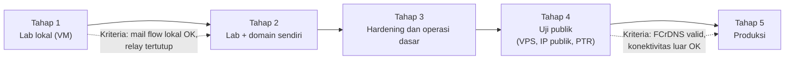

# Jalur Lab ke Produksi dan Etika Operasional

!!! info "Identitas chapter"
    **ID:** `CH-01-01-03` · **Kategori/modul:** CAT-01 / MOD-01-01 · **Estimasi:** 60 menit · **Lingkungan:** konseptual · [Lihat di dashboard](../../../#CH-01-01-03)

## 1. Ringkasan

Mail server yang berjalan di lab belum tentu siap menerima email dari internet. Chapter ini menjelaskan jalur bertahap dari lab ke produksi dan tanggung jawab etis seorang operator email.

## 2. Tujuan Pembelajaran

1. Menjelaskan mengapa uji lokal yang berhasil belum berarti siap produksi.
2. Memahami kebijakan abuse dan tanggung jawab operator email.

## 3. Prasyarat

- `CH-01-01-02` — lab VM dan snapshot.

## 4. Materi Teori

### 4.1 Lab bukan produksi

Di lab, email berpindah antar VM Anda sendiri. Di internet, server Anda menghadapi pihak lain yang menilai reputasi, identitas, dan keamanan Anda. Beberapa hal yang tidak diuji lab:

- **Reputasi IP dan domain.** Penerima besar menolak atau menyaring pengirim berreputasi buruk atau tidak dikenal.
- **DNS yang benar.** Record MX, PTR (reverse DNS), dan autentikasi pengirim (SPF, DKIM, DMARC) harus tepat.
- **Kebijakan penyedia.** Banyak penyedia VPS membatasi port 25 keluar; periksa kebijakan penyedia Anda sebelum merencanakan uji publik.
- **Serangan nyata.** Server publik segera dipindai dan diserang, termasuk percobaan open relay.
- **Ketersediaan dan pemulihan.** Produksi butuh monitoring, backup yang teruji restore, dan runbook.

### 4.2 Peta lingkungan

Pindah ke tahap berikutnya hanya setelah kriteria tahap sekarang terpenuhi dan terbukti dengan bukti (log, output perintah, hasil uji), bukan perasaan.

### 4.3 Tanggung jawab operator email

- **Jangan menjadi open relay.** Server tidak boleh meneruskan email dari pihak tak dikenal ke pihak ketiga.
- **Tangani laporan abuse.** Sediakan alamat kontak yang dipantau dan tanggapi laporan dengan cepat.
- **Hormati privasi.** Isi email pengguna bersifat pribadi. Akses administratif hanya untuk keperluan operasional yang sah.
- **Patuhi aturan hukum dan kebijakan penyedia.** Jangan mengirim pesan massal tanpa izin penerima. Aturan berbeda antar negara; pelajari ketentuan yang berlaku bagi Anda.
- **Uji hanya pada sistem milik sendiri.** Pemindaian atau percobaan serangan pada server orang lain tanpa izin dapat melanggar hukum.

### 4.4 Batas tanggung jawab materi ini

Materi ini bukan nasihat hukum. Untuk kewajiban hukum dan kepatuhan di organisasi Anda, rujuk ketentuan yang berlaku dan pihak berwenang di organisasi tersebut.

## 5. Praktik dan Implementasi

**Checklist persiapan**

- [ ] Saya sudah membaca bagian 4.1 sampai 4.3.

**Langkah**

1. Buat tabel dua kolom: "Berhasil di lab" dan "Belum terbukti untuk produksi". Isi minimal lima item untuk masing-masing.
2. Tulis kriteria transisi Anda sendiri untuk pindah dari Tahap 1 ke Tahap 2, merujuk tabel di `CH-01-01-01`.
3. Tulis satu halaman kebijakan operator versi pribadi: kontak abuse, siapa yang berhak mengakses mailbox, dan bagaimana laporan ditangani.

## 6. Perintah Linux

Chapter konseptual: tidak ada perintah wajib.

## 7. Konfigurasi

Tidak ada konfigurasi.

## 8. Verifikasi

- Tabel "Berhasil di lab / Belum terbukti" terisi dan masuk akal.
- Kriteria transisi tertulis dan terukur (dapat dibuktikan dengan output atau log).
- Kebijakan operator versi pribadi tersedia.

## 9. Troubleshooting

| Gejala | Penyebab | Tindakan |
|---|---|---|
| Merasa "sudah siap produksi" setelah lab berhasil | Belum menguji hal yang hanya ada di internet | Kembali ke daftar 4.1 dan buktikan tiap item |
| Penyedia memblokir port 25 | Kebijakan anti-spam penyedia | Konfirmasi kebijakan sebelum uji publik; pilih penyedia yang mengizinkan |

## 10. Security Review

- Lab tidak boleh terhubung ke jaringan produksi.
- Jangan membuka layanan email ke internet sebelum relay terbukti tertutup dan autentikasi diwajibkan.
- Jangan membagikan data email nyata di forum atau repositori.

## 11. Latihan

1. Jelaskan dengan kata-kata sendiri lima alasan lab belum setara produksi.
2. Mengapa open relay berbahaya bagi operator dan pihak lain?
3. Buat kriteria transisi Tahap 4 ke Tahap 5 beserta bukti yang Anda butuhkan.

## 12. Assessment

1. Sebutkan tiga hal yang tidak teruji di lab.
2. Apa tanggung jawab operator saat menerima laporan abuse?
3. Apa itu open relay?
4. Mengapa kebijakan port 25 penyedia perlu diperiksa sebelum uji publik?

**Kunci singkat.** (1) Reputasi IP/domain, DNS (MX/PTR/SPF/DKIM/DMARC), serangan nyata. (2) Menanggapi dengan cepat melalui kontak yang dipantau. (3) Server yang meneruskan email untuk pihak tak dikenal. (4) Banyak penyedia membatasi port 25 keluar.

## 13. Checklist Kelulusan

- [ ] Saya dapat menjelaskan mengapa lab belum setara produksi.
- [ ] Saya memahami tanggung jawab dasar operator email.
- [ ] Saya memiliki kriteria transisi tertulis.
- [ ] Tidak ada kredensial dalam catatan saya.

## 14. Referensi Resmi

- [RFC 5321 — Simple Mail Transfer Protocol](https://www.rfc-editor.org/rfc/rfc5321)
- [Dokumentasi Ubuntu Server](https://documentation.ubuntu.com/server/)
- Kebijakan port 25 dan abuse penyedia VPS Anda (periksa di situs penyedia).

---

[Kembali ke dashboard kurikulum](../../../#CH-01-01-03){ .md-button }
