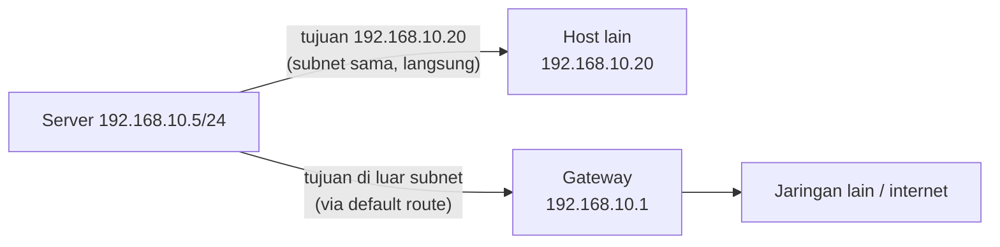

# Alamat IP, Subnet, Routing, dan Gateway

!!! info "Identitas chapter"
    **ID:** `CH-02-03-01` · **Kategori/modul:** CAT-02 / MOD-02-03 (Jaringan) · **Estimasi:** 120 menit · **Lingkungan:** lab lokal (VM) · [Lihat di dashboard](../../../#CH-02-03-01)

!!! note "Catatan verifikasi"
    Pada 2026-10-13 di Ubuntu 24.04.3 LTS (WSL2) dijalankan `ip -br addr`, `ip route`, dan `ip -4 route show default`. Perhitungan subnet diperiksa dengan modul `ipaddress` Python. Pengubahan alamat (`ip addr add`, Netplan) **tidak dijalankan**.

## 1. Ringkasan

Server email harus dapat dijangkau dan menjangkau pihak lain. Anda belajar membaca alamat IP, menghitung subnet, dan memahami routing serta gateway, lalu membaca konfigurasi jaringan dengan `ip`.

## 2. Tujuan Pembelajaran

1. Menghitung subnet dan memahami routing.
2. Membaca konfigurasi jaringan dengan `ip`.

## 3. Prasyarat

- `CH-02-02-02` — proses, socket, dan port listening.

## 4. Materi Teori

### 4.1 Alamat IPv4 dan prefix

Alamat IPv4 terdiri dari 32 bit, ditulis sebagai empat oktet (`192.168.10.5`). Notasi CIDR `/24` berarti 24 bit pertama adalah bagian jaringan.

| Prefix | Netmask | Total alamat | Host yang dapat dipakai |
|---|---|---|---|
| `/24` | 255.255.255.0 | 256 | 254 |
| `/26` | 255.255.255.192 | 64 | 62 |
| `/30` | 255.255.255.252 | 4 | 2 |

Rumus: total = 2^(32 − prefix); host = total − 2 (alamat jaringan dan broadcast tidak dipakai host pada subnet biasa).

### 4.2 Contoh perhitungan

Subnet `192.168.10.64/26`: alamat jaringan `192.168.10.64`, broadcast `192.168.10.127`, host `192.168.10.65`–`192.168.10.126` (62 host). `192.168.10.70` berada di subnet ini; `192.168.10.130` tidak. (Hasil ini dicek dengan modul `ipaddress` Python.)

### 4.3 Alamat privat

Rentang privat (RFC 1918): `10.0.0.0/8`, `172.16.0.0/12`, `192.168.0.0/16`. Alamat ini tidak dirutekan di internet publik. Jaringan lab biasanya memakai rentang privat.

### 4.4 Routing dan gateway

Tabel routing memutuskan ke mana paket dikirim. Tujuan di subnet yang sama dikirim langsung; selain itu dikirim ke **gateway default**, yaitu router yang meneruskan ke jaringan lain. Aturan yang paling spesifik (prefix terpanjang) menang.



### 4.5 IPv6 secara singkat

IPv6 memakai alamat 128 bit (`fe80::...` untuk link-local). Mail server publik kelak perlu memikirkan IPv4 dan IPv6; chapter ini hanya mengenalkan bahwa keduanya muncul di keluaran `ip`.

## 5. Praktik dan Implementasi

**Checklist persiapan**

- [ ] Saya membuka VM lab dan tahu adapter mana yang NAT dan mana yang host-only.

**Langkah**

1. Lihat alamat tiap antarmuka.
2. Lihat tabel routing dan gateway default.
3. Hitung subnet dari alamat dan prefix yang Anda temukan.
4. Tentukan apakah dua alamat yang Anda pilih berada di subnet yang sama.

## 6. Perintah Linux

Diuji:

```bash
# pengguna biasa
ip -br addr
ip route
ip -4 route show default
```

Contoh output pada uji (alamat di VM Anda akan berbeda):

```text
lo      UNKNOWN  127.0.0.1/8 ::1/128
eth0    UP       172.26.58.187/20 fe80::.../64
default via 172.26.48.1 dev eth0 proto kernel onlink
172.26.48.0/20 dev eth0 proto kernel scope link src 172.26.58.187
```

Perhitungan subnet cepat tanpa alat khusus (diuji di Python 3):

```bash
# pengguna biasa
python3 -c "import ipaddress as i;n=i.ip_network('192.168.10.0/24');print(n.netmask,n.broadcast_address,n.num_addresses-2)"
```

Hasil: `255.255.255.0 192.168.10.255 254`.

| Perintah | Fungsi |
|---|---|
| `ip -br addr` | Alamat antarmuka (ringkas) |
| `ip route` | Tabel routing |
| `ip -br link` | Status antarmuka (up/down) |

## 7. Konfigurasi

Ubuntu Server 24.04 umumnya memakai Netplan (`/etc/netplan/*.yaml`) untuk konfigurasi alamat permanen. Chapter ini **tidak mengubah** konfigurasi jaringan. Mengubah alamat salah dapat memutus akses ke VM; selalu buat snapshot dan siapkan akses konsol sebelum mengubahnya (dibahas pada Level 3).

## 8. Verifikasi

- Anda dapat menyebutkan alamat, prefix, dan gateway default VM tanpa melihat catatan.
- Perhitungan subnet manual Anda sama dengan hasil `ipaddress`.

## 9. Troubleshooting

| Gejala | Penyebab | Tindakan |
|---|---|---|
| Tidak ada default route | Gateway tidak diatur | Periksa konfigurasi jaringan dan adapter VM |
| Antarmuka `DOWN` | Adapter terputus | Periksa pengaturan hypervisor |
| Tidak dapat menjangkau host di subnet berbeda | Gateway/route salah | `ip route get <IP-TUJUAN>` untuk melihat jalur yang dipakai |
| Alamat bentrok | IP ganda di jaringan | Ganti salah satu alamat |

## 10. Security Review

- Gunakan jaringan privat/host-only untuk lab.
- Jangan menetapkan alamat publik di lab.
- Catat alamat yang Anda pakai agar tidak tumpang tindih dengan jaringan produksi.

## 11. Latihan

1. Hitung alamat jaringan, broadcast, dan jumlah host untuk `10.1.2.0/27`.
2. Tentukan apakah `10.1.2.40` berada di subnet tersebut.
3. Jelaskan bagaimana server memutuskan apakah paket dikirim langsung atau ke gateway.

## 12. Assessment

1. Berapa host yang dapat dipakai pada `/26`?
2. Apa fungsi gateway default?
3. Apa beda alamat privat dan publik?

**Kunci singkat.** (1) 62. (2) Meneruskan paket ke jaringan lain. (3) Alamat privat tidak dirutekan di internet publik.

## 13. Checklist Kelulusan

- [ ] Saya dapat menghitung subnet sederhana.
- [ ] Saya dapat membaca keluaran `ip addr` dan `ip route`.
- [ ] Saya tidak mengubah jaringan tanpa snapshot.

## 14. Referensi Resmi

- [Dokumentasi Ubuntu Server — jaringan](https://documentation.ubuntu.com/server/)
- [RFC 1918 — Address Allocation for Private Internets](https://www.rfc-editor.org/rfc/rfc1918)
- [RFC 4632 — CIDR](https://www.rfc-editor.org/rfc/rfc4632)

---

[Kembali ke dashboard kurikulum](../../../#CH-02-03-01){ .md-button }
