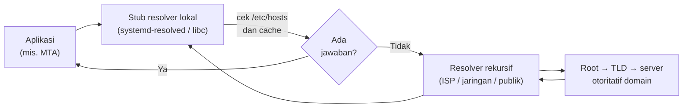

# Resolusi DNS dan Alat Diagnosis

!!! info "Identitas chapter"
    **ID:** `CH-02-03-02` · **Kategori/modul:** CAT-02 / MOD-02-03 · **Estimasi:** 120 menit · **Lingkungan:** lab lokal (VM) · [Lihat di dashboard](../../../#CH-02-03-02)

!!! note "Catatan verifikasi"
    Pada 2026-10-13 di Ubuntu 24.04.3 LTS (WSL2) dijalankan `dig`, `host`, `getent`, `resolvectl status`, dan membaca `/etc/hosts` serta `/etc/resolv.conf`. Hasil DNS publik (alamat `example.com`, daftar MX `gmail.com`) bisa berubah kapan saja. Lingkungan uji memakai resolver WSL, bukan konfigurasi server.

## 1. Ringkasan

Pengiriman email bergantung pada DNS: MTA pengirim bertanya record MX untuk menemukan server tujuan. Anda belajar alur resolusi nama dan memakai `dig`, `host`, `getent`, dan `resolvectl` untuk mendiagnosisnya.

## 2. Tujuan Pembelajaran

1. Menjelaskan alur resolusi nama.
2. Memakai `dig`, `host`, dan `getent` untuk diagnosis.

## 3. Prasyarat

- `CH-02-03-01` — alamat IP dan routing.

## 4. Materi Teori

### 4.1 Alur resolusi



Resolver rekursif menelusuri hierarki DNS atas nama klien dan menyimpan hasilnya (cache) sesuai TTL.

### 4.2 Jenis record yang relevan

| Record | Fungsi | Relevansi email |
|---|---|---|
| `A` / `AAAA` | Nama → alamat IPv4 / IPv6 | Alamat host mail server |
| `MX` | Host penerima email domain + prioritas (angka kecil = prioritas tinggi) | Penentu tujuan pengiriman |
| `PTR` | Alamat → nama (reverse DNS) | Dicek penerima untuk reputasi |
| `TXT` | Teks bebas | Dipakai SPF, DKIM, DMARC kelak |
| `CNAME` | Alias | MX tidak boleh menunjuk ke CNAME |

### 4.3 Dari nama ke tujuan email

Untuk mengirim ke `siti@example.net`, MTA bertanya MX `example.net`, memilih host berprioritas terendah, lalu bertanya A/AAAA host tersebut. Bila tidak ada MX, MTA dapat memakai A/AAAA domain itu sendiri (RFC 5321). Alur lengkapnya ada di Diagram C pada `CH-03-01-01`.

### 4.4 Alat diagnosis

| Alat | Fungsi |
|---|---|
| `dig <nama> <tipe>` | Query DNS terperinci |
| `dig +short ...` | Hasil ringkas |
| `host -t MX <domain>` | Query singkat, mudah dibaca |
| `getent hosts <nama>` | Resolusi **seperti yang dilihat aplikasi** (memakai `/etc/hosts` dan NSS) |
| `resolvectl status` | Konfigurasi resolver systemd-resolved |

Perbedaan penting: `dig` langsung bertanya ke server DNS, sedangkan `getent` menggambarkan apa yang dilihat program. Jika keduanya berbeda, periksa `/etc/hosts` dan urutan NSS.

## 5. Praktik dan Implementasi

**Checklist persiapan**

- [ ] VM terhubung ke internet.
- [ ] Saya tahu cara membaca kolom TTL dan prioritas MX.

**Langkah**

1. Baca konfigurasi resolver lokal.
2. Query record A, MX, dan PTR.
3. Bandingkan hasil `dig` dengan `getent hosts`.
4. Catat prioritas MX dan tentukan host mana yang dicoba pertama.

## 6. Perintah Linux

Diuji:

```bash
# pengguna biasa
dig example.com A +noall +answer
dig gmail.com MX +noall +answer
dig +short -x 8.8.8.8
host -t MX gmail.com
getent ahosts example.com | head -2
```

Contoh output pada uji (nilai dapat berubah):

```text
example.com.   0  IN  A   104.20.23.154
gmail.com.     ...  IN  MX  5 gmail-smtp-in.l.google.com.
gmail.com.     ...  IN  MX  30 alt3.gmail-smtp-in.l.google.com.
dns.google.
gmail.com mail is handled by 5 gmail-smtp-in.l.google.com.
```

Domain tanpa layanan email dapat menyatakan *null MX*. Pada uji `dig +short MX example.com` mengembalikan `0 .`, artinya domain itu tidak menerima email.

## 7. Konfigurasi

| Berkas | Isi |
|---|---|
| `/etc/hosts` | Pemetaan nama → IP lokal, diprioritaskan sebelum DNS |
| `/etc/resolv.conf` | Daftar resolver; pada Ubuntu biasanya dikelola otomatis oleh systemd-resolved |

Pada uji WSL2, `/etc/resolv.conf` dibuat otomatis oleh WSL dan berisi satu `nameserver`. Pada server Ubuntu, jangan mengedit `/etc/resolv.conf` manual bila dikelola oleh systemd-resolved; atur lewat Netplan. Chapter ini tidak mengubah konfigurasi.

## 8. Verifikasi

- `dig MX <domain>` menampilkan satu atau lebih record MX dengan prioritas.
- `getent hosts <nama>` menghasilkan alamat yang konsisten dengan `dig`, kecuali ada entri khusus di `/etc/hosts`.

## 9. Troubleshooting

| Gejala | Penyebab | Tindakan |
|---|---|---|
| `NXDOMAIN` | Nama tidak ada | Periksa ejaan; cek di server otoritatif |
| `SERVFAIL` / timeout | Resolver bermasalah atau jaringan putus | Coba resolver lain: `dig @8.8.8.8 ...` (hanya untuk uji) |
| `dig` benar tetapi aplikasi gagal | `/etc/hosts` atau NSS | Bandingkan dengan `getent hosts` |
| Hasil lama | Cache/TTL | Tunggu TTL; `resolvectl flush-caches` (hak root) |

## 10. Security Review

- DNS klasik tidak terenkripsi atau terautentikasi; DNSSEC dan penguncian resolver dibahas di level lanjut.
- Jangan menaruh pemetaan sementara di `/etc/hosts` lalu lupa; itu menutupi masalah DNS yang sebenarnya.
- Gunakan resolver yang tepercaya pada server.

## 11. Latihan

1. Cari MX tiga domain berbeda dan urutkan berdasarkan prioritas.
2. Cari PTR untuk satu alamat publik dan jelaskan mengapa penerima email memeriksanya.
3. Jelaskan perbedaan `dig` dan `getent hosts`.

## 12. Assessment

1. Record apa yang menentukan server tujuan email?
2. Apa arti angka prioritas MX?
3. Mengapa `getent` kadang berbeda dari `dig`?
4. Apa itu null MX?

**Kunci singkat.** (1) MX. (2) Angka lebih kecil dicoba lebih dulu. (3) `getent` memakai `/etc/hosts` dan NSS seperti aplikasi. (4) `MX 0 .` yang menyatakan domain tidak menerima email.

## 13. Checklist Kelulusan

- [ ] Saya dapat menjelaskan alur resolusi nama.
- [ ] Saya dapat mengambil record A, MX, dan PTR.
- [ ] Saya dapat membedakan hasil `dig` dengan `getent`.

## 14. Referensi Resmi

- [Dokumentasi Ubuntu Server](https://documentation.ubuntu.com/server/)
- [RFC 1034 — Domain Names: Concepts and Facilities](https://www.rfc-editor.org/rfc/rfc1034)
- [RFC 5321 — SMTP (bagian routing MX)](https://www.rfc-editor.org/rfc/rfc5321)
- [RFC 7505 — A "Null MX" No Service Resource Record](https://www.rfc-editor.org/rfc/rfc7505)

---

[Kembali ke dashboard kurikulum](../../../#CH-02-03-02){ .md-button }
