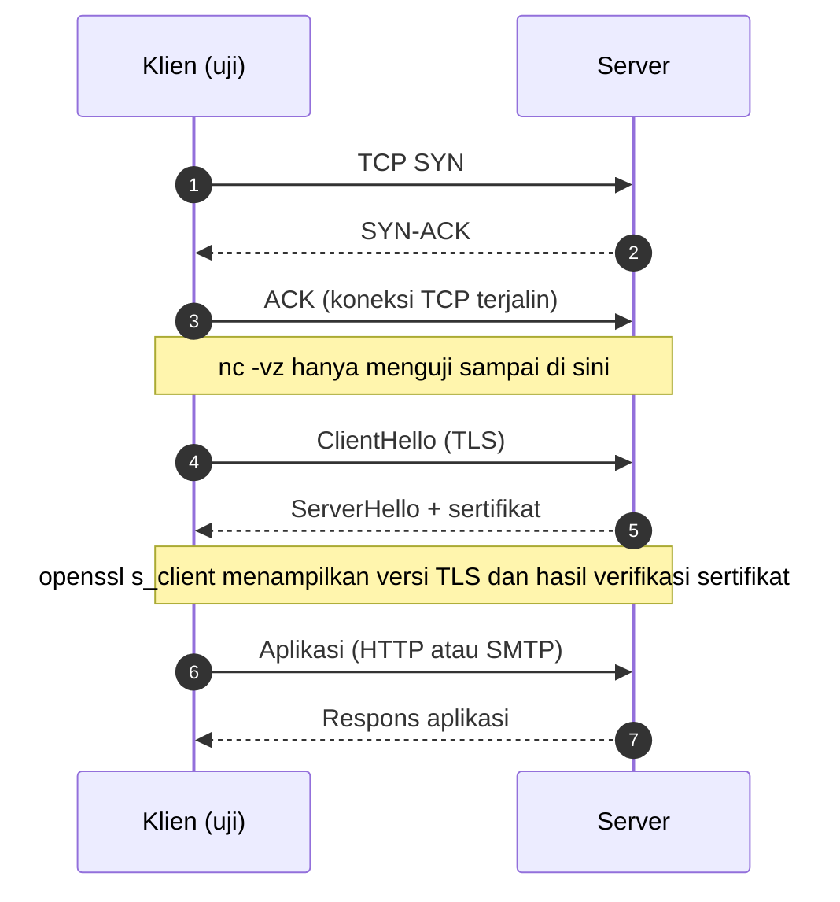

# Diagnosis Koneksi dengan curl dan openssl

!!! info "Identitas chapter"
    **ID:** `CH-02-03-04` · **Kategori/modul:** CAT-02 / MOD-02-03 · **Estimasi:** 90 menit · **Lingkungan:** lab lokal (VM) · [Lihat di dashboard](../../../#CH-02-03-04)

!!! note "Catatan verifikasi"
    Pada 2026-10-13 di Ubuntu 24.04.3 LTS (WSL2) dijalankan: `curl` ke `https://example.com`, `openssl s_client` ke `example.com:443`, `nc -vz` ke port 2525 lokal (ditolak) dan ke `gmail-smtp-in.l.google.com:25` (berhasil terhubung). Pada `nc` ke port 25 **hanya koneksi TCP yang diuji; tidak ada pesan SMTP dikirim**. Banyak jaringan dan penyedia memblokir port 25 keluar; hasil Anda bisa berbeda.

## 1. Ringkasan

Saat email tidak terkirim, pertanyaan pertama adalah: apakah port terjangkau, dan apakah TLS berjalan? Anda belajar menguji konektivitas TCP dan TLS dari command line dan membaca hasil handshake TLS secara dasar.

## 2. Tujuan Pembelajaran

1. Menguji konektivitas TCP dan TLS dari command line.
2. Membaca hasil handshake TLS secara dasar.

## 3. Prasyarat

- `CH-02-03-03` — TCP/IP, port, dan firewall.

## 4. Materi Teori

### 4.1 Lapisan diagnosis

Diagnosis dilakukan dari bawah ke atas: nama (DNS) → TCP → TLS → protokol aplikasi.



Percakapan SMTP lengkap (EHLO, MAIL FROM, RCPT TO, DATA, QUIT) dibahas pada Diagram B di `CH-03-01-01`.

### 4.2 Alat dan fungsi

| Alat | Menguji | Contoh |
|---|---|---|
| `nc -vz <host> <port>` | Hanya TCP connect | Apakah port 25 terbuka? |
| `curl -v` / `curl -sI` | HTTP(S), termasuk handshake | Apakah situs web merespons? |
| `openssl s_client` | Handshake TLS dan sertifikat | Versi TLS, verifikasi sertifikat |

### 4.3 Menafsirkan hasil `nc`

| Pesan | Arti |
|---|---|
| `succeeded` | Port terbuka dan menerima koneksi |
| `Connection refused` | Host menjawab, tetapi tidak ada layanan yang listening (atau ditolak aktif) |
| Timeout | Paket tak dijawab: sering karena firewall menjatuhkan paket atau rute bermasalah |

### 4.4 Menafsirkan hasil TLS

Perhatikan: versi protokol (mis. TLSv1.3), subjek/nama sertifikat, dan `Verification` (hasil validasi rantai sertifikat). Sertifikat yang tidak cocok dengan nama host atau kedaluwarsa menyebabkan klien menolak koneksi.

## 5. Praktik dan Implementasi

**Checklist persiapan**

- [ ] Saya hanya menguji host milik sendiri atau layanan publik yang wajar (mis. `example.com` untuk HTTPS).
- [ ] Saya tahu bahwa banyak penyedia memblokir port 25 keluar.

**Langkah**

1. Uji TCP ke port web publik dan ke port lokal yang tidak dipakai.
2. Lihat handshake TLS ke situs publik.
3. Uji TCP ke port 25 server email publik (hanya koneksi; jangan kirim data).
4. Catat perbedaan hasil `succeeded`, `refused`, dan timeout.

## 6. Perintah Linux

Diuji:

```bash
# pengguna biasa
curl -sS -o /dev/null -w '%{http_code} %{remote_ip}\n' -m 10 https://example.com
nc -vz -w 3 127.0.0.1 2525
echo | openssl s_client -connect example.com:443 -servername example.com 2>/dev/null \
  | grep -E "Verification|subject="
nc -vz -w 8 gmail-smtp-in.l.google.com 25
```

Contoh output pada uji:

```text
200 104.20.23.154
nc: connect to 127.0.0.1 port 2525 (tcp) failed: Connection refused
subject=CN = example.com
Verification: OK
Connection to gmail-smtp-in.l.google.com (...) 25 port [tcp/smtp] succeeded!
```

Ringkasan TLS singkat (`-brief`) pada uji menampilkan `Protocol version: TLSv1.3` dan `Peer certificate: CN = example.com`.

| Opsi | Fungsi |
|---|---|
| `curl -sS` | Diam tetapi tetap menampilkan galat |
| `curl -w` | Mencetak variabel hasil (kode HTTP, IP tujuan) |
| `nc -v` | Verbose; `-z` hanya memindai/menguji tanpa kirim data; `-w` batas waktu |
| `openssl s_client -servername` | Mengirim SNI agar sertifikat yang benar dipilih |

## 7. Konfigurasi

Tidak ada konfigurasi. Alat ini hanya membaca.

## 8. Verifikasi

- Anda dapat membedakan `succeeded`, `refused`, dan timeout, dan menyebutkan dugaan penyebab masing-masing.
- Anda dapat menunjukkan versi TLS dan hasil verifikasi sertifikat dari keluaran `openssl`.

## 9. Troubleshooting

| Gejala | Penyebab | Tindakan |
|---|---|---|
| Timeout ke port 25 | Port 25 keluar diblokir penyedia/jaringan | Konfirmasi kebijakan penyedia |
| `Connection refused` | Layanan tidak listening | `ss -ltn` pada server tujuan; cek service |
| `Verification: ... certificate has expired` / nama tidak cocok | Sertifikat bermasalah | Periksa tanggal dan nama pada sertifikat |
| `curl: (6) Could not resolve host` | DNS gagal | Kembali ke `CH-02-03-02` |

## 10. Security Review

- Uji hanya host milik sendiri atau layanan publik yang wajar. Pemindaian port massal pada host lain tanpa izin dapat dianggap penyalahgunaan.
- Jangan mengirim kredensial lewat `nc` (tanpa enkripsi).
- Jangan menonaktifkan verifikasi sertifikat (`curl -k`) selain untuk uji lokal yang sadar risiko.

## 11. Latihan

1. Uji TCP ke port 443 dan 80 sebuah situs publik dan bandingkan hasilnya.
2. Jelaskan mengapa `nc -vz` berhasil tidak berarti layanan di baliknya sehat.
3. Tulis urutan diagnosis jika `curl https://situs-saya` gagal.

## 12. Assessment

1. Apa arti `Connection refused` dibanding timeout?
2. Apa yang diuji `nc -vz`?
3. Apa fungsi `-servername` pada `openssl s_client`?
4. Mengapa port 25 sering timeout dari VPS?

**Kunci singkat.** (1) Refused: host menjawab tanpa layanan; timeout: paket tak dijawab (firewall/rute). (2) Hanya pembukaan koneksi TCP. (3) Mengirim SNI agar sertifikat sesuai nama dipilih. (4) Penyedia sering memblokir port 25 keluar.

## 13. Checklist Kelulusan

- [ ] Saya dapat menguji TCP dan TLS dari command line.
- [ ] Saya dapat menafsirkan hasil sukses, refused, dan timeout.
- [ ] Saya tidak memindai host milik orang lain.

## 14. Referensi Resmi

- [Dokumentasi curl](https://curl.se/docs/)
- [Dokumentasi OpenSSL `s_client`](https://docs.openssl.org/master/man1/openssl-s_client/)
- [RFC 8446 — TLS 1.3](https://www.rfc-editor.org/rfc/rfc8446)
- [Dokumentasi Ubuntu Server](https://documentation.ubuntu.com/server/)

---

[Kembali ke dashboard kurikulum](../../../#CH-02-03-04){ .md-button }
