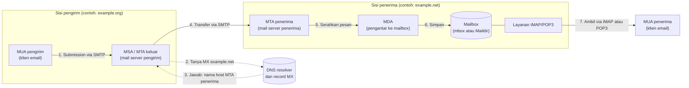
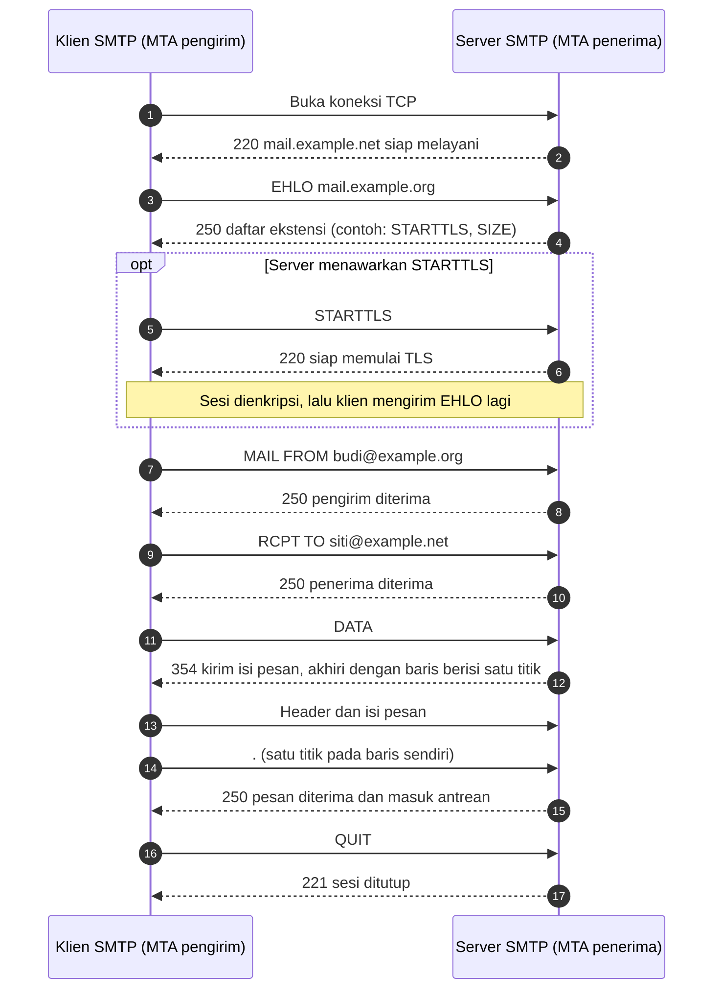
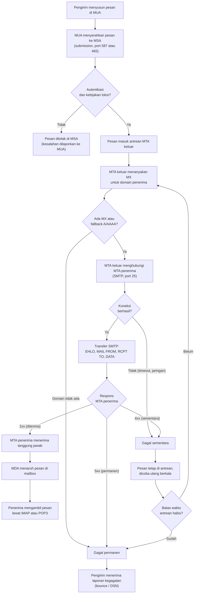

# Bab 1 — Pengenalan Mail Server dan Arsitektur Email

!!! info "Identitas chapter"
    **ID:** `CH-03-01-01` · **Kategori/modul:** CAT-03 / MOD-03-01 (Model dan Protokol Email) · **Estimasi:** 90 menit · **Lingkungan:** konseptual, tanpa instalasi · [Lihat chapter ini di dashboard](../../../#CH-03-01-01)

## 1. Ringkasan

Chapter ini memperkenalkan **apa itu mail server**, komponen yang terlibat dalam perjalanan sebuah email, dan tiga tahap yang sering tertukar: **submission** (klien menyerahkan pesan), **relay/transfer** antarserver, dan **retrieval** (penerima mengambil pesan). Pemahaman ini menjadi dasar untuk memasang Postfix dan Dovecot pada chapter berikutnya.

Chapter ini bersifat konseptual. Tidak ada perintah yang wajib dijalankan dan tidak ada klaim pengujian pada VM; kolom `verified_on` sengaja dikosongkan.

Protokol SMTP, ESMTP, IMAP, dan POP3 dibahas lebih rinci pada chapter berikutnya di modul ini (`CH-03-01-02`). Di sini Anda hanya mempelajari peran dan perbedaannya.

## 2. Tujuan Pembelajaran

Setelah menyelesaikan chapter ini, Anda mampu:

1. Menjelaskan fungsi mail server dan membedakannya dari klien email dan penyedia webmail.
2. Menyebutkan dan membedakan peran MUA, MSA, MTA, MDA, mailbox, DNS, dan record MX.
3. Menggambar alur pesan dari pengirim hingga mailbox penerima dan menandai protokol di setiap segmen.
4. Membedakan *submission*, *server-to-server delivery*, dan *mailbox retrieval*.
5. Menjelaskan perbedaan SMTP, IMAP, dan POP3.
6. Menjelaskan apa yang terjadi saat pengiriman gagal sementara (antre dan coba ulang) dan gagal permanen (ditolak/bounce).

## 3. Prasyarat

- `CH-02-03-04` — chapter terakhir pada modul prasyarat `MOD-02-03` (lihat dashboard). Anda perlu memahami dasar alamat IP, port, dan DNS.
- Tidak perlu VM atau domain pada chapter ini.

## 4. Materi Teori

### 4.1 Pengertian dan fungsi mail server

**Mail server** adalah sistem (satu atau beberapa layanan) yang menerima, menyimpan sementara, meneruskan, dan menyerahkan email. Ia bukan satu program tunggal. Pada Ubuntu, fungsi itu biasanya dibagi antara perangkat lunak seperti Postfix (mengirim dan menerima antarserver) dan Dovecot (menyediakan akses ke mailbox lewat IMAP/POP3).

Fungsi utamanya:

- **Menerima** pesan dari klien pengguna dan dari mail server lain.
- **Meneruskan** pesan ke server tujuan yang benar berdasarkan domain penerima.
- **Menyimpan** pesan di mailbox sampai penerima mengambilnya.
- **Mengantre dan mencoba ulang** pesan yang belum bisa terkirim, lalu melaporkan kegagalan permanen kepada pengirim.

### 4.2 Komponen utama email

| Komponen | Kepanjangan / arti | Peran |
|---|---|---|
| **MUA** | Mail User Agent | Aplikasi yang dipakai pengguna untuk menulis dan membaca email (klien desktop, aplikasi ponsel, atau webmail). |
| **MSA** | Mail Submission Agent | Layanan yang menerima pesan dari MUA, biasanya dengan autentikasi dan TLS (umumnya port 587 atau 465). Sering berupa mode lain dari program MTA yang sama. |
| **MTA** | Mail Transfer Agent | Layanan yang memindahkan pesan antarserver memakai SMTP (antarserver umumnya port 25) dan mengelola antrean. |
| **MDA** | Mail Delivery Agent | Komponen yang menaruh pesan ke mailbox penerima, dan dapat menerapkan penyaringan (misalnya Sieve). |
| **Mailbox** | Penyimpanan pesan | Tempat pesan disimpan, misalnya format mbox atau Maildir. |
| **SMTP** | Simple Mail Transfer Protocol | Protokol untuk *mengirim*: dari MUA ke MSA dan dari MTA ke MTA. |
| **IMAP** | Internet Message Access Protocol | Protokol untuk *mengambil dan mengelola* pesan yang tetap tersimpan di server. |
| **POP3** | Post Office Protocol v3 | Protokol sederhana untuk *mengunduh* pesan, biasanya lalu menghapusnya dari server. |
| **DNS** | Domain Name System | Sistem nama yang memberi tahu MTA ke mana pesan untuk sebuah domain harus dikirim. |
| **Record MX** | Mail Exchanger | Record DNS yang menunjuk host penerima email untuk sebuah domain, dengan nilai prioritas. |

Catatan: istilah MSA, MTA, dan MDA menyatakan *peran*, bukan produk. Satu paket perangkat lunak bisa menjalankan lebih dari satu peran.

### 4.3 Arsitektur mail server

Diagram A menunjukkan hubungan antar komponen. Garis penuh adalah jalur pesan, garis putus-putus adalah pencarian DNS.

Peran tiap komponen pada diagram:

- **MUA pengirim** menyusun pesan dan menyerahkannya ke server pengirim lewat SMTP *submission*.
- **MSA/MTA keluar** memeriksa identitas pengirim (autentikasi) bila diwajibkan, lalu mengambil alih tanggung jawab pengiriman.
- **DNS dan MX** menentukan server tujuan. MTA pengirim tidak mengetahui alamat server penerima sebelum bertanya ke DNS.
- **MTA penerima** menerima pesan dari server lain lewat SMTP dan memutuskan menerima, menunda, atau menolak.
- **MDA** menaruh pesan yang diterima ke mailbox yang tepat.
- **Mailbox** menyimpan pesan sampai dibaca.
- **Layanan IMAP/POP3** menyajikan isi mailbox kepada MUA penerima. Segmen ini terpisah dari SMTP.

### 4.4 Alur pengiriman email

Tiga segmen yang harus dibedakan:

| Segmen | Dari → ke | Protokol | Port lazim | Autentikasi |
|---|---|---|---|---|
| **Submission** | MUA pengirim → MSA | SMTP (submission) | 587 (STARTTLS) atau 465 (TLS langsung) | Umumnya wajib |
| **Server-to-server delivery** | MTA pengirim → MTA penerima | SMTP | 25 | Tidak memakai login pengguna; keamanan memakai TLS oportunistik, SPF, DKIM, DMARC (dibahas pada chapter lain) |
| **Retrieval** | MUA penerima ← server penerima | IMAP atau POP3 | 993/143 (IMAP), 995/110 (POP3) | Wajib |

Angka port di atas adalah praktik umum, bukan kewajiban protokol. Nilai pasti bergantung pada konfigurasi server.

Urutan logisnya:

1. Pengirim menulis pesan di MUA dan menekan kirim.
2. MUA menyerahkan pesan ke MSA (*submission*).
3. MTA keluar membaca domain penerima (bagian setelah `@`) dan menanyakan record MX ke DNS.
4. MTA keluar memilih host MX berprioritas terendah yang dapat dihubungi dan membuka sesi SMTP.
5. MTA penerima menerima, menunda, atau menolak pesan.
6. Jika diterima, MDA menaruh pesan di mailbox.
7. Penerima membuka MUA dan mengambil pesan lewat IMAP atau POP3.

### 4.5 Protokol SMTP dan perannya

SMTP adalah protokol berbasis teks yang awalnya didefinisikan di RFC 821 dan kini di RFC 5321. Bentuk modernnya, **ESMTP**, menambah ekstensi yang ditawarkan server sebagai respons `EHLO` (misalnya `STARTTLS` dan `AUTH`).

Peran SMTP: **mendorong (push) pesan maju** menuju tujuan. SMTP dipakai pada submission dan transfer antarserver, **tidak** untuk membaca mailbox.

Diagram B memperlihatkan percakapan SMTP representatif. Respons nyata dapat berbeda antar server: teks dan kadang kodenya bergantung pada kebijakan dan perangkat lunak. Kode di bawah hanya ilustrasi.

Poin penting dari diagram:

- **`EHLO`** (atau `HELO` pada klien lama) memperkenalkan klien dan menanyakan kemampuan server.
- **`MAIL FROM`** dan **`RCPT TO`** membentuk *envelope* yang dipakai untuk routing. Ini berbeda dari header `From:` dan `To:` yang terlihat di MUA (dibahas pada `CH-03-01-03`).
- **`DATA`** memulai isi pesan; **baris yang hanya berisi satu titik** menandai akhir pesan.
- Kode `2xx` berarti sukses, `3xx` berarti server menunggu data lanjutan, `4xx` gagal sementara, `5xx` gagal permanen.
- Diagram tidak menampilkan kredensial. Pada *submission*, autentikasi (`AUTH`) terjadi **setelah** TLS aktif agar kredensial tidak terkirim dalam teks biasa.
- SMTP **tidak selalu tanpa enkripsi**. Sesi dapat dienkripsi dengan TLS langsung (port 465) atau ditingkatkan lewat `STARTTLS`. Pada transfer antarserver di port 25, TLS bersifat oportunistik sehingga belum menjamin enkripsi pada semua pengiriman.

### 4.6 Perbedaan SMTP, IMAP, dan POP3

| Aspek | SMTP | IMAP | POP3 |
|---|---|---|---|
| Fungsi | Mengirim dan meneruskan pesan | Mengakses dan mengelola pesan di server | Mengunduh pesan dari server |
| Arah | Klien → server, server → server | Server → klien, dua arah untuk status | Server → klien |
| Lokasi pesan | Dalam perjalanan | Tetap di server | Umumnya dipindah ke perangkat klien |
| Folder dan status baca | Tidak berlaku | Disinkronkan di semua perangkat | Terbatas |
| Banyak perangkat | Tidak berlaku | Cocok | Kurang cocok |
| Port lazim | 25, 587, 465 | 143 (STARTTLS), 993 (TLS) | 110 (STARTTLS), 995 (TLS) |

Ringkasnya: **SMTP untuk mengirim, IMAP/POP3 untuk mengambil**. Mengonfigurasi klien email selalu membutuhkan dua server, yaitu server keluar (SMTP) dan server masuk (IMAP/POP3), walaupun keduanya sering berada di host yang sama.

### 4.7 Diagram C — Proses pengiriman email

Penjelasan alur:

1. **Penyusunan dan submission.** Pesan hanya dianggap "diterima" oleh server pengirim setelah MSA mengakuinya. Sebelum itu, pengirim masih dapat melihat galat langsung di MUA.
2. **Autentikasi dan kebijakan.** MSA umumnya mewajibkan login. Pesan yang gagal pemeriksaan ditolak pada tahap ini.
3. **Pencarian MX.** MTA keluar bertanya ke DNS. Jika tidak ada record MX, MTA dapat memakai record A/AAAA domain sebagai cadangan (aturan RFC 5321). Jika domain tidak ada sama sekali, hasilnya gagal permanen.
4. **Transfer SMTP.** MTA keluar menghubungi host MX berprioritas terendah, lalu mencoba host berikutnya bila gagal.
5. **Respons.** Respons `2xx` berarti MTA penerima mengambil tanggung jawab atas pesan. Respons `4xx` berarti gagal sementara: pesan tetap di antrean dan dicoba ulang. Respons `5xx` berarti ditolak permanen.
6. **Antrean dan batas waktu.** Pesan yang terus gagal sementara akhirnya dihentikan setelah batas waktu antrean dan diperlakukan sebagai gagal permanen. Nilai batas ini bergantung pada konfigurasi server; Postfix memakai pengaturan sendiri yang dibahas pada chapter antrean.
7. **Bounce/DSN.** Kegagalan permanen menghasilkan pesan laporan ke pengirim (*Delivery Status Notification*).
8. **Delivery dan retrieval.** Setelah diterima, MDA menyimpan pesan, dan penerima mengambilnya melalui IMAP atau POP3. Langkah ini tidak melibatkan SMTP.

### 4.8 Contoh skenario pengiriman email

Skenario: **Budi** (`budi@example.org`) mengirim email ke **Siti** (`siti@example.net`). Domain `example.org` dan `example.net` adalah domain contoh yang dicadangkan untuk dokumentasi (RFC 2606).

| Langkah | Kejadian |
|---|---|
| 1 | Budi menulis pesan di aplikasi email dan menekan *Kirim*. |
| 2 | Aplikasi masuk ke server keluar `example.org` (autentikasi dengan akun Budi) dan menyerahkan pesan. |
| 3 | Server `example.org` membaca domain `example.net` dan menanyakan MX. DNS menjawab dengan satu atau lebih host. |
| 4 | Server `example.org` membuka sesi SMTP ke host MX berprioritas terendah. |
| 5 | Server `example.net` menerima, lalu MDA menaruh pesan di mailbox Siti. |
| 6 | Siti membuka aplikasi email, yang memakai IMAP untuk menampilkan pesan baru. |

Variasi: jika server `example.net` sedang mati, server `example.org` menyimpan pesan di antrean dan mencoba lagi. Jika alamat `siti@example.net` tidak ada, server `example.net` dapat menjawab `5xx` dan Budi menerima laporan *bounce*.

## 5. Praktik dan Implementasi

Bagian ini adalah **demonstrasi konseptual**; tidak ada instalasi.

**Checklist persiapan**

- [ ] Saya sudah membaca bagian 4.2 sampai 4.7.
- [ ] Saya memiliki kertas atau alat gambar untuk membuat diagram sendiri.

**Langkah**

1. Tutup halaman ini, lalu gambar ulang alur Diagram A dari ingatan. Beri label protokol pada tiap panah.
2. Buka pengaturan akun di aplikasi email yang Anda pakai. Catat jenis server masuk (IMAP/POP3) dan server keluar (SMTP). Jangan mencatat kata sandi.
3. Di aplikasi email Anda, cari fitur untuk melihat header lengkap sebuah pesan (sering bernama "Show original" atau "Lihat sumber pesan"). Temukan baris `Received:`; setiap baris mewakili satu MTA yang dilalui pesan. Baca dari bawah ke atas untuk urutan kronologis.
4. Tuliskan satu skenario pengiriman Anda sendiri dalam format tabel seperti bagian 4.8.

## 6. Perintah Linux

Chapter konseptual: **tidak ada perintah wajib**.

Sebagai pratinjau, chapter modul Routing dan Pengiriman akan memakai `dig MX` untuk melihat record MX. Pratinjau ini tidak dijalankan atau diuji sebagai bagian dari chapter ini.

## 7. Konfigurasi

Tidak ada berkas konfigurasi pada chapter ini. Konfigurasi Postfix dan Dovecot dimulai pada kategori instalasi inti (CAT-06).

## 8. Verifikasi

Anda dianggap paham jika dapat melakukan semua hal berikut tanpa melihat materi:

- Menggambar alur dari MUA pengirim sampai MUA penerima dengan label MSA, MTA, DNS/MX, MDA, dan mailbox.
- Menyebutkan protokol dan port lazim pada tiap segmen: submission, transfer antarserver, dan retrieval.
- Menjelaskan mengapa `5xx` menghasilkan bounce langsung sedangkan `4xx` menyebabkan pesan diantre.

Hasil yang diharapkan: diagram dan jawaban Anda konsisten dengan Diagram A, B, dan C.

## 9. Troubleshooting

| Gejala | Kemungkinan penyebab | Tindakan |
|---|---|---|
| Bingung apakah masalah ada di pengiriman atau penerimaan | Mencampur SMTP dengan IMAP/POP3 | Tentukan segmen yang gagal: submission, transfer antarserver, atau retrieval |
| Pesan terkirim tetapi tidak muncul di klien | Pesan sudah diterima server, tetapi klien tidak mengambilnya | Periksa pengaturan IMAP/POP3 dan folder spam, bukan konfigurasi SMTP |
| Salah mengartikan kode respons | Mengabaikan digit pertama | Pakai aturan `2xx` sukses, `4xx` sementara, `5xx` permanen |

## 10. Security Review

- SMTP pada awalnya **tidak mengautentikasi pengirim**. Inilah akar spoofing dan alasan SPF, DKIM, dan DMARC (dibahas pada chapter lain).
- Server keluar harus **mewajibkan autentikasi** pada submission. Server yang meneruskan pesan untuk siapa saja disebut *open relay* dan disalahgunakan untuk spam.
- Kredensial tidak boleh dikirim tanpa enkripsi. Gunakan TLS pada submission dan retrieval.
- Jangan mencatat kata sandi, token, atau isi email nyata pada catatan belajar atau repositori.
- Keberhasilan di lab tidak berarti siap produksi. Lingkungan publik menambah persyaratan reputasi IP, PTR, dan kebijakan penyedia.

## 11. Latihan

1. Gambarlah Diagram A sendiri untuk skenario dua domain berbeda dan tandai setiap protokol.
2. Seorang pengguna dapat mengirim email tetapi tidak dapat menerimanya di ponsel. Segmen apa yang kemungkinan bermasalah dan mengapa?
3. Susun tabel perbandingan IMAP dan POP3 untuk pengguna dengan tiga perangkat.
4. Tuliskan percakapan SMTP untuk pengiriman ke dua penerima. Perintah mana yang berulang?
5. Jelaskan perbedaan penolakan oleh MSA dengan bounce yang diterima belakangan.

## 12. Assessment

1. Apa perbedaan MSA dan MTA? Mengapa keduanya dibedakan walaupun sering berjalan pada satu program?
2. Mengapa MTA pengirim membutuhkan DNS sebelum dapat mengirim pesan?
3. Sebutkan tiga segmen perjalanan email dan protokol yang dipakai tiap segmen.
4. Apa arti respons `451` dibanding `550` terhadap nasib pesan?
5. Mengapa SMTP tidak dapat dipakai untuk membaca isi mailbox?
6. Benar atau salah: "SMTP selalu dikirim tanpa enkripsi." Jelaskan.
7. Apa fungsi baris yang hanya berisi satu titik pada sesi SMTP?

**Kunci singkat.** (1) MSA menerima pesan dari klien dengan autentikasi, MTA meneruskan antarserver. (2) DNS memberi host tujuan lewat MX. (3) Submission, transfer antarserver, dan retrieval. (4) `451` sementara sehingga pesan diantre dan dicoba ulang, `550` permanen sehingga pesan ditolak. (5) SMTP hanya mendorong pesan maju. (6) Salah; TLS langsung atau STARTTLS dapat dipakai. (7) Menandai akhir isi pesan.

## 13. Checklist Kelulusan

- [ ] Saya dapat menjelaskan fungsi mail server.
- [ ] Saya dapat membedakan MUA, MSA, MTA, MDA, mailbox, DNS, dan MX.
- [ ] Saya dapat membedakan submission, transfer antarserver, dan retrieval.
- [ ] Saya dapat menjelaskan perbedaan SMTP, IMAP, dan POP3.
- [ ] Saya dapat menggambar alur pengiriman beserta jalur gagal sementara dan permanen.
- [ ] Deliverable: diagram arsitektur email buatan sendiri dan jawaban assessment tersimpan.
- [ ] Tidak ada kredensial atau isi email nyata dalam catatan saya.

!!! note "Status belajar"
    Ubah status chapter secara manual di dashboard. Menyelesaikan checklist ini tidak mengubah status otomatis.

## 14. Referensi Resmi

- [RFC 5321 — Simple Mail Transfer Protocol](https://www.rfc-editor.org/rfc/rfc5321)
- [RFC 5322 — Internet Message Format](https://www.rfc-editor.org/rfc/rfc5322)
- [RFC 6409 — Message Submission for Mail](https://www.rfc-editor.org/rfc/rfc6409)
- [RFC 3501 — IMAP version 4rev1](https://www.rfc-editor.org/rfc/rfc3501)
- [RFC 1939 — Post Office Protocol, Version 3](https://www.rfc-editor.org/rfc/rfc1939)
- [RFC 2606 — Reserved Top Level DNS Names](https://www.rfc-editor.org/rfc/rfc2606)
- [Dokumentasi Postfix](https://www.postfix.org/documentation.html)
- [Dokumentasi Dovecot](https://doc.dovecot.org/)

Tautan referensi tidak diverifikasi otomatis pada build ini; periksa ketersediaannya sebelum dipakai.

---

[Kembali ke dashboard kurikulum](../../../#CH-03-01-01){ .md-button }
