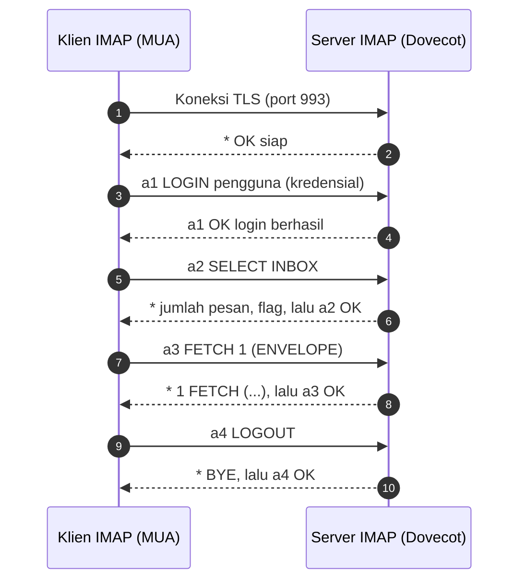

# Protokol SMTP, ESMTP, IMAP, dan POP3

!!! info "Identitas chapter"
    **ID:** `CH-03-01-02` · **Kategori/modul:** CAT-03 / MOD-03-01 (Model dan Protokol Email) · **Estimasi:** 120 menit · **Lingkungan:** lab lokal (VM) · [Lihat chapter ini di dashboard](../../../#CH-03-01-02)

!!! warning "Status verifikasi"
    Perintah pada chapter ini belum dijalankan penulis pada VM Ubuntu 24.04 (`verified_on: null`). Keluaran yang ditampilkan adalah **ilustrasi bentuk**, bukan hasil uji. Jalankan sendiri dan bandingkan dengan sistem Anda.

## 1. Ringkasan

Pada `CH-03-01-01` Anda mempelajari peran komponen email. Chapter ini membedah **protokol percakapannya**: perintah dan kode respons SMTP/ESMTP, lalu cara IMAP dan POP3 mengambil pesan. Anda mengamati sesi protokol dengan `nc` dan `openssl s_client` sebagai alat baca, bukan untuk mengirim email nyata.

## 2. Tujuan Pembelajaran

Setelah menyelesaikan chapter ini, Anda mampu:

1. Menjelaskan urutan perintah SMTP dan arti kelas kode respons `2xx`, `3xx`, `4xx`, `5xx`.
2. Menjelaskan apa yang ditawarkan ESMTP melalui respons `EHLO` (mis. `STARTTLS`, `AUTH`, `SIZE`).
3. Membandingkan IMAP dan POP3 dari sisi model data, port, dan kasus pakai.
4. Mengamati banner dan kemampuan server memakai `nc` dan `openssl s_client`.
5. Mengenali kapan sesi plaintext tidak boleh dipakai.

## 3. Prasyarat

- `CH-03-01-01` — peran MUA, MSA, MTA, MDA.
- Keterampilan `nc` dan `openssl s_client` dari `CH-02-03-04`.
- Server tujuan uji: **server milik Anda sendiri** (VM lab) atau yang Anda diizinkan menguji. Jangan mencoba sesi SMTP manual ke server pihak lain.

## 4. Materi Teori

### 4.1 SMTP dan ESMTP

SMTP (RFC 5321) adalah protokol teks berbasis baris. Klien mengirim perintah, server membalas kode tiga digit diikuti teks. ESMTP adalah SMTP yang memakai `EHLO` sehingga server dapat mengiklankan **ekstensi**.

| Perintah | Fungsi |
|---|---|
| `EHLO <nama>` | Memperkenalkan klien dan meminta daftar ekstensi. `HELO` adalah bentuk lama tanpa ekstensi. |
| `STARTTLS` | Meningkatkan koneksi ke TLS. |
| `AUTH <mekanisme>` | Autentikasi (umum pada port submission). |
| `MAIL FROM:<alamat>` | Membuka transaksi dan menetapkan pengirim envelope. |
| `RCPT TO:<alamat>` | Menambah penerima envelope; dapat berulang. |
| `DATA` | Memulai isi pesan; diakhiri baris yang hanya berisi `.`. |
| `RSET`, `NOOP`, `QUIT` | Membatalkan transaksi, tes hidup, menutup sesi. |

Kelas respons:

| Kelas | Arti | Tindakan klien |
|---|---|---|
| `2xx` | Sukses | Lanjut |
| `3xx` | Perlu data lanjutan | Kirim data (mis. setelah `DATA`) |
| `4xx` | Gagal **sementara** | Simpan di antrean, coba lagi |
| `5xx` | Gagal **permanen** | Hentikan, laporkan ke pengirim |

Teks pesan dan kode rinci dapat berbeda antar server; andalkan **digit pertama** untuk keputusan umum.

### 4.2 Port dan mode keamanan

| Port | Layanan | Mode TLS |
|---|---|---|
| 25 | SMTP antarserver | Plaintext, `STARTTLS` oportunistik |
| 587 | Submission | `STARTTLS`, autentikasi |
| 465 | Submission (SMTPS) | TLS langsung sejak koneksi |
| 143 | IMAP | `STARTTLS` |
| 993 | IMAP | TLS langsung |
| 110 | POP3 | `STARTTLS` |
| 995 | POP3 | TLS langsung |

### 4.3 IMAP dan POP3

**IMAP** (RFC 3501) menjaga pesan tetap di server dan menyinkronkan folder, status baca, dan flag antar perangkat. Perintah diawali **tag** buatan klien (`a1 LOGIN ...`).

**POP3** (RFC 1939) lebih sederhana: klien masuk, mendaftar pesan, mengunduh, lalu (umumnya) menghapus dari server.

| Aspek | IMAP | POP3 |
|---|---|---|
| Lokasi pesan | Server | Umumnya perangkat klien |
| Folder | Ya | Tidak (hanya inbox) |
| Multi-perangkat | Cocok | Kurang cocok |
| Beban storage server | Lebih besar | Lebih kecil |

### 4.4 Sesi IMAP sederhana



Kredensial pada `LOGIN` hanya aman jika TLS sudah aktif.

## 5. Praktik dan Implementasi

**Checklist persiapan**

- [ ] VM lab berjalan dan Anda dapat masuk lewat SSH.
- [ ] Paket `netcat-openbsd` dan `openssl` tersedia (`nc -h`, `openssl version`).
- [ ] Snapshot VM tersedia sebelum bereksperimen.

**Langkah**

1. Cek apakah ada layanan yang mendengarkan di VM Anda: `ss -tlnp`. Jika Postfix/Dovecot belum terpasang (mereka dipasang di L5), gunakan server lab yang sudah disediakan pengajar atau lanjutkan ke bagian teori dan latihan.
2. Bila ada server SMTP milik Anda di `localhost`, amati banner dan ekstensi (bagian 6).
3. Catat setiap ekstensi dari respons `EHLO` dan jelaskan fungsinya.
4. Bandingkan dengan mengamati banner IMAP pada port 993 menggunakan `openssl s_client`.

## 6. Perintah Linux

Mengamati banner dan ekstensi SMTP pada server lab milik Anda:

```bash title="Sesi SMTP manual (hanya server milik sendiri)" 
nc -C localhost 25
```

Lalu ketik, satu baris per langkah:

```text
EHLO klien.lab.example.com
QUIT
```

- `nc -C` mengirim akhiran baris CRLF seperti yang diharapkan SMTP.
- Bentuk balasan yang diharapkan: baris `220 ...` (banner), lalu beberapa baris `250-...` dan `250 ...` terakhir. Ekstensi yang tampil bergantung pada konfigurasi server.

Mengamati `STARTTLS` pada port submission:

```bash title="STARTTLS SMTP"
openssl s_client -starttls smtp -connect localhost:587 -crlf
```

- `-starttls smtp` membuat `openssl` melakukan `EHLO`/`STARTTLS` sebelum handshake TLS.
- Keluaran memuat rantai sertifikat dan parameter TLS; di lab dengan sertifikat swasigned, galat verifikasi **wajar** dan tidak berarti protokol rusak.

Mengamati IMAP dengan TLS langsung:

```bash title="IMAP TLS"
openssl s_client -connect localhost:993 -quiet
```

Bentuk yang diharapkan: baris `* OK ... ready`. Ketik `a1 LOGOUT` untuk keluar. **Jangan mengetik kata sandi nyata** pada sesi yang akan Anda salin ke catatan.

## 7. Konfigurasi

Tidak ada berkas konfigurasi yang diubah. Konfigurasi Postfix dan Dovecot dimulai pada CAT-06.

## 8. Verifikasi

- Anda dapat menyebut minimal tiga ekstensi ESMTP dan fungsinya dari hasil `EHLO` (atau dari contoh di materi bila belum ada server).
- Anda dapat memetakan setiap port pada tabel 4.2 ke protokol dan mode TLS.
- Anda dapat menjelaskan perbedaan `4xx` dan `5xx` terhadap nasib pesan.

## 9. Troubleshooting

| Gejala | Kemungkinan penyebab | Tindakan |
|---|---|---|
| `nc` tidak berhasil terhubung | Layanan tidak berjalan atau firewall | `ss -tlnp`, `ufw status`; ingat bahwa belum ada MTA hingga L5 |
| Server tampak "menggantung" setelah ketik perintah | Akhiran baris bukan CRLF | Gunakan `nc -C` atau `openssl ... -crlf` |
| `certificate verify failed` | Sertifikat swasigned di lab | Wajar di lab; di produksi harus sertifikat tepercaya (CAT-08) |
| Port 25 keluar tidak bisa dijangkau dari VM cloud | Penyedia memblokir port 25 | Itu kebijakan penyedia, bukan kesalahan konfigurasi |

## 10. Security Review

- Sesi plaintext (`nc` ke port 25/143/110) hanya untuk mengamati; **jangan kirim kredensial** lewat koneksi tanpa TLS.
- Banner dan ekstensi membocorkan perangkat lunak/versi; pertimbangkan itu di produksi.
- Jangan menjalankan sesi SMTP manual ke server pihak ketiga tanpa izin; bisa dianggap penyalahgunaan.
- Simpan output sesi tanpa kredensial dan tanpa isi email nyata.

## 11. Latihan

1. Susun tabel: untuk tiap perintah SMTP, tulis tujuan dan kode respons sukses yang lazim.
2. Jelaskan mengapa klien mengirim `EHLO` lagi setelah `STARTTLS`.
3. Terjemahkan kode `421`, `450`, `550`, `554` menjadi tindakan klien (coba lagi atau berhenti).
4. Mengapa IMAP lebih cocok daripada POP3 untuk pengguna dengan ponsel dan laptop?
5. Gambar ulang diagram sesi IMAP dari ingatan.

## 12. Assessment

1. Apa perbedaan `HELO` dan `EHLO`?
2. Mengapa port 25 tidak dipakai untuk submission pengguna?
3. Apa beda port 587 dan 465 dalam hal TLS?
4. Sebutkan satu risiko membuka POP3/IMAP tanpa TLS.
5. Apa arti tag pada perintah IMAP?

**Kunci singkat.** (1) `EHLO` meminta ekstensi. (2) Port 25 untuk transfer antarserver dan sering diblokir/tanpa autentikasi pengguna. (3) 587 `STARTTLS`, 465 TLS langsung. (4) Kredensial dapat disadap. (5) Mencocokkan respons dengan perintah.

## 13. Checklist Kelulusan

- [ ] Saya dapat menjelaskan perintah SMTP dan kelas respons.
- [ ] Saya dapat menjelaskan fungsi ESMTP dan `STARTTLS`.
- [ ] Saya dapat membandingkan IMAP dan POP3.
- [ ] Saya telah mengamati banner/ekstensi pada server milik sendiri, atau menjelaskan mengapa belum bisa.
- [ ] Tidak ada kredensial dalam catatan saya.

!!! note "Status belajar"
    Ubah status chapter secara manual di dashboard. Menyelesaikan checklist ini tidak mengubah status otomatis.

## 14. Referensi Resmi

- [RFC 5321 — SMTP](https://www.rfc-editor.org/rfc/rfc5321)
- [RFC 3207 — SMTP STARTTLS](https://www.rfc-editor.org/rfc/rfc3207)
- [RFC 6409 — Message Submission](https://www.rfc-editor.org/rfc/rfc6409)
- [RFC 3501 — IMAP4rev1](https://www.rfc-editor.org/rfc/rfc3501)
- [RFC 1939 — POP3](https://www.rfc-editor.org/rfc/rfc1939)
- [RFC 8314 — TLS untuk submission dan akses](https://www.rfc-editor.org/rfc/rfc8314)

Tautan referensi tidak diverifikasi otomatis pada build ini; periksa ketersediaannya sebelum dipakai.

---

[Kembali ke dashboard kurikulum](../../../#CH-03-01-02){ .md-button }
