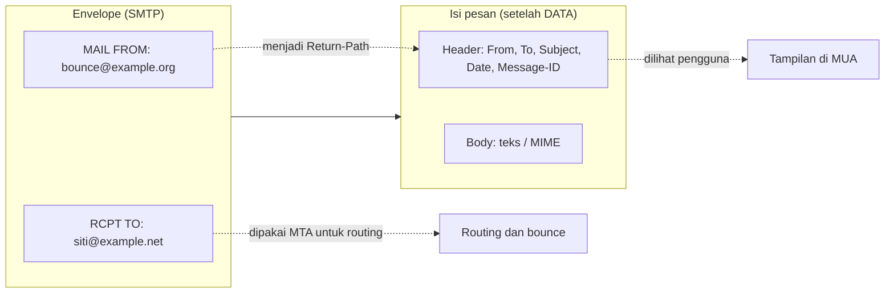

# Envelope vs Header, MIME, dan Lampiran

!!! info "Identitas chapter"
    **ID:** `CH-03-01-03` · **Kategori/modul:** CAT-03 / MOD-03-01 (Model dan Protokol Email) · **Estimasi:** 90 menit · **Lingkungan:** konseptual, tanpa instalasi · [Lihat chapter ini di dashboard](../../../#CH-03-01-03)

## 1. Ringkasan

Sebuah email memiliki dua "lapisan alamat": **envelope** (dipakai server untuk routing) dan **header** (dilihat pengguna di klien). Keduanya bisa berbeda, dan perbedaan itu menjadi dasar spoofing, mailing list, dan bounce. Chapter ini juga menjelaskan **MIME**, yaitu cara email membawa teks non-ASCII dan lampiran. Chapter ini konseptual; Anda menganalisis pesan milik sendiri.

## 2. Tujuan Pembelajaran

1. Membedakan `MAIL FROM`/`RCPT TO` (envelope) dari header `From:`/`To:`.
2. Membaca header `Received:`, `Message-ID:`, `Return-Path:`, dan `Authentication-Results:`.
3. Menjelaskan struktur MIME: `Content-Type`, boundary, dan encoding.
4. Menjelaskan bagaimana lampiran dibawa dalam pesan multipart.
5. Menjelaskan dampak perbedaan envelope dan header terhadap keamanan.

## 3. Prasyarat

- `CH-03-01-02` — perintah SMTP.
- Satu email milik Anda sendiri yang boleh dianalisis. **Sanitasi** (hapus alamat, IP, dan token pihak lain) sebelum menyimpannya ke catatan atau repositori.

## 4. Materi Teori

### 4.1 Envelope dan header

| | Envelope | Header |
|---|---|---|
| Dibawa oleh | Perintah SMTP | Isi pesan (setelah `DATA`) |
| Pengirim | `MAIL FROM` (menjadi `Return-Path`) | `From:` |
| Penerima | `RCPT TO` | `To:`, `Cc:` |
| Dipakai untuk | Routing dan bounce | Tampilan di klien |
| Penerima `Bcc` | Ada di `RCPT TO` | Tidak tercantum |

Analogi: envelope adalah amplop surat pos, header adalah kepala surat di dalamnya. Pos hanya membaca amplop.



### 4.2 Header yang paling sering dibaca

| Header | Arti |
|---|---|
| `Received:` | Ditambahkan oleh **tiap** MTA yang dilalui; baris terbaru di atas. Baca dari bawah ke atas untuk urutan kronologis. |
| `Message-ID:` | Pengenal unik pesan; dipakai untuk melacak di log dan menautkan balasan. |
| `Return-Path:` | Alamat envelope pengirim, tujuan bounce. |
| `Date:`, `Subject:` | Diisi pengirim; tidak terjamin benar. |
| `Authentication-Results:` | Hasil SPF/DKIM/DMARC menurut penerima (CAT-08). |

Hanya header yang ditambahkan **server yang Anda percayai** layak dipercaya; header lain dapat dipalsukan pengirim.

### 4.3 MIME

SMTP awalnya hanya ASCII 7-bit. MIME (RFC 2045–2049) memperluasnya:

- `MIME-Version: 1.0`
- `Content-Type:` mis. `text/plain; charset=UTF-8`, `text/html`, `multipart/mixed`, `multipart/alternative`.
- `Content-Transfer-Encoding:` mis. `7bit`, `quoted-printable`, `base64`.
- **Boundary**: string pemisah antar bagian multipart.

Contoh kerangka pesan dengan teks dan satu lampiran (ilustrasi):

```text
From: Budi <budi@example.org>
To: Siti <siti@example.net>
Subject: Laporan
MIME-Version: 1.0
Content-Type: multipart/mixed; boundary="BATAS-1"

--BATAS-1
Content-Type: text/plain; charset=UTF-8

Halo Siti, laporan terlampir.
--BATAS-1
Content-Type: application/pdf; name="laporan.pdf"
Content-Transfer-Encoding: base64
Content-Disposition: attachment; filename="laporan.pdf"

(isi base64 dipotong)
--BATAS-1--
```

`multipart/alternative` berisi versi teks dan HTML dari isi yang sama; klien memilih salah satu. `base64` menambah ukuran sekitar sepertiga, sehingga batas ukuran pesan server (`SIZE`) berlaku pada ukuran yang sudah ter-encode.

## 5. Praktik dan Implementasi

**Checklist persiapan**

- [ ] Satu email milik sendiri siap dianalisis.
- [ ] Anda mengetahui cara menampilkan sumber/header lengkap di klien Anda.

**Langkah**

1. Tampilkan sumber pesan. Simpan salinan, lalu **sanitasi** alamat, IP, dan token.
2. Tandai `Return-Path`, `From`, `To`, dan `Message-ID`. Apakah `Return-Path` sama dengan `From`?
3. Urutkan semua `Received:` dari bawah ke atas dan catat host serta perkiraan jeda waktu antar-hop.
4. Temukan `Content-Type` utama dan boundary. Hitung jumlah bagian MIME.
5. Tulis ringkasan satu paragraf: jalur pesan dan struktur MIME-nya.

## 6. Perintah Linux

Jika Anda menyimpan pesan sebagai berkas `pesan.eml` di VM, bagian dasar dapat dilihat dengan:

```bash title="Menampilkan header dan struktur"
sed -n '1,/^$/p' pesan.eml
grep -n -i '^content-type\|^--' pesan.eml
```

- `sed -n '1,/^$/p'` mencetak dari baris pertama sampai baris kosong pertama, yaitu seluruh header.
- `grep` menandai tipe konten dan baris boundary.

Keluaran bergantung pada pesan Anda; tidak ada keluaran standar. Jangan menjalankan perintah ini terhadap pesan yang berisi data sensitif pada sistem bersama.

## 7. Konfigurasi

Tidak ada konfigurasi.

## 8. Verifikasi

- Anda dapat menunjuk perbedaan (jika ada) antara `Return-Path` dan `From:` pada pesan Anda.
- Anda dapat menjelaskan urutan hop dari `Received:`.
- Anda dapat menjelaskan struktur MIME pesan yang Anda analisis.

## 9. Troubleshooting

| Gejala | Kemungkinan penyebab | Tindakan |
|---|---|---|
| Header `Received:` tampak terbalik | Baris terbaru ada di atas | Baca dari bawah ke atas |
| Lampiran tidak terbuka | `Content-Type` atau encoding salah | Periksa `Content-Transfer-Encoding` dan boundary |
| Karakter Indonesia/Unicode rusak | Charset tidak dideklarasikan | Gunakan `charset=UTF-8` |
| Pesan ditolak karena ukuran | Ukuran setelah base64 melewati batas | Periksa batas `SIZE` server |

## 10. Security Review

- Header `From:` mudah dipalsukan; jangan menjadikannya bukti identitas. Autentikasi (SPF/DKIM/DMARC) dibahas di CAT-08.
- Lampiran adalah vektor malware; server dan pengguna perlu penyaringan.
- Header dan IP dalam contoh yang dibagikan dapat membocorkan topologi internal; sanitasi.
- Penerima `Bcc` hanya ada di envelope, tidak di header; pastikan klien atau skrip pengirim benar-benar tidak menaruh `Bcc` pada header yang terkirim.

## 11. Latihan

1. Buat tabel envelope vs header untuk pesan dengan satu penerima `Bcc`.
2. Jelaskan bagaimana mailing list dapat membuat `Return-Path` berbeda dari `From:`.
3. Rancang kerangka MIME untuk pesan dengan teks, HTML, dan dua lampiran.
4. Jelaskan mengapa bounce dikirim ke `Return-Path`, bukan `From:`.

## 12. Assessment

1. Alamat mana yang dipakai MTA untuk routing?
2. Mengapa `Received:` dibaca dari bawah ke atas?
3. Apa fungsi boundary pada MIME?
4. Mengapa ukuran lampiran terlihat membesar?
5. Mengapa `From:` tidak dapat dipercaya sebagai bukti identitas?

**Kunci singkat.** (1) Envelope. (2) Setiap hop menambah di atas. (3) Memisahkan bagian. (4) Base64 menambah overhead sekitar 33%. (5) Pengirim bebas menulisnya.

## 13. Checklist Kelulusan

- [ ] Saya dapat membedakan envelope dan header.
- [ ] Saya dapat membaca `Received:`, `Message-ID`, dan `Return-Path`.
- [ ] Saya dapat menjelaskan struktur MIME dan lampiran.
- [ ] Deliverable: catatan analisis satu pesan (tersanitasi).

!!! note "Status belajar"
    Ubah status chapter secara manual di dashboard. Menyelesaikan checklist ini tidak mengubah status otomatis.

## 14. Referensi Resmi

- [RFC 5322 — Internet Message Format](https://www.rfc-editor.org/rfc/rfc5322)
- [RFC 2045 — MIME Bagian 1](https://www.rfc-editor.org/rfc/rfc2045)
- [RFC 2046 — MIME Bagian 2](https://www.rfc-editor.org/rfc/rfc2046)
- [RFC 5321 — SMTP](https://www.rfc-editor.org/rfc/rfc5321)

Tautan referensi tidak diverifikasi otomatis pada build ini; periksa ketersediaannya sebelum dipakai.

---

[Kembali ke dashboard kurikulum](../../../#CH-03-01-03){ .md-button }
