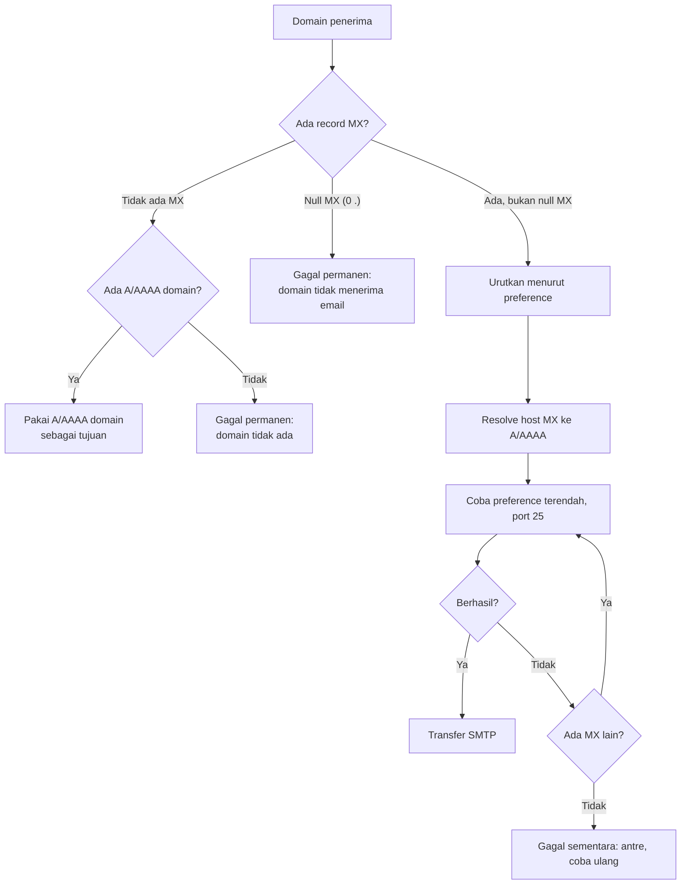

# Lookup MX dan Routing SMTP

!!! info "Identitas chapter"
    **ID:** `CH-03-02-01` · **Kategori/modul:** CAT-03 / MOD-03-02 (Routing dan Pengiriman) · **Estimasi:** 90 menit · **Lingkungan:** lab lokal (VM) · [Lihat chapter ini di dashboard](../../../#CH-03-02-01)

!!! warning "Status verifikasi"
    Perintah belum dijalankan penulis pada VM Ubuntu 24.04 (`verified_on: null`). Keluaran adalah ilustrasi bentuk. Domain `example.com` dipakai sebagai contoh dokumentasi; hasil sebenarnya bergantung pada DNS saat Anda menjalankannya.

## 1. Ringkasan

Sebelum mengirim, MTA harus tahu **ke host mana** pesan untuk `@domain` dikirim. Jawabannya ada di DNS: record **MX**. Chapter ini menjelaskan prioritas MX, fallback ke A/AAAA, dan cara menelusurinya dengan `dig`. Pembuatan record untuk domain Anda sendiri dibahas di CAT-05.

## 2. Tujuan Pembelajaran

1. Menelusuri jalur routing sebuah domain dengan `dig MX`.
2. Menjelaskan prioritas MX (angka terendah dicoba lebih dulu).
3. Menjelaskan fallback ke A/AAAA jika tidak ada MX, serta *null MX*.
4. Mengenali konfigurasi MX yang tidak valid.

## 3. Prasyarat

- `CH-03-01-03`.
- `dig` terpasang (`dnsutils` atau `bind9-dnsutils`, lihat `CH-02-03-02`) dan akses DNS dari VM.

## 4. Materi Teori

### 4.1 Cara MTA memilih tujuan

Untuk penerima `siti@example.net`, MTA pengirim:

1. Mengambil domain `example.net`.
2. Menanyakan MX. Jika ada, mengurutkan berdasarkan **preference** (angka kecil = prioritas tinggi).
3. Menyelesaikan nama host MX ke alamat A/AAAA, lalu mencoba terhubung ke port 25.
4. Jika gagal sementara, mencoba MX berikutnya; jika semua gagal, pesan ditunda.
5. Jika **tidak ada MX sama sekali**, memakai record A/AAAA domain itu sendiri (*implicit MX*, RFC 5321).
6. Jika domain menyatakan **null MX** (`MX 0 .`, RFC 7505), domain tidak menerima email dan pengiriman gagal permanen.



### 4.2 Aturan MX yang benar

| Aturan | Alasan |
|---|---|
| Target MX harus **nama host** yang punya A/AAAA | Alamat IP tidak boleh menjadi target MX |
| Target MX **tidak boleh CNAME** | RFC 2181 melarang; perilaku MTA tidak terjamin |
| Beberapa MX dengan preference sama dipilih acak | Dasar pembagian beban |
| MX cadangan harus menerapkan kebijakan yang sama | Spammer sering menyasar MX cadangan yang longgar |

## 5. Praktik dan Implementasi

**Checklist persiapan**

- [ ] `dig -v` berfungsi.
- [ ] VM dapat melakukan resolusi DNS keluar.

**Langkah**

1. Cari MX sebuah domain publik yang Anda kenal (domain contoh atau domain Anda sendiri).
2. Catat preference dan host; selesaikan tiap host ke A/AAAA.
3. Gambar jalur pengiriman dan urutan percobaannya.
4. Periksa domain yang tidak memiliki MX (hanya A) dan amati perilaku implicit MX secara teori.
5. Catat apakah ada MX yang menunjuk CNAME atau tanpa A/AAAA.

## 6. Perintah Linux

```bash title="Mencari MX dan menyelesaikan targetnya"
dig +short MX example.com
dig +short A mail.example.com
dig +short AAAA mail.example.com
```

- `+short` mencetak hanya jawaban.
- Bentuk keluaran MX: `<preference> <host>.`, misalnya `10 mail.example.com.`.
- Domain contoh dapat saja berupa null MX (`0 .`) atau tanpa MX; hasilnya tidak dijamin dan dapat berubah, jadi catat apa yang Anda lihat sendiri.

Untuk melihat TTL dan bagian lengkap:

```bash title="Jawaban lengkap"
dig MX example.com
```

Perhatikan kolom TTL pada bagian `ANSWER SECTION`. Gunakan resolver tertentu dengan `dig @1.1.1.1 MX example.com` untuk membandingkan, jika kebijakan lab Anda mengizinkan DNS publik.

## 7. Konfigurasi

Tidak ada konfigurasi pada chapter ini.

## 8. Verifikasi

- Anda dapat menyebut urutan percobaan MTA berdasarkan keluaran `dig` Anda.
- Anda dapat membedakan domain dengan MX, tanpa MX, dan dengan null MX.

## 9. Troubleshooting

| Gejala | Kemungkinan penyebab | Tindakan |
|---|---|---|
| `dig` tidak menjawab (timeout) | Resolver tidak terjangkau | `resolvectl status`; periksa DNS di Netplan |
| `NXDOMAIN` | Domain tidak ada atau salah ketik | Periksa ejaan; `dig +trace` |
| MX menunjuk host tanpa A/AAAA | Konfigurasi DNS salah | Tambahkan A/AAAA atau perbaiki target |
| MX berupa CNAME | Konfigurasi tidak valid | Ganti target dengan host yang punya A/AAAA |

## 10. Security Review

- MX sekunder yang tidak terjaga adalah celah klasik; samakan kebijakan penolakan spam dan relay.
- Jangan mengarahkan MX ke host yang tidak Anda kendalikan.
- Perubahan DNS yang tidak sah dapat membelokkan email; amankan akun registrar dengan MFA.

## 11. Latihan

1. Jelaskan perbedaan `10` dan `20` sebagai preference MX.
2. Domain punya dua MX dengan preference 10 dan satu dengan 20. Bagaimana MTA memilih?
3. Apa yang terjadi bila semua MX tidak dapat dihubungi?
4. Mengapa MX tidak boleh berupa IP?

## 12. Assessment

1. Apa itu implicit MX?
2. Apa fungsi null MX?
3. Mengapa MX tidak boleh CNAME?
4. Bagaimana MTA memperlakukan `NXDOMAIN` dibanding timeout?

**Kunci singkat.** (1) Fallback ke A/AAAA bila tak ada MX. (2) Menyatakan domain tidak menerima email. (3) Perilaku tidak terjamin dan dilarang RFC. (4) `NXDOMAIN` gagal permanen, timeout sementara.

## 13. Checklist Kelulusan

- [ ] Saya dapat menelusuri MX dan A/AAAA suatu domain dengan `dig`.
- [ ] Saya dapat menjelaskan prioritas MX dan fallback.
- [ ] Saya dapat mengenali konfigurasi MX tidak valid.

!!! note "Status belajar"
    Ubah status chapter secara manual di dashboard. Menyelesaikan checklist ini tidak mengubah status otomatis.

## 14. Referensi Resmi

- [RFC 5321 — SMTP, bagian 5 (Address Resolution)](https://www.rfc-editor.org/rfc/rfc5321)
- [RFC 7505 — Null MX](https://www.rfc-editor.org/rfc/rfc7505)
- [RFC 2181 — Klarifikasi spesifikasi DNS](https://www.rfc-editor.org/rfc/rfc2181)
- [RFC 1035 — Nama domain, implementasi dan spesifikasi](https://www.rfc-editor.org/rfc/rfc1035)

Tautan referensi tidak diverifikasi otomatis pada build ini; periksa ketersediaannya sebelum dipakai.

---

[Kembali ke dashboard kurikulum](../../../#CH-03-02-01){ .md-button }
