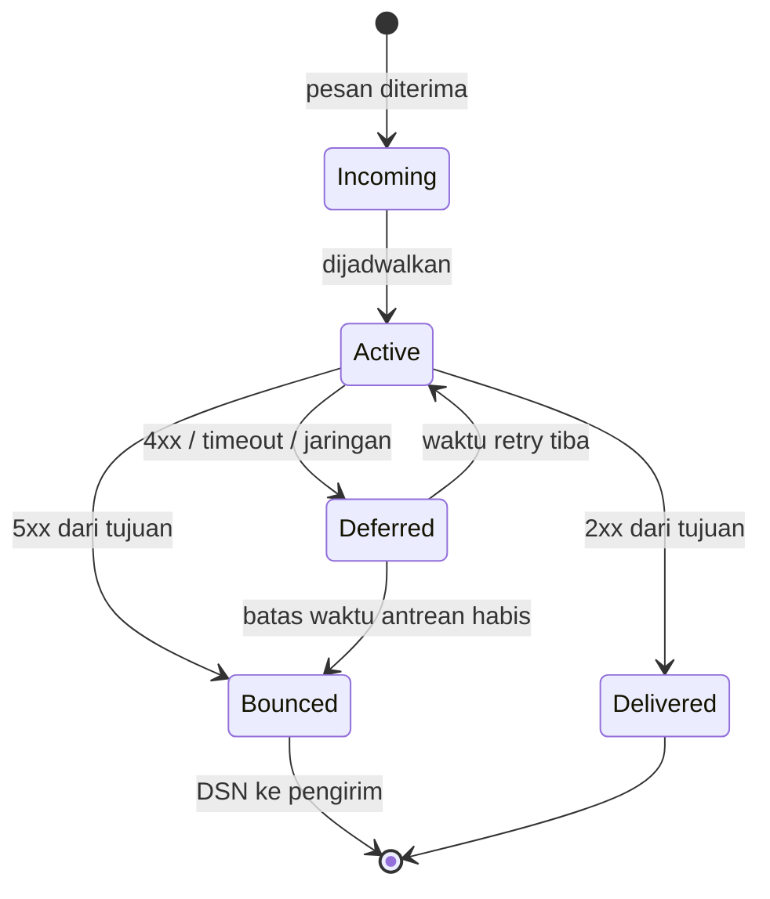

# Antrian, Deferred, Retry, Bounce, dan DSN

!!! info "Identitas chapter"
    **ID:** `CH-03-02-02` · **Kategori/modul:** CAT-03 / MOD-03-02 (Routing dan Pengiriman) · **Estimasi:** 90 menit · **Lingkungan:** konseptual, tanpa instalasi · [Lihat chapter ini di dashboard](../../../#CH-03-02-02)

## 1. Ringkasan

Email adalah sistem **store-and-forward**: pesan yang belum bisa dikirim tidak hilang, melainkan menunggu di antrean dan dicoba ulang. Chapter ini menjelaskan status pesan dalam antrean, perbedaan *deferred* dan *bounce*, dan cara membaca laporan *Delivery Status Notification* (DSN). Perintah antrean Postfix dibahas praktis di `CH-06-01-06`.

## 2. Tujuan Pembelajaran

1. Menjelaskan status pesan: aktif, deferred, ditolak, terkirim.
2. Membedakan kegagalan sementara (`4xx`) dan permanen (`5xx`).
3. Menjelaskan retry berkala dan batas waktu antrean.
4. Membaca DSN: aksi, status, dan diagnostic code.
5. Membedakan *reject saat sesi SMTP* dan *bounce setelah diterima*.

## 3. Prasyarat

- `CH-03-02-01` — routing MX.

## 4. Materi Teori

### 4.1 Siklus pesan di MTA



Postfix memakai nama antrean `incoming`, `active`, `deferred`, dan `hold`; konsep umumnya berlaku di MTA lain.

### 4.2 Sementara vs permanen

| Situasi | Kode lazim | Hasil |
|---|---|---|
| Mailbox penuh sementara, greylisting | `4xx` | Deferred, dicoba ulang |
| Server tujuan tidak terjangkau | tidak ada respons | Deferred |
| Alamat penerima tidak ada | `550` | Bounce segera |
| Ditolak kebijakan (spam, SPF) | `5xx` (kadang `4xx`) | Bounce atau deferred sesuai kebijakan |
| Antrean melewati batas | — | Bounce karena kedaluwarsa |

Postfix secara default mencoba ulang dengan interval bertambah dan menyerah pada batas waktu tertentu (`maximal_queue_lifetime`); nilai default dan kebijakan pastinya Anda periksa di dokumentasi Postfix untuk versi terpasang, bukan dari hafalan.

### 4.3 Reject vs bounce

- **Reject saat sesi**: server penerima menolak pada saat sesi SMTP. Server pengirim yang sedang berhubungan langsung tahu dan membuat laporan sendiri. Ini cara yang baik dan tidak menimbulkan *backscatter*.
- **Bounce setelah diterima**: server menerima pesan (`250`) lalu belakangan menemukan tidak bisa mengantarkan, sehingga mengirim DSN ke `Return-Path`. Jika `Return-Path` dipalsukan, DSN mengenai korban tak bersalah (*backscatter*).

Kesimpulan desain: tolak dalam sesi SMTP sedapat mungkin, jangan "terima lalu bounce".

### 4.4 Membaca DSN

DSN (RFC 3464) memuat bagian terstruktur, kira-kira (ilustrasi):

```text
Final-Recipient: rfc822; siti@example.net
Action: failed
Status: 5.1.1
Diagnostic-Code: smtp; 550 5.1.1 pengguna tidak ditemukan
```

| Field | Arti |
|---|---|
| `Action` | `failed`, `delayed`, `delivered`, `relayed`, `expanded` |
| `Status` | Kode `kelas.subjek.detail` (RFC 3463); `5.x.x` permanen, `4.x.x` sementara |
| `Diagnostic-Code` | Pesan asli dari server |
| `Remote-MTA` | Server yang menolak |

## 5. Praktik dan Implementasi

Demonstrasi konseptual; belum memerlukan MTA.

**Langkah**

1. Dari tiga skenario (mailbox tidak ada, server tujuan mati, pesan terlalu besar), tentukan apakah hasilnya deferred atau bounce, dan mengapa.
2. Gambar ulang diagram status dari ingatan lalu beri label kode respons.
3. Tuliskan DSN fiktif untuk skenario pertama dan jelaskan setiap fieldnya.
4. Jelaskan bagaimana pengirim mengetahui pesannya tertunda (DSN `delayed`) dan kapan ia menyerah.

## 6. Perintah Linux

Tidak ada perintah wajib. Pratinjau: `postqueue -p` dan `postcat` pada `CH-06-01-06` untuk melihat antrean nyata.

## 7. Konfigurasi

Tidak ada konfigurasi. Parameter Postfix terkait (`maximal_queue_lifetime`, `bounce_queue_lifetime`, `minimal_backoff_time`, `maximal_backoff_time`) dibahas pada `CH-06-01-06`.

## 8. Verifikasi

Anda paham jika dapat memprediksi nasib pesan untuk setiap skenario pada bagian 5 dan membaca `Status` pada DSN.

## 9. Troubleshooting

| Gejala | Kemungkinan penyebab | Tindakan |
|---|---|---|
| Pengirim tidak mendapat kabar | DSN dibuang atau `Return-Path` kosong | Periksa jalur bounce |
| Pesan tertunda lama | Tujuan menolak sementara terus-menerus | Baca `Diagnostic-Code`, periksa DNS/tujuan |
| Banyak DSN tidak jelas ke pengguna lain | Backscatter | Tolak dalam sesi, bukan bounce setelah terima |

## 10. Security Review

- Backscatter menyakiti pihak ketiga dan merusak reputasi server Anda.
- DSN dapat membocorkan informasi internal (host, versi); batasi detailnya jika perlu.
- Mengabaikan DSN menyembunyikan masalah pengiriman nyata.

## 11. Latihan

1. Buat tabel: sepuluh kode respons umum dan nasib pesan (deferred/bounce).
2. Jelaskan bagaimana spammer memanfaatkan backscatter.
3. Mengapa "terima lalu bounce" berbahaya untuk server publik?

## 12. Assessment

1. Apa beda deferred dan bounce?
2. Apa arti `Status: 4.4.1`? (tebak kelasnya)
3. Mengapa sebaiknya menolak dalam sesi SMTP?

**Kunci singkat.** (1) Deferred dicoba ulang, bounce final. (2) Sementara (`4.x.x`). (3) Menghindari backscatter.

## 13. Checklist Kelulusan

- [ ] Saya dapat menjelaskan status pesan dan retry.
- [ ] Saya dapat membaca DSN.
- [ ] Saya dapat menjelaskan backscatter.

!!! note "Status belajar"
    Ubah status chapter secara manual di dashboard. Menyelesaikan checklist ini tidak mengubah status otomatis.

## 14. Referensi Resmi

- [RFC 3464 — Format DSN](https://www.rfc-editor.org/rfc/rfc3464)
- [RFC 3463 — Enhanced Mail System Status Codes](https://www.rfc-editor.org/rfc/rfc3463)
- [RFC 5321 — SMTP](https://www.rfc-editor.org/rfc/rfc5321)
- [Postfix: Queue Scheduler (QSHAPE)](https://www.postfix.org/documentation.html)

Tautan referensi tidak diverifikasi otomatis pada build ini; periksa ketersediaannya sebelum dipakai.

---

[Kembali ke dashboard kurikulum](../../../#CH-03-02-02){ .md-button }
