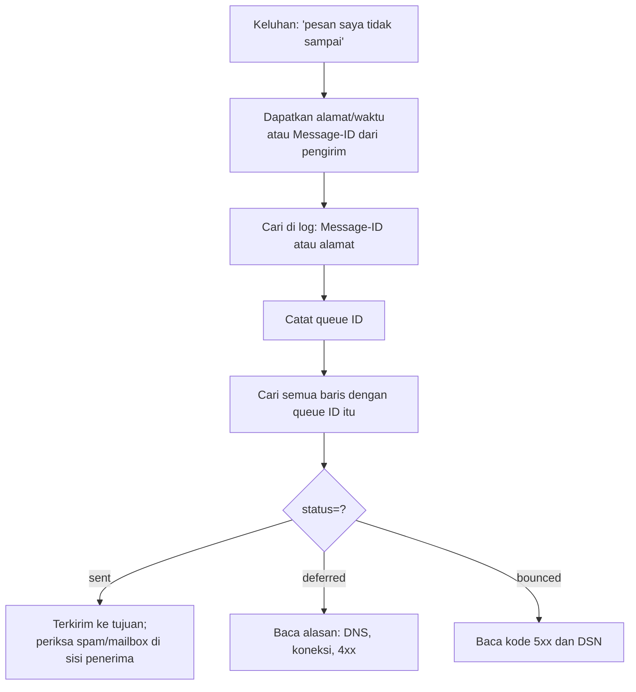

# Format Mailbox, Message-ID, dan Log Email

!!! info "Identitas chapter"
    **ID:** `CH-03-02-03` · **Kategori/modul:** CAT-03 / MOD-03-02 (Routing dan Pengiriman) · **Estimasi:** 90 menit · **Lingkungan:** konseptual, tanpa instalasi · [Lihat chapter ini di dashboard](../../../#CH-03-02-03)

## 1. Ringkasan

Setelah diterima, pesan harus disimpan. Chapter ini membandingkan **mbox** dan **Maildir**, menjelaskan `Message-ID`, dan cara melacak satu pesan lewat log. Anda belum memasang MTA; contoh log berbentuk ilustrasi dan dilatih lagi pada `CH-06-01-06`.

## 2. Tujuan Pembelajaran

1. Membedakan mbox dan Maildir dari struktur, penguncian, dan performa.
2. Menjelaskan fungsi `Message-ID` dan perbedaannya dengan *queue ID*.
3. Melacak satu pesan melalui log berdasarkan queue ID atau `Message-ID`.
4. Menjelaskan mengapa Maildir dipilih pada kurikulum ini.

## 3. Prasyarat

- `CH-03-02-02`.

## 4. Materi Teori

### 4.1 mbox vs Maildir

| Aspek | mbox | Maildir |
|---|---|---|
| Struktur | Satu berkas per folder, pesan digabung | Satu berkas per pesan dalam direktori `cur/`, `new/`, `tmp/` |
| Penguncian | Perlu lock berkas | Tidak perlu lock; berkas ditulis di `tmp/` lalu dipindah |
| Akses bersamaan | Rawan konflik | Aman |
| Backup per pesan | Sulit | Mudah (berkas biasa) |
| Banyak pesan | Berkas besar lambat | Banyak berkas kecil, skala lebih baik |

```text
~/Maildir/
├── new/    pesan baru, belum dilihat klien
├── cur/    pesan yang sudah dilihat; nama berkas memuat flag
└── tmp/    penulisan sementara
```

Nama berkas Maildir memuat waktu, identitas unik, dan (di `cur/`) flag seperti `S` (seen). Dovecot memakai Maildir pada kurikulum ini (`CH-06-02-01`).

### 4.2 Message-ID dan queue ID

| ID | Dibuat oleh | Lingkup |
|---|---|---|
| `Message-ID` | Pengirim/MUA/server pertama | Global, ada di header, tetap sepanjang jalur |
| Queue ID | Setiap MTA | Lokal, berubah di tiap server |

`Message-ID` membantu melacak pesan **antar server** dan menautkan balasan (`In-Reply-To`, `References`). Queue ID membantu menelusuri satu pesan **di dalam satu server**.

### 4.3 Menelusuri log

Contoh log Postfix (ilustrasi, bukan hasil uji):

```text
postfix/smtpd[1234]: 4F2A1B0C3D: client=unknown[192.0.2.10]
postfix/cleanup[1236]: 4F2A1B0C3D: message-id=<abc123@example.org>
postfix/qmgr[900]: 4F2A1B0C3D: from=<budi@example.org>, size=1520, nrcpt=1 (queue active)
postfix/smtp[1240]: 4F2A1B0C3D: to=<siti@example.net>, relay=mail.example.net[198.51.100.5]:25, delay=1.2, status=sent (250 2.0.0 OK)
postfix/qmgr[900]: 4F2A1B0C3D: removed
```

Alur penelusuran:



## 5. Praktik dan Implementasi

**Langkah**

1. Dari pesan yang Anda sanitasi pada `CH-03-01-03`, ambil `Message-ID`.
2. Dengan log contoh pada 4.3, tulis ulang urutan peristiwa dengan kata-kata Anda.
3. Tentukan baris mana yang membuktikan pesan sudah diserahkan ke server tujuan.
4. Gambar struktur direktori Maildir untuk dua folder (Inbox dan Sent) dan beri contoh nama berkas hasil rekaan.

## 6. Perintah Linux

Tidak wajib. Untuk sekadar membiasakan pola pencarian:

```bash title="Pola pencarian di log (setelah MTA terpasang pada L5)"
grep 'ID-ANTREAN' /var/log/mail.log
journalctl -u 'postfix@-' | grep 'ID-ANTREAN'
```

- `ID-ANTREAN` adalah placeholder; ganti dengan queue ID dari log Anda.
- Ubuntu 24.04 tidak selalu memasang `rsyslog` secara default, sehingga `/var/log/mail.log` mungkin tidak ada; periksa keberadaan berkas dan jurnal systemd. Detail ada di `CH-06-01-06`.

## 7. Konfigurasi

Tidak ada. Pemilihan Maildir dikonfigurasi pada `CH-06-01-03` dan `CH-06-02-01`.

## 8. Verifikasi

- Anda dapat menjelaskan struktur Maildir dan memberi alasan memilihnya.
- Anda dapat melacak pesan pada log contoh dari `Message-ID` ke status akhir.

## 9. Troubleshooting

| Gejala | Kemungkinan penyebab | Tindakan |
|---|---|---|
| Log email tidak ditemukan | Berkas log tidak dibuat; log hanya di jurnal | Gunakan `journalctl` |
| Tidak ada baris dengan queue ID | Pesan belum/tidak mencapai server ini | Cari berdasarkan alamat dan waktu |
| Banyak baris sama dari klien lain | Lalu lintas lain bercampur | Filter dengan queue ID |

## 10. Security Review

- Log memuat alamat dan IP; anggap sebagai data pribadi. Sanitasi sebelum dibagikan.
- Izin direktori Maildir harus membatasi akses hanya ke pemilik dan layanan terkait.
- Rotasi dan retensi log perlu dikelola (`CAT-11`).

## 11. Latihan

1. Jelaskan mengapa Maildir tidak butuh lock berkas.
2. Sebutkan satu kasus ketika Anda memakai `Message-ID` dan satu ketika queue ID.
3. Tulis alur Anda mencari pesan yang "hilang" dari log.

## 12. Assessment

1. Apa fungsi `tmp/`, `new/`, `cur/`?
2. Mengapa queue ID berbeda di tiap server?
3. Apa arti `status=deferred` pada log?

**Kunci singkat.** (1) Penulisan sementara, pesan baru, pesan terbaca. (2) Dibuat per MTA. (3) Pengiriman gagal sementara.

## 13. Checklist Kelulusan

- [ ] Saya dapat membedakan mbox dan Maildir.
- [ ] Saya dapat membedakan `Message-ID` dan queue ID.
- [ ] Saya dapat menjelaskan alur penelusuran log.

!!! note "Status belajar"
    Ubah status chapter secara manual di dashboard. Menyelesaikan checklist ini tidak mengubah status otomatis.

## 14. Referensi Resmi

- [Dovecot: Maildir](https://doc.dovecot.org/)
- [Postfix: dokumentasi](https://www.postfix.org/documentation.html)
- [RFC 5322 — Message-ID](https://www.rfc-editor.org/rfc/rfc5322)
- [Format Maildir (D. J. Bernstein)](https://cr.yp.to/proto/maildir.html)

Tautan referensi tidak diverifikasi otomatis pada build ini; periksa ketersediaannya sebelum dipakai.

---

[Kembali ke dashboard kurikulum](../../../#CH-03-02-03){ .md-button }
