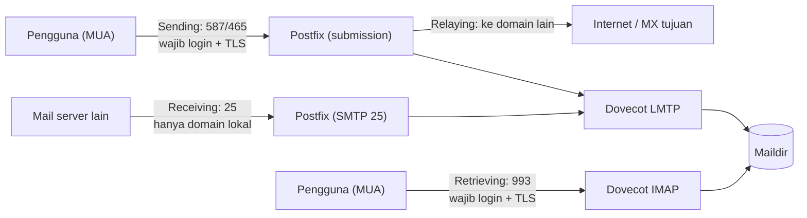

# Mengirim, Menerima, Relay, dan Mengambil Email

!!! info "Identitas chapter"
    **ID:** `CH-03-02-04` · **Kategori/modul:** CAT-03 / MOD-03-02 (Routing dan Pengiriman) · **Estimasi:** 60 menit · **Lingkungan:** konseptual, tanpa instalasi · [Lihat chapter ini di dashboard](../../../#CH-03-02-04)

## 1. Ringkasan

Chapter penutup Level 2 ini menyatukan empat fungsi yang sering tertukar: **sending**, **receiving**, **relaying**, dan **retrieving**. Anda memetakan setiap fungsi ke port, layanan, dan kontrol keamanannya, sebagai pegangan sebelum memasang server pada Level 3–5.

## 2. Tujuan Pembelajaran

1. Mendefinisikan sending, receiving, relaying, dan retrieving.
2. Memetakan tiap fungsi ke port, layanan, dan aturan autentikasi.
3. Menjelaskan open relay dan bagaimana kebijakan relay mencegahnya.
4. Menyusun peta fungsi untuk mail server lab Anda.

## 3. Prasyarat

- `CH-03-02-03` dan seluruh modul `MOD-03-01`.

## 4. Materi Teori

### 4.1 Empat fungsi

| Fungsi | Arti | Protokol / port | Siapa yang boleh |
|---|---|---|---|
| **Sending** (submission) | Pengguna menyerahkan pesan ke server | SMTP 587/465 | Pengguna terautentikasi |
| **Receiving** | Server menerima pesan untuk domain yang dilayani | SMTP 25 | Siapa saja, **hanya untuk domain lokal** |
| **Relaying** | Server meneruskan pesan untuk domain lain | SMTP | Hanya pengguna terautentikasi/jaringan tepercaya |
| **Retrieving** | Pengguna membaca mailbox | IMAP 993 / POP3 995 | Pengguna terautentikasi |

Prinsip kunci: server menerima dari siapa saja **hanya jika tujuannya domain miliknya**; meneruskan ke domain lain hanya untuk pihak yang berwenang. Melanggar prinsip ini membuat **open relay**.

### 4.2 Arsitektur dan batas kepercayaan



Diagram menunjukkan arsitektur target yang akan dibangun di CAT-06. LMTP adalah protokol penyerahan lokal dari Postfix ke Dovecot (`CH-06-02-04`).

### 4.3 Open relay

Open relay adalah server yang bersedia meneruskan email dari siapa pun ke siapa pun. Spammer memakainya untuk menyamarkan asal, dan IP server cepat masuk daftar hitam. Pencegahan: kebijakan relay yang hanya mengizinkan jaringan tepercaya, pengguna terautentikasi, dan domain tujuan lokal (`CH-06-01-04`), serta **uji nyata** sebelum server terhubung ke internet.

### 4.4 Peta fungsi untuk lab Anda

| Fungsi | Layanan | Port | Kontrol |
|---|---|---|---|
| Sending | Postfix submission | 587 | AUTH + TLS |
| Receiving | Postfix | 25 | Domain lokal saja |
| Relaying | Postfix | — | Autentikasi/`mynetworks` terbatas |
| Retrieving | Dovecot | 993 | AUTH + TLS |

## 5. Praktik dan Implementasi

**Langkah**

1. Gambar diagram sendiri untuk skenario: dua pengguna pada domain lab Anda dan satu pengguna di domain luar.
2. Beri label setiap panah dengan salah satu dari empat fungsi.
3. Untuk tiap panah, tulis siapa yang boleh memakainya dan bagaimana server memeriksanya.
4. Tulis tiga uji yang akan Anda jalankan di L5 untuk membuktikan server bukan open relay.

## 6. Perintah Linux

Tidak ada perintah wajib. Setelah layanan terpasang, Anda dapat memeriksa soket yang mendengarkan:

```bash title="Memeriksa port yang mendengarkan (setelah L5)"
ss -tlnp | grep -E ':(25|587|993)\b'
```

Perintah ini menampilkan layanan yang membuka port tersebut; belum ada hasil yang bisa diharapkan sebelum Postfix/Dovecot dipasang.

## 7. Konfigurasi

Tidak ada konfigurasi.

## 8. Verifikasi

Anda paham jika peta fungsi Anda memiliki setiap fungsi yang terpetakan ke satu port, satu layanan, dan satu kontrol akses.

## 9. Troubleshooting

| Gejala | Kemungkinan penyebab | Tindakan |
|---|---|---|
| Kirim ke domain luar ditolak "relay access denied" | Klien tidak login atau tidak tepercaya | Pastikan AUTH di port 587 |
| Server menerima untuk domain asing | Salah konfigurasi relay | Periksa kebijakan relay (L5) |
| Email terkirim tapi tidak terbaca di klien | Masalah retrieval, bukan sending | Periksa IMAP |

## 10. Security Review

- Open relay adalah kesalahan konfigurasi paling mahal; uji sebelum terhubung ke internet.
- Receiving tidak boleh dibatasi autentikasi pengguna (server lain tidak punya akun), jadi pertahanan ada pada penolakan domain asing, bukan login.
- Pisahkan port 25 (antarserver) dan 587/465 (pengguna) agar kebijakan dapat berbeda.

## 11. Latihan

1. Jelaskan mengapa port 25 tidak meminta login pengguna.
2. Susun matriks fungsi × kontrol keamanan.
3. Jelaskan apa yang terjadi bila `mynetworks` terlalu luas.

## 12. Assessment

1. Apa beda receiving dan relaying?
2. Mengapa open relay berbahaya?
3. Protokol apa untuk retrieving?

**Kunci singkat.** (1) Receiving untuk domain lokal, relaying untuk domain lain. (2) Disalahgunakan spam dan memicu daftar hitam. (3) IMAP/POP3.

## 13. Checklist Kelulusan

- [ ] Saya dapat memetakan empat fungsi ke port dan layanan.
- [ ] Saya dapat menjelaskan open relay.
- [ ] Deliverable Level 2: diagram arsitektur email buatan sendiri dan catatan analisis satu pesan (`CH-03-01-03`).

!!! note "Status belajar"
    Ubah status chapter secara manual di dashboard. Menyelesaikan checklist ini tidak mengubah status otomatis.

## 14. Referensi Resmi

- [RFC 5321 — SMTP](https://www.rfc-editor.org/rfc/rfc5321)
- [RFC 6409 — Message Submission](https://www.rfc-editor.org/rfc/rfc6409)
- [Postfix: SMTP relay and access control](https://www.postfix.org/SMTPD_ACCESS_README.html)
- [RFC 8314 — TLS untuk email](https://www.rfc-editor.org/rfc/rfc8314)

Tautan referensi tidak diverifikasi otomatis pada build ini; periksa ketersediaannya sebelum dipakai.

---

[Kembali ke dashboard kurikulum](../../../#CH-03-02-04){ .md-button }
