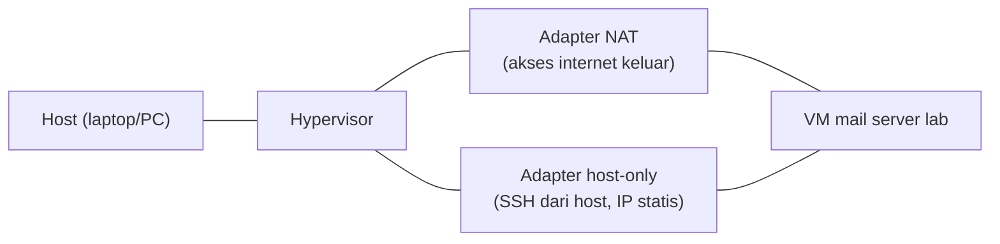

# Perencanaan Hardware, VM, dan Sizing

!!! info "Identitas chapter"
    **ID:** `CH-04-01-01` · **Kategori/modul:** CAT-04 / MOD-04-01 (Perencanaan dan Instalasi) · **Estimasi:** 60 menit · **Lingkungan:** konseptual, tanpa instalasi · [Lihat chapter ini di dashboard](../../../#CH-04-01-01)

## 1. Ringkasan

Sebelum memasang server, tetapkan kebutuhan CPU, RAM, disk, dan jaringan beserta asumsinya. Chapter ini memberi cara menghitung kapasitas awal secara sederhana dan mendokumentasikannya. Angka di sini adalah **titik awal berbasis asumsi**, bukan standar; ukur dan koreksi saat beban nyata ada.

## 2. Tujuan Pembelajaran

1. Mengidentifikasi sumber daya yang dikonsumsi mail server: CPU, RAM, disk, I/O, dan jaringan.
2. Menghitung perkiraan kebutuhan storage dari jumlah akun, kuota, dan retensi.
3. Menentukan spesifikasi VM lab dan merencanakan pertumbuhan.
4. Mendokumentasikan asumsi kapasitas dalam lembar perencanaan.

## 3. Prasyarat

- `CH-03-02-04` (arsitektur email) dan `CH-02-04-01` (SSH).
- VM lab dari `CH-01-01-02`.

## 4. Materi Teori

### 4.1 Faktor yang memengaruhi sizing

| Sumber daya | Pendorong utama |
|---|---|
| Disk (kapasitas) | Jumlah akun × kuota, lampiran, retensi, backup |
| Disk (I/O) | Banyak berkas kecil (Maildir), indeks Dovecot, antrean |
| RAM | Proses Postfix/Dovecot bersamaan, cache filesystem, anti-spam/antivirus |
| CPU | TLS, anti-spam, kompresi, penyaringan konten |
| Jaringan | Volume pesan dan lampiran, retrieval IMAP |

Anti-spam dan antivirus (CAT-10) biasanya menjadi konsumen RAM/CPU terbesar; rencanakan sejak awal bila akan dipasang.

### 4.2 Rumus perencanaan storage

Perkiraan kasar: `kapasitas = akun × kuota_rata_rata × faktor_pertumbuhan + backup + ruang_kerja`.

Contoh hitung (asumsi fiktif untuk latihan): 20 akun × 2 GB × 1,5 pertumbuhan = 60 GB data mailbox. Tambahkan ruang untuk sistem operasi, log, antrean, dan salinan lokal backup. Pisahkan perhitungan antara **kapasitas terpakai** dan **kapasitas yang dialokasikan** (kuota biasanya tidak terpakai penuh).

### 4.3 Titik awal lab

Untuk lab satu server tanpa anti-spam berat, spesifikasi sederhana lazim dipakai (contoh titik awal, bukan syarat): 2 vCPU, 2–4 GB RAM, 20–40 GB disk, satu antarmuka jaringan. Jika Anda memasang anti-spam dan antivirus kelak, naikkan RAM. Pastikan snapshot hypervisor tersedia sebelum perubahan besar.

### 4.4 Perencanaan jaringan lab



Adapter host-only memberi IP stabil untuk SSH dan uji dari host; adapter NAT memberi akses `apt`. Nama adapter dan menu berbeda antar hypervisor.

## 5. Praktik dan Implementasi

**Checklist persiapan**

- [ ] Anda mengetahui spesifikasi host (RAM, CPU, disk kosong).
- [ ] Hypervisor lab dari L0 dapat dibuka.

**Langkah**

1. Isi lembar perencanaan: jumlah akun, kuota rata-rata, pertumbuhan, retensi, dan asumsi.
2. Hitung kapasitas disk dan bulatkan ke atas dengan margin.
3. Tentukan spesifikasi VM dan jelaskan alasan setiap angka.
4. Putuskan topologi jaringan lab (NAT + host-only) dan rencana IP.
5. Simpan lembar perencanaan di repositori catatan tanpa data sensitif.

## 6. Perintah Linux

Setelah VM ada, verifikasi sumber daya yang benar-benar terlihat:

```bash title="Memeriksa sumber daya VM"
nproc
free -h
lsblk
df -h /
```

- `nproc` jumlah vCPU, `free -h` memori, `lsblk` perangkat blok, `df -h /` ruang partisi root.
- Bandingkan hasilnya dengan rencana Anda; keluaran bergantung pada VM.

## 7. Konfigurasi

Tidak ada. Lembar perencanaan adalah dokumen, bukan berkas sistem.

## 8. Verifikasi

- Lembar perencanaan menyatakan asumsi dan hasil hitungan.
- Spesifikasi VM tercantum beserta alasan.

## 9. Troubleshooting

| Gejala | Kemungkinan penyebab | Tindakan |
|---|---|---|
| Disk cepat penuh | Kuota tidak ditegakkan, log/antrean besar | Pantau `df`, atur kuota dan rotasi log |
| Server lambat saat anti-spam aktif | RAM kurang | Tambah RAM, kurangi layanan |
| Host tersendat | Alokasi VM terlalu besar | Kurangi alokasi atau hentikan VM lain |

## 10. Security Review

- Jangan membeli/menyewa sumber daya produksi atas dasar angka lab.
- Rencanakan ruang untuk backup dan log; keduanya sering terlupa.
- Dokumentasikan asumsi agar bisa ditinjau, tanpa menaruh IP atau kredensial nyata.

## 11. Latihan

1. Hitung kapasitas untuk 50 akun, kuota 5 GB, pertumbuhan 1,3.
2. Jelaskan dampak menambah anti-spam pada RAM.
3. Buat tabel rencana IP lab (placeholder) tanpa IP publik nyata.

## 12. Assessment

1. Mengapa I/O penting bagi Maildir?
2. Mengapa kapasitas terpakai berbeda dari kuota alokasi?
3. Mengapa asumsi harus ditulis?

**Kunci singkat.** (1) Banyak berkas kecil. (2) Kuota jarang terpakai penuh. (3) Agar dapat dikoreksi.

## 13. Checklist Kelulusan

- [ ] Lembar perencanaan kapasitas selesai.
- [ ] Spesifikasi VM dan rencana jaringan lab dicatat.
- [ ] Tidak ada IP/kredensial nyata dalam catatan.

!!! note "Status belajar"
    Ubah status chapter secara manual di dashboard. Menyelesaikan checklist ini tidak mengubah status otomatis.

## 14. Referensi Resmi

- [Dokumentasi Ubuntu Server](https://documentation.ubuntu.com/server/)
- [Persyaratan sistem Ubuntu Server](https://ubuntu.com/server/docs/system-requirements)
- [Dokumentasi Postfix](https://www.postfix.org/documentation.html)
- [Dokumentasi Dovecot](https://doc.dovecot.org/)

Tautan referensi tidak diverifikasi otomatis pada build ini; periksa ketersediaannya sebelum dipakai.

---

[Kembali ke dashboard kurikulum](../../../#CH-04-01-01){ .md-button }
