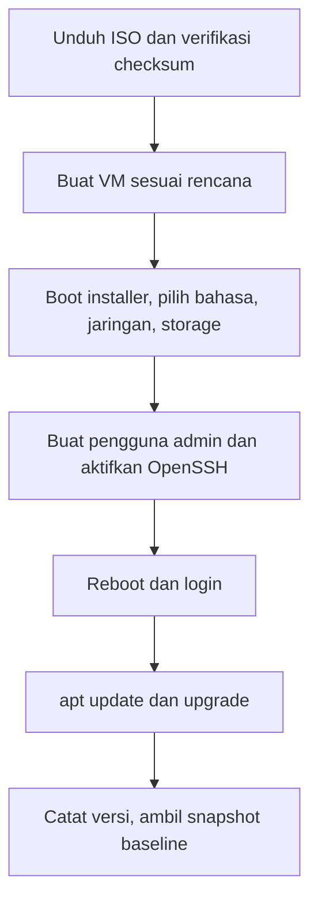

# Instalasi Ubuntu Server LTS dan Pembaruan

!!! info "Identitas chapter"
    **ID:** `CH-04-01-02` · **Kategori/modul:** CAT-04 / MOD-04-01 (Perencanaan dan Instalasi) · **Estimasi:** 120 menit · **Lingkungan:** lab lokal (VM) · [Lihat chapter ini di dashboard](../../../#CH-04-01-02)

!!! warning "Status verifikasi"
    Instalasi dan pembaruan mengubah sistem dan belum dijalankan penulis (`verified_on: null`). Jalankan hanya pada VM lab dengan snapshot.

## 1. Ringkasan

Anda memasang Ubuntu Server 24.04 LTS pada VM lab, membuat pengguna admin non-root, memperbarui sistem, dan mencatat versi terpasang. Hasilnya adalah server baseline yang menjadi dasar seluruh level berikutnya.

## 2. Tujuan Pembelajaran

1. Memasang Ubuntu Server LTS dengan pilihan yang sesuai rencana.
2. Membuat pengguna admin non-root dan mengaktifkan OpenSSH server.
3. Memperbarui paket dengan `apt` dan mencatat versi.
4. Mengambil snapshot baseline setelah instalasi bersih.

## 3. Prasyarat

- `CH-04-01-01` — lembar perencanaan.
- Berkas ISO Ubuntu Server 24.04 LTS, diunduh dari situs resmi dan **checksum diverifikasi**.

## 4. Materi Teori

### 4.1 Memilih rilis

Gunakan rilis **LTS** untuk server. Kurikulum memakai 24.04 LTS (Noble Numbat); periksa kebijakan dukungan rilis di dokumentasi Ubuntu karena masa dukungan dan rilis terbaru berubah. Instalasi "minimal" mengurangi permukaan serangan, tetapi lab dapat memakai instalasi server standar.

### 4.2 Pilihan penting pada installer

| Pilihan | Rekomendasi lab | Alasan |
|---|---|---|
| Bahasa/keyboard | English / sesuai perangkat | Pesan galat lebih mudah dicari |
| Jaringan | DHCP dulu, statis di chapter berikutnya | Memastikan akses `apt` |
| Storage | Disk penuh, mis. LVM default | Sederhana; perencanaan lanjut di `CH-04-02-03` |
| Nama pengguna | Non-root, bukan `admin` generik | Menghindari tebakan nama umum |
| OpenSSH server | Aktifkan | Administrasi jarak jauh |
| Snap tambahan | Jangan pilih | Menjaga baseline bersih |

### 4.3 Alur instalasi



## 5. Praktik dan Implementasi

**Checklist persiapan**

- [ ] ISO terunduh dan checksum cocok dengan yang diterbitkan.
- [ ] VM dibuat sesuai `CH-04-01-01`.
- [ ] Anda mengetahui pengguna/kata sandi yang akan dibuat (jangan dicatat di repositori).

**Langkah**

1. Verifikasi checksum ISO (bagian 6).
2. Boot VM dari ISO, ikuti installer sesuai tabel 4.2.
3. Setelah reboot, login dengan pengguna admin, lalu uji SSH dari host.
4. Perbarui sistem (bagian 6).
5. Catat versi, ambil snapshot "baseline-instalasi".

## 6. Perintah Linux

Verifikasi checksum di host (nilai referensi berasal dari halaman resmi Ubuntu, `SHA256SUMS`):

```bash title="Verifikasi checksum ISO"
sha256sum ubuntu-24.04-live-server-amd64.iso
```

Nama berkas ISO dapat berbeda (mis. versi titik); bandingkan hasil dengan nilai di `SHA256SUMS` resmi. Pada Windows gunakan `Get-FileHash`.

Di server setelah instalasi:

```bash title="Pembaruan dan pencatatan versi"
sudo apt update
sudo apt full-upgrade
lsb_release -a
uname -r
```

- `apt update` menyegarkan indeks; `apt full-upgrade` memasang pembaruan termasuk perubahan dependensi.
- `lsb_release -a` dan `uname -r` mencatat rilis dan kernel; keluaran bergantung pada sistem Anda.
- Jika diminta reboot (mis. berkas `/var/run/reboot-required`), lakukan `sudo reboot`.

## 7. Konfigurasi

Tidak ada berkas yang diedit manual. Pilihan installer tersimpan di sistem; jangan menyalin berkas autoinstall yang memuat hash kata sandi ke repositori.

## 8. Verifikasi

```bash title="Verifikasi"
lsb_release -d
systemctl is-active ssh
apt list --upgradable 2>/dev/null | head
```

Hasil yang diharapkan: deskripsi rilis Ubuntu 24.04, `active` untuk `ssh`, dan daftar pembaruan kosong atau minimal setelah upgrade. Bandingkan, jangan mengasumsikan.

## 9. Troubleshooting

| Gejala | Kemungkinan penyebab | Tindakan |
|---|---|---|
| Installer tidak boot | Mode boot (UEFI/BIOS) salah | Sesuaikan pengaturan VM |
| `apt update` gagal | Tidak ada internet/DNS | Periksa `ip a`, `resolvectl`; pakai adapter NAT |
| SSH menolak | `ssh` belum aktif/firewall | `systemctl status ssh` |
| Dikunci karena paket lock | `unattended-upgrades` sedang jalan | Tunggu atau cek `ps` |

## 10. Security Review

- Verifikasi checksum ISO mencegah memasang berkas rusak/palsu.
- Gunakan pengguna non-root dengan `sudo`; jangan aktifkan login root.
- Jangan simpan kata sandi atau berkas autoinstall berisi hash di repositori.
- Snapshot menyimpan seluruh isi VM, termasuk kata sandi di disk; perlakukan sebagai data sensitif.

## 11. Latihan

1. Jelaskan perbedaan `apt upgrade` dan `apt full-upgrade`.
2. Mengapa memverifikasi checksum ISO?
3. Pulihkan snapshot, lalu pastikan versi dan kondisi layanan kembali.

## 12. Assessment

1. Mengapa memilih LTS untuk server?
2. Apa risiko login root langsung?
3. Apa fungsi snapshot baseline?

**Kunci singkat.** (1) Dukungan jangka panjang. (2) Serangan brute force dan tanpa audit pengguna. (3) Titik pemulihan bersih.

## 13. Checklist Kelulusan

- [ ] Ubuntu Server 24.04 terpasang, pengguna admin non-root.
- [ ] Sistem diperbarui dan versi dicatat.
- [ ] Snapshot baseline dibuat.
- [ ] Tidak ada kredensial dalam catatan.

!!! note "Status belajar"
    Ubah status chapter secara manual di dashboard. Menyelesaikan checklist ini tidak mengubah status otomatis.

## 14. Referensi Resmi

- [Dokumentasi Ubuntu Server](https://documentation.ubuntu.com/server/)
- [Unduh Ubuntu Server](https://ubuntu.com/download/server)
- [Verifikasi ISO Ubuntu](https://ubuntu.com/tutorials/how-to-verify-ubuntu)
- [Paket Ubuntu](https://packages.ubuntu.com/)

Tautan referensi tidak diverifikasi otomatis pada build ini; periksa ketersediaannya sebelum dipakai.

---

[Kembali ke dashboard kurikulum](../../../#CH-04-01-02){ .md-button }
