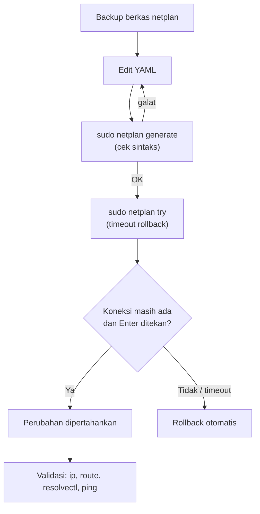

# IP Statis dan Validasi Jaringan (Netplan)

!!! info "Identitas chapter"
    **ID:** `CH-04-02-01` · **Kategori/modul:** CAT-04 / MOD-04-02 (Konfigurasi Dasar) · **Estimasi:** 90 menit · **Lingkungan:** lab lokal (VM) · [Lihat chapter ini di dashboard](../../../#CH-04-02-01)

!!! warning "Status verifikasi"
    Mengubah jaringan dapat memutus akses. Perintah belum dijalankan penulis (`verified_on: null`). Lakukan dari konsol hypervisor, bukan hanya dari SSH, dan ambil snapshot lebih dulu.

## 1. Ringkasan

Mail server membutuhkan alamat IP yang stabil. Anda mengonfigurasi IP statis dengan **Netplan**, memvalidasi gateway dan DNS, dan memakai `netplan try` agar perubahan salah dapat dibatalkan otomatis.

## 2. Tujuan Pembelajaran

1. Menulis konfigurasi Netplan YAML untuk IP statis, gateway, dan DNS.
2. Menguji dengan `netplan try` sebelum `netplan apply`.
3. Memvalidasi alamat, rute, dan resolusi DNS.
4. Memulihkan jaringan jika konfigurasi salah.

## 3. Prasyarat

- `CH-04-01-02` — server terpasang.
- Pemahaman IP/subnet/gateway dari `CH-02-03-01`.
- Akses konsol hypervisor.

## 4. Materi Teori

### 4.1 Netplan

Netplan membaca YAML di `/etc/netplan/*.yaml` lalu menghasilkan konfigurasi untuk renderer (di Ubuntu Server biasanya `systemd-networkd`). Sintaks YAML sensitif terhadap **indentasi spasi** (bukan tab). Berkas harus berizin ketat (mis. `600`); Netplan versi baru memperingatkan jika izin terlalu longgar.

### 4.2 Alur perubahan aman



## 5. Praktik dan Implementasi

**Checklist persiapan**

- [ ] Snapshot VM.
- [ ] Rencana IP (placeholder): `192.168.56.10/24`, gateway sesuai jaringan lab, DNS sesuai kebijakan lab.
- [ ] Nama antarmuka diketahui dari `ip -br a`.

**Langkah**

1. Catat nama antarmuka dan alamat saat ini.
2. Cadangkan berkas Netplan yang ada.
3. Edit dengan contoh pada bagian 7, sesuaikan nilai.
4. Jalankan `netplan generate`, lalu `netplan try`.
5. Validasi (bagian 8) dan ambil snapshot.

## 6. Perintah Linux

```bash title="Inspeksi awal"
ip -br a
ip route
ls -l /etc/netplan/
```

```bash title="Backup dan penerapan aman"
sudo cp /etc/netplan/50-cloud-init.yaml /etc/netplan/50-cloud-init.yaml.bak
sudo netplan generate
sudo netplan try
```

- Nama berkas Netplan di sistem Anda bisa berbeda; sesuaikan dengan `ls`.
- `netplan try` menerapkan sementara dan membatalkan sendiri setelah timeout jika tidak dikonfirmasi.
- Cadangan `.bak` di `/etc/netplan/` tidak dibaca karena ekstensinya bukan `.yaml`; tetap, jangan biarkan berkas cadangan berisi rahasia.

## 7. Konfigurasi

```yaml title="/etc/netplan/50-cloud-init.yaml (contoh, sesuaikan nama antarmuka dan nilai)"
network:
  version: 2
  ethernets:
    NAMA-ANTARMUKA:
      dhcp4: false
      addresses:
        - 192.168.56.10/24
      routes:
        - to: default
          via: GATEWAY-LAB
      nameservers:
        addresses: [DNS-LAB]
```

- `NAMA-ANTARMUKA`, `GATEWAY-LAB`, dan `DNS-LAB` adalah **placeholder**; isi sesuai lab Anda.
- Pada VM dengan `cloud-init`, perubahan jaringan manual dapat tertimpa; periksa dokumentasi cloud-init bila berkas dibuat otomatis.
- Gunakan `routes` dengan `to: default`; sintaks `gateway4` lama sudah usang.

## 8. Verifikasi

```bash title="Validasi jaringan"
ip -br a
ip route
resolvectl status
ping -c 2 GATEWAY-LAB
getent hosts ubuntu.com
```

Hasil yang diharapkan: IP statis terpasang, rute default via gateway, DNS terdaftar, ping ke gateway berhasil, dan resolusi nama berhasil. Setelah reboot, ulangi untuk memastikan konfigurasi persisten.

## 9. Troubleshooting

| Gejala | Kemungkinan penyebab | Tindakan |
|---|---|---|
| `netplan generate` galat | Indentasi/sintaks YAML | Periksa spasi, tanda hubung, titik dua |
| Peringatan izin berkas | Izin terlalu longgar | `sudo chmod 600 /etc/netplan/*.yaml` |
| Jaringan putus | IP/gateway salah | Tunggu rollback, atau pulihkan `.bak` lewat konsol |
| Ping IP berhasil, nama gagal | DNS salah | Periksa `nameservers`, `resolvectl` |

## 10. Security Review

- Jangan mengubah jaringan hanya lewat SSH tanpa mekanisme rollback.
- Pastikan IP statis tidak bentrok dengan perangkat lain.
- Batasi akses berkas konfigurasi; berkas netplan Wi-Fi bisa memuat kunci.

## 11. Latihan

1. Sengaja salahkan indentasi dan amati galat `netplan generate`.
2. Ubah alamat DNS dan verifikasi dengan `resolvectl`.
3. Pulihkan dari snapshot setelah mensimulasikan kesalahan gateway.

## 12. Assessment

1. Mengapa `netplan try` lebih aman?
2. Mengapa Netplan memakai spasi bukan tab?
3. Mengapa mail server perlu IP statis?

**Kunci singkat.** (1) Ada rollback otomatis. (2) YAML melarang tab untuk indentasi. (3) DNS dan firewall bergantung pada IP stabil.

## 13. Checklist Kelulusan

- [ ] IP statis aktif dan persisten setelah reboot.
- [ ] Gateway dan DNS tervalidasi.
- [ ] Prosedur rollback dipahami.

!!! note "Status belajar"
    Ubah status chapter secara manual di dashboard. Menyelesaikan checklist ini tidak mengubah status otomatis.

## 14. Referensi Resmi

- [Dokumentasi Netplan](https://netplan.readthedocs.io/)
- [Ubuntu Server: Networking](https://documentation.ubuntu.com/server/)
- [RFC 1918 — Alokasi alamat privat](https://www.rfc-editor.org/rfc/rfc1918)

Tautan referensi tidak diverifikasi otomatis pada build ini; periksa ketersediaannya sebelum dipakai.

---

[Kembali ke dashboard kurikulum](../../../#CH-04-02-01){ .md-button }
