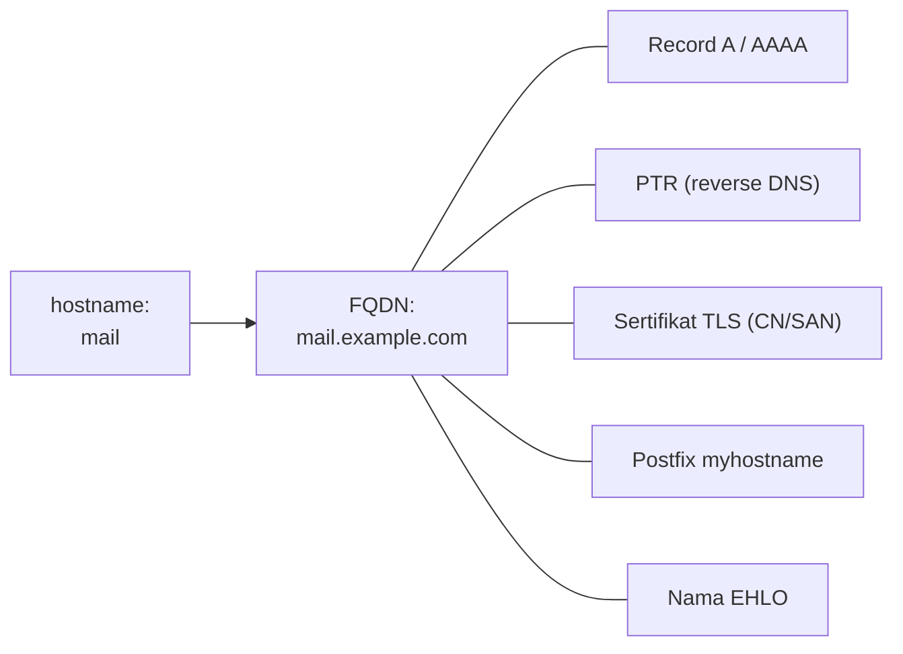

# Hostname, FQDN, Timezone, dan Sinkronisasi Waktu

!!! info "Identitas chapter"
    **ID:** `CH-04-02-02` · **Kategori/modul:** CAT-04 / MOD-04-02 (Konfigurasi Dasar) · **Estimasi:** 90 menit · **Lingkungan:** lab lokal (VM) · [Lihat chapter ini di dashboard](../../../#CH-04-02-02)

!!! warning "Status verifikasi"
    Perintah yang mengubah sistem belum dijalankan penulis (`verified_on: null`). Domain `example.com` dan IP `192.168.56.10` adalah contoh.

## 1. Ringkasan

Postfix memperkenalkan dirinya dengan nama host saat `EHLO`, dan banyak server penerima memeriksa kecocokan nama itu dengan DNS. Waktu yang salah merusak log, sertifikat TLS, dan tanda tangan DKIM. Chapter ini menetapkan **hostname dan FQDN yang konsisten** serta **sinkronisasi waktu**.

## 2. Tujuan Pembelajaran

1. Membedakan hostname pendek dan FQDN.
2. Menetapkan hostname dengan `hostnamectl` dan menjaga `/etc/hosts` konsisten.
3. Mengatur timezone dan memeriksa sinkronisasi waktu.
4. Menjelaskan mengapa waktu dan nama memengaruhi email.

## 3. Prasyarat

- `CH-04-02-01`.

## 4. Materi Teori

### 4.1 Hostname dan FQDN

- **Hostname**: nama pendek, mis. `mail`.
- **FQDN**: nama lengkap, mis. `mail.example.com`.

Untuk mail server, FQDN idealnya sama dengan nama pada record A, PTR (`CAT-05`), sertifikat TLS (`CAT-08`), dan `myhostname` Postfix (`CH-06-01-02`). Ketidakcocokan sering menyebabkan penolakan atau skor spam lebih tinggi.



### 4.2 `/etc/hosts`

`/etc/hosts` memetakan nama ke IP secara lokal. Baris untuk IP server dengan FQDN diikuti hostname pendek membantu agar `hostname -f` mengembalikan FQDN. Hindari menaruh FQDN pada `127.0.0.1` jika IP statis tersedia, karena beberapa layanan memakai alamat itu sebagai identitas.

### 4.3 Waktu

Ubuntu Server memakai `systemd-timesyncd` secara default; `chrony` adalah alternatif dengan diagnostik lebih kaya. Pilih satu; jangan menjalankan keduanya. Zona waktu hanya mengubah tampilan; simpan log dan jadwal dengan ingatan bahwa sistem internal bekerja pada UTC.

## 5. Praktik dan Implementasi

**Checklist persiapan**

- [ ] Rencana FQDN (mis. `mail.example.com`) dan IP statis dari chapter sebelumnya.
- [ ] Snapshot VM.

**Langkah**

1. Lihat kondisi saat ini (bagian 6).
2. Tetapkan hostname, edit `/etc/hosts`.
3. Atur timezone.
4. Pastikan sinkronisasi waktu aktif.
5. Verifikasi (bagian 8) dan reboot sekali untuk memastikan persisten.

## 6. Perintah Linux

```bash title="Kondisi awal"
hostnamectl
hostname -f
timedatectl
```

```bash title="Menetapkan hostname dan timezone"
sudo hostnamectl set-hostname mail
sudo timedatectl set-timezone Asia/Jakarta
```

- `set-hostname` mengisi hostname statis; FQDN diresolusi melalui `/etc/hosts` atau DNS.
- Daftar timezone: `timedatectl list-timezones`. Pilih sesuai kebutuhan; produksi sering memakai UTC.

Sinkronisasi waktu:

```bash title="Memeriksa sinkronisasi (timesyncd)"
timedatectl timesync-status
```

Jika memilih `chrony`:

```bash title="Opsional: chrony"
sudo apt install chrony
chronyc tracking
```

`apt install chrony` menggantikan timesyncd; jalankan hanya jika Anda memilih chrony. Bentuk keluaran `chronyc tracking` memuat offset dan stratum; nilai tergantung sistem.

## 7. Konfigurasi

```text title="/etc/hosts (contoh)"
127.0.0.1 localhost
192.168.56.10 mail.example.com mail
```

- Baris kedua memetakan IP statis ke FQDN lalu nama pendek.
- `/etc/hostname` berisi nama pendek (diisi `hostnamectl`).
- Edit `/etc/hosts` dengan hati-hati (`sudo nano`); salah edit dapat memperlambat `sudo`.

## 8. Verifikasi

```bash title="Validasi"
hostnamectl --static
hostname -f
getent hosts mail.example.com
timedatectl
```

Hasil yang diharapkan: `hostname -f` menampilkan FQDN, `getent` menampilkan IP statis, `timedatectl` menunjukkan sinkronisasi aktif (`System clock synchronized: yes`). Pesan persis bergantung pada versi.

## 9. Troubleshooting

| Gejala | Kemungkinan penyebab | Tindakan |
|---|---|---|
| `hostname -f` mengembalikan `mail` saja | `/etc/hosts` tidak memuat FQDN | Perbaiki baris IP statis |
| `sudo: unable to resolve host` | Hostname tidak ada di `/etc/hosts` | Tambahkan nama host |
| Waktu tidak sinkron | NTP diblokir/ layanan mati | `timedatectl timesync-status`, cek firewall keluar UDP 123 |
| Dua layanan waktu aktif | timesyncd dan chrony | Gunakan satu saja |

## 10. Security Review

- Waktu salah merusak validasi sertifikat dan DKIM.
- Jangan memakai nama host yang menyingkap informasi internal sensitif.
- Pastikan sumber waktu tepercaya dan batasi keluarnya lalu lintas NTP sesuai kebijakan.

## 11. Latihan

1. Ubah timezone, lalu kembalikan; apa yang berubah dan tidak berubah pada log?
2. Buat hostname tidak cocok dengan `/etc/hosts` dan amati dampaknya pada `sudo` (di VM snapshot).
3. Tulis tabel konsistensi nama untuk lab Anda.

## 12. Assessment

1. Apa beda hostname dan FQDN?
2. Mengapa waktu penting untuk DKIM dan TLS?
3. Mengapa tidak menjalankan dua layanan sinkronisasi waktu?

**Kunci singkat.** (1) Pendek vs lengkap. (2) Validitas bergantung pada timestamp. (3) Saling berebut kendali jam.

## 13. Checklist Kelulusan

- [ ] Hostname dan FQDN konsisten dan persisten.
- [ ] Timezone benar dan waktu tersinkronisasi.
- [ ] Tabel konsistensi nama selesai.

!!! note "Status belajar"
    Ubah status chapter secara manual di dashboard. Menyelesaikan checklist ini tidak mengubah status otomatis.

## 14. Referensi Resmi

- [Ubuntu Server: Time synchronization](https://documentation.ubuntu.com/server/)
- [hostnamectl(1)](https://www.freedesktop.org/software/systemd/man/latest/hostnamectl.html)
- [timedatectl(1)](https://www.freedesktop.org/software/systemd/man/latest/timedatectl.html)
- [chrony](https://chrony-project.org/documentation.html)

Tautan referensi tidak diverifikasi otomatis pada build ini; periksa ketersediaannya sebelum dipakai.

---

[Kembali ke dashboard kurikulum](../../../#CH-04-02-02){ .md-button }
