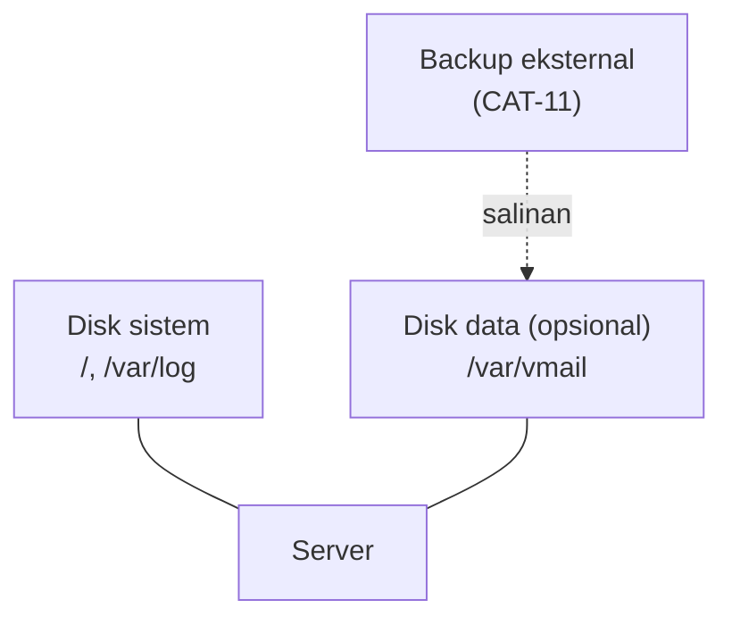

# Perencanaan Storage dan Izin Filesystem

!!! info "Identitas chapter"
    **ID:** `CH-04-02-03` · **Kategori/modul:** CAT-04 / MOD-04-02 (Konfigurasi Dasar) · **Estimasi:** 90 menit · **Lingkungan:** lab lokal (VM) · [Lihat chapter ini di dashboard](../../../#CH-04-02-03)

!!! warning "Status verifikasi"
    Perintah baca-saja (`lsblk`, `df`, `du`, `mount`) aman; perubahan `fstab`/izin belum dijalankan penulis (`verified_on: null`). Salah `fstab` dapat menghalangi boot; kerjakan dengan snapshot.

## 1. Ringkasan

Data mail (mailbox, antrean, log) tumbuh terus. Chapter ini merencanakan tata letak storage, memeriksa kondisi disk, dan menetapkan izin direktori yang aman. Pada lab, Anda cukup merencanakan lokasi dan memverifikasi; memisahkan volume nyata bersifat opsional.

## 2. Tujuan Pembelajaran

1. Membaca tata letak disk dengan `lsblk`, `df`, `du`, dan `mount`.
2. Menentukan lokasi data mail (`/var/vmail`, `/var/spool/postfix`, `/var/log`) dan alasan memisahkannya.
3. Menetapkan kepemilikan dan izin direktori dengan prinsip least privilege.
4. Menjelaskan fungsi `/etc/fstab` dan risikonya.

## 3. Prasyarat

- `CH-04-02-02`; dasar izin dari `CH-02-01-03`.

## 4. Materi Teori

### 4.1 Lokasi data yang relevan

| Lokasi | Isi | Catatan |
|---|---|---|
| `/var/spool/postfix` | Antrean Postfix | Hanya diakses Postfix; tumbuh saat delivery macet |
| `/var/vmail` (rencana) | Mailbox virtual (Maildir) | Dibahas di L6; pemilik pengguna khusus |
| `/home/*/Maildir` | Mailbox pengguna sistem | Alternatif (`CH-06-01-03`) |
| `/var/log` dan jurnal | Log | Perlu rotasi |
| `/etc/postfix`, `/etc/dovecot` | Konfigurasi | Backup wajib |

### 4.2 Mengapa memisahkan volume

Memisahkan data mailbox ke volume tersendiri membuat disk penuh oleh mailbox tidak menjatuhkan sistem, memudahkan ekspansi dan backup, dan memungkinkan opsi mount khusus. Dengan LVM, volume dapat diperbesar. Di lab, cukup mencatat rencana atau menambah disk virtual kedua bila ingin berlatih.



### 4.3 Izin

Prinsip: setiap direktori dimiliki oleh akun layanan yang memerlukannya dengan izin sesempit mungkin (mis. `0700` untuk mailbox pribadi, `0750` bila grup layanan memerlukan). Jangan memakai `chmod 777`. Pemilik spesifik untuk `vmail` dibuat pada `CH-07-01-01`.

### 4.4 `/etc/fstab`

`fstab` mendefinisikan sistem berkas yang dipasang saat boot. Gunakan **UUID** (dari `blkid`) bukan nama perangkat, dan opsi `nofail` untuk disk non-kritis agar boot tidak berhenti bila disk hilang. Selalu uji dengan `sudo mount -a` sebelum reboot.

## 5. Praktik dan Implementasi

**Checklist persiapan**

- [ ] Snapshot VM.
- [ ] Rencana kapasitas dari `CH-04-01-01`.

**Langkah**

1. Inspeksi disk (bagian 6).
2. Tentukan apakah lab memakai disk kedua; jika ya, tambahkan disk virtual (di hypervisor).
3. Tulis tabel rencana: lokasi, pemilik, izin, volume.
4. (Opsional) Format, mount, dan uji disk kedua (bagian 7).
5. Verifikasi dan catat.

## 6. Perintah Linux

```bash title="Inspeksi"
lsblk -f
df -hT
sudo du -xh --max-depth=1 /var | sort -h | tail
mount | grep -E ' / | /var'
```

- `lsblk -f` menampilkan sistem berkas dan UUID; `df -hT` ruang beserta jenis; `du` mencari direktori besar; `mount` menampilkan opsi mount.
- Keluaran bergantung pada VM; tidak ada angka acuan.

## 7. Konfigurasi

Hanya jika menambah disk data kedua (`/dev/sdb` adalah contoh; **periksa nama disk dengan `lsblk` dulu**, karena salah target menghapus data):

```bash title="Opsional: menyiapkan disk data (menghapus isi disk tersebut)"
sudo mkfs.ext4 /dev/sdb
sudo mkdir -p /var/vmail
sudo blkid /dev/sdb
```

```text title="/etc/fstab (tambahkan satu baris; ganti UUID-DISK)"
UUID=UUID-DISK /var/vmail ext4 defaults,nofail 0 2
```

```bash title="Uji sebelum reboot"
sudo mount -a
findmnt /var/vmail
```

- `mkfs.ext4` **menghapus** seluruh isi perangkat; pastikan perangkatnya benar.
- `mount -a` memeriksa `fstab`; bila ada galat, perbaiki sebelum reboot.

## 8. Verifikasi

- `findmnt /var/vmail` (jika disk kedua dipakai) menampilkan titik mount; `df -h /var/vmail` menampilkan kapasitasnya.
- Setelah reboot, titik mount tetap ada.
- Tabel rencana izin sudah ditulis.

## 9. Troubleshooting

| Gejala | Kemungkinan penyebab | Tindakan |
|---|---|---|
| Boot masuk emergency mode | `fstab` salah | Perbaiki lewat konsol; gunakan `nofail` |
| `mount -a` galat | UUID/jenis salah | Cek `blkid` |
| `No space left on device` padahal ruang ada | Inode habis (banyak berkas kecil) | `df -i`; pertimbangkan jumlah inode |
| Permission denied saat layanan menulis | Pemilik/izin salah | `ls -ld`, `namei -l` |

## 10. Security Review

- Jangan `chmod 777`; mailbox harus tidak dapat dibaca pengguna lain.
- Opsi `nodev,nosuid,noexec` pada volume data mengurangi risiko, tetapi uji kompatibilitasnya.
- Enkripsi disk dan backup terenkripsi dipertimbangkan untuk produksi.
- Mengubah `fstab` tanpa snapshot berisiko mengunci sistem.

## 11. Latihan

1. Hitung inode yang dibutuhkan untuk 1 juta pesan Maildir dan bandingkan dengan `df -i`.
2. Rancang tata letak volume untuk produksi kecil.
3. Jelaskan fungsi opsi `nofail`.

## 12. Assessment

1. Mengapa memakai UUID di `fstab`?
2. Mengapa Maildir bisa menghabiskan inode?
3. Mengapa izin mailbox ketat?

**Kunci singkat.** (1) Nama perangkat dapat berubah. (2) Satu berkas per pesan. (3) Privasi isi email.

## 13. Checklist Kelulusan

- [ ] Saya dapat membaca tata letak disk dan penggunaannya.
- [ ] Tabel rencana lokasi dan izin selesai.
- [ ] `fstab` (bila diubah) teruji dengan `mount -a` dan reboot.

!!! note "Status belajar"
    Ubah status chapter secara manual di dashboard. Menyelesaikan checklist ini tidak mengubah status otomatis.

## 14. Referensi Resmi

- [Ubuntu Server: Storage](https://documentation.ubuntu.com/server/)
- [fstab(5)](https://man7.org/linux/man-pages/man5/fstab.5.html)
- [Filesystem Hierarchy Standard](https://refspecs.linuxfoundation.org/fhs.shtml)
- [Dokumentasi Dovecot: lokasi mail](https://doc.dovecot.org/)

Tautan referensi tidak diverifikasi otomatis pada build ini; periksa ketersediaannya sebelum dipakai.

---

[Kembali ke dashboard kurikulum](../../../#CH-04-02-03){ .md-button }
