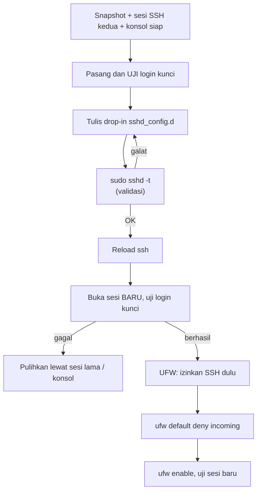

# SSH Aman dan Firewall Awal

!!! info "Identitas chapter"
    **ID:** `CH-04-03-01` · **Kategori/modul:** CAT-04 / MOD-04-03 (Baseline Keamanan Awal) · **Estimasi:** 120 menit · **Lingkungan:** lab lokal (VM) · [Lihat chapter ini di dashboard](../../../#CH-04-03-01)

!!! danger "Risiko terkunci"
    Salah konfigurasi SSH atau firewall dapat mengunci Anda dari server. Siapkan **konsol hypervisor**, snapshot, dan **sesi SSH kedua yang tetap terbuka** sebelum mengubah apa pun. Perintah belum dijalankan penulis (`verified_on: null`).

## 1. Ringkasan

Anda mengamankan akses administrasi: login SSH hanya dengan kunci dan firewall `deny incoming` secara default dengan pengecualian SSH. Ini baseline sebelum membuka port email.

## 2. Tujuan Pembelajaran

1. Mengaktifkan login SSH berbasis kunci dan menonaktifkan kata sandi serta login root.
2. Memvalidasi konfigurasi `sshd` sebelum diterapkan.
3. Mengaktifkan UFW dengan urutan yang tidak mengunci diri.
4. Menjelaskan alasan pembatasan akses administrasi.

## 3. Prasyarat

- `CH-04-02-03`; SSH dasar dari `CH-02-04-01`; firewall dasar dari `CH-02-03-03`.
- Pasangan kunci SSH sudah dibuat di klien dan kunci publik sudah dipasang pada server (`ssh-copy-id`).

## 4. Materi Teori

### 4.1 Prinsip

- **Kunci, bukan kata sandi**: kunci tidak dapat ditebak lewat brute force jarak jauh seperti kata sandi lemah.
- **Tanpa login root**: tindakan administratif melalui `sudo` meninggalkan jejak per pengguna.
- **Firewall default-deny**: hanya port yang jelas dibutuhkan yang dibuka.

### 4.2 Urutan aman



Urutan pada UFW penting: izinkan SSH **sebelum** `enable`.

## 5. Praktik dan Implementasi

**Checklist persiapan**

- [ ] Login kunci sudah berhasil dari klien Anda.
- [ ] Sesi SSH kedua terbuka sebagai cadangan.
- [ ] Snapshot dan akses konsol tersedia.

**Langkah**

1. Uji login kunci pada sesi baru.
2. Buat berkas drop-in sshd (bagian 7).
3. Validasi dengan `sshd -t`, reload, uji sesi baru.
4. Atur UFW (bagian 6) dengan urutan benar.
5. Verifikasi dan snapshot.

## 6. Perintah Linux

```bash title="Validasi dan reload SSH"
sudo sshd -t
sudo systemctl reload ssh
```

`sshd -t` tidak mencetak apa pun jika sintaks benar. Pada Ubuntu 24.04 unit bernama `ssh` (alias `sshd`) dan dapat memakai socket activation; bila `reload` tidak memadai, ikuti `systemctl status ssh` dan dokumentasi Ubuntu untuk versi Anda.

Firewall:

```bash title="UFW: izinkan SSH sebelum enable"
sudo ufw status verbose
sudo ufw allow OpenSSH
sudo ufw default deny incoming
sudo ufw default allow outgoing
sudo ufw enable
sudo ufw status numbered
```

- `allow OpenSSH` memakai profil aplikasi UFW yang membuka port SSH; jika Anda mengubah port SSH, izinkan port itu secara eksplisit.
- Port email (25/587/993) **belum** dibuka; dibuka bertahap di L5–L8.

## 7. Konfigurasi

```text title="/etc/ssh/sshd_config.d/10-hardening.conf"
PermitRootLogin no
PasswordAuthentication no
KbdInteractiveAuthentication no
PubkeyAuthentication yes
```

- Berkas drop-in tidak mengubah `sshd_config` utama dan mudah dibatalkan.
- Pada Ubuntu, berkas drop-in lain (mis. dari cloud-init) dapat sudah mengatur `PasswordAuthentication`; arahan yang dibaca **lebih awal** menang, sehingga nama berkas berurutan penting. Periksa hasil akhir dengan `sudo sshd -T | grep -i -E 'passwordauth|permitroot'`.

## 8. Verifikasi

```bash title="Verifikasi"
sudo sshd -T | grep -i -E 'passwordauthentication|permitrootlogin|pubkeyauthentication'
sudo ufw status verbose
```

Hasil yang diharapkan: `passwordauthentication no`, `permitrootlogin no`, `pubkeyauthentication yes`; UFW aktif dengan default deny incoming dan SSH diizinkan. Uji juga bahwa login dengan kata sandi **ditolak** dari klien (`ssh -o PubkeyAuthentication=no ...`).

## 9. Troubleshooting

| Gejala | Kemungkinan penyebab | Tindakan |
|---|---|---|
| `Permission denied (publickey)` | Kunci belum terpasang / izin `~/.ssh` salah | Periksa `authorized_keys`, izin `700`/`600` |
| Terkunci setelah `ufw enable` | SSH belum diizinkan | Konsol hypervisor: `ufw allow OpenSSH` atau `ufw disable` |
| Pengaturan tidak berlaku | Drop-in lain menimpa | `sshd -T` |
| `sshd -t` galat | Salah ketik arahan | Perbaiki sesuai pesan |

## 10. Security Review

- Jangan menonaktifkan password sebelum login kunci teruji.
- Jaga kunci privat (jangan unggah ke repositori atau salin ke server).
- Pertimbangkan membatasi sumber SSH (`ufw allow from <IP-ADMIN> to any port 22`) pada produksi.
- Layanan fail2ban/rate limit dibahas pada CAT-10.

## 11. Latihan

1. Buka sesi SSH baru setelah perubahan dan buktikan kata sandi ditolak.
2. Simulasikan terkunci (pada snapshot) dan pulihkan lewat konsol.
3. Batasi SSH hanya dari IP host-only Anda.

## 12. Assessment

1. Mengapa mengizinkan SSH sebelum `ufw enable`?
2. Apa fungsi `sshd -t`?
3. Mengapa sesi kedua dibiarkan terbuka?

**Kunci singkat.** (1) Agar tidak terputus. (2) Validasi sintaks. (3) Jalan masuk darurat.

## 13. Checklist Kelulusan

- [ ] Login kunci saja; root dan password nonaktif (terverifikasi).
- [ ] UFW aktif default-deny dengan SSH diizinkan.
- [ ] Prosedur pemulihan terkunci dipahami.

!!! note "Status belajar"
    Ubah status chapter secara manual di dashboard. Menyelesaikan checklist ini tidak mengubah status otomatis.

## 14. Referensi Resmi

- [sshd_config(5)](https://man.openbsd.org/sshd_config)
- [Ubuntu Server: OpenSSH](https://documentation.ubuntu.com/server/)
- [Ubuntu Server: Firewall (UFW)](https://documentation.ubuntu.com/server/)
- [ufw(8)](https://manpages.ubuntu.com/manpages/noble/man8/ufw.8.html)

Tautan referensi tidak diverifikasi otomatis pada build ini; periksa ketersediaannya sebelum dipakai.

---

[Kembali ke dashboard kurikulum](../../../#CH-04-03-01){ .md-button }
