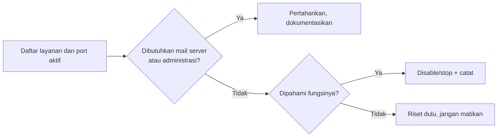

# Hardening Awal dan Pembaruan Otomatis

!!! info "Identitas chapter"
    **ID:** `CH-04-03-02` · **Kategori/modul:** CAT-04 / MOD-04-03 (Baseline Keamanan Awal) · **Estimasi:** 90 menit · **Lingkungan:** lab lokal (VM) · [Lihat chapter ini di dashboard](../../../#CH-04-03-02)

!!! warning "Status verifikasi"
    Mengubah layanan dan konfigurasi apt; belum dijalankan penulis (`verified_on: null`). Gunakan snapshot.

## 1. Ringkasan

Anda mengaktifkan **pembaruan keamanan otomatis** dan mengurangi permukaan serangan dengan menonaktifkan layanan yang tidak dibutuhkan. Ini hardening awal; hardening mendalam mail server ada di CAT-10.

## 2. Tujuan Pembelajaran

1. Mengaktifkan `unattended-upgrades` untuk pembaruan keamanan.
2. Mendaftar layanan dan port yang aktif, lalu menilai kebutuhannya.
3. Menonaktifkan layanan yang tidak diperlukan dengan aman.
4. Menjelaskan trade-off pembaruan otomatis pada server produksi.

## 3. Prasyarat

- `CH-04-03-01`; `systemctl` dari `CH-02-02-01`; `apt` dari `CH-02-01-04`.

## 4. Materi Teori

### 4.1 Permukaan serangan

Setiap layanan yang mendengarkan jaringan adalah potensi celah. Prinsip: *jalankan hanya yang dibutuhkan*. Sebelum mematikan sesuatu, ketahui **fungsinya** dan **ketergantungannya**; jangan menonaktifkan berdasarkan nama yang terdengar asing.

### 4.2 Pembaruan otomatis

`unattended-upgrades` memasang pembaruan sesuai konfigurasi (default umumnya pembaruan keamanan). Manfaat: celah ditutup cepat. Risiko: pembaruan dapat me-restart layanan atau mengubah perilaku. Praktik baik: aktifkan untuk keamanan, pantau log, dan lakukan reboot terjadwal bila kernel diperbarui. Kebijakan produksi (jendela perawatan) dibahas di CAT-13.



## 5. Praktik dan Implementasi

**Langkah**

1. Inventaris layanan dan port (bagian 6).
2. Tentukan yang tidak dibutuhkan, beri alasan tertulis.
3. Aktifkan `unattended-upgrades`.
4. Uji dengan simulasi (`--dry-run`) dan periksa log.
5. Catat konfigurasi akhir dan snapshot.

## 6. Perintah Linux

```bash title="Inventaris"
sudo ss -tulpn
systemctl list-unit-files --state=enabled --type=service
systemctl list-units --type=service --state=running
```

```bash title="Pembaruan otomatis"
sudo apt install unattended-upgrades
sudo dpkg-reconfigure -plow unattended-upgrades
sudo unattended-upgrade --dry-run --debug
```

- `ss -tulpn` memetakan port ke proses; pada VM bersih biasanya hanya SSH dan layanan sistem (resolver lokal).
- `--dry-run` mensimulasikan tanpa memasang paket. Keluaran panjang; cari baris "Allowed origins".
- Hentikan layanan yang tidak diperlukan hanya setelah dipahami:

```bash title="Contoh menonaktifkan layanan yang tidak dipakai"
sudo systemctl disable --now NAMA-LAYANAN
```

`NAMA-LAYANAN` adalah placeholder. Jangan menonaktifkan `systemd-resolved`, `ssh`, atau layanan jaringan.

## 7. Konfigurasi

```text title="/etc/apt/apt.conf.d/20auto-upgrades (dihasilkan dpkg-reconfigure)"
APT::Periodic::Update-Package-Lists "1";
APT::Periodic::Unattended-Upgrade "1";
```

Sumber pembaruan yang diizinkan diatur di `/etc/apt/apt.conf.d/50unattended-upgrades`. Opsi reboot otomatis (`Unattended-Upgrade::Automatic-Reboot`) bersifat opsional; aktifkan hanya bila Anda memahami dampak downtime.

## 8. Verifikasi

```bash title="Verifikasi"
systemctl is-enabled unattended-upgrades
cat /etc/apt/apt.conf.d/20auto-upgrades
ls /var/log/unattended-upgrades/
sudo ss -tulpn
```

Hasil yang diharapkan: layanan aktif, konfigurasi periodik berisi `"1"`, dan daftar port tidak memuat layanan yang tidak Anda kenal.

## 9. Troubleshooting

| Gejala | Kemungkinan penyebab | Tindakan |
|---|---|---|
| Pembaruan tidak jalan | Timer apt tidak aktif | `systemctl list-timers \| grep apt` |
| Lock `dpkg` | Proses apt lain berjalan | Tunggu; jangan hapus lock sembarangan |
| Layanan penting mati setelah disable | Dependensi terlewat | Aktifkan kembali, tinjau `systemctl list-dependencies` |

## 10. Security Review

- Pembaruan otomatis menutup celah lebih cepat daripada patch manual, tetapi tetap perlu pemantauan.
- Jangan mematikan layanan keamanan (AppArmor, auditd bila ada).
- Dokumentasikan setiap layanan yang dinonaktifkan agar bisa ditinjau dan dibalik.

## 11. Latihan

1. Buat tabel layanan aktif beserta fungsi dan keputusan (pertahankan/matikan).
2. Jalankan `--dry-run` dan jelaskan paket yang akan diperbarui.
3. Diskusikan risiko reboot otomatis pada mail server produksi.

## 12. Assessment

1. Mengapa tidak mematikan layanan yang belum dipahami?
2. Apa manfaat dan risiko pembaruan otomatis?
3. Apa fungsi `--dry-run`?

**Kunci singkat.** (1) Dapat merusak dependensi. (2) Celah cepat tertutup; perilaku bisa berubah. (3) Simulasi tanpa perubahan.

## 13. Checklist Kelulusan

- [ ] Pembaruan keamanan otomatis aktif dan teruji.
- [ ] Inventaris layanan dan alasan keputusan tercatat.
- [ ] Tidak ada layanan tak dikenal mendengarkan jaringan.

!!! note "Status belajar"
    Ubah status chapter secara manual di dashboard. Menyelesaikan checklist ini tidak mengubah status otomatis.

## 14. Referensi Resmi

- [Ubuntu Server: Automatic updates](https://documentation.ubuntu.com/server/)
- [Ubuntu Wiki: Security](https://wiki.ubuntu.com/Security)
- [Paket unattended-upgrades](https://packages.ubuntu.com/noble/unattended-upgrades)

Tautan referensi tidak diverifikasi otomatis pada build ini; periksa ketersediaannya sebelum dipakai.

---

[Kembali ke dashboard kurikulum](../../../#CH-04-03-02){ .md-button }
