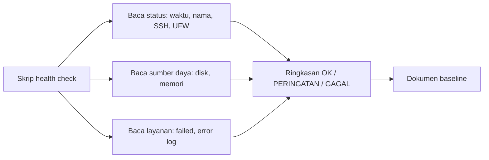

# Pemeriksaan Kesehatan Baseline

!!! info "Identitas chapter"
    **ID:** `CH-04-03-03` · **Kategori/modul:** CAT-04 / MOD-04-03 (Baseline Keamanan Awal) · **Estimasi:** 60 menit · **Lingkungan:** lab lokal (VM) · [Lihat chapter ini di dashboard](../../../#CH-04-03-03)

!!! warning "Status verifikasi"
    Skrip contoh belum dijalankan penulis (`verified_on: null`). Skrip hanya membaca status; uji pada VM Anda dan koreksi bila perlu.

## 1. Ringkasan

Chapter penutup Level 3 ini merangkum baseline menjadi **skrip health check** yang hanya membaca kondisi: waktu, hostname/FQDN, SSH, firewall, update, disk, memori, dan layanan gagal. Hasilnya menjadi dokumen baseline sebelum Postfix dan Dovecot dipasang.

## 2. Tujuan Pembelajaran

1. Menyusun skrip health check baca-saja dengan kode keluar yang bermakna.
2. Mendokumentasikan kondisi baseline server.
3. Menafsirkan hasil dan membedakan peringatan dengan kegagalan.
4. Menjelaskan manfaat baseline untuk diagnosis di masa depan.

## 3. Prasyarat

- `CH-04-03-02`; skrip dasar dari `CH-02-01-05`.

## 4. Materi Teori

### 4.1 Mengapa baseline

Tanpa gambaran kondisi normal, sulit menilai apakah sebuah gejala abnormal. Baseline mencatat keadaan sehat: angka, konfigurasi, dan port aktif. Ia juga menjadi daftar periksa saat membangun ulang server.

### 4.2 Cakupan pemeriksaan

| Aspek | Pemeriksaan | Tanda sehat |
|---|---|---|
| Waktu | `timedatectl` | Tersinkronisasi |
| Identitas | `hostname -f` | Sama dengan FQDN rencana |
| SSH | `sshd -T` | Password dan root nonaktif |
| Firewall | `ufw status` | Aktif |
| Update | `apt list --upgradable` | Tidak ada keamanan tertunda |
| Disk/memori | `df`, `free` | Ruang cukup |
| Layanan | `systemctl --failed` | Tidak ada yang gagal |
| Log | `journalctl -p err` | Tidak ada galat baru yang tidak dikenal |



## 5. Praktik dan Implementasi

**Langkah**

1. Simpan skrip pada bagian 7 sebagai `healthcheck.sh` di direktori pengguna admin.
2. Jalankan dan baca hasilnya.
3. Perbaiki item yang gagal, lalu jalankan lagi.
4. Simpan keluaran bersih sebagai `baseline-YYYY-MM-DD.txt` (tanpa data sensitif).
5. Ambil snapshot "baseline-L3".

## 6. Perintah Linux

```bash title="Menjalankan skrip"
chmod +x healthcheck.sh
./healthcheck.sh
echo "exit=$?"
```

Hasil: setiap baris diawali `OK`, `WARN`, atau `FAIL`; kode keluar `0` jika tidak ada `FAIL`.

## 7. Konfigurasi

```bash title="healthcheck.sh (contoh minimal, baca-saja)"
#!/usr/bin/env bash
set -u
fail=0
ok()   { echo "OK   $*"; }
warn() { echo "WARN $*"; }
bad()  { echo "FAIL $*"; fail=1; }

# Waktu
if [ "$(timedatectl show -p NTPSynchronized --value)" = "yes" ]; then
  ok "waktu tersinkronisasi"
else
  bad "waktu belum tersinkronisasi"
fi

# FQDN
fqdn=$(hostname -f 2>/dev/null)
case "$fqdn" in
  *.*) ok "FQDN: $fqdn" ;;
  *)   bad "FQDN tidak lengkap: ${fqdn:-kosong}" ;;
esac

# Firewall
if sudo -n ufw status 2>/dev/null | grep -q "Status: active"; then
  ok "ufw aktif"
else
  warn "ufw tidak aktif atau perlu sudo tanpa password"
fi

# Disk
use=$(df --output=pcent / | tail -1 | tr -dc '0-9')
if [ "$use" -ge 90 ]; then bad "disk root ${use}%"; else ok "disk root ${use}%"; fi

# Layanan gagal
n=$(systemctl --failed --no-legend | wc -l)
if [ "$n" -eq 0 ]; then ok "tidak ada unit gagal"; else bad "$n unit gagal"; fi

exit "$fail"
```

- Skrip tidak mengubah apa pun. `sudo -n` mencegah skrip menunggu kata sandi; ia hanya menampilkan peringatan bila tidak bisa.
- Ambang disk 90% adalah contoh; sesuaikan dengan rencana Anda.

## 8. Verifikasi

- Skrip berjalan tanpa galat sintaks (`bash -n healthcheck.sh`).
- Semua item `OK` pada server baseline sehat; item `FAIL` dijelaskan atau diperbaiki.
- Dokumen baseline tersimpan tanpa kredensial.

## 9. Troubleshooting

| Gejala | Kemungkinan penyebab | Tindakan |
|---|---|---|
| `timedatectl show` tidak mengenal properti | Versi systemd berbeda | Gunakan `timedatectl` biasa dan baca manual |
| `Permission denied` | Skrip belum executable | `chmod +x` |
| Selalu `WARN ufw` | `sudo` butuh password | Jalankan skrip dengan `sudo` atau abaikan bagian itu |

## 10. Security Review

- Skrip baca-saja; jangan menambahkan perintah yang mengubah sistem tanpa tinjauan.
- Jangan menyimpan hasil yang berisi IP publik, kunci, atau hostname internal sensitif ke repositori publik.
- Simpan skrip di lokasi yang hanya dapat ditulis administrator.

## 11. Latihan

1. Tambahkan pemeriksaan memori dengan ambang yang Anda tentukan.
2. Tambahkan pemeriksaan bahwa password SSH nonaktif.
3. Jalankan skrip dari `cron` atau timer systemd dan simpan hasilnya (opsional).

## 12. Assessment

1. Mengapa kode keluar penting bagi skrip pemantauan?
2. Apa beda `WARN` dan `FAIL`?
3. Mengapa baseline disimpan?

**Kunci singkat.** (1) Otomasi dapat bereaksi. (2) Peringatan tidak memblokir; gagal perlu tindakan. (3) Pembanding saat gejala muncul.

## 13. Checklist Kelulusan

- [ ] Skrip health check berjalan dan hasilnya ditafsirkan.
- [ ] Dokumen baseline tersimpan tanpa data sensitif.
- [ ] Deliverable Level 3: server dengan IP statis, FQDN, SSH kunci, firewall aktif, dan skrip health check.

!!! note "Status belajar"
    Ubah status chapter secara manual di dashboard. Menyelesaikan checklist ini tidak mengubah status otomatis.

## 14. Referensi Resmi

- [Ubuntu Server: dokumentasi](https://documentation.ubuntu.com/server/)
- [systemd: journalctl](https://www.freedesktop.org/software/systemd/man/latest/journalctl.html)
- [GNU Bash Reference Manual](https://www.gnu.org/software/bash/manual/bash.html)

Tautan referensi tidak diverifikasi otomatis pada build ini; periksa ketersediaannya sebelum dipakai.

---

[Kembali ke dashboard kurikulum](../../../#CH-04-03-03){ .md-button }
