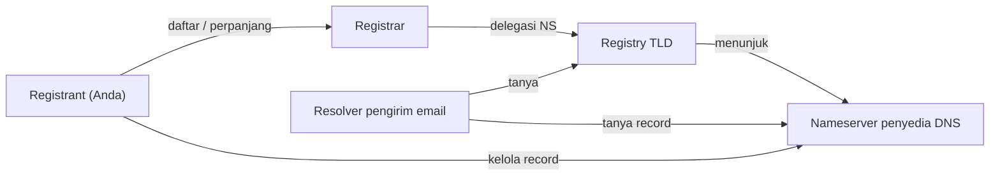

# Registrasi Domain dan Hosting DNS

!!! info "Identitas chapter"
    **ID:** `CH-05-01-01` · **Kategori/modul:** CAT-05 / MOD-05-01 (Fondasi DNS untuk Email) · **Estimasi:** 60 menit · **Lingkungan:** lab + domain yang Anda kendalikan · [Lihat chapter ini di dashboard](../../../#CH-05-01-01)

!!! warning "Batas lab dan domain nyata"
    Mulai level ini Anda memakai **domain milik sendiri**. Perubahan DNS pada domain nyata berdampak ke luar lab. Chapter ini konseptual dan tidak mengharuskan membeli domain; `example.com` hanya contoh dokumentasi.

## 1. Ringkasan

Email membutuhkan domain yang Anda kendalikan dan layanan DNS yang andal. Chapter ini membahas memilih registrar dan penyedia DNS, mengamankan akunnya, dan syarat domain sebelum dipakai untuk email.

## 2. Tujuan Pembelajaran

1. Membedakan registrar, registry, dan penyedia DNS (hosting nameserver).
2. Memilih registrar/DNS dengan kriteria keamanan dan kontrol.
3. Menerapkan pengamanan akun: MFA, kunci transfer, kontak.
4. Menjelaskan syarat domain terkendali untuk produksi.

## 3. Prasyarat

- `CH-04-03-03` — server baseline.
- Alamat email kontak yang tidak bergantung pada domain yang sedang didaftarkan.

## 4. Materi Teori

### 4.1 Pihak yang terlibat

| Pihak | Peran |
|---|---|
| Registry | Mengelola TLD (mis. `.com`, `.id`) |
| Registrar | Tempat Anda mendaftar/memperpanjang domain, menetapkan nameserver |
| Penyedia DNS | Menjalankan nameserver yang menjawab record zona Anda |
| Pemilik (registrant) | Anda; kontrol penuh seharusnya ada di tangan Anda |

Registrar dan penyedia DNS bisa satu perusahaan atau terpisah. Pada domain `.id`, ketentuan registrasi ditetapkan oleh pengelola `.id`; periksa registrar terakreditasi resminya.



### 4.2 Kriteria memilih

| Kriteria | Alasan |
|---|---|
| Dukungan record yang dibutuhkan (A, AAAA, MX, TXT, PTR melalui penyedia IP) | Email butuh TXT panjang dan MX |
| Dukungan MFA dan kunci registrar | Pembajakan akun = pembajakan email domain |
| Kontrol TTL | Mempermudah perubahan terkontrol |
| API/ekspor zona | Backup dan audit |
| Dukungan DNSSEC (opsional) | `CH-05-02-02` |

### 4.3 Pengamanan akun

Aktifkan MFA, gunakan kata sandi unik di pengelola kata sandi, aktifkan *registrar lock*, catat tanggal kedaluwarsa dan aktifkan perpanjangan, serta batasi siapa yang memiliki akses. Domain yang kedaluwarsa dapat dibeli pihak lain dan dipakai untuk menerima email Anda.

## 5. Praktik dan Implementasi

**Langkah**

1. Tentukan nama domain dan nama host server (mis. `mail`).
2. Bandingkan dua penyedia dengan tabel kriteria 4.2 (tanpa mengunggah data pribadi).
3. Jika Anda mendaftar domain, aktifkan MFA dan registrar lock lebih dulu.
4. Catat nameserver, tanggal kedaluwarsa, dan siapa pengelola (tanpa kredensial).
5. Tulis rencana record untuk chapter berikutnya.

## 6. Perintah Linux

Jika domain sudah ada, periksa delegasinya (baca-saja):

```bash title="Melihat nameserver domain"
dig +short NS example.com
whois example.com | head -20
```

- `whois` mungkin belum terpasang (`sudo apt install whois`). Kolom dan format hasil berbeda antar registry; privasi kontak sering disamarkan.
- Hasil `dig NS` harus sama dengan yang tercatat di registrar.

## 7. Konfigurasi

Tidak ada berkas konfigurasi lokal. Konfigurasi dilakukan di panel registrar/DNS (berbeda antar penyedia).

## 8. Verifikasi

- `dig +short NS domain-anda` menunjukkan nameserver yang Anda harapkan.
- MFA dan lock aktif; tanggal kedaluwarsa tercatat.

## 9. Troubleshooting

| Gejala | Kemungkinan penyebab | Tindakan |
|---|---|---|
| NS lama masih muncul | Delegasi belum berubah / cache | Tunggu TTL, periksa di registrar |
| Domain tidak resolve | Zona kosong / NS salah | Pastikan zona dibuat di penyedia |
| Tidak bisa transfer | Registrar lock aktif | Normal; buka kunci hanya saat transfer sah |

## 10. Security Review

- Pembajakan akun DNS memungkinkan penyerang mengalihkan MX dan menyadap email.
- Jangan membagikan kredensial registrar; gunakan akses terpisah bila ada tim.
- Jangan menyimpan token API di repositori.
- Pertimbangkan perpanjangan multi-tahun dan notifikasi kedaluwarsa.

## 11. Latihan

1. Susun tabel perbandingan dua penyedia DNS berdasarkan kriteria 4.2.
2. Gambar rantai delegasi untuk `mail.example.com`.
3. Tulis prosedur pemulihan jika akun registrar diretas.

## 12. Assessment

1. Apa perbedaan registrar dan penyedia DNS?
2. Mengapa MFA wajib pada akun DNS?
3. Apa risiko domain kedaluwarsa bagi email?

**Kunci singkat.** (1) Pendaftaran vs layanan nameserver. (2) Mencegah pembajakan record. (3) Domain dibeli orang lain dan menerima email Anda.

## 13. Checklist Kelulusan

- [ ] Saya dapat membedakan registrar, registry, dan penyedia DNS.
- [ ] Akun domain/DNS diamankan (MFA, lock) atau rencananya tertulis.
- [ ] Tidak ada kredensial di catatan.

!!! note "Status belajar"
    Ubah status chapter secara manual di dashboard. Menyelesaikan checklist ini tidak mengubah status otomatis.

## 14. Referensi Resmi

- [ICANN](https://www.icann.org/)
- [RFC 1034 — Konsep dan fasilitas nama domain](https://www.rfc-editor.org/rfc/rfc1034)
- [RFC 1035 — Implementasi dan spesifikasi](https://www.rfc-editor.org/rfc/rfc1035)
- [PANDI (pengelola .id)](https://pandi.id/)

Tautan referensi tidak diverifikasi otomatis pada build ini; periksa ketersediaannya sebelum dipakai.

---

[Kembali ke dashboard kurikulum](../../../#CH-05-01-01){ .md-button }
