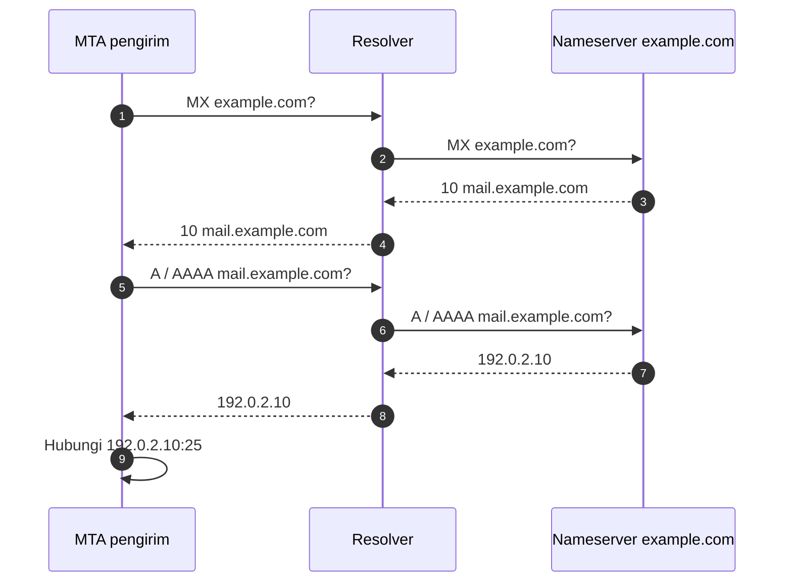

# Record A, AAAA, dan MX

!!! info "Identitas chapter"
    **ID:** `CH-05-01-02` · **Kategori/modul:** CAT-05 / MOD-05-01 (Fondasi DNS untuk Email) · **Estimasi:** 90 menit · **Lingkungan:** lab + domain yang Anda kendalikan · [Lihat chapter ini di dashboard](../../../#CH-05-01-02)

!!! warning "Status verifikasi"
    Belum dijalankan penulis terhadap domain nyata (`verified_on: null`). `example.com`, `192.0.2.10`, dan `2001:db8::10` adalah nilai dokumentasi; ganti dengan milik Anda. Jangan mengarahkan MX ke server yang belum siap menerima email.

## 1. Ringkasan

Anda membuat record yang membuat server dapat ditemukan: **A/AAAA** untuk nama host dan **MX** untuk tujuan email domain. Lalu memverifikasinya dengan `dig`.

## 2. Tujuan Pembelajaran

1. Membuat A/AAAA untuk `mail.example.com` dan MX untuk `example.com`.
2. Memverifikasi record dengan `dig` terhadap nameserver otoritatif dan resolver.
3. Menjelaskan prioritas MX dan aturan target.
4. Menghindari kesalahan MX umum.

## 3. Prasyarat

- `CH-05-01-01`; MX dan routing dari `CH-03-02-01`; IP server dari `CH-04-02-01`.
- Alamat IP publik server (atau rencana), atau gunakan domain lab/IP privat hanya untuk latihan zona internal.

## 4. Materi Teori

### 4.1 Rencana record

| Nama | Tipe | Nilai | Fungsi |
|---|---|---|---|
| `mail.example.com.` | A | `192.0.2.10` | IPv4 server |
| `mail.example.com.` | AAAA | `2001:db8::10` | IPv6 (hanya jika benar-benar dilayani) |
| `example.com.` | MX 10 | `mail.example.com.` | Tujuan email domain |

Rekomendasi: jangan menambahkan AAAA kecuali server benar-benar menerima dan mengirim lewat IPv6 dengan PTR dan firewall setara; AAAA yang salah menyebabkan kegagalan sporadis.

### 4.2 Alur resolusi pengiriman



### 4.3 Kesalahan yang sering terjadi

| Kesalahan | Akibat |
|---|---|
| MX menunjuk IP | Tidak valid |
| MX menunjuk CNAME | Perilaku tidak terjamin |
| Lupa titik akhir di panel yang mensyaratkan FQDN | Nama dianggap relatif: `mail.example.com.example.com` |
| MX tanpa A/AAAA | Pengirim tidak dapat menemukan alamat |
| AAAA salah | Kegagalan sebagian pengirim |

Sebagian panel DNS menambahkan sendiri titik akhir atau nama domain; baca petunjuk penyedia.

## 5. Praktik dan Implementasi

**Checklist persiapan**

- [ ] Akses ke panel DNS domain Anda.
- [ ] IP publik server (atau keputusan memakai zona latihan).
- [ ] TTL rendah (mis. 300 detik) dipilih sementara untuk memudahkan koreksi.

**Langkah**

1. Tambahkan A (dan AAAA bila relevan) untuk `mail`.
2. Tambahkan MX 10 yang menunjuk `mail.example.com.`.
3. Verifikasi dengan `dig` (bagian 6).
4. Catat TTL dan hasil dari dua resolver.
5. Naikkan TTL setelah stabil (lihat `CH-05-01-04`).

## 6. Perintah Linux

```bash title="Verifikasi record"
dig +short A mail.example.com
dig +short AAAA mail.example.com
dig +short MX example.com
```

```bash title="Bertanya langsung ke nameserver otoritatif"
dig +short NS example.com
dig @NS-OTORITATIF A mail.example.com +norecurse
```

- `NS-OTORITATIF` adalah placeholder dari hasil `dig NS`.
- `+norecurse` memastikan jawaban datang dari server itu sendiri, bukan dari cache.
- Bentuk hasil: A berupa alamat IP; MX berupa `10 mail.example.com.`.

## 7. Konfigurasi

Konfigurasi dilakukan di panel DNS (tidak ada berkas lokal). Bentuk zona dalam notasi BIND sebagai referensi bacaan:

```text title="Bentuk zona (ilustrasi)"
example.com.        3600 IN MX 10 mail.example.com.
mail.example.com.   3600 IN A     192.0.2.10
```

Jangan menyalin ini sebagai konfigurasi nyata; penyedia memiliki format sendiri.

## 8. Verifikasi

- A/AAAA dan MX muncul dari resolver dan nameserver otoritatif.
- Target MX memiliki A/AAAA dan bukan CNAME: `dig +short CNAME mail.example.com` kosong.

## 9. Troubleshooting

| Gejala | Kemungkinan penyebab | Tindakan |
|---|---|---|
| Record tidak muncul | Cache / propagasi | Tanya nameserver otoritatif |
| `mail.example.com.example.com` | Titik akhir hilang | Gunakan FQDN dengan titik atau nama relatif sesuai panel |
| Hasil berbeda antar resolver | TTL / cache | Tunggu dan bandingkan |
| MX ke CNAME | Konfigurasi | Ganti ke host dengan A/AAAA |

## 10. Security Review

- Jangan mempublikasikan MX sebelum server siap dan relay terkunci.
- Gunakan TTL rendah hanya sementara; TTL sangat rendah memperbanyak kueri.
- Catat perubahan DNS (siapa, kapan) untuk audit.
- Zona yang bisa diubah banyak orang adalah risiko pembajakan.

## 11. Latihan

1. Rancang rencana record untuk domain dengan dua MX (utama dan cadangan).
2. Perbaiki skenario: MX menunjuk ke CNAME.
3. Bandingkan hasil `dig` dari resolver lab dan nameserver otoritatif.

## 12. Assessment

1. Mengapa AAAA yang salah berbahaya?
2. Apa arti titik di akhir nama?
3. Bagaimana membuktikan jawaban berasal dari server otoritatif?

**Kunci singkat.** (1) Gagal sporadis pada pengirim IPv6. (2) Nama absolut. (3) `dig @otoritatif +norecurse`.

## 13. Checklist Kelulusan

- [ ] A/AAAA dan MX terverifikasi.
- [ ] MX tidak menunjuk IP atau CNAME.
- [ ] Rencana TTL dicatat.

!!! note "Status belajar"
    Ubah status chapter secara manual di dashboard. Menyelesaikan checklist ini tidak mengubah status otomatis.

## 14. Referensi Resmi

- [RFC 1035 — Domain Names](https://www.rfc-editor.org/rfc/rfc1035)
- [RFC 5321 — SMTP](https://www.rfc-editor.org/rfc/rfc5321)
- [RFC 2181 — Klarifikasi DNS](https://www.rfc-editor.org/rfc/rfc2181)
- [RFC 5737 — Blok alamat dokumentasi IPv4](https://www.rfc-editor.org/rfc/rfc5737)
- [RFC 3849 — Prefiks dokumentasi IPv6](https://www.rfc-editor.org/rfc/rfc3849)

Tautan referensi tidak diverifikasi otomatis pada build ini; periksa ketersediaannya sebelum dipakai.

---

[Kembali ke dashboard kurikulum](../../../#CH-05-01-02){ .md-button }
