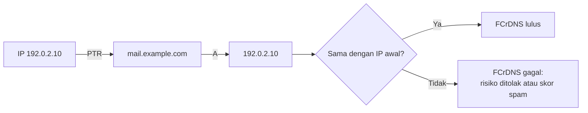

# PTR, Reverse DNS, dan FCrDNS

!!! info "Identitas chapter"
    **ID:** `CH-05-01-03` · **Kategori/modul:** CAT-05 / MOD-05-01 (Fondasi DNS untuk Email) · **Estimasi:** 90 menit · **Lingkungan:** lab + domain yang Anda kendalikan · [Lihat chapter ini di dashboard](../../../#CH-05-01-03)

!!! warning "Status verifikasi"
    Belum dijalankan penulis (`verified_on: null`). IP `192.0.2.10` adalah alamat dokumentasi.

## 1. Ringkasan

Reverse DNS memetakan **IP ke nama**. Banyak server penerima menilai pengirim dari kecocokan PTR dengan A (*forward-confirmed reverse DNS*, FCrDNS). PTR tidak berada di panel domain Anda, melainkan di **pemilik blok IP** (penyedia VPS/ISP), sehingga prosesnya berbeda.

## 2. Tujuan Pembelajaran

1. Menjelaskan reverse DNS, zona `in-addr.arpa`, dan FCrDNS.
2. Memverifikasi PTR dengan `dig -x` dan `host`.
3. Memeriksa kesesuaian PTR dengan A dan nama EHLO.
4. Mengetahui siapa yang harus dihubungi untuk mengubah PTR.

## 3. Prasyarat

- `CH-05-01-02` — A/AAAA sudah dibuat.
- Mengetahui IP publik server dan penyedianya.

## 4. Materi Teori

### 4.1 Reverse DNS

Untuk IPv4 `192.0.2.10`, PTR berada pada nama `10.2.0.192.in-addr.arpa.` (oktet dibalik). Delegasi zona reverse diberikan kepada pemilik blok IP, bukan pemilik domain. Karena itu PTR diatur lewat panel/tiket penyedia IP.

### 4.2 FCrDNS

FCrDNS lulus bila: IP → PTR → nama, lalu nama → A → IP yang sama.



Idealnya nama PTR sama dengan nama yang dipakai pada `EHLO`, `myhostname`, dan sertifikat TLS (`CH-04-02-02`).

### 4.3 Dampak

Banyak penyedia email besar menolak atau menurunkan reputasi pengirim tanpa PTR yang cocok. Aturan persis berbeda antar penerima dan berubah; anggap FCrDNS sebagai syarat praktis, bukan jaminan lolos.

## 5. Praktik dan Implementasi

**Langkah**

1. Tentukan IP publik server dan siapa yang mengelola blok IP-nya.
2. Cari cara menetapkan PTR di panel/tiket penyedia.
3. Ajukan PTR ke `mail.example.com` (nama yang sama dengan A).
4. Verifikasi dengan `dig -x` dan `host`.
5. Jalankan uji FCrDNS dua arah.

Pada lab dengan IP privat, PTR publik tidak dapat diuji; baca bagian teori dan latih dengan zona reverse internal bila dosen menyediakan.

## 6. Perintah Linux

```bash title="Verifikasi PTR"
dig +short -x 192.0.2.10
host 192.0.2.10
```

```bash title="Uji FCrDNS (dua arah)"
NAMA=$(dig +short -x 192.0.2.10 | head -1)
echo "PTR: $NAMA"
dig +short A "$NAMA"
```

- Hasil yang diharapkan: `PTR: mail.example.com.` lalu `192.0.2.10`.
- Jika PTR kosong atau berbeda, FCrDNS gagal.
- Ganti `192.0.2.10` dengan IP Anda.

## 7. Konfigurasi

Tidak ada konfigurasi lokal; PTR diatur di penyedia IP. Beberapa penyedia hanya mengizinkan nama yang sudah memiliki A yang menunjuk ke IP tersebut.

## 8. Verifikasi

- `dig -x IP` mengembalikan FQDN server.
- `dig A FQDN` mengembalikan IP yang sama.
- FQDN sama dengan `hostname -f` dan rencana EHLO.

## 9. Troubleshooting

| Gejala | Kemungkinan penyebab | Tindakan |
|---|---|---|
| PTR kosong | Belum diatur | Ajukan ke penyedia IP |
| PTR berisi nama generik penyedia | Default penyedia | Ubah ke FQDN Anda |
| PTR benar tapi A tidak cocok | A salah / belum terpropagasi | Perbaiki A (`CH-05-01-02`) |
| Banyak PTR untuk satu IP | Konfigurasi ganda | Gunakan satu PTR yang jelas |

## 10. Security Review

- IP dinamis/residensial sering diblokir untuk pengiriman; PTR generik menandakan IP semacam itu.
- Jangan memakai nama PTR yang bukan milik Anda.
- Dokumentasikan IP dan PTR; perubahan IP memerlukan pembaruan PTR dan DNS.

## 11. Latihan

1. Tulis nama zona reverse untuk `198.51.100.25`.
2. Rancang tabel konsistensi: IP, PTR, A, EHLO, sertifikat.
3. Jelaskan mengapa pemilik domain tidak bisa mengubah PTR sendiri.

## 12. Assessment

1. Apa itu FCrDNS?
2. Siapa yang mengendalikan PTR?
3. Mengapa PTR sebaiknya sama dengan nama EHLO?

**Kunci singkat.** (1) PTR dan A saling cocok. (2) Pemilik blok IP. (3) Konsistensi identitas.

## 13. Checklist Kelulusan

- [ ] Saya dapat memeriksa PTR dan FCrDNS.
- [ ] Saya tahu cara dan pihak yang mengubah PTR.
- [ ] Tabel konsistensi nama selesai.

!!! note "Status belajar"
    Ubah status chapter secara manual di dashboard. Menyelesaikan checklist ini tidak mengubah status otomatis.

## 14. Referensi Resmi

- [RFC 1035 — Domain Names](https://www.rfc-editor.org/rfc/rfc1035)
- [RFC 5321 — SMTP, bagian identitas EHLO](https://www.rfc-editor.org/rfc/rfc5321)
- [RFC 1912 — Kesalahan umum konfigurasi DNS](https://www.rfc-editor.org/rfc/rfc1912)
- [dig(1)](https://manpages.ubuntu.com/manpages/noble/man1/dig.1.html)

Tautan referensi tidak diverifikasi otomatis pada build ini; periksa ketersediaannya sebelum dipakai.

---

[Kembali ke dashboard kurikulum](../../../#CH-05-01-03){ .md-button }
