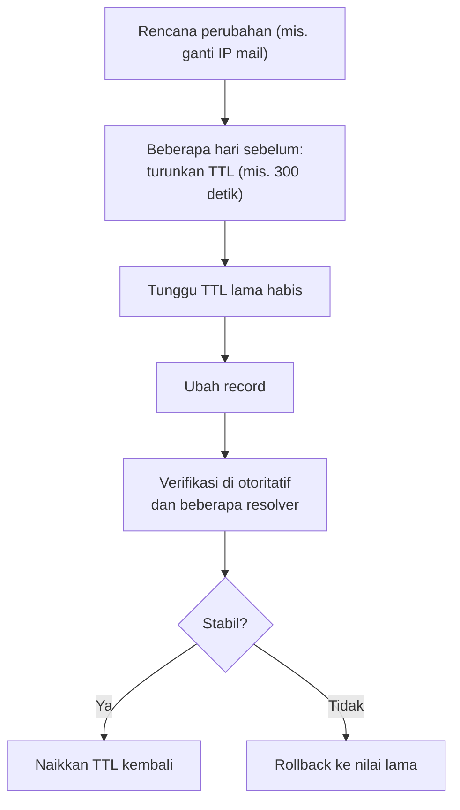

# TTL, Propagasi, dan Cache DNS

!!! info "Identitas chapter"
    **ID:** `CH-05-01-04` · **Kategori/modul:** CAT-05 / MOD-05-01 (Fondasi DNS untuk Email) · **Estimasi:** 60 menit · **Lingkungan:** lab + domain yang Anda kendalikan · [Lihat chapter ini di dashboard](../../../#CH-05-01-04)

!!! warning "Status verifikasi"
    Belum dijalankan penulis (`verified_on: null`). Perintah hanya membaca DNS.

## 1. Ringkasan

DNS tidak "menyebar" seperti siaran; yang terjadi adalah **cache** pada resolver yang kedaluwarsa menurut TTL. Memahami TTL membantu merencanakan perubahan MX/IP tanpa kehilangan email, dan memeriksa konsistensi antar resolver.

## 2. Tujuan Pembelajaran

1. Menjelaskan TTL, cache positif dan negatif, dan istilah "propagasi".
2. Merencanakan perubahan DNS (menurunkan TTL sebelum migrasi).
3. Memverifikasi record pada beberapa resolver dan nameserver otoritatif.
4. Menelusuri delegasi dengan `dig +trace`.

## 3. Prasyarat

- `CH-05-01-02` dan `CH-05-01-03`.

## 4. Materi Teori

### 4.1 TTL dan cache

TTL (detik) menyatakan berapa lama resolver boleh menyimpan jawaban. Perubahan record baru terlihat oleh resolver setelah cache lama kedaluwarsa. Karena resolver berbeda mengambil jawaban pada waktu berbeda, hasil bisa tidak seragam sementara. Ada juga **cache negatif** (jawaban "tidak ada" yang disimpan sesuai SOA), sehingga record baru bisa belum terlihat bila sebelumnya dicari saat belum ada.

### 4.2 Strategi perubahan



Selama transisi, jalankan server lama dan baru agar email yang masih menuju IP lama tidak hilang. Pengirim yang masih menyimpan IP lama akan terus mengirim sampai cache habis.

### 4.3 Kontrol dan batas

- TTL tinggi: lebih sedikit kueri, perubahan lambat terlihat.
- TTL rendah: perubahan cepat, kueri lebih banyak.
- Sebagian resolver menerapkan batas minimum/maksimum TTL sendiri.

## 5. Praktik dan Implementasi

**Langkah**

1. Cek TTL record yang Anda buat (`dig`).
2. Bandingkan jawaban dari nameserver otoritatif dan dua resolver.
3. Tulis rencana perubahan IP fiktif lengkap dengan jadwal TTL.
4. Telusuri delegasi dengan `dig +trace`.

## 6. Perintah Linux

```bash title="Membaca TTL"
dig mail.example.com A +noall +answer
```

Kolom kedua pada baris jawaban adalah TTL tersisa pada cache resolver (turun saat Anda mengulangi), sedangkan pada nameserver otoritatif nilainya TTL penuh.

```bash title="Membandingkan resolver"
dig @RESOLVER-1 +short MX example.com
dig @RESOLVER-2 +short MX example.com
dig @NS-OTORITATIF +short MX example.com +norecurse
```

`RESOLVER-1/2` dan `NS-OTORITATIF` adalah placeholder. Gunakan resolver yang diizinkan kebijakan lab Anda.

```bash title="Menelusuri delegasi"
dig +trace MX example.com
```

Keluaran menampilkan akar → TLD → nameserver otoritatif, lengkap dengan jawaban akhir.

## 7. Konfigurasi

Tidak ada konfigurasi lokal. Mengosongkan cache resolver lokal Ubuntu:

```bash title="Mengosongkan cache systemd-resolved"
sudo resolvectl flush-caches
resolvectl statistics
```

Ini hanya berdampak pada cache VM Anda, bukan resolver pihak lain.

## 8. Verifikasi

- Jawaban otoritatif dan resolver konsisten setelah TTL habis.
- Rencana perubahan memuat nilai TTL, jadwal, dan rollback.

## 9. Troubleshooting

| Gejala | Kemungkinan penyebab | Tindakan |
|---|---|---|
| Nilai lama masih muncul | Cache belum kedaluwarsa | Bandingkan TTL sisa; tunggu |
| NXDOMAIN walau record sudah dibuat | Cache negatif | Tunggu SOA minimum / flush lokal |
| Hasil berbeda antar lokasi | Resolver berbeda | Bandingkan dengan otoritatif |
| `+trace` berhenti | Delegasi rusak | Periksa NS di registrar |

## 10. Security Review

- Jangan mengandalkan "propagasi cepat" untuk keamanan; jalankan layanan lama sampai transisi selesai.
- Perubahan DNS tak sah terlihat sebagai perubahan TTL/nilai mendadak; pantau.
- TTL sangat tinggi mempersulit pemulihan setelah pembajakan.

## 11. Latihan

1. Hitung berapa lama perubahan IP terlihat bila TTL 86400 dan Anda tidak menurunkannya.
2. Buat jadwal migrasi MX dengan TTL.
3. Jelaskan mengapa `+norecurse` ke otoritatif lebih tepat untuk memeriksa sumber kebenaran.

## 12. Assessment

1. Apa itu cache negatif?
2. Mengapa menurunkan TTL sebelum migrasi?
3. Mengapa istilah "propagasi" kurang tepat?

**Kunci singkat.** (1) Jawaban "tidak ada" ikut di-cache. (2) Agar cache lama cepat habis. (3) Yang terjadi kedaluwarsa cache, bukan penyebaran.

## 13. Checklist Kelulusan

- [ ] Saya dapat membaca TTL dan membandingkan resolver.
- [ ] Rencana perubahan DNS tertulis.
- [ ] Saya dapat memakai `dig +trace`.

!!! note "Status belajar"
    Ubah status chapter secara manual di dashboard. Menyelesaikan checklist ini tidak mengubah status otomatis.

## 14. Referensi Resmi

- [RFC 1035 — Domain Names](https://www.rfc-editor.org/rfc/rfc1035)
- [RFC 2308 — Negative Caching of DNS Queries](https://www.rfc-editor.org/rfc/rfc2308)
- [RFC 8767 — Serving Stale Data](https://www.rfc-editor.org/rfc/rfc8767)
- [resolvectl(1)](https://www.freedesktop.org/software/systemd/man/latest/resolvectl.html)

Tautan referensi tidak diverifikasi otomatis pada build ini; periksa ketersediaannya sebelum dipakai.

---

[Kembali ke dashboard kurikulum](../../../#CH-05-01-04){ .md-button }
