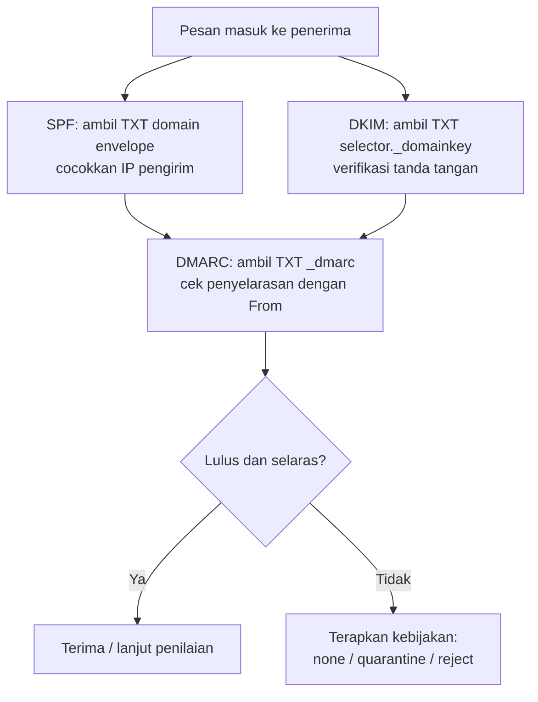

# Record Autentikasi: SPF, DKIM, DMARC (Publikasi DNS)

!!! info "Identitas chapter"
    **ID:** `CH-05-02-01` · **Kategori/modul:** CAT-05 / MOD-05-02 (DNS Autentikasi dan Troubleshooting) · **Estimasi:** 90 menit · **Lingkungan:** lab + domain yang Anda kendalikan · [Lihat chapter ini di dashboard](../../../#CH-05-02-01)

!!! warning "Cakupan chapter"
    Chapter ini hanya membahas **di mana dan bagaimana record autentikasi dipublikasikan di DNS**. Penyusunan kebijakan, pembuatan kunci DKIM, penandatanganan, dan penerapan DMARC dibahas di CAT-08. Jangan mempublikasikan kebijakan ketat sebelum server dan semua sumber pengirim siap. `verified_on: null`.

## 1. Ringkasan

SPF, DKIM, dan DMARC semuanya hidup sebagai record **TXT** di DNS, tetapi berbeda dengan MX/A/PTR yang mengatur *routing*. Chapter ini membedakan keduanya dan memperlihatkan posisi serta bentuk setiap record.

## 2. Tujuan Pembelajaran

1. Membedakan record routing (A, AAAA, MX, PTR) dari record autentikasi (TXT).
2. Menunjukkan nama dan bentuk record SPF, DKIM, DMARC.
3. Membaca record tersebut dengan `dig TXT`.
4. Menjelaskan hubungan record dengan penerima yang memverifikasi.

## 3. Prasyarat

- `CH-05-01-04`; arsitektur email `CH-03-01-01`.

## 4. Materi Teori

### 4.1 Posisi di DNS

| Mekanisme | Nama record | Bentuk (ilustrasi) | Memeriksa |
|---|---|---|---|
| SPF | `example.com` (TXT) | `v=spf1 mx -all` | Apakah IP pengirim diizinkan untuk domain envelope |
| DKIM | `SELECTOR._domainkey.example.com` (TXT) | `v=DKIM1; k=rsa; p=KUNCI-PUBLIK` | Tanda tangan kriptografis pada pesan |
| DMARC | `_dmarc.example.com` (TXT) | `v=DMARC1; p=none; rua=mailto:...` | Penyelarasan identitas dan kebijakan tindakan |

`SELECTOR` adalah nama bebas yang Anda pilih (mis. tanggal) agar kunci dapat dirotasi. Nilai pada tabel adalah **bentuk**, bukan konfigurasi yang boleh disalin.

### 4.2 Alur verifikasi di sisi penerima



### 4.3 Batasan DNS

- Satu string TXT dibatasi 255 karakter; nilai panjang (kunci DKIM) dipecah menjadi beberapa string yang digabung penerima. Banyak panel DNS menanganinya otomatis.
- SPF dibatasi 10 pencarian DNS; melebihinya membuat hasil `permerror`.
- Hanya **satu** record SPF per nama; dua record SPF membuatnya tidak valid.
- DNS publik terbuka: jangan menaruh informasi sensitif di TXT.

## 5. Praktik dan Implementasi

**Langkah**

1. Gambar tabel tiga record untuk domain Anda dengan nama yang akan dipakai (belum dipublikasikan).
2. Periksa apakah domain Anda sudah memiliki TXT SPF/DMARC dengan `dig`.
3. Tentukan sumber pengirim yang sah (server sendiri, layanan lain).
4. Tulis rencana publikasi bertahap: DMARC `p=none` dulu untuk memantau, bukan langsung `reject`.

## 6. Perintah Linux

```bash title="Membaca record autentikasi (baca-saja)"
dig +short TXT example.com
dig +short TXT _dmarc.example.com
dig +short TXT SELECTOR._domainkey.example.com
```

- Ganti `SELECTOR` dengan selector sebenarnya.
- Hasil yang diharapkan: bila belum dibuat, kosong. Jika ada, string dalam tanda kutip.
- Banyak domain memiliki TXT lain (verifikasi layanan); pilih yang diawali `v=spf1`.

## 7. Konfigurasi

Tidak ada konfigurasi lokal. Record dipublikasikan di panel DNS; langkah rinci penyusunan nilai ada di CAT-08. Rencana awal yang aman untuk pemantauan (ilustrasi, bukan perintah):

```text title="Rencana awal (ilustrasi)"
_dmarc.example.com  TXT  "v=DMARC1; p=none; rua=mailto:dmarc@example.com"
```

`p=none` hanya memantau tanpa menolak. Pastikan alamat `rua` benar-benar dapat menerima dan Anda siap membaca laporan.

## 8. Verifikasi

- Anda dapat menunjuk nama DNS tepat untuk SPF, DKIM, dan DMARC.
- Anda dapat menjelaskan fungsi masing-masing tanpa membuka materi.

## 9. Troubleshooting

| Gejala | Kemungkinan penyebab | Tindakan |
|---|---|---|
| Dua record SPF | Penambahan tanpa menggabung | Gabung menjadi satu |
| DKIM tak ditemukan | Selector/nama salah | Periksa `selector._domainkey` |
| TXT terpotong | Batas 255 karakter | Pecah string sesuai panel |
| `permerror` SPF | Terlalu banyak lookup | Sederhanakan SPF |

## 10. Security Review

- Kebijakan `reject` yang terlalu dini dapat membuang email sah.
- SPF terlalu longgar (`+all`, `?all`) tidak melindungi domain.
- Rotasi DKIM berkala memakai selector baru.
- Kepemilikan DNS = kepemilikan identitas email: lindungi akun (`CH-05-01-01`).

## 11. Latihan

1. Tuliskan nama DNS lengkap untuk selector `s2026` pada domain Anda.
2. Jelaskan perbedaan SPF dan DKIM dalam satu paragraf.
3. Susun rencana tiga tahap penerapan DMARC.

## 12. Assessment

1. Mengapa hanya satu record SPF per nama?
2. Di mana kunci publik DKIM disimpan?
3. Apa arti `p=none`?

**Kunci singkat.** (1) Dua record ambigu → tidak valid. (2) TXT pada `selector._domainkey`. (3) Hanya memantau.

## 13. Checklist Kelulusan

- [ ] Saya dapat membedakan record routing dan autentikasi.
- [ ] Saya tahu nama DNS SPF, DKIM, DMARC.
- [ ] Rencana publikasi bertahap tertulis.

!!! note "Status belajar"
    Ubah status chapter secara manual di dashboard. Menyelesaikan checklist ini tidak mengubah status otomatis.

## 14. Referensi Resmi

- [RFC 7208 — SPF](https://www.rfc-editor.org/rfc/rfc7208)
- [RFC 6376 — DKIM](https://www.rfc-editor.org/rfc/rfc6376)
- [RFC 7489 — DMARC](https://www.rfc-editor.org/rfc/rfc7489)
- [RFC 8301 — Algoritma DKIM](https://www.rfc-editor.org/rfc/rfc8301)

Tautan referensi tidak diverifikasi otomatis pada build ini; periksa ketersediaannya sebelum dipakai.

---

[Kembali ke dashboard kurikulum](../../../#CH-05-02-01){ .md-button }
