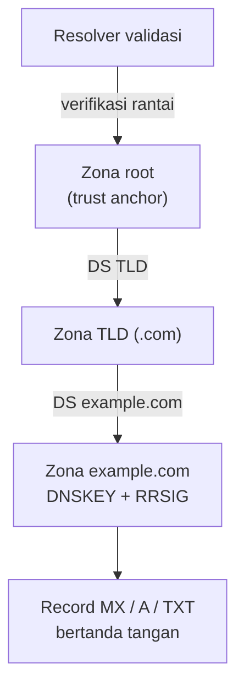

# DNSSEC dan Split-Horizon DNS

!!! info "Identitas chapter"
    **ID:** `CH-05-02-02` · **Kategori/modul:** CAT-05 / MOD-05-02 (DNS Autentikasi dan Troubleshooting) · **Estimasi:** 90 menit · **Lingkungan:** lab + domain yang Anda kendalikan · [Lihat chapter ini di dashboard](../../../#CH-05-02-02)

!!! warning "Status verifikasi"
    Konseptual dan baca-saja (`verified_on: null`). Mengaktifkan DNSSEC pada zona nyata salah langkah dapat membuat domain **tidak dapat di-resolve** oleh resolver yang memvalidasi. Chapter ini tidak meminta Anda mengaktifkannya.

## 1. Ringkasan

DNSSEC menambahkan tanda tangan digital pada jawaban DNS agar dapat diverifikasi keasliannya. Split-horizon memberikan jawaban DNS berbeda untuk klien internal dan eksternal. Keduanya relevan bagi email, tetapi membawa risiko operasional yang perlu dipahami sebelum dipakai.

## 2. Tujuan Pembelajaran

1. Menjelaskan apa yang dilindungi (dan tidak) oleh DNSSEC.
2. Mengenali rantai kepercayaan: DNSKEY, RRSIG, DS.
3. Mengecek apakah domain bertanda tangan dengan `dig +dnssec` dan `delv`.
4. Menjelaskan skenario dan risiko split-horizon.

## 3. Prasyarat

- `CH-05-02-01`; `dig +trace` dari `CH-05-01-04`.

## 4. Materi Teori

### 4.1 DNSSEC

DNSSEC menjamin **keaslian dan integritas** data DNS (bukan kerahasiaan). Resolver yang memvalidasi memeriksa tanda tangan (RRSIG) memakai kunci (DNSKEY), dan kunci diikat ke zona induk melalui record DS.



Hasil validasi: *secure* (rantai valid), *insecure* (zona tidak bertanda tangan), atau *bogus* (tanda tangan rusak → resolver validasi mengembalikan SERVFAIL).

### 4.2 Hubungan dengan email

DNSSEC mencegah pemalsuan jawaban MX/TXT. Ia juga prasyarat bagi **DANE** (TLSA) untuk TLS SMTP, topik lanjutan (CAT-15, opsional). Banyak penyedia DNS menawarkan DNSSEC; penyedia email besar tidak mewajibkannya.

### 4.3 Risiko operasional

- Salah mengelola kunci atau DS (mis. DS tertinggal setelah pindah penyedia) membuat domain bogus → email dan situs gagal di resolver yang memvalidasi.
- Rotasi kunci memerlukan prosedur yang cermat.
- Gunakan DNSSEC hanya jika penyedia mengelolanya otomatis dan Anda memahami prosedur pindah penyedia.

### 4.4 Split-horizon

Split-horizon menjawab berbeda berdasarkan asal klien. Contoh: klien internal menerima IP privat untuk `mail.example.com`, klien eksternal menerima IP publik.

| Keuntungan | Risiko |
|---|---|
| Klien LAN langsung ke IP internal | Dua sumber kebenaran; mudah tak sinkron |
| Menyembunyikan topologi | Sulit didiagnosis ("di rumah bisa, dari luar tidak") |
| — | Sertifikat/nama harus tetap cocok pada kedua sisi |

Untuk mail server tunggal, usahakan satu pandangan DNS; gunakan split-horizon hanya jika benar-benar perlu dan dokumentasikan perbedaannya.

## 5. Praktik dan Implementasi

**Langkah**

1. Periksa apakah domain publik yang Anda kenal bertanda tangan (bagian 6).
2. Bandingkan hasil `dig +dnssec` dengan `delv`.
3. Tulis ringkasan: apa yang dilindungi, apa yang tidak.
4. Tentukan apakah lab/domain Anda membutuhkan split-horizon; jika tidak, tulis alasannya.

## 6. Perintah Linux

```bash title="Memeriksa DNSSEC (baca-saja)"
dig +dnssec +multi MX example.com
dig +short DS example.com
dig +short DNSKEY example.com
delv MX example.com
```

- `delv` tersedia di paket `bind9-dnsutils`; ia memvalidasi sendiri dan melaporkan "fully validated" bila berhasil.
- Pada `dig`, flag `ad` (authenticated data) menandakan resolver telah memvalidasi.
- Domain contoh dapat tidak bertanda tangan; hasil bergantung pada domain dan waktu.

## 7. Konfigurasi

Tidak ada. Pengaktifan DNSSEC dilakukan di penyedia DNS dan registrar (menambah DS) — **di luar cakupan latihan ini**.

## 8. Verifikasi

- Anda dapat menyimpulkan status (secure/insecure/bogus) dari hasil `dig`/`delv`.
- Anda dapat menjelaskan risiko pindah penyedia dengan DNSSEC aktif.

## 9. Troubleshooting

| Gejala | Kemungkinan penyebab | Tindakan |
|---|---|---|
| `SERVFAIL` hanya di resolver tertentu | DNSSEC bogus | Bandingkan `dig +cd` (checking disabled) |
| `delv` galat | Resolver/trust anchor | Periksa versi dan jaringan |
| Beda jawaban internal/eksternal | Split-horizon | Dokumentasikan; periksa dari kedua sisi |

## 10. Security Review

- DNSSEC tidak mengenkripsi; ia tidak menggantikan TLS.
- Menonaktifkan validasi hanya untuk diagnosis, jangan permanen.
- Split-horizon yang salah dapat membocorkan alamat internal atau mengarahkan klien keliru.

## 11. Latihan

1. Jelaskan perbedaan *insecure* dan *bogus*.
2. Gambarkan rantai DS/DNSKEY untuk domain Anda.
3. Tulis skenario ketika split-horizon menguntungkan dan alternatifnya.

## 12. Assessment

1. Apa yang dijamin DNSSEC?
2. Apa fungsi record DS?
3. Mengapa DS yang usang berbahaya?

**Kunci singkat.** (1) Keaslian dan integritas jawaban. (2) Mengikat kunci zona ke zona induk. (3) Validasi gagal → domain tidak terselesaikan.

## 13. Checklist Kelulusan

- [ ] Saya dapat menjelaskan DNSSEC dan risikonya.
- [ ] Saya dapat memeriksa status DNSSEC suatu domain.
- [ ] Saya dapat menjelaskan split-horizon dan trade-off-nya.

!!! note "Status belajar"
    Ubah status chapter secara manual di dashboard. Menyelesaikan checklist ini tidak mengubah status otomatis.

## 14. Referensi Resmi

- [RFC 4033 — DNSSEC: pengantar dan persyaratan](https://www.rfc-editor.org/rfc/rfc4033)
- [RFC 4034 — Record DNSSEC](https://www.rfc-editor.org/rfc/rfc4034)
- [RFC 4035 — Perubahan protokol DNSSEC](https://www.rfc-editor.org/rfc/rfc4035)
- [RFC 7672 — DANE untuk SMTP](https://www.rfc-editor.org/rfc/rfc7672)

Tautan referensi tidak diverifikasi otomatis pada build ini; periksa ketersediaannya sebelum dipakai.

---

[Kembali ke dashboard kurikulum](../../../#CH-05-02-02){ .md-button }
