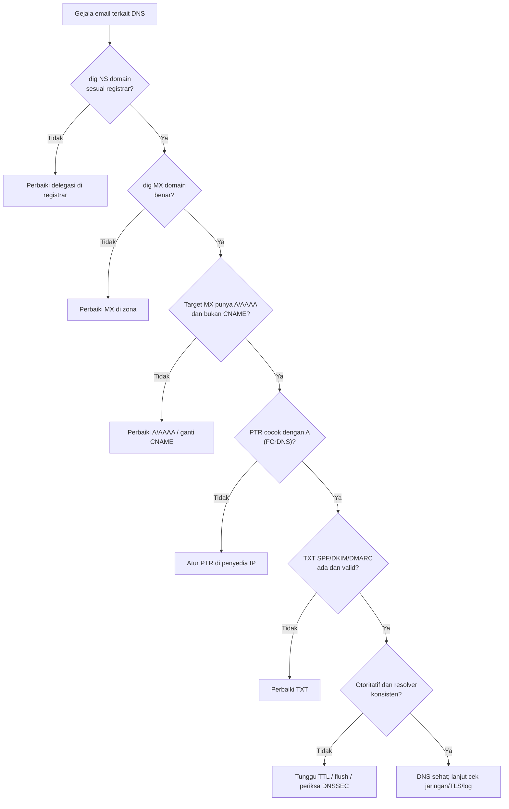

# Kesalahan Umum dan Troubleshooting DNS

!!! info "Identitas chapter"
    **ID:** `CH-05-02-03` · **Kategori/modul:** CAT-05 / MOD-05-02 (DNS Autentikasi dan Troubleshooting) · **Estimasi:** 90 menit · **Lingkungan:** lab + domain yang Anda kendalikan · [Lihat chapter ini di dashboard](../../../#CH-05-02-03)

!!! warning "Status verifikasi"
    Perintah baca-saja; belum dijalankan penulis (`verified_on: null`).

## 1. Ringkasan

Chapter penutup Level 4 ini merangkum **kesalahan DNS paling sering** yang mengganggu email dan menyusun **checklist verifikasi** yang dapat diulang. Hasilnya adalah prosedur diagnosis dan catatan troubleshooting DNS sebagai deliverable level.

## 2. Tujuan Pembelajaran

1. Mendiagnosis kesalahan MX, A/AAAA, PTR, dan TXT secara berurutan.
2. Memakai `dig`, `host`, dan `resolvectl` secara tepat.
3. Menyusun checklist verifikasi DNS siap pakai.
4. Menentukan apakah masalah ada di zona, delegasi, cache, atau resolver lokal.

## 3. Prasyarat

- Seluruh `MOD-05-01` dan `CH-05-02-01` serta `CH-05-02-02`.

## 4. Materi Teori

### 4.1 Katalog kesalahan

| Gejala | Penyebab umum | Cara memeriksa |
|---|---|---|
| Email tidak masuk sama sekali | Tidak ada MX / MX salah | `dig MX domain` |
| MX tidak ditemukan hostnya | Target tanpa A/AAAA | `dig A target` |
| Banyak penolakan "reverse DNS" | PTR tidak ada/tidak cocok | `dig -x IP`, `dig A nama` |
| SPF `permerror` | Dua record SPF / >10 lookup | `dig TXT domain` |
| DKIM fail | Selector/kunci salah | `dig TXT selector._domainkey.domain` |
| Record baru tak terlihat | Cache / TTL / cache negatif | Bandingkan otoritatif vs resolver |
| `SERVFAIL` | DNSSEC bogus / NS tak menjawab | `dig +trace`, `dig +cd` |
| Hanya IPv6 gagal | AAAA salah | `dig AAAA`, hapus bila belum siap |

### 4.2 Alur diagnosis



### 4.3 Prinsip

Selalu mulai dari **sumber kebenaran** (nameserver otoritatif), baru resolver. Ubah satu hal pada satu waktu dan catat. Jangan mengambil kesimpulan dari satu resolver.

## 5. Praktik dan Implementasi

**Langkah**

1. Jalankan skrip pemeriksaan pada bagian 7 terhadap domain Anda.
2. Salin hasil ke catatan (tanpa data sensitif).
3. Untuk setiap temuan, tulis penyebab dan tindakan.
4. Buat checklist final berformat tabel sebagai deliverable.

## 6. Perintah Linux

```bash title="Pemeriksaan manual cepat"
DOMAIN=example.com
dig +short NS "$DOMAIN"
dig +short MX "$DOMAIN"
dig +short TXT "$DOMAIN"
dig +short TXT "_dmarc.$DOMAIN"
resolvectl query "$DOMAIN"
```

- `resolvectl query` menunjukkan jawaban melalui resolver lokal dan protokol yang dipakai.
- Ganti `DOMAIN` dengan domain Anda.

## 7. Konfigurasi

Skrip baca-saja untuk memeriksa MX dan FCrDNS (contoh minimal):

```bash title="cek-dns.sh"
#!/usr/bin/env bash
set -u
domain="${1:?pemakaian: $0 domain}"
mx_hosts=$(dig +short MX "$domain" | awk '{print $2}')
[ -n "$mx_hosts" ] || { echo "FAIL tidak ada MX untuk $domain"; exit 1; }
rc=0
for h in $mx_hosts; do
  ips=$(dig +short A "$h")
  [ -n "$ips" ] || { echo "FAIL $h tidak punya A"; rc=1; continue; }
  for ip in $ips; do
    ptr=$(dig +short -x "$ip" | head -1)
    if [ "${ptr%.}" = "${h%.}" ]; then
      echo "OK   $h $ip PTR cocok"
    else
      echo "WARN $h $ip PTR='${ptr:-kosong}'"
    fi
  done
done
exit "$rc"
```

Skrip tidak mengubah apa pun. PTR yang berbeda dari nama MX tidak selalu salah (penyedia hosting bersama), sehingga ditandai `WARN`.

## 8. Verifikasi

- Skrip berjalan (`bash -n cek-dns.sh` lalu jalankan dengan domain Anda).
- Checklist verifikasi DNS final lengkap dan diuji pada domain Anda.

## 9. Troubleshooting

| Gejala | Kemungkinan penyebab | Tindakan |
|---|---|---|
| Skrip memberi `FAIL tidak ada MX` | Domain tanpa MX / salah ketik | Periksa ejaan, `dig MX` manual |
| Hasil berbeda antar kali | Cache | Ulangi setelah TTL, bandingkan otoritatif |
| `resolvectl` tidak ada | Layanan resolver lain | Pakai `dig` langsung |

## 10. Security Review

- Hasil diagnosis dapat memuat IP dan topologi; sanitasi sebelum dibagikan.
- Jangan mengubah DNS produksi tanpa rencana rollback.
- Audit berkala atas record yang tidak dikenal (indikasi pembajakan).

## 11. Latihan

1. Sengaja salah ketik MX pada zona lab (jika ada) dan jalankan alur diagnosis.
2. Perluas skrip agar memeriksa AAAA.
3. Susun checklist 10 item verifikasi DNS sebelum go-live.

## 12. Assessment

1. Mengapa mulai dari nameserver otoritatif?
2. Apa tanda cache negatif?
3. Mengapa PTR berbeda tidak selalu kesalahan?

**Kunci singkat.** (1) Sumber kebenaran. (2) Record baru tak terlihat padahal sudah dibuat. (3) Hosting bersama memakai nama generik.

## 13. Checklist Kelulusan

- [ ] Saya dapat mengikuti alur diagnosis DNS.
- [ ] Skrip/checklist verifikasi tersimpan dan teruji.
- [ ] Deliverable Level 4: tabel rencana record, hasil verifikasi `dig`, dan catatan troubleshooting DNS.

!!! note "Status belajar"
    Ubah status chapter secara manual di dashboard. Menyelesaikan checklist ini tidak mengubah status otomatis.

## 14. Referensi Resmi

- [RFC 1912 — Kesalahan umum konfigurasi DNS](https://www.rfc-editor.org/rfc/rfc1912)
- [RFC 7208 — SPF](https://www.rfc-editor.org/rfc/rfc7208)
- [RFC 7489 — DMARC](https://www.rfc-editor.org/rfc/rfc7489)
- [dig(1)](https://manpages.ubuntu.com/manpages/noble/man1/dig.1.html)

Tautan referensi tidak diverifikasi otomatis pada build ini; periksa ketersediaannya sebelum dipakai.

---

[Kembali ke dashboard kurikulum](../../../#CH-05-02-03){ .md-button }
