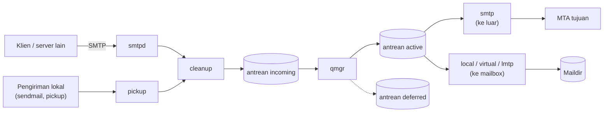

# Arsitektur Postfix dan Instalasi

!!! info "Identitas chapter"
    **ID:** `CH-06-01-01` · **Kategori/modul:** CAT-06 / MOD-06-01 (Postfix) · **Estimasi:** 90 menit · **Lingkungan:** lab lokal (VM) · [Lihat chapter ini di dashboard](../../../#CH-06-01-01)

!!! warning "Lab saja, belum untuk internet"
    Pasang dan uji Postfix hanya di VM lab **yang tidak terhubung ke internet publik** (port 25 tidak diteruskan dari luar) sampai `CH-06-01-04` membuktikan server bukan open relay. Perintah belum dijalankan penulis (`verified_on: null`). Versi paket pada Ubuntu 24.04 perlu Anda catat dengan `postconf mail_version`.

## 1. Ringkasan

Postfix adalah MTA modular: beberapa program kecil dengan satu tugas, dikoordinasikan oleh `master`. Chapter ini menjelaskan arsitektur dan alur proses, memasang Postfix pada Ubuntu, dan memeriksa statusnya.

## 2. Tujuan Pembelajaran

1. Menjelaskan komponen Postfix: `master`, `smtpd`, `cleanup`, `qmgr`, `smtp`, `local`/`virtual`, `pickup`.
2. Menjelaskan alur pesan masuk dan keluar melalui antrean Postfix.
3. Memasang Postfix dengan `apt` dan memilih jenis konfigurasi awal.
4. Memeriksa versi, proses, dan port yang dibuka.

## 3. Prasyarat

- `CH-05-02-03` (DNS) dan seluruh baseline `CAT-04` (FQDN, firewall, health check).
- Snapshot VM.

## 4. Materi Teori

### 4.1 Komponen

| Komponen | Tugas |
|---|---|
| `master` | Memulai dan mengawasi proses lain (dikonfigurasi di `master.cf`) |
| `smtpd` | Menerima SMTP masuk (dari klien dan server lain) |
| `pickup` | Mengambil pesan lokal dari antrean `maildrop` |
| `cleanup` | Merapikan header, menambahkan Message-ID, menaruh pesan ke antrean `incoming` |
| `qmgr` | Pengelola antrean; menjadwalkan pengiriman |
| `smtp` | Mengirim ke server lain |
| `local` / `virtual` | Mengantar ke mailbox lokal/virtual |
| `lmtp` | Mengantar ke Dovecot lewat LMTP (`CH-06-02-04`) |
| `trivial-rewrite` | Menentukan transport dan penulisan ulang alamat |
| `bounce` | Menghasilkan DSN |

### 4.2 Alur pesan



Setiap komponen berjalan dengan hak minimal; ini sebabnya kelemahan satu bagian tidak otomatis memberi akses ke semuanya.

### 4.3 Jenis konfigurasi saat instalasi

Paket Postfix di Ubuntu menanyakan jenis konfigurasi lewat debconf:

| Pilihan | Arti | Untuk lab ini |
|---|---|---|
| Internet Site | Mengirim/menerima langsung via SMTP | **Ya** |
| Internet with smarthost | Mengirim lewat relay penyedia | Opsional kemudian |
| Satellite system | Semua email dikirim ke relay | Tidak |
| Local only | Hanya lokal | Tidak |
| No configuration | Tanpa konfigurasi awal | Tidak |

Pilihan "System mail name" diisi dengan domain email (mis. `example.com`), bukan FQDN host.

## 5. Praktik dan Implementasi

**Checklist persiapan**

- [ ] Snapshot VM.
- [ ] FQDN server benar (`hostname -f`).
- [ ] Firewall UFW aktif dan **port 25 tidak terbuka ke internet**.

**Langkah**

1. Pasang Postfix (bagian 6) dan pilih *Internet Site* bila diminta.
2. Isi System mail name dengan domain Anda.
3. Periksa status, versi, dan port.
4. Simpan konfigurasi awal (`postconf -n`) sebagai referensi.
5. Snapshot "postfix-terpasang".

## 6. Perintah Linux

```bash title="Instalasi"
sudo apt update
sudo apt install postfix
```

Pada instalasi non-interaktif Anda dapat menyetel jawaban debconf terlebih dulu (`debconf-set-selections`), tetapi untuk belajar jalankan interaktif agar melihat setiap pilihan.

```bash title="Status dan versi"
postconf mail_version
systemctl status postfix --no-pager
sudo ss -tlnp | grep -E 'master|:25\b'
```

- `postconf mail_version` mencetak versi terpasang; catat untuk dokumentasi.
- Di Ubuntu, `postfix.service` adalah unit pembungkus; instansi sebenarnya bernama `postfix@-.service`. Jika `status postfix` terlihat "active (exited)", periksa `systemctl status 'postfix@-'`.
- `ss` harus menunjukkan `master` mendengarkan port 25. Pada konfigurasi default, port ini bisa mendengarkan pada semua antarmuka; pembatasan dibahas di `CH-06-01-03`.

```bash title="Konfigurasi yang berbeda dari default"
postconf -n
```

## 7. Konfigurasi

Tidak ada pengeditan manual pada chapter ini. Berkas utama yang dihasilkan instalasi:

| Berkas | Fungsi |
|---|---|
| `/etc/postfix/main.cf` | Parameter utama |
| `/etc/postfix/master.cf` | Definisi layanan/proses |
| `/etc/mailname` | Nama domain untuk alamat pengirim lokal |

Ingat: `postconf -n` menampilkan **nilai efektif yang berbeda dari default**, berguna untuk membaca konfigurasi tanpa komentar.

## 8. Verifikasi

```bash title="Verifikasi"
postconf mail_version myhostname mydomain myorigin
sudo postfix check
systemctl is-active postfix
```

Hasil yang diharapkan: versi tercetak, `postfix check` tanpa keluaran (tanpa galat), dan unit aktif. Nilai `myhostname` seharusnya cocok dengan FQDN Anda.

## 9. Troubleshooting

| Gejala | Kemungkinan penyebab | Tindakan |
|---|---|---|
| `apt install` meminta konfigurasi berulang | Jawaban debconf | `sudo dpkg-reconfigure postfix` |
| Postfix tidak mau start | Kesalahan `main.cf` | `sudo postfix check`, `journalctl -u 'postfix@-'` |
| Port 25 tidak mendengarkan | Layanan mati | `systemctl status`, lihat log |
| `myhostname` salah | FQDN tidak konsisten | Perbaiki di `CH-06-01-02` |

## 10. Security Review

- Default paket dapat mendengarkan pada semua antarmuka; **jangan teruskan port 25 dari internet** sebelum relay diuji.
- Jangan mengubah `main.cf` tanpa `postfix check`.
- Simpan hasil `postconf -n` tanpa data sensitif.
- Catat versi untuk pelacakan CVE (CAT-13).

## 11. Latihan

1. Gambar ulang alur pesan masuk dari `smtpd` sampai Maildir.
2. Apa beda `postconf` dan `postconf -n`?
3. Jelaskan mengapa Postfix dipecah menjadi banyak proses.

## 12. Assessment

1. Apa tugas `qmgr`?
2. Mengapa `postfix check` dijalankan sebelum reload?
3. Mengapa tidak membuka port 25 ke internet pada tahap ini?

**Kunci singkat.** (1) Menjadwalkan pengiriman dari antrean. (2) Menangkap kesalahan konfigurasi. (3) Relay belum teruji.

## 13. Checklist Kelulusan

- [ ] Postfix terpasang dan berjalan; versi dicatat.
- [ ] Saya dapat menjelaskan komponen dan alur pesan.
- [ ] Port 25 tidak terekspos ke internet.

!!! note "Status belajar"
    Ubah status chapter secara manual di dashboard. Menyelesaikan checklist ini tidak mengubah status otomatis.

## 14. Referensi Resmi

- [Dokumentasi Postfix](https://www.postfix.org/documentation.html)
- [Postfix: Arsitektur (OVERVIEW)](https://www.postfix.org/OVERVIEW.html)
- [Postfix: Basic Configuration](https://www.postfix.org/BASIC_CONFIGURATION_README.html)
- [Ubuntu Server: Postfix](https://documentation.ubuntu.com/server/)

Tautan referensi tidak diverifikasi otomatis pada build ini; periksa ketersediaannya sebelum dipakai.

---

[Kembali ke dashboard kurikulum](../../../#CH-06-01-01){ .md-button }
