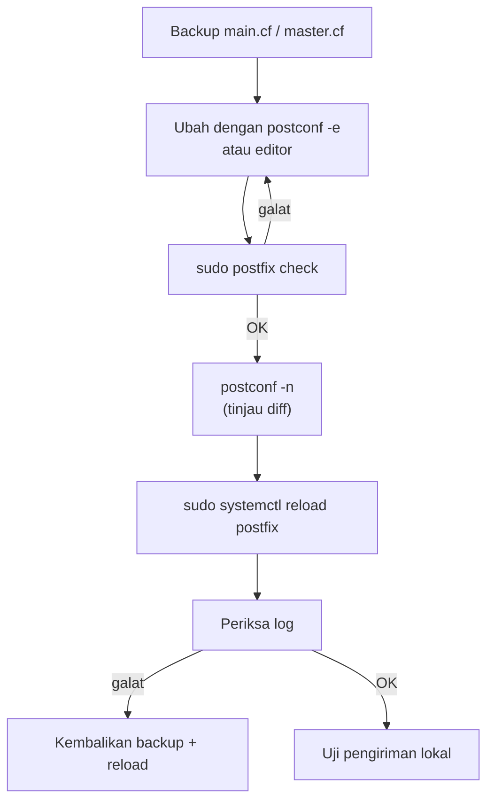

# main.cf, master.cf, dan Identitas Server

!!! info "Identitas chapter"
    **ID:** `CH-06-01-02` · **Kategori/modul:** CAT-06 / MOD-06-01 (Postfix) · **Estimasi:** 120 menit · **Lingkungan:** lab lokal (VM) · [Lihat chapter ini di dashboard](../../../#CH-06-01-02)

!!! warning "Status verifikasi"
    Mengubah konfigurasi layanan; belum dijalankan penulis (`verified_on: null`). Backup `main.cf` sebelum mengedit. Nilai `example.com` adalah contoh.

## 1. Ringkasan

Anda mengatur identitas server pada `main.cf`: `myhostname`, `mydomain`, `myorigin`, dan `mydestination`; memahami `master.cf`; serta menerapkan perubahan dengan aman memakai `postconf`, `postfix check`, dan `postfix reload`.

## 2. Tujuan Pembelajaran

1. Mengubah parameter dengan `postconf -e` dan memverifikasinya.
2. Menetapkan `myhostname`, `mydomain`, `myorigin` secara konsisten dengan FQDN.
3. Membaca struktur `master.cf` (nama layanan, tipe, `chroot`, perintah).
4. Menerapkan perubahan lewat validasi → reload → pemeriksaan log.

## 3. Prasyarat

- `CH-06-01-01`; FQDN dari `CH-04-02-02`.

## 4. Materi Teori

### 4.1 Parameter identitas

| Parameter | Arti | Contoh |
|---|---|---|
| `myhostname` | Nama host server (FQDN), dipakai pada banner dan EHLO | `mail.example.com` |
| `mydomain` | Domain induk | `example.com` |
| `myorigin` | Domain yang ditambahkan pada alamat pengirim lokal | `$mydomain` |
| `mydestination` | Domain yang dianggap **lokal** | `$myhostname, localhost.$mydomain, localhost` |

Dalam `main.cf`, `$nama` memanggil nilai parameter lain. Jangan masukkan domain virtual ke `mydestination`; itu untuk virtual mailbox di CAT-07.

### 4.2 `main.cf` dan `master.cf`

`main.cf` memuat parameter global (`nama = nilai`). `master.cf` mendefinisikan proses layanan; tiap baris memiliki kolom: nama, tipe (`inet`, `unix`), private, unpriv, chroot, wakeup, maxproc, perintah. Mengubah `master.cf` (mis. mengaktifkan submission di 587) dibahas bertahap di chapter keamanan; jangan menghapus komentar secara massal tanpa memahami tiap baris.

### 4.3 Alur perubahan aman



## 5. Praktik dan Implementasi

**Checklist persiapan**

- [ ] `hostname -f` menghasilkan FQDN yang diharapkan.
- [ ] Backup konfigurasi tersimpan.

**Langkah**

1. Cadangkan konfigurasi.
2. Setel identitas (bagian 6).
3. Validasi dan reload.
4. Periksa banner SMTP lokal.
5. Catat hasil `postconf -n`.

## 6. Perintah Linux

```bash title="Backup"
sudo cp -a /etc/postfix /etc/postfix.bak-$(date +%F)
```

```bash title="Menyetel identitas (ganti nilai contoh)"
sudo postconf -e 'myhostname = mail.example.com'
sudo postconf -e 'mydomain = example.com'
sudo postconf -e 'myorigin = $mydomain'
sudo postfix check
sudo systemctl reload postfix
```

- `postconf -e` menulis ke `main.cf`. Tanda kutip tunggal mencegah shell memperluas `$mydomain`.
- Jangan menaruh cadangan di bawah `/etc/postfix/` itu sendiri; di sini salinan berada di sebelahnya.

```bash title="Melihat hasil"
postconf myhostname mydomain myorigin mydestination
nc -C localhost 25
```

Pada `nc`, ketik `QUIT` setelah banner. Bentuk banner: `220 mail.example.com ESMTP Postfix (Ubuntu)`. Banner bergantung pada `smtpd_banner`; versi tidak ditampilkan secara default.

## 7. Konfigurasi

```text title="/etc/postfix/main.cf (potongan identitas)"
myhostname = mail.example.com
mydomain = example.com
myorigin = $mydomain
mydestination = $myhostname, localhost.$mydomain, localhost
```

Ganti nilai dengan domain Anda. `mydestination` default Ubuntu dapat sedikit berbeda; pertahankan nilai bawaan kecuali Anda paham dampaknya.

## 8. Verifikasi

```bash title="Verifikasi"
sudo postfix check
postconf -n | grep -E '^(myhostname|mydomain|myorigin|mydestination)'
journalctl -u 'postfix@-' -n 20 --no-pager
```

Hasil yang diharapkan: tanpa galat, parameter sesuai, tidak ada galat konfigurasi pada log.

## 9. Troubleshooting

| Gejala | Kemungkinan penyebab | Tindakan |
|---|---|---|
| `postfix check` memberi galat | Salah ketik parameter | Perbaiki sesuai pesan |
| Reload tidak berpengaruh | Salah berkas/service | `postconf` menampilkan nilai aktif |
| `myhostname` tampak lain di EHLO | Konfigurasi `smtp_helo_name` | Periksa `postconf smtp_helo_name` |
| Surat dianggap bukan lokal | `mydestination` salah | Tinjau nilai efektif |

## 10. Security Review

- Banner dan EHLO publik mengungkap nama; pastikan sesuai PTR.
- Jangan membiarkan `mydestination` memuat domain yang tidak Anda kelola.
- Ubah satu hal sekali; simpan diff.

## 11. Latihan

1. Ubah `myorigin`, kirim surat uji lokal, amati alamat pengirim.
2. Cari baris `smtp` dan `submission` di `master.cf` dan jelaskan kolomnya.
3. Simulasikan galat dengan salah ketik dan baca output `postfix check`.

## 12. Assessment

1. Apa beda `myhostname` dan `mydomain`?
2. Mengapa memakai `postconf -e` lebih aman daripada edit manual?
3. Apa risiko `mydestination` terlalu luas?

**Kunci singkat.** (1) Host vs domain induk. (2) Mengurangi salah sintaks dan memvalidasi nama parameter. (3) Surat untuk domain itu dianggap lokal.

## 13. Checklist Kelulusan

- [ ] Identitas server konsisten dengan FQDN.
- [ ] Perubahan memakai validasi → reload → cek log.
- [ ] Backup dan `postconf -n` tersimpan.

!!! note "Status belajar"
    Ubah status chapter secara manual di dashboard. Menyelesaikan checklist ini tidak mengubah status otomatis.

## 14. Referensi Resmi

- [Postfix: postconf(5)](https://www.postfix.org/postconf.5.html)
- [Postfix: master(5)](https://www.postfix.org/master.5.html)
- [Postfix: Basic Configuration](https://www.postfix.org/BASIC_CONFIGURATION_README.html)
- [Postfix: postconf(1)](https://www.postfix.org/postconf.1.html)

Tautan referensi tidak diverifikasi otomatis pada build ini; periksa ketersediaannya sebelum dipakai.

---

[Kembali ke dashboard kurikulum](../../../#CH-06-01-02){ .md-button }
