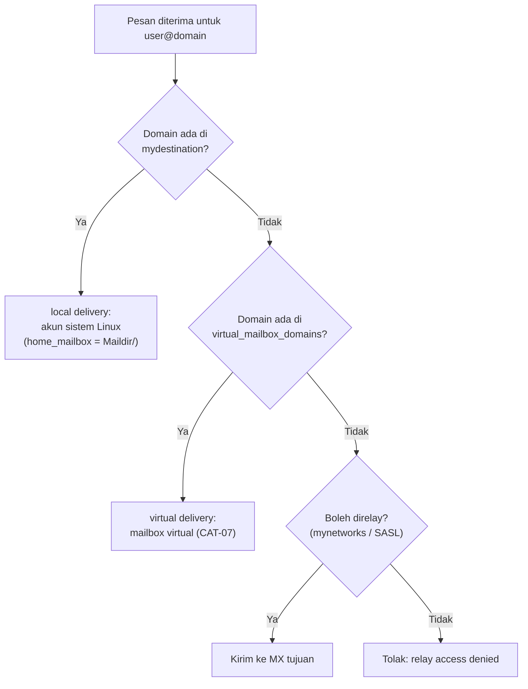

# Antarmuka, Jaringan Tepercaya, dan Delivery Lokal

!!! info "Identitas chapter"
    **ID:** `CH-06-01-03` · **Kategori/modul:** CAT-06 / MOD-06-01 (Postfix) · **Estimasi:** 90 menit · **Lingkungan:** lab lokal (VM) · [Lihat chapter ini di dashboard](../../../#CH-06-01-03)

!!! warning "Status verifikasi"
    Mengubah konfigurasi Postfix; belum dijalankan penulis (`verified_on: null`). `mynetworks` yang terlalu luas adalah penyebab utama open relay.

## 1. Ringkasan

Anda membatasi antarmuka tempat Postfix mendengarkan (`inet_interfaces`), menetapkan jaringan tepercaya (`mynetworks`), dan membedakan **delivery lokal** (akun sistem, `home_mailbox`) dari **virtual mailbox delivery** (CAT-07).

## 2. Tujuan Pembelajaran

1. Menetapkan `inet_interfaces` dan `inet_protocols` sesuai kebutuhan.
2. Menetapkan `mynetworks` seketat mungkin dan menjelaskan risikonya.
3. Mengonfigurasi delivery lokal Maildir dengan `home_mailbox`.
4. Membedakan local delivery dan virtual mailbox delivery.

## 3. Prasyarat

- `CH-06-01-02`.

## 4. Materi Teori

### 4.1 `inet_interfaces` dan `inet_protocols`

| Parameter | Nilai umum | Arti |
|---|---|---|
| `inet_interfaces` | `all`, `loopback-only`, atau alamat | Antarmuka tempat `smtpd` mendengarkan |
| `inet_protocols` | `ipv4`, `ipv6`, `all` | Protokol IP yang dipakai |

Server yang menerima email dari luar harus mendengarkan pada antarmuka publik. Untuk **lab terisolasi** `loopback-only` paling aman; ubah ke alamat host-only saat ingin menguji dari host.

### 4.2 `mynetworks`

`mynetworks` berisi klien yang **diizinkan merelai** tanpa autentikasi. Isi yang aman untuk server publik: hanya loopback (`127.0.0.0/8 [::1]/128`). Memasukkan seluruh LAN atau subnet penyedia berarti setiap perangkat di sana (termasuk yang terinfeksi malware) dapat memakai server Anda untuk mengirim spam.

### 4.3 Delivery lokal vs virtual



`home_mailbox = Maildir/` membuat MDA lokal Postfix menulis ke `~/Maildir/` pengguna sistem. Alternatif lain (Dovecot LMTP) dibahas di `CH-06-02-04`.

## 5. Praktik dan Implementasi

**Checklist persiapan**

- [ ] Backup `main.cf`.
- [ ] Mengetahui alamat host-only VM (`ip -br a`).
- [ ] Satu akun sistem uji (mis. `labuser`) tanpa hak sudo.

**Langkah**

1. Setel antarmuka dan protokol sesuai kebutuhan lab.
2. Periksa dan ketatkan `mynetworks`.
3. Aktifkan Maildir lokal.
4. Kirim surat lokal ke `labuser` dan lihat Maildir-nya.
5. Verifikasi dan ambil snapshot.

## 6. Perintah Linux

```bash title="Pengaturan"
sudo postconf -e 'inet_interfaces = loopback-only'
sudo postconf -e 'inet_protocols = ipv4'
sudo postconf -e 'mynetworks = 127.0.0.0/8'
sudo postconf -e 'home_mailbox = Maildir/'
sudo postfix check && sudo systemctl restart postfix
```

- `inet_interfaces` perlu **restart**, bukan hanya reload, agar soket berubah.
- Nilai `loopback-only` hanya cocok bila Anda menguji dari VM itu sendiri.
- `inet_protocols = ipv4` menghindari masalah AAAA bila IPv6 belum direncanakan.

```bash title="Membuat akun uji dan mengirim surat lokal"
sudo adduser labuser
printf 'Subject: uji lokal\n\nIsi uji.\n' | sendmail labuser
sudo ls -R /home/labuser/Maildir
```

`sendmail` tersedia dari paket Postfix; pesan dikirim ke `labuser@<myorigin>`. Jika `ls` menunjukkan berkas di `new/`, local delivery bekerja.

## 7. Konfigurasi

```text title="/etc/postfix/main.cf (potongan)"
inet_interfaces = loopback-only
inet_protocols = ipv4
mynetworks = 127.0.0.0/8
home_mailbox = Maildir/
```

Ubah `inet_interfaces` menjadi `all` (atau alamat tertentu) hanya setelah `CH-06-01-04` membuktikan relay terkunci.

## 8. Verifikasi

```bash title="Verifikasi"
postconf inet_interfaces inet_protocols mynetworks home_mailbox
sudo ss -tlnp | grep ':25'
journalctl -u 'postfix@-' -n 20 --no-pager
```

Hasil yang diharapkan: nilai sesuai, port 25 hanya pada `127.0.0.1`, dan log menunjukkan `status=sent` untuk surat lokal.

## 9. Troubleshooting

| Gejala | Kemungkinan penyebab | Tindakan |
|---|---|---|
| Tidak dapat terhubung dari host | `loopback-only` | Ubah ke alamat host-only |
| Surat lokal tidak muncul | `home_mailbox`/izin salah | Cek log `status=` dan izin home |
| `Maildir` tak terbentuk | Belum ada pesan | Postfix membuat saat pengiriman pertama |
| Banyak koneksi tak dikenal | `mynetworks` luas / port terbuka | Ketatkan, periksa UFW |

## 10. Security Review

- `mynetworks` terlalu luas = open relay di dalam jaringan tepercaya.
- Mendengarkan di semua antarmuka tanpa firewall menambah risiko; tetap blokir port 25 dari luar sampai siap.
- Akun uji harus tanpa sudo dan dihapus setelah selesai (`sudo deluser --remove-home labuser`).

## 11. Latihan

1. Ubah `mynetworks` menjadi subnet host-only dan jelaskan siapa yang kini dapat merelai.
2. Jelaskan perbedaan reload dan restart untuk `inet_interfaces`.
3. Rancang tabel keputusan local vs virtual vs relay.

## 12. Assessment

1. Apa fungsi `mynetworks`?
2. Mengapa `loopback-only` aman untuk lab?
3. Apa fungsi `home_mailbox`?

**Kunci singkat.** (1) Klien yang boleh merelai tanpa login. (2) Tidak terjangkau dari luar VM. (3) Lokasi mailbox pengguna lokal.

## 13. Checklist Kelulusan

- [ ] `inet_interfaces` dan `mynetworks` sesuai kebutuhan dan seketat mungkin.
- [ ] Local delivery Maildir teruji.
- [ ] Akun uji dihapus atau dicatat.

!!! note "Status belajar"
    Ubah status chapter secara manual di dashboard. Menyelesaikan checklist ini tidak mengubah status otomatis.

## 14. Referensi Resmi

- [Postfix: postconf(5) — inet_interfaces, mynetworks](https://www.postfix.org/postconf.5.html)
- [Postfix: Local delivery](https://www.postfix.org/LOCAL_RECIPIENT_README.html)
- [Postfix: Basic Configuration](https://www.postfix.org/BASIC_CONFIGURATION_README.html)
- [Postfix: sendmail(1)](https://www.postfix.org/sendmail.1.html)

Tautan referensi tidak diverifikasi otomatis pada build ini; periksa ketersediaannya sebelum dipakai.

---

[Kembali ke dashboard kurikulum](../../../#CH-06-01-03){ .md-button }
