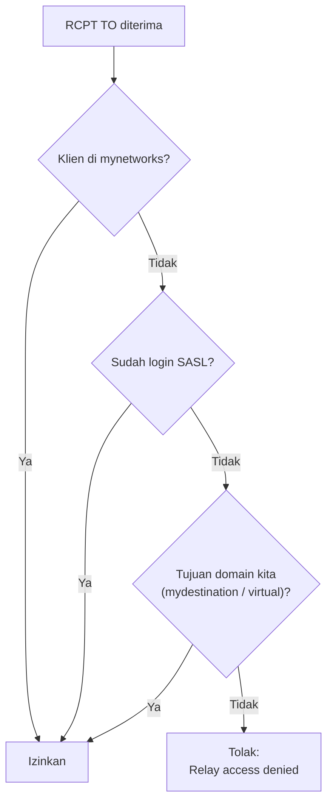

# Pembatasan Relay dan Pencegahan Open Relay

!!! info "Identitas chapter"
    **ID:** `CH-06-01-04` · **Kategori/modul:** CAT-06 / MOD-06-01 (Postfix) · **Estimasi:** 120 menit · **Lingkungan:** lab lokal (VM) · [Lihat chapter ini di dashboard](../../../#CH-06-01-04)

!!! danger "Kontrol keamanan utama"
    Open relay membuat IP Anda cepat masuk daftar hitam. Uji **dari luar server** dan dari klien tidak terautentikasi. Jangan menguji relay dengan mengirim spam nyata atau ke alamat pihak lain; gunakan alamat uji milik Anda. Belum dijalankan penulis (`verified_on: null`).

## 1. Ringkasan

Anda menerapkan `smtpd_relay_restrictions` dan `smtpd_recipient_restrictions`, lalu **membuktikan dengan uji nyata** bahwa server menolak relay dari klien tidak tepercaya. Ini syarat sebelum port 25 dibuka ke jaringan yang lebih luas.

## 2. Tujuan Pembelajaran

1. Menjelaskan urutan evaluasi pembatasan Postfix selama sesi SMTP.
2. Mengonfigurasi `smtpd_relay_restrictions` yang menolak relay tidak sah.
3. Menguji penolakan relay dengan `swaks` atau `nc`.
4. Membaca log penolakan (`Relay access denied`).

## 3. Prasyarat

- `CH-06-01-03`; `nc` dari `CH-03-01-02`.
- Satu mesin uji lain (host atau VM kedua) agar uji tidak berasal dari `mynetworks`.

## 4. Materi Teori

### 4.1 Tahap pembatasan

Postfix mengevaluasi pembatasan pada tiap tahap SMTP. Dua yang utama:

| Parameter | Tahap | Fungsi |
|---|---|---|
| `smtpd_relay_restrictions` | `RCPT TO` | Memutuskan siapa boleh merelai |
| `smtpd_recipient_restrictions` | `RCPT TO` | Pembatasan tambahan penerima |

Nilai default Ubuntu/Postfix modern umumnya memuat urutan yang aman, mis. `permit_mynetworks, permit_sasl_authenticated, defer_unauth_destination`. Periksa nilai Anda dengan `postconf smtpd_relay_restrictions`; **jangan** menimpa tanpa memahami maknanya.

### 4.2 Arti pernyataan

| Pernyataan | Arti |
|---|---|
| `permit_mynetworks` | Izinkan klien dalam `mynetworks` |
| `permit_sasl_authenticated` | Izinkan klien yang sudah login SASL |
| `defer_unauth_destination` | Tolak tujuan yang bukan domain Anda untuk klien lain |
| `reject_unauth_destination` | Serupa, penolakan permanen |

Urutan penting: `permit_*` mengizinkan lebih dulu; baris penolak terakhir menutup sisanya. Menaruh `permit` tanpa syarat di akhir menjadikan server open relay.



### 4.3 Uji relay yang benar

Uji harus mengirim `RCPT TO` ke alamat **domain luar** dari klien yang bukan `mynetworks` dan tidak login. Hasil benar: kode `4xx/5xx` "Relay access denied". Sukses `250` berarti server terbuka dan **harus diperbaiki**.

## 5. Praktik dan Implementasi

**Checklist persiapan**

- [ ] Backup `main.cf`.
- [ ] `inet_interfaces` mendengarkan pada alamat yang dapat dijangkau mesin uji.
- [ ] `mynetworks` tidak memuat alamat mesin uji.

**Langkah**

1. Tinjau nilai restriksi saat ini.
2. Setel urutan yang aman.
3. Reload dan uji dari mesin lain.
4. Uji juga bahwa penerimaan untuk domain lokal tetap berfungsi.
5. Catat bukti (tanpa data sensitif).

## 6. Perintah Linux

```bash title="Tinjau dan setel"
postconf smtpd_relay_restrictions smtpd_recipient_restrictions
sudo postconf -e 'smtpd_relay_restrictions = permit_mynetworks, permit_sasl_authenticated, defer_unauth_destination'
sudo postfix check && sudo systemctl reload postfix
```

`permit_sasl_authenticated` baru bermakna setelah SASL dikonfigurasi (`CH-06-02-03`); sebelum itu tidak ada klien yang terautentikasi.

Uji dari **mesin lain** (ganti `IP-SERVER` dengan alamat server lab):

```bash title="Uji relay manual"
nc -C IP-SERVER 25
```

Ketik:

```text
EHLO penguji.lab.example.com
MAIL FROM:<penguji@lab.example.com>
RCPT TO:<tujuan@example.org>
QUIT
```

Hasil yang diharapkan untuk `RCPT TO` domain luar: penolakan seperti `554 5.7.1 <tujuan@example.org>: Relay access denied` (atau `4xx` bila memakai `defer_`). Bila memakai `swaks`:

```bash title="Opsional: swaks"
sudo apt install swaks
swaks --to tujuan@example.org --from penguji@lab.example.com --server IP-SERVER --quit-after RCPT
```

`--quit-after RCPT` berhenti sebelum `DATA`, sehingga tidak ada pesan terkirim.

## 7. Konfigurasi

```text title="/etc/postfix/main.cf (potongan)"
smtpd_relay_restrictions =
    permit_mynetworks,
    permit_sasl_authenticated,
    defer_unauth_destination
```

Bentuk bernilai banyak boleh ditulis di beberapa baris dengan indentasi lanjutan. Tambahan penolakan lain (HELO, DNSBL) dibahas pada CAT-10.

## 8. Verifikasi

```bash title="Bukti di log"
journalctl -u 'postfix@-' --since "10 min ago" --no-pager | grep -i -E 'relay|reject|NOQUEUE'
```

Hasil yang diharapkan: baris `NOQUEUE: reject: RCPT ... Relay access denied` untuk uji Anda, dan **tidak ada** pesan yang masuk antrean untuk tujuan luar.

## 9. Troubleshooting

| Gejala | Kemungkinan penyebab | Tindakan |
|---|---|---|
| Uji tampak berhasil (`250`) | `mynetworks` memuat mesin uji, atau `permit` terlalu longgar | Periksa `mynetworks` dan urutan |
| Domain lokal ikut ditolak | `mydestination` salah | Cek identitas |
| Uji dari server itu sendiri selalu lolos | `127.0.0.1` ada di `mynetworks` | Uji dari mesin lain |
| Perubahan tak berefek | Belum reload | `systemctl reload postfix` |

## 10. Security Review

- Selalu uji dari klien tidak terautentikasi di luar `mynetworks`.
- Jangan membuat pengecualian `permit` sementara dan lupa menghapusnya.
- Ulangi uji relay setiap kali `main.cf` berubah.
- Pantau antrean dan log untuk pola relay mendadak (CAT-13).

## 11. Latihan

1. Sengaja tambahkan IP mesin uji ke `mynetworks`, jalankan uji, lalu kembalikan dan tulis kesimpulan.
2. Ubah `defer_` menjadi `reject_` dan amati kode respons.
3. Tulis prosedur uji relay yang dapat diulang dalam tiga langkah.

## 12. Assessment

1. Apa yang membuat sebuah server open relay?
2. Mengapa uji dari server itu sendiri tidak cukup?
3. Apa beda `defer_unauth_destination` dan `reject_unauth_destination`?

**Kunci singkat.** (1) Meneruskan pesan untuk pihak tak berwenang ke domain mana pun. (2) `127.0.0.1` tepercaya. (3) Sementara vs permanen.

## 13. Checklist Kelulusan

- [ ] Pembatasan relay terkonfigurasi sesuai urutan aman.
- [ ] Uji dari mesin lain menunjukkan relay ditolak (bukti log tersimpan).
- [ ] Penerimaan domain lokal tetap berfungsi.

!!! note "Status belajar"
    Ubah status chapter secara manual di dashboard. Menyelesaikan checklist ini tidak mengubah status otomatis.

## 14. Referensi Resmi

- [Postfix: SMTPD Access Control](https://www.postfix.org/SMTPD_ACCESS_README.html)
- [Postfix: Postfix Anti-UCE (Relay)](https://www.postfix.org/SMTPD_ACCESS_README.html#relay)
- [Postfix: postconf(5) — smtpd_relay_restrictions](https://www.postfix.org/postconf.5.html#smtpd_relay_restrictions)
- [swaks](https://jetmore.org/john/code/swaks/)

Tautan referensi tidak diverifikasi otomatis pada build ini; periksa ketersediaannya sebelum dipakai.

---

[Kembali ke dashboard kurikulum](../../../#CH-06-01-04){ .md-button }
