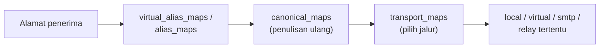

# Alias, Address Rewriting, dan Transport Maps

!!! info "Identitas chapter"
    **ID:** `CH-06-01-05` · **Kategori/modul:** CAT-06 / MOD-06-01 (Postfix) · **Estimasi:** 120 menit · **Lingkungan:** lab lokal (VM) · [Lihat chapter ini di dashboard](../../../#CH-06-01-05)

!!! warning "Status verifikasi"
    Mengubah pemetaan alamat dan routing; belum dijalankan penulis (`verified_on: null`). Salah `transport_maps` dapat membelokkan email ke tujuan keliru. Jangan membuat alias ke tujuan eksternal sembarangan.

## 1. Ringkasan

Anda mengelola **alias** (`/etc/aliases`), menulis ulang alamat (`canonical_maps`), dan mengarahkan domain tertentu ke jalur pengiriman khusus (`transport_maps`). Semua berbasis tabel lookup yang dikompilasi dengan `postmap`.

## 2. Tujuan Pembelajaran

1. Membuat alias lokal dan menerapkan dengan `newaliases`.
2. Memahami format tabel Postfix (`hash:`) dan `postmap`.
3. Menjelaskan `canonical_maps` vs alias vs `virtual_alias_maps`.
4. Menetapkan `transport_maps` secara terkontrol dan mengujinya dengan `postmap -q`.

## 3. Prasyarat

- `CH-06-01-04`.

## 4. Materi Teori

### 4.1 Tabel lookup

Postfix membaca pemetaan dari tabel, mis. `hash:/etc/postfix/transport`. Berkas teks harus dikompilasi menjadi `.db` dengan `postmap`; `/etc/aliases` memakai `newaliases`. Perubahan berefek setelah dikompilasi dan, untuk sebagian parameter, setelah reload.

### 4.2 Perbandingan

| Fitur | Parameter | Fungsi |
|---|---|---|
| Alias lokal | `alias_maps` (`/etc/aliases`) | Memetakan nama lokal ke penerima lain |
| Penulisan ulang | `canonical_maps`, `sender_canonical_maps` | Mengubah alamat pada header/envelope |
| Alias virtual | `virtual_alias_maps` | Alias lintas domain; dipakai di CAT-07 |
| Transport | `transport_maps` | Menentukan jalur pengiriman per domain/penerima |

### 4.3 Alur pencarian



Urutan rinci pada Postfix lebih kompleks; gunakan `postmap -q` dan log untuk memastikan yang sebenarnya terjadi, bukan menebak.

## 5. Praktik dan Implementasi

**Checklist persiapan**

- [ ] Backup `main.cf` dan `/etc/aliases`.
- [ ] Akun uji lokal (`labuser`) dari chapter sebelumnya.

**Langkah**

1. Tambahkan alias `admin: labuser`.
2. Jalankan `newaliases` dan uji pengiriman ke `admin`.
3. Buat tabel transport contoh yang **tidak** mengubah jalur nyata (hanya diuji dengan `postmap -q`).
4. Verifikasi dengan `postmap -q` dan log.
5. Kembalikan perubahan percobaan yang tidak diperlukan.

## 6. Perintah Linux

```bash title="Alias"
echo 'admin: labuser' | sudo tee -a /etc/aliases
sudo newaliases
printf 'Subject: uji alias\n\nIsi.\n' | sendmail admin
```

- `tee -a` menambah baris; periksa `/etc/aliases` agar tidak ada duplikat. Alias `root` sebaiknya menunjuk ke akun nyata agar surat sistem terbaca.

```bash title="Tabel transport (contoh)"
echo 'lab.example.net  smtp:[mail-relay.lab.example.com]:25' | sudo tee /etc/postfix/transport
sudo postmap /etc/postfix/transport
postmap -q lab.example.net /etc/postfix/transport
```

- `postmap -q KUNCI TABEL` menampilkan hasil lookup; keluaran yang diharapkan adalah nilai transport di atas.
- Tanda kurung siku `[ ]` menonaktifkan pencarian MX untuk host relay.
- Tabel ini belum aktif sampai `transport_maps` diatur; aktifkan hanya bila Anda benar-benar membutuhkannya:

```bash title="Mengaktifkan transport_maps (opsional)"
sudo postconf -e 'transport_maps = hash:/etc/postfix/transport'
sudo postfix check && sudo systemctl reload postfix
```

## 7. Konfigurasi

```text title="/etc/aliases"
postmaster: root
root: labuser
admin: labuser
```

```text title="/etc/postfix/main.cf (potongan, opsional)"
transport_maps = hash:/etc/postfix/transport
```

Baris `postmaster` dan `root` mungkin sudah ada; **jangan menghapus** baris bawaan. Tabel transport hanya memengaruhi domain yang tercantum.

## 8. Verifikasi

```bash title="Verifikasi"
postconf alias_maps transport_maps
postalias -q admin hash:/etc/aliases
sudo ls /home/labuser/Maildir/new
journalctl -u 'postfix@-' -n 30 --no-pager
```

Hasil yang diharapkan: `postalias -q` mencetak `labuser`, pesan ke `admin` berakhir di Maildir `labuser`, dan log menunjukkan `status=sent`.

## 9. Troubleshooting

| Gejala | Kemungkinan penyebab | Tindakan |
|---|---|---|
| Alias tidak berlaku | `newaliases` belum dijalankan | Jalankan, uji ulang |
| `postmap` galat izin | Berkas di lokasi tak boleh ditulis | Gunakan `sudo` |
| Email membelok ke tujuan tak terduga | `transport_maps` terlalu luas (mis. `*`) | Periksa tabel; gunakan `postmap -q` |
| Loop pengiriman | Alias saling menunjuk | Perbaiki rantai alias |

## 10. Security Review

- Alias yang menjalankan program (`|perintah`) berbahaya; hindari.
- Alias ke luar domain dapat membocorkan email atau dijadikan relay; batasi.
- `root: ...` penting agar notifikasi sistem tidak hilang atau salah alamat.
- Jangan menaruh kredensial relay dalam tabel transport.

## 11. Latihan

1. Buat alias dengan dua tujuan lokal dan uji.
2. Rancang tabel transport untuk dua domain berbeda dan uji dengan `postmap -q`.
3. Jelaskan kapan memakai `canonical_maps` vs alias.

## 12. Assessment

1. Mengapa `postmap` perlu dijalankan?
2. Apa risiko alias berisi `|perintah`?
3. Apa fungsi tanda `[ ]` pada transport?

**Kunci singkat.** (1) Postfix membaca `.db` terkompilasi. (2) Eksekusi program. (3) Menonaktifkan pencarian MX.

## 13. Checklist Kelulusan

- [ ] Alias lokal teruji.
- [ ] Saya dapat membuat dan menguji tabel `hash:`.
- [ ] Perubahan uji yang tidak dibutuhkan sudah dikembalikan.

!!! note "Status belajar"
    Ubah status chapter secara manual di dashboard. Menyelesaikan checklist ini tidak mengubah status otomatis.

## 14. Referensi Resmi

- [Postfix: aliases(5)](https://www.postfix.org/aliases.5.html)
- [Postfix: transport(5)](https://www.postfix.org/transport.5.html)
- [Postfix: canonical(5)](https://www.postfix.org/canonical.5.html)
- [Postfix: postmap(1)](https://www.postfix.org/postmap.1.html)

Tautan referensi tidak diverifikasi otomatis pada build ini; periksa ketersediaannya sebelum dipakai.

---

[Kembali ke dashboard kurikulum](../../../#CH-06-01-05){ .md-button }
