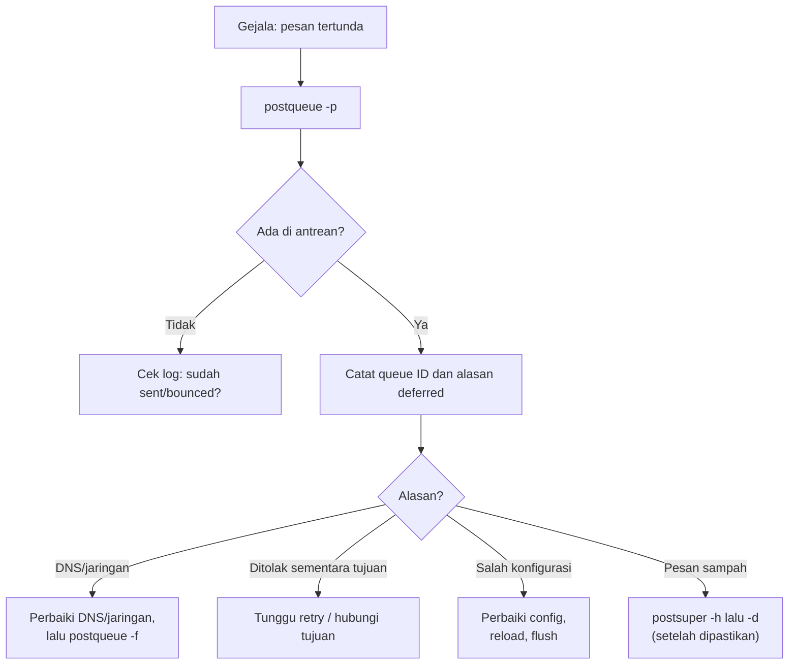

# Manajemen Antrian dan Analisis Log

!!! info "Identitas chapter"
    **ID:** `CH-06-01-06` · **Kategori/modul:** CAT-06 / MOD-06-01 (Postfix) · **Estimasi:** 120 menit · **Lingkungan:** lab lokal (VM) · [Lihat chapter ini di dashboard](../../../#CH-06-01-06)

!!! warning "Status verifikasi"
    Perintah baca-saja (`postqueue -p`, `postcat`, log) aman. `postsuper -d` **menghapus pesan permanen**; gunakan hanya pada pesan uji. Belum dijalankan penulis (`verified_on: null`).

## 1. Ringkasan

Anda memeriksa antrean Postfix, membaca isi pesan di antrean, mengelola pesan tertahan secara aman, dan menganalisis log untuk menemukan penyebab *deferred* dan *bounce*. Ini dasar troubleshooting pada level selanjutnya.

## 2. Tujuan Pembelajaran

1. Melihat antrean dengan `postqueue -p` dan membaca queue ID.
2. Memeriksa pesan dengan `postcat -q`.
3. Memakai `postqueue -f`, `postsuper -h/-H/-d` dengan hati-hati.
4. Menemukan log Postfix di Ubuntu 24.04 dan menelusuri satu pesan dari queue ID.

## 3. Prasyarat

- `CH-06-01-05`; konsep antrean dari `CH-03-02-02`; log dari `CH-03-02-03`.

## 4. Materi Teori

### 4.1 Antrean

Antrean utama: `incoming`, `active`, `deferred`, `hold`. Pesan yang gagal sementara masuk `deferred` dan dicoba ulang dengan jeda bertambah. Parameter terkait: `maximal_queue_lifetime`, `bounce_queue_lifetime`, `minimal_backoff_time`, `maximal_backoff_time`; periksa nilai default Anda dengan `postconf`.



### 4.2 Log di Ubuntu 24.04

Postfix mengirim log ke syslog/journal. `rsyslog` mungkin tidak terpasang secara default sehingga `/var/log/mail.log` tidak ada; jika tidak ada, gunakan `journalctl`. Anda dapat memasang `rsyslog` bila menginginkan berkas `mail.log`. Periksa dengan `ls /var/log/mail.log` sebelum bergantung padanya.

### 4.3 Membaca baris log

Fokus pada: queue ID, `from=`, `to=`, `relay=`, `delay=`, `status=` (`sent`, `deferred`, `bounced`), serta pesan di dalam tanda kurung (respons server tujuan).

## 5. Praktik dan Implementasi

**Checklist persiapan**

- [ ] Postfix berjalan dan relay terkunci (`CH-06-01-04`).
- [ ] Anda dapat membuat pesan yang tertunda secara aman: kirim ke domain yang tidak ada di lab, mis. `tidak-ada@lab.example.invalid`.

**Langkah**

1. Kirim satu pesan uji ke tujuan yang tidak dapat diselesaikan.
2. Lihat antrean dan catat queue ID.
3. Baca pesan dengan `postcat`.
4. Telusuri log dengan queue ID.
5. Bersihkan pesan uji dengan `postsuper -d` setelah dipastikan miliknya.

## 6. Perintah Linux

```bash title="Mengirim pesan uji yang akan tertunda/gagal"
printf 'Subject: uji antrean\n\nIsi.\n' | sendmail tidak-ada@lab.example.invalid
```

TLD `.invalid` dicadangkan (RFC 2606) dan tidak akan pernah resolve, sehingga pesan menjadi gagal DNS tanpa mengganggu pihak luar.

```bash title="Memeriksa antrean"
postqueue -p
sudo postcat -q QUEUE-ID | head -40
```

- `postqueue -p` menampilkan queue ID, ukuran, waktu, pengirim, dan alasan penundaan. Antrean kosong dicetak `Mail queue is empty`.
- `postcat -q` menampilkan isi berkas antrean; butuh `sudo`.

```bash title="Log dan penelusuran"
journalctl -u 'postfix@-' --since "15 min ago" --no-pager | grep QUEUE-ID
```

`QUEUE-ID` adalah placeholder.

```bash title="Mengelola antrean (hati-hati)"
sudo postqueue -f                # coba kirim ulang seluruh antrean sekarang
sudo postsuper -h QUEUE-ID       # tahan satu pesan
sudo postsuper -H QUEUE-ID       # lepas tahanan
sudo postsuper -d QUEUE-ID       # hapus satu pesan (permanen)
```

**Jangan** menjalankan `postsuper -d ALL` kecuali di VM lab yang benar-benar hanya berisi pesan uji.

## 7. Konfigurasi

Tidak ada perubahan wajib. Untuk melihat nilai retry efektif:

```bash title="Parameter retry"
postconf maximal_queue_lifetime bounce_queue_lifetime minimal_backoff_time maximal_backoff_time
```

Ubah nilai ini hanya jika ada alasan operasional yang jelas (CAT-13).

## 8. Verifikasi

- Anda dapat menunjukkan queue ID, alasan deferred, dan statusnya di log.
- Setelah `postsuper -d`, `postqueue -p` menunjukkan antrean kosong.

## 9. Troubleshooting

| Gejala | Kemungkinan penyebab | Tindakan |
|---|---|---|
| `mail.log` tidak ada | `rsyslog` tidak terpasang | Gunakan `journalctl` |
| `postqueue -p` kosong padahal pesan tertunda | Pesan sudah bounce | Cari `status=bounced` di log |
| Banyak `deferred` ke satu domain | DNS atau tujuan bermasalah | Baca alasan; periksa DNS dan jaringan |
| `postsuper` ditolak | Butuh hak | Gunakan `sudo` |

## 10. Security Review

- Isi antrean adalah email pengguna; akses dengan prinsip minimal dan jangan menyalin ke tempat umum.
- Penghapusan massal dapat membuang email sah; pastikan dulu, catat tindakan.
- Lonjakan antrean tiba-tiba dapat menandakan akun disusupi atau relay terbuka.
- Sanitasi log sebelum dibagikan.

## 11. Latihan

1. Buat tiga pesan uji tertunda, tahan satu, hapus satu, dan flush sisanya.
2. Tulis kolom penting pada keluaran `postqueue -p`.
3. Rancang prosedur menangani antrean yang membengkak.

## 12. Assessment

1. Apa beda `postsuper -h` dan `-d`?
2. Mengapa domain `.invalid` cocok untuk uji?
3. Di mana log Postfix berada di Ubuntu 24.04?

**Kunci singkat.** (1) Menahan vs menghapus permanen. (2) Tidak pernah resolve dan dicadangkan. (3) Jurnal systemd; `mail.log` hanya jika `rsyslog` terpasang.

## 13. Checklist Kelulusan

- [ ] Saya dapat membaca antrean dan log Postfix.
- [ ] Saya dapat mengelola pesan antrean tanpa menghapus pesan sah.
- [ ] Antrean uji dibersihkan.

!!! note "Status belajar"
    Ubah status chapter secara manual di dashboard. Menyelesaikan checklist ini tidak mengubah status otomatis.

## 14. Referensi Resmi

- [Postfix: postqueue(1)](https://www.postfix.org/postqueue.1.html)
- [Postfix: postsuper(1)](https://www.postfix.org/postsuper.1.html)
- [Postfix: postcat(1)](https://www.postfix.org/postcat.1.html)
- [Postfix: Queue Scheduler (QSHAPE_README)](https://www.postfix.org/QSHAPE_README.html)
- [RFC 2606 — Reserved Top Level DNS Names](https://www.rfc-editor.org/rfc/rfc2606)

Tautan referensi tidak diverifikasi otomatis pada build ini; periksa ketersediaannya sebelum dipakai.

---

[Kembali ke dashboard kurikulum](../../../#CH-06-01-06){ .md-button }
