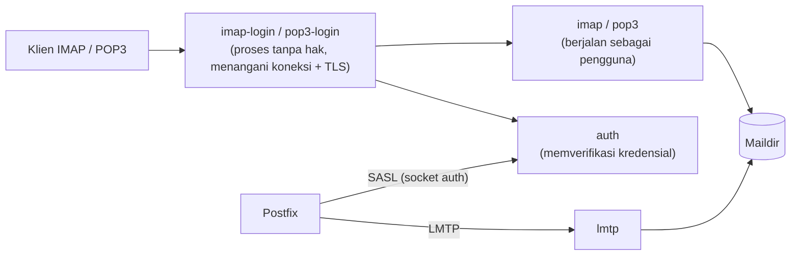

# Arsitektur Dovecot, Maildir, dan Izin

!!! info "Identitas chapter"
    **ID:** `CH-06-02-01` · **Kategori/modul:** CAT-06 / MOD-06-02 (Dovecot) · **Estimasi:** 90 menit · **Lingkungan:** lab lokal (VM) · [Lihat chapter ini di dashboard](../../../#CH-06-02-01)

!!! warning "Status verifikasi"
    Belum dijalankan penulis (`verified_on: null`). Konfigurasi Dovecot berbeda antar versi mayor; Ubuntu 24.04 memakai rangkaian 2.3. Catat versi dengan `dovecot --version` dan periksa dokumentasi versi tersebut.

## 1. Ringkasan

Dovecot menyajikan mailbox kepada klien (IMAP/POP3), menangani autentikasi, dan menerima pengiriman lokal (LMTP). Chapter ini menjelaskan komponennya, memasang paket, dan menetapkan lokasi serta izin **Maildir**.

## 2. Tujuan Pembelajaran

1. Menjelaskan proses Dovecot: `master`, `config`, `auth`, `imap-login`/`imap`, `lmtp`.
2. Memasang paket Dovecot yang diperlukan.
3. Menetapkan `mail_location` ke Maildir.
4. Menetapkan izin mailbox yang benar dan mengujinya.

## 3. Prasyarat

- `CH-06-01-06`; Maildir dari `CH-03-02-03`.

## 4. Materi Teori

### 4.1 Arsitektur



Pemisahan `*-login` dan proses `imap` membatasi dampak celah: proses yang menghadap jaringan tidak memiliki akses ke isi mailbox.

### 4.2 Paket dan struktur konfigurasi

| Paket | Fungsi |
|---|---|
| `dovecot-core` | Inti, otomatis dipasang |
| `dovecot-imapd` | Layanan IMAP |
| `dovecot-pop3d` | Layanan POP3 |
| `dovecot-lmtpd` | Layanan LMTP |

Konfigurasi di `/etc/dovecot/dovecot.conf` yang memuat `conf.d/*.conf`. Lihat konfigurasi efektif dengan `doveconf -n`.

### 4.3 `mail_location` dan izin

Contoh Maildir pada home pengguna sistem: `mail_location = maildir:~/Maildir`. Pemilik mailbox harus pengguna terkait (atau `vmail` untuk virtual, CAT-07); izin direktori `0700` sehingga hanya pemilik yang membaca. Pastikan `mail_location` Dovecot **sama** dengan `home_mailbox` Postfix (`Maildir/`) bila keduanya dipakai untuk akun sistem.

## 5. Praktik dan Implementasi

**Checklist persiapan**

- [ ] Snapshot VM; Postfix berjalan.
- [ ] Akun uji `labuser` dengan `Maildir` dari `CH-06-01-03`.

**Langkah**

1. Pasang paket.
2. Setel `mail_location`.
3. Reload dan lihat konfigurasi efektif.
4. Periksa izin Maildir.
5. Catat versi.

## 6. Perintah Linux

```bash title="Instalasi"
sudo apt install dovecot-core dovecot-imapd dovecot-pop3d dovecot-lmtpd
dovecot --version
sudo systemctl status dovecot --no-pager
```

- Versi tercetak sesuai paket Ubuntu 24.04; catat sebagai bukti.
- Pemasangan POP3 opsional; pasang `dovecot-pop3d` hanya jika diperlukan oleh kasus penggunaan.

```bash title="Konfigurasi efektif dan izin"
doveconf -n
doveconf mail_location
sudo ls -ld /home/labuser/Maildir
```

## 7. Konfigurasi

```text title="/etc/dovecot/conf.d/10-mail.conf (potongan)"
mail_location = maildir:~/Maildir
```

Ubah baris yang sudah ada, bukan menambah baris kedua. Nilai bawaan Ubuntu mungkin sudah Maildir; pastikan dengan `doveconf mail_location`.

```bash title="Menerapkan"
sudo doveconf -n > /dev/null && sudo systemctl reload dovecot
```

`doveconf -n` yang berhasil berarti sintaks dapat dibaca; periksa pesan galat bila ada.

## 8. Verifikasi

```bash title="Verifikasi"
doveconf mail_location
sudo -u labuser stat -c '%U %a' /home/labuser/Maildir
sudo doveadm mailbox list -u labuser
```

Hasil yang diharapkan: `mail_location` bertipe Maildir, Maildir dimiliki `labuser` dengan izin ketat (mis. `700`), dan `doveadm mailbox list` mencantumkan `INBOX` setidaknya. Keluaran persis bergantung pada kondisi mailbox.

## 9. Troubleshooting

| Gejala | Kemungkinan penyebab | Tindakan |
|---|---|---|
| `doveadm mailbox list` kosong/galat | `mail_location` tidak cocok | Periksa path |
| `Permission denied` | Pemilik/izin salah | `chown`, `chmod` pada Maildir |
| Perubahan tidak berlaku | Belum reload | `systemctl reload dovecot` |
| Konfigurasi tak terbaca | Salah sintaks | `doveconf -n` menunjukkan baris galat |

## 10. Security Review

- Izin Maildir `0700`; jangan `777`.
- Batasi protokol yang dipasang pada yang dibutuhkan.
- Simpan versi dan pantau pembaruan keamanan.
- Layanan belum memakai TLS ketat; jangan buka ke jaringan tidak tepercaya (TLS di CAT-08).

## 11. Latihan

1. Gambar ulang alur `imap-login` → `auth` → `imap`.
2. Cari lima parameter pada `doveconf -n` dan jelaskan fungsinya.
3. Ubah izin Maildir secara sengaja salah (pada snapshot) dan baca galatnya.

## 12. Assessment

1. Mengapa Dovecot memisahkan proses login dari proses pengguna?
2. Apa fungsi `doveconf -n`?
3. Mengapa `mail_location` Dovecot dan `home_mailbox` Postfix harus konsisten?

**Kunci singkat.** (1) Membatasi dampak celah. (2) Menampilkan konfigurasi efektif non-default. (3) Agar kedua program membaca/menulis lokasi yang sama.

## 13. Checklist Kelulusan

- [ ] Dovecot terpasang; versi dicatat.
- [ ] `mail_location` Maildir dan izin benar.
- [ ] Saya dapat menjelaskan arsitektur Dovecot.

!!! note "Status belajar"
    Ubah status chapter secara manual di dashboard. Menyelesaikan checklist ini tidak mengubah status otomatis.

## 14. Referensi Resmi

- [Dokumentasi Dovecot](https://doc.dovecot.org/)
- [Dovecot: Maildir](https://doc.dovecot.org/2.3/admin_manual/mailbox_formats/maildir/)
- [Dovecot: Mail location](https://doc.dovecot.org/2.3/configuration_manual/mail_location/)
- [Paket Ubuntu dovecot-core](https://packages.ubuntu.com/noble/dovecot-core)

Tautan referensi tidak diverifikasi otomatis pada build ini; periksa ketersediaannya sebelum dipakai.

---

[Kembali ke dashboard kurikulum](../../../#CH-06-02-01){ .md-button }
