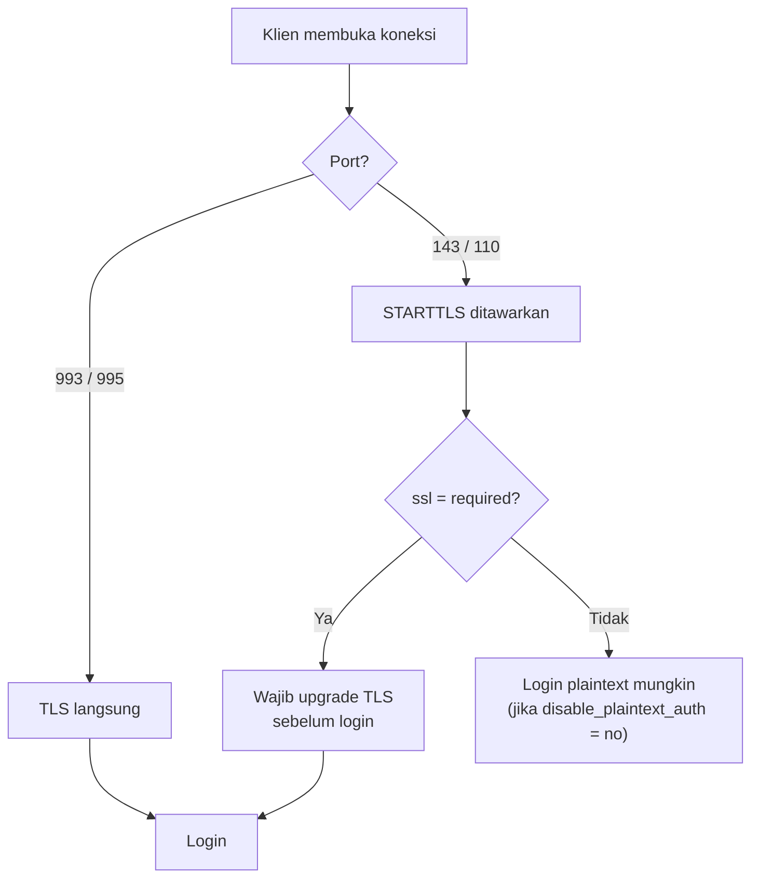

# Konfigurasi IMAP dan POP3

!!! info "Identitas chapter"
    **ID:** `CH-06-02-02` · **Kategori/modul:** CAT-06 / MOD-06-02 (Dovecot) · **Estimasi:** 90 menit · **Lingkungan:** lab lokal (VM) · [Lihat chapter ini di dashboard](../../../#CH-06-02-02)

!!! danger "Plaintext hanya untuk lab tertutup"
    Contoh menonaktifkan persyaratan TLS untuk login **hanya pada loopback di VM lab**. Jangan lakukan di jaringan yang dapat dijangkau pihak lain. TLS yang benar dibahas di CAT-08. Belum dijalankan penulis (`verified_on: null`).

## 1. Ringkasan

Anda mengaktifkan protokol IMAP (dan POP3 bila perlu), memahami pengaturan `protocols`, `listen`, dan `ssl`, lalu menguji akses mailbox dengan `doveadm` dan `openssl s_client`.

## 2. Tujuan Pembelajaran

1. Mengaktifkan `protocols = imap` (dan opsional `pop3`) dan membatasi `listen`.
2. Memahami `ssl` dan `disable_plaintext_auth` serta dampaknya.
3. Menguji akses IMAP lewat TLS dengan `openssl s_client` dan lewat `doveadm`.
4. Menjelaskan kapan POP3 pantas diaktifkan.

## 3. Prasyarat

- `CH-06-02-01`.

## 4. Materi Teori

### 4.1 Protokol dan port

| Layanan | Port | TLS |
|---|---|---|
| IMAP | 143 | `STARTTLS` |
| IMAPS | 993 | TLS langsung |
| POP3 | 110 | `STARTTLS` |
| POP3S | 995 | TLS langsung |

Paket Dovecot di Ubuntu umumnya menyiapkan sertifikat swasigned bawaan agar layanan dapat mulai (periksa `ssl_cert` pada `doveconf -n`); **ini tidak untuk produksi**. Sertifikat tepercaya dibahas di CAT-08.

### 4.2 Pengaturan penting

| Parameter | Fungsi |
|---|---|
| `protocols` | Layanan yang diaktifkan |
| `listen` | Alamat tempat mendengarkan |
| `ssl` | `yes`, `required`, atau `no` |
| `disable_plaintext_auth` | Menolak login tanpa TLS |

Praktik aman: `ssl = required` dan `disable_plaintext_auth = yes` (default pada paket modern biasanya aman). Menurunkannya hanya untuk percobaan pada loopback.



### 4.3 IMAP vs POP3

Aktifkan IMAP untuk penggunaan modern. Aktifkan POP3 hanya jika ada klien/kebutuhan khusus (mis. perangkat lama); setiap protokol tambahan memperluas permukaan serangan.

## 5. Praktik dan Implementasi

**Checklist persiapan**

- [ ] `CH-06-02-01` selesai; akun `labuser` memiliki kata sandi uji (jangan dicatat).
- [ ] Snapshot VM.

**Langkah**

1. Setel `protocols` dan `listen`.
2. Pastikan `ssl` tidak dilonggarkan kecuali untuk loopback terkontrol.
3. Reload, periksa port.
4. Uji koneksi TLS ke 993.
5. Uji akses mailbox dengan `doveadm`.

## 6. Perintah Linux

```bash title="Memeriksa pengaturan dan me-reload"
sudo doveconf protocols listen ssl disable_plaintext_auth
sudo systemctl reload dovecot
sudo ss -tlnp | grep dovecot
```

```bash title="Uji koneksi TLS"
openssl s_client -connect 127.0.0.1:993 -quiet
```

Bentuk yang diharapkan: handshake TLS (galat verifikasi sertifikat swasigned wajar) lalu baris `* OK [CAPABILITY ...] Dovecot ready.` Ketik `a1 LOGOUT` untuk keluar. **Jangan mengetik kata sandi nyata.**

```bash title="Akses mailbox tanpa login jaringan"
sudo doveadm mailbox list -u labuser
sudo doveadm fetch -u labuser 'hdr' mailbox INBOX | head -20
```

`doveadm fetch` dijalankan sebagai root dan membaca mailbox; gunakan hanya pada akun uji.

## 7. Konfigurasi

```text title="/etc/dovecot/dovecot.conf (potongan)"
protocols = imap lmtp
listen = *, ::
```

```text title="/etc/dovecot/conf.d/10-ssl.conf (potongan; jangan melonggarkan)"
ssl = required
```

- `protocols = imap lmtp` mengaktifkan IMAP dan LMTP; tambahkan `pop3` hanya bila perlu.
- `listen = *, ::` mendengarkan semua alamat; di lab tertutup ganti dengan alamat spesifik. Sesuaikan dengan firewall (UFW belum membuka port 993; buka secara sadar dan hanya untuk lab).
- Jika Anda perlu uji plaintext, lakukan **hanya di loopback** dan kembalikan setelah selesai.

## 8. Verifikasi

```bash title="Verifikasi"
doveconf -n | grep -E 'protocols|ssl|listen'
sudo ss -tlnp | grep -E ':(143|993)\b'
```

Hasil yang diharapkan: protokol sesuai, port IMAP mendengarkan, `ssl` sesuai niat Anda. Nilai bergantung pada konfigurasi bawaan paket.

## 9. Troubleshooting

| Gejala | Kemungkinan penyebab | Tindakan |
|---|---|---|
| Port 993 tidak mendengarkan | `protocols` tidak memuat imap | Periksa dan reload |
| Sertifikat ditolak klien | Swasigned | Wajar di lab; solusi di CAT-08 |
| `Plaintext authentication disabled` | Login tanpa TLS | Gunakan TLS |
| Tidak dapat terhubung dari host | Firewall/`listen` | UFW dan alamat `listen` |

## 10. Security Review

- Jangan menonaktifkan persyaratan TLS di luar loopback.
- Sertifikat swasigned melatih kebiasaan buruk "abaikan peringatan"; ganti dengan sertifikat nyata secepatnya (CAT-08).
- Batasi `listen` dan buka port hanya yang dibutuhkan.
- POP3 tanpa kebutuhan = permukaan serangan tambahan.

## 11. Latihan

1. Bandingkan banner IMAP via 993 dan 143.
2. Jelaskan dampak `ssl = required` terhadap klien lama.
3. Putuskan apakah POP3 perlu untuk skenario Anda, dengan alasan.

## 12. Assessment

1. Apa beda 143 dan 993?
2. Mengapa sertifikat swasigned bawaan tidak untuk produksi?
3. Apa fungsi `disable_plaintext_auth`?

**Kunci singkat.** (1) STARTTLS vs TLS langsung. (2) Tidak tepercaya dan sama pada banyak instalasi. (3) Menolak login tanpa enkripsi.

## 13. Checklist Kelulusan

- [ ] IMAP aktif dan teruji lewat TLS.
- [ ] Pengaturan keamanan tidak dilonggarkan di luar loopback.
- [ ] Keputusan POP3 didokumentasikan.

!!! note "Status belajar"
    Ubah status chapter secara manual di dashboard. Menyelesaikan checklist ini tidak mengubah status otomatis.

## 14. Referensi Resmi

- [Dovecot: SSL configuration](https://doc.dovecot.org/2.3/configuration_manual/dovecot_ssl_configuration/)
- [Dokumentasi Dovecot 2.3 (termasuk doveadm)](https://doc.dovecot.org/2.3/)
- [RFC 3501 — IMAP4rev1](https://www.rfc-editor.org/rfc/rfc3501)
- [RFC 8314 — TLS untuk email](https://www.rfc-editor.org/rfc/rfc8314)

Tautan referensi tidak diverifikasi otomatis pada build ini; periksa ketersediaannya sebelum dipakai.

---

[Kembali ke dashboard kurikulum](../../../#CH-06-02-02){ .md-button }
