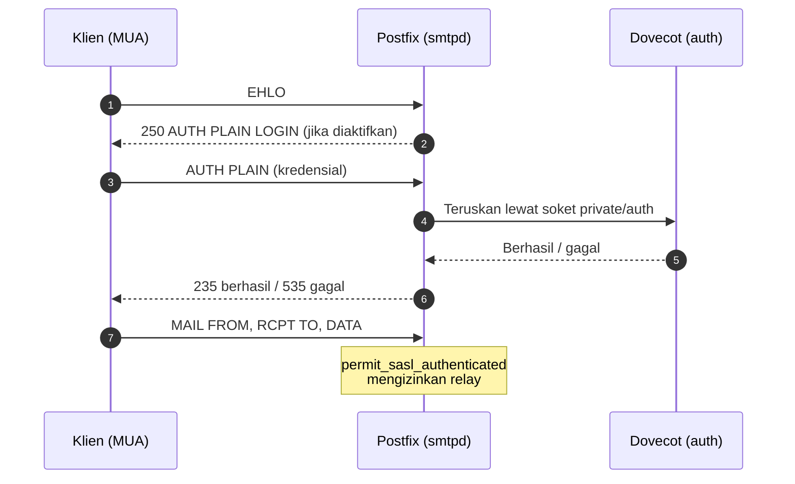

# Autentikasi: Sistem vs Virtual User dan SASL dengan Postfix

!!! info "Identitas chapter"
    **ID:** `CH-06-02-03` · **Kategori/modul:** CAT-06 / MOD-06-02 (Dovecot) · **Estimasi:** 150 menit · **Lingkungan:** lab lokal (VM) · [Lihat chapter ini di dashboard](../../../#CH-06-02-03)

!!! warning "Status verifikasi"
    Mengubah dua layanan sekaligus; belum dijalankan penulis (`verified_on: null`). Hash kata sandi bukan rahasia yang boleh disimpan di repositori. SMTP AUTH di port 25 **tanpa TLS** mengirim kredensial terbuka; di sini hanya untuk loopback/lab tertutup, TLS di CAT-08.

## 1. Ringkasan

Anda membandingkan **system user** dan **virtual user**, memilih skema hash kata sandi, lalu mengintegrasikan **SMTP AUTH** Postfix dengan Dovecot sebagai penyedia SASL, dan menguji dengan `doveadm auth test`.

## 2. Tujuan Pembelajaran

1. Membandingkan system user dan virtual user (passwd-file).
2. Membuat hash kata sandi dengan `doveadm pw` dan menyimpannya di berkas pengguna.
3. Mengonfigurasi `auth` Dovecot dan soket SASL untuk Postfix.
4. Mengaktifkan `smtpd_sasl_*` pada Postfix dan menguji autentikasi.

## 3. Prasyarat

- `CH-06-02-02`; relay dari `CH-06-01-04`.

## 4. Materi Teori

### 4.1 System vs virtual user

| Aspek | System user | Virtual user |
|---|---|---|
| Akun | Akun Linux (`/etc/passwd`) | Entri di berkas/DB Dovecot |
| Login shell | Berpotensi | Tidak ada |
| Skala | Terbatas | Cocok untuk banyak domain/akun |
| Risiko | Kredensial email = kredensial sistem | Terisolasi dari OS |

Virtual user adalah pilihan yang disarankan untuk produksi (dibahas lanjut di CAT-07). Chapter ini memakai **passwd-file** sederhana di lab.

### 4.2 Alur SASL Postfix–Dovecot



Postfix tidak menyimpan kata sandi; ia mendelegasikan verifikasi ke Dovecot melalui soket Unix.

### 4.3 Skema hash

Gunakan skema kuat dan bergaram yang didukung Dovecot, mis. `ARGON2ID` bila tersedia atau `SHA512-CRYPT`. Lihat daftar dengan `doveadm pw -l`. Jangan memakai `PLAIN`, `MD5` tanpa garam, atau skema lemah lain.

## 5. Praktik dan Implementasi

**Checklist persiapan**

- [ ] Snapshot VM, backup `/etc/dovecot` dan `/etc/postfix`.
- [ ] Mengetahui bahwa tahap ini lab tertutup.

**Langkah**

1. Buat hash kata sandi uji (bagian 6).
2. Buat berkas pengguna `passwd-file`.
3. Atur `auth` Dovecot dan soket Postfix.
4. Atur parameter SASL Postfix.
5. Uji dengan `doveadm auth test`.
6. Uji SMTP AUTH dari loopback.

## 6. Perintah Linux

```bash title="Membuat hash (kata sandi diminta interaktif)"
doveadm pw -l
doveadm pw -s SHA512-CRYPT
```

`doveadm pw` meminta kata sandi dua kali dan mencetak hash seperti `{SHA512-CRYPT}$6$...`. Salin hasilnya ke berkas pengguna; jangan mengetik kata sandi pada argumen perintah karena tersimpan di riwayat shell.

```bash title="Berkas pengguna virtual"
sudo install -m 0640 -o root -g dovecot /dev/null /etc/dovecot/users
sudo nano /etc/dovecot/users
```

Isi baris berformat `pengguna@domain:{HASH}` (lihat bagian 7). Izin `0640 root:dovecot` agar hanya Dovecot yang membaca hash.

```bash title="Terapkan dan uji"
sudo doveconf -n > /dev/null && sudo systemctl restart dovecot
sudo postfix check && sudo systemctl reload postfix
doveadm auth test siti@example.com
```

`doveadm auth test` meminta kata sandi; keluaran berhasil mengandung `auth succeeded`. Nama persis keluaran dapat berbeda antar versi.

## 7. Konfigurasi

```text title="/etc/dovecot/conf.d/10-auth.conf (potongan)"
auth_mechanisms = plain login
!include auth-passwdfile.conf.ext
```

```text title="/etc/dovecot/conf.d/auth-passwdfile.conf.ext (cek isi bawaan)"
passdb {
  driver = passwd-file
  args = scheme=SHA512-CRYPT username_format=%u /etc/dovecot/users
}
userdb {
  driver = passwd-file
  args = username_format=%u /etc/dovecot/users
}
```

Sesuaikan `scheme` dengan hash yang Anda buat. Pada virtual user, `userdb` perlu `uid`, `gid`, dan `home` (disediakan di CAT-07); untuk uji autentikasi saja `passdb` sudah cukup. Aktifkan satu include (`auth-system.conf.ext` **atau** `auth-passwdfile.conf.ext`) untuk menghindari kebingungan.

Soket SASL untuk Postfix:

```text title="/etc/dovecot/conf.d/10-master.conf (potongan)"
service auth {
  unix_listener /var/spool/postfix/private/auth {
    mode = 0660
    user = postfix
    group = postfix
  }
}
```

Parameter SASL Postfix:

```bash title="Mengaktifkan SASL di Postfix"
sudo postconf -e 'smtpd_sasl_type = dovecot'
sudo postconf -e 'smtpd_sasl_path = private/auth'
sudo postconf -e 'smtpd_sasl_auth_enable = yes'
sudo postconf -e 'smtpd_tls_auth_only = yes'
```

- `smtpd_sasl_path` relatif terhadap `queue_directory` (`/var/spool/postfix`).
- `smtpd_tls_auth_only = yes` mencegah AUTH di sesi tanpa TLS dan **membuat uji lokal gagal sampai TLS siap**; ini perilaku yang diinginkan. Untuk menguji AUTH lokal sementara, hapus pengaturan itu hanya di VM tertutup lalu kembalikan. Idealnya selesaikan CAT-08 terlebih dahulu.

## 8. Verifikasi

```bash title="Verifikasi"
ls -l /var/spool/postfix/private/auth
postconf smtpd_sasl_type smtpd_sasl_path smtpd_sasl_auth_enable
journalctl -u dovecot -n 20 --no-pager
```

Hasil yang diharapkan: soket ada dengan pemilik `postfix`, parameter SASL terpasang, dan log Dovecot menunjukkan autentikasi berhasil/gagal sesuai uji tanpa galat konfigurasi. Uji kegagalan (kata sandi salah) harus ditolak.

## 9. Troubleshooting

| Gejala | Kemungkinan penyebab | Tindakan |
|---|---|---|
| Soket `private/auth` tidak ada | `service auth` belum diterapkan | Restart Dovecot, cek `10-master.conf` |
| `535 authentication failed` | Hash/skema tidak cocok | Samakan `scheme` dan hash |
| `AUTH` tidak ditawarkan | `smtpd_tls_auth_only` tanpa TLS | Selesaikan TLS atau uji di lab tertutup |
| Postfix tidak dapat menulis log SASL | Izin soket | Periksa `mode/user/group` |

## 10. Security Review

- Kata sandi **tidak boleh** dicatat di repositori, riwayat shell, atau tangkapan layar.
- AUTH tanpa TLS membocorkan kredensial; produksi mewajibkan TLS (CAT-08).
- Batasi izin berkas pengguna; backup berkas hash harus terenkripsi.
- Pertimbangkan pembatasan laju login (CAT-10).

## 11. Latihan

1. Buat dua hash dengan skema berbeda dan bandingkan format.
2. Jelaskan mengapa Postfix tidak membaca berkas pengguna langsung.
3. Uji kegagalan login dan baca log Dovecot.

## 12. Assessment

1. Apa keuntungan virtual user dibanding system user?
2. Apa fungsi soket `private/auth`?
3. Mengapa `smtpd_tls_auth_only = yes`?

**Kunci singkat.** (1) Terpisah dari OS dan lebih skalabel. (2) Jalur komunikasi Postfix ke Dovecot untuk verifikasi. (3) Mencegah kredensial terkirim tanpa enkripsi.

## 13. Checklist Kelulusan

- [ ] Saya dapat membuat hash kuat dan menyimpannya dengan izin ketat.
- [ ] `doveadm auth test` berhasil untuk kredensial benar dan gagal untuk yang salah.
- [ ] SASL Postfix–Dovecot terkonfigurasi; keterbatasan TLS dipahami.

!!! note "Status belajar"
    Ubah status chapter secara manual di dashboard. Menyelesaikan checklist ini tidak mengubah status otomatis.

## 14. Referensi Resmi

- [Dovecot: Authentication](https://doc.dovecot.org/2.3/configuration_manual/authentication/)
- [Dovecot: Password schemes](https://doc.dovecot.org/2.3/configuration_manual/authentication/password_schemes/)
- [Dovecot: Postfix and Dovecot SASL](https://doc.dovecot.org/2.3/configuration_manual/howto/postfix_and_dovecot_sasl/)
- [Postfix: SASL README](https://www.postfix.org/SASL_README.html)

Tautan referensi tidak diverifikasi otomatis pada build ini; periksa ketersediaannya sebelum dipakai.

---

[Kembali ke dashboard kurikulum](../../../#CH-06-02-03){ .md-button }
