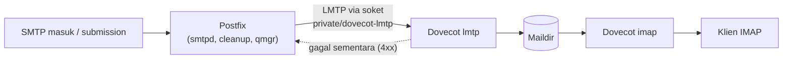

# Integrasi LMTP Postfix dan Dovecot

!!! info "Identitas chapter"
    **ID:** `CH-06-02-04` · **Kategori/modul:** CAT-06 / MOD-06-02 (Dovecot) · **Estimasi:** 90 menit · **Lingkungan:** lab lokal (VM) · [Lihat chapter ini di dashboard](../../../#CH-06-02-04)

!!! warning "Status verifikasi"
    Belum dijalankan penulis (`verified_on: null`). Perubahan `mailbox_transport`/`virtual_transport` mengalihkan seluruh delivery; backup konfigurasi dan uji dengan akun uji.

## 1. Ringkasan

Daripada Postfix menulis ke Maildir sendiri, Postfix menyerahkan pesan ke Dovecot lewat **LMTP**. Dovecot lalu menyimpan pesan, sehingga satu komponen memegang aturan penyimpanan (izin, kuota, Sieve). Ini menyelesaikan alur end-to-end Level 5: kirim → antre → LMTP → Maildir → IMAP.

## 2. Tujuan Pembelajaran

1. Menjelaskan LMTP dan perbedaannya dengan SMTP.
2. Mengaktifkan layanan `lmtp` Dovecot dengan soket untuk Postfix.
3. Mengonfigurasi Postfix agar mengirim lokal lewat LMTP.
4. Memverifikasi alur delivery melalui log dan membaca pesan lewat IMAP.

## 3. Prasyarat

- `CH-06-02-03`; Dovecot dengan `lmtp` di `protocols`.

## 4. Materi Teori

### 4.1 LMTP

LMTP (RFC 2033) mirip SMTP tetapi untuk penyerahan **lokal** akhir: tidak ada antrean sendiri dan memberi status per penerima, sehingga satu penerima yang gagal tidak membuat pesan seluruhnya gagal. Dovecot menyediakan server LMTP.

### 4.2 Alur



Jika Dovecot menolak sementara, Postfix mengantre dan mencoba lagi; jika menolak permanen (mis. pengguna tidak ada), Postfix menghasilkan bounce.

### 4.3 Dua pengaturan Postfix

| Parameter | Dipakai untuk |
|---|---|
| `mailbox_transport` | Pengiriman ke akun **lokal** (system user) |
| `virtual_transport` | Pengiriman ke mailbox **virtual** (CAT-07) |

Untuk lab ini dengan system user, gunakan `mailbox_transport`; `virtual_transport` akan dipakai di CAT-07.

## 5. Praktik dan Implementasi

**Checklist persiapan**

- [ ] Backup `/etc/dovecot` dan `/etc/postfix`.
- [ ] `protocols` Dovecot memuat `lmtp` (`CH-06-02-02`).
- [ ] Akun `labuser` dan Maildir tersedia.

**Langkah**

1. Tambahkan soket LMTP di Dovecot.
2. Atur transport Postfix.
3. Validasi kedua layanan.
4. Kirim pesan uji ke `labuser`.
5. Verifikasi dengan log dan `doveadm`.

## 6. Perintah Linux

```bash title="Mengatur Postfix"
sudo postconf -e 'mailbox_transport = lmtp:unix:private/dovecot-lmtp'
sudo postconf -e 'home_mailbox ='
sudo postfix check && sudo systemctl reload postfix
```

- `home_mailbox` dikosongkan agar tidak bertabrakan dengan `mailbox_transport`; Dovecot yang menentukan lokasi Maildir (`mail_location`).
- Alamat `unix:private/dovecot-lmtp` relatif ke `/var/spool/postfix`.

```bash title="Menerapkan di Dovecot dan menguji"
sudo doveconf -n > /dev/null && sudo systemctl restart dovecot
printf 'Subject: uji lmtp\n\nIsi.\n' | sendmail labuser
sudo doveadm mailbox status -u labuser messages INBOX
```

Hasil yang diharapkan pada `doveadm mailbox status`: jumlah `messages` bertambah setelah pengiriman.

## 7. Konfigurasi

```text title="/etc/dovecot/conf.d/10-master.conf (potongan)"
service lmtp {
  unix_listener /var/spool/postfix/private/dovecot-lmtp {
    mode = 0600
    user = postfix
    group = postfix
  }
}
```

```text title="/etc/postfix/main.cf (potongan)"
mailbox_transport = lmtp:unix:private/dovecot-lmtp
```

- Bagian `service lmtp` mungkin sudah ada di `10-master.conf`; **ubah** blok yang ada, jangan membuat duplikat.
- Jalur `private/dovecot-lmtp` relatif terhadap `queue_directory` (`/var/spool/postfix`). Bila ada galat "No such file", periksa keberadaan soket di `/var/spool/postfix/private/`.

## 8. Verifikasi

```bash title="Verifikasi"
ls -l /var/spool/postfix/private/dovecot-lmtp
journalctl -u 'postfix@-' --since "5 min ago" --no-pager | grep -E 'relay=.*dovecot-lmtp|status='
journalctl -u dovecot --since "5 min ago" --no-pager | grep -i lmtp
```

Hasil yang diharapkan: soket ada; log Postfix menunjukkan `status=sent` dengan relay `private/dovecot-lmtp`; log Dovecot mencatat penyimpanan pesan. Bentuk persis baris bergantung pada versi.

Uji IMAP dari mailbox: `sudo doveadm fetch -u labuser 'hdr.subject' mailbox INBOX` menampilkan subjek uji.

## 9. Troubleshooting

| Gejala | Kemungkinan penyebab | Tindakan |
|---|---|---|
| `connect to private/dovecot-lmtp: No such file` | Soket belum dibuat | Periksa `service lmtp`, restart Dovecot |
| `Permission denied` ke soket | `user/group/mode` salah | Samakan dengan pengguna `postfix` |
| Pesan deferred | Dovecot menolak sementara | Baca log Dovecot |
| `User doesn't exist` | Akun tidak dikenal | Periksa `userdb` |
| Dua salinan pesan | `home_mailbox` dan LMTP aktif bersamaan | Pastikan satu jalur saja |

## 10. Security Review

- Soket LMTP hanya dapat diakses `postfix`; mode `0600`.
- Jangan membuka LMTP di TCP publik.
- Dovecot memegang penyimpanan, sehingga kebijakan izin dan kuota terpusat.
- Perhatikan agar bounce tidak mengalir ke pihak ketiga (backscatter, `CH-03-02-02`).

## 11. Latihan

1. Jelaskan alur satu pesan dari `sendmail` sampai muncul di IMAP.
2. Hentikan Dovecot sebentar, kirim pesan, amati `deferred`, hidupkan lagi dan `postqueue -f`.
3. Bandingkan jalur `home_mailbox` vs LMTP dalam tabel.

## 12. Assessment

1. Apa perbedaan LMTP dan SMTP?
2. Mengapa `home_mailbox` dikosongkan saat memakai LMTP?
3. Apa yang terjadi bila Dovecot mati saat pesan datang?

**Kunci singkat.** (1) LMTP untuk penyerahan lokal akhir dengan status per penerima. (2) Menghindari delivery ganda. (3) Pesan menjadi deferred dan dicoba ulang.

## 13. Checklist Kelulusan

- [ ] Pesan uji terkirim lewat LMTP dan terbaca via IMAP/`doveadm`.
- [ ] `postfix check` dan `doveconf -n` tanpa galat.
- [ ] Uji relay ditolak masih lulus (ulang `CH-06-01-04`).
- [ ] Deliverable Level 5: konfigurasi terdokumentasi dan bukti uji (tanpa kredensial).

!!! note "Status belajar"
    Ubah status chapter secara manual di dashboard. Menyelesaikan checklist ini tidak mengubah status otomatis.

## 14. Referensi Resmi

- [RFC 2033 — LMTP](https://www.rfc-editor.org/rfc/rfc2033)
- [Dovecot: LMTP server](https://doc.dovecot.org/2.3/configuration_manual/protocols/lmtp_server/)
- [Postfix: mailbox_transport](https://www.postfix.org/postconf.5.html#mailbox_transport)
- [Postfix: virtual_transport](https://www.postfix.org/postconf.5.html#virtual_transport)

Tautan referensi tidak diverifikasi otomatis pada build ini; periksa ketersediaannya sebelum dipakai.

---

[Kembali ke dashboard kurikulum](../../../#CH-06-02-04){ .md-button }
