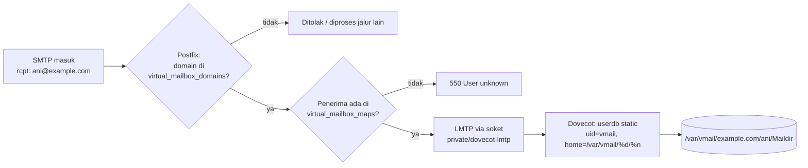

# Virtual Domain dan Virtual Mailbox

!!! info "Identitas chapter"
    **ID:** `CH-07-01-01` · **Kategori/modul:** CAT-07 / MOD-07-01 (Provisioning Mailbox) · **Estimasi:** 150 menit · **Lingkungan:** lab lokal (VM) · [Lihat chapter ini di dashboard](../../../#CH-07-01-01)

!!! warning "Peringatan"
    Perubahan `virtual_transport` dan `mydestination` mengalihkan delivery. Backup `/etc/postfix` dan `/etc/dovecot`, dan uji hanya di VM lab dengan domain contoh. Belum dijalankan penulis pada VM (`verified_on: null`).

## 1. Ringkasan

Sampai Level 5 mailbox berasal dari akun sistem Linux. Di chapter ini Anda memindahkan domain `example.com` ke model **virtual**: alamat email tidak lagi sama dengan akun login Linux, dan semua mailbox disimpan di bawah satu pengguna layanan `vmail`. Postfix hanya memvalidasi penerima, sedangkan Dovecot menyimpan pesan lewat LMTP (`CH-06-02-04`) dan mengautentikasi pengguna dari berkas `passwd-file`.

## 2. Tujuan Pembelajaran

1. Menjelaskan peran `virtual_mailbox_domains`, `virtual_mailbox_maps`, dan `virtual_transport`.
2. Membuat pengguna layanan `vmail` dan direktori penyimpanan dengan izin minimal.
3. Mengonfigurasi Dovecot (`passdb` passwd-file dan `userdb` static) untuk dua akun uji.
4. Memverifikasi penerima dikenal Postfix dan akun dikenal Dovecot.

## 3. Prasyarat

- `CH-06-02-04` — Integrasi LMTP Postfix dan Dovecot.
- Postfix dengan LMTP ke Dovecot berfungsi untuk akun sistem (`CH-06-02-04`).

## 4. Materi Teori

### 4.1 Pembagian tugas

| Komponen | Tugas pada model virtual |
|---|---|
| Postfix | Menerima untuk domain virtual, **memvalidasi** penerima (`virtual_mailbox_maps`), menyerahkan ke LMTP |
| Dovecot LMTP | Menyimpan pesan ke Maildir milik `vmail` |
| Dovecot auth | Memverifikasi kata sandi (`passdb`) dan menentukan lokasi mailbox (`userdb`) |

Domain tidak boleh berada di `mydestination` **dan** `virtual_mailbox_domains` sekaligus; Postfix akan memperlakukannya sebagai konfigurasi bertabrakan.



### 4.2 Parameter inti

| Parameter | Fungsi |
|---|---|
| `virtual_mailbox_domains` | Daftar domain yang dilayani sebagai virtual |
| `virtual_mailbox_maps` | Tabel penerima valid (untuk validasi saat RCPT) |
| `virtual_transport` | Transport pengiriman; di sini LMTP ke Dovecot |

## 5. Praktik dan Implementasi

**Checklist persiapan**

- [ ] Snapshot VM dan backup `/etc/postfix`, `/etc/dovecot`.
- [ ] Domain contoh `example.com` dipakai hanya di lab.

**Langkah**

1. Buat pengguna sistem `vmail` tanpa login dan direktori `/var/vmail`.
2. Hapus `example.com` dari `mydestination` jika ada (pada contoh `CH-06-01-02` nilainya tidak memuat domain utama).
3. Tambahkan parameter virtual di Postfix, buat tabel `vmailbox`, dan `postmap`.
4. Konfigurasikan `passdb`/`userdb` Dovecot dan buat berkas `users`.
5. Validasi konfigurasi, reload, lalu uji.

## 6. Perintah Linux

```bash title="Pengguna layanan dan direktori"
sudo groupadd -g 5000 vmail
sudo useradd -u 5000 -g vmail -d /var/vmail -s /usr/sbin/nologin -r vmail
sudo mkdir -p /var/vmail
sudo chown vmail:vmail /var/vmail
sudo chmod 0700 /var/vmail
```

UID/GID 5000 hanyalah contoh; pilih nilai yang belum terpakai (`getent passwd 5000`).

```bash title="Parameter Postfix"
sudo postconf -e 'virtual_mailbox_domains = example.com'
sudo postconf -e 'virtual_mailbox_maps = hash:/etc/postfix/vmailbox'
sudo postconf -e 'virtual_transport = lmtp:unix:private/dovecot-lmtp'
printf 'ani@example.com example.com/ani/\nbudi@example.com example.com/budi/\n' | sudo tee /etc/postfix/vmailbox >/dev/null
sudo postmap /etc/postfix/vmailbox
sudo postfix check && sudo systemctl reload postfix
```

```bash title="Membuat hash kata sandi untuk Dovecot (interaktif)"
doveadm pw -s SHA512-CRYPT
```

Perintah meminta kata sandi uji dua kali dan mencetak hash berawalan `{SHA512-CRYPT}`. Jangan menyalin hash nyata ke repositori atau catatan.

## 7. Konfigurasi

```text title="/etc/dovecot/users (satu baris per akun; hash adalah placeholder)"
ani@example.com:{SHA512-CRYPT}<HASH-DARI-DOVEADM-PW>
budi@example.com:{SHA512-CRYPT}<HASH-DARI-DOVEADM-PW>
```

```text title="/etc/dovecot/conf.d/auth-passwdfile.conf.ext (ringkas)"
passdb {
  driver = passwd-file
  args = scheme=SHA512-CRYPT username_format=%u /etc/dovecot/users
}
userdb {
  driver = static
  args = uid=vmail gid=vmail home=/var/vmail/%d/%n
}
```

```text title="/etc/dovecot/conf.d/10-mail.conf (potongan)"
mail_location = maildir:~/Maildir
```

- Pastikan `auth_username_format` dan `10-auth.conf` memuat `auth-passwdfile.conf.ext` dan tidak lagi memuat blok `passdb`/`userdb` sistem yang bertabrakan; periksa dengan `doveconf -n`.
- Izin berkas `users`: `sudo chown root:dovecot /etc/dovecot/users && sudo chmod 0640 /etc/dovecot/users`.
- Nama berkas dan baris `!include` pada paket Ubuntu dapat berbeda; sesuaikan dengan `doveconf -n`.

## 8. Verifikasi

```bash title="Verifikasi"
sudo postmap -q ani@example.com hash:/etc/postfix/vmailbox
sudo doveadm user ani@example.com
sudo doveadm auth test ani@example.com
```

Hasil yang diharapkan: `postmap -q` mencetak `example.com/ani/`; `doveadm user` menampilkan `uid`/`gid` `vmail` dan `home`; `doveadm auth test` meminta kata sandi uji lalu melaporkan keberhasilan. Kirim pesan uji ke `ani@example.com` dan periksa `/var/vmail/example.com/ani/Maildir/new/` (sebagai root). Bentuk keluaran persis bergantung pada versi.

## 9. Troubleshooting

| Gejala | Kemungkinan penyebab | Tindakan |
|---|---|---|
| `User unknown in virtual mailbox table` | Entri `vmailbox` hilang / `postmap` belum dijalankan | Jalankan `postmap`, reload |
| `mail for example.com loops back to myself` | Domain ada di `mydestination` | Hapus dari `mydestination` |
| `auth test` gagal | Hash salah / skema tidak cocok | Buat ulang hash dengan skema yang sama dengan `scheme=` |
| `Permission denied` ke Maildir | Pemilik bukan `vmail` | `chown -R vmail:vmail /var/vmail` |

## 10. Security Review

- `/var/vmail` berisi semua email: izin `0700` dan pemilik `vmail`.
- Berkas `users` memuat hash kata sandi; batasi baca dan jangan commit ke repositori.
- Gunakan skema hash kuat (SHA512-CRYPT atau yang direkomendasikan dokumentasi Dovecot); jangan skema plaintext.
- `vmail` tidak boleh punya shell login.

## 11. Latihan

1. Tambahkan akun ketiga dan buktikan penerima dikenal Postfix dan Dovecot.
2. Kirim ke penerima yang tidak ada dan baca penolakannya di log.
3. Gambar ulang diagram alur untuk domain kedua.

## 12. Assessment

1. Mengapa domain tidak boleh berada di `mydestination` dan `virtual_mailbox_domains` sekaligus?
2. Apa fungsi `virtual_mailbox_maps` bila penyimpanan dilakukan Dovecot?
3. Mengapa `vmail` tidak diberi shell?

**Kunci singkat.** (1) Bertabrakan, mail loop. (2) Validasi penerima saat RCPT. (3) Mengurangi dampak bila akun disalahgunakan.

## 13. Checklist Kelulusan

- [ ] Dua akun virtual dikenal Postfix dan Dovecot.
- [ ] Pesan uji tersimpan di Maildir milik `vmail`.
- [ ] Tidak ada hash atau kata sandi nyata tersimpan di catatan.

!!! note "Status belajar"
    Ubah status chapter secara manual di dashboard. Menyelesaikan checklist ini tidak mengubah status otomatis.

## 14. Referensi Resmi

- [Postfix: Virtual Domain Hosting Howto](https://www.postfix.org/VIRTUAL_README.html)
- [Postfix: virtual_mailbox_maps](https://www.postfix.org/postconf.5.html#virtual_mailbox_maps)
- [Dokumentasi Dovecot 2.3: passwd-file](https://doc.dovecot.org/2.3/configuration_manual/authentication/passwd_file/)

Tautan referensi tidak diverifikasi otomatis pada build ini; periksa ketersediaannya sebelum dipakai.

---

[Kembali ke dashboard kurikulum](../../../#CH-07-01-01){ .md-button }
