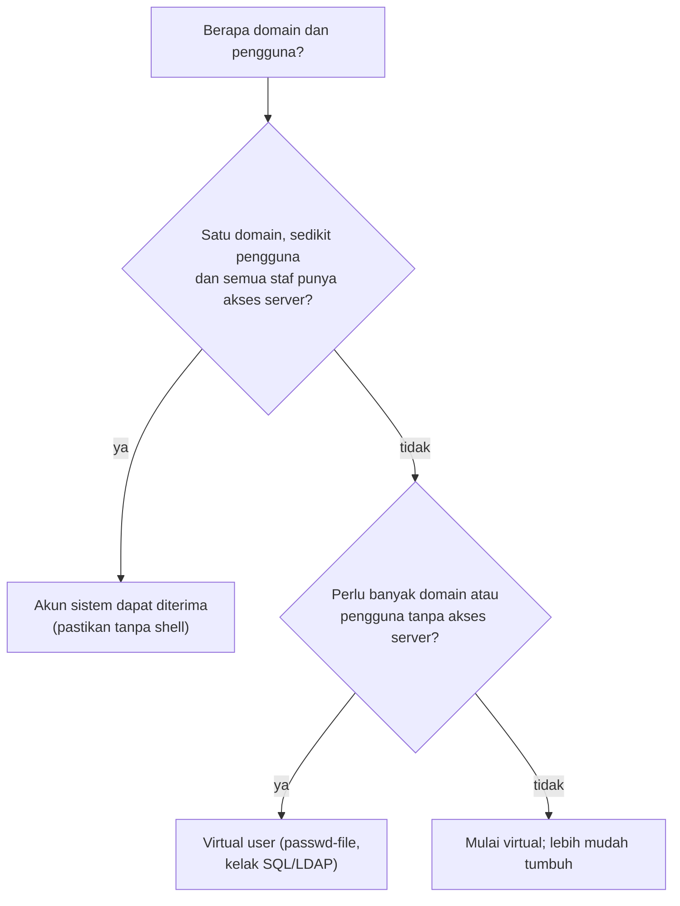

# Akun Sistem vs Virtual User: Trade-off

!!! info "Identitas chapter"
    **ID:** `CH-07-01-02` · **Kategori/modul:** CAT-07 / MOD-07-01 (Provisioning Mailbox) · **Estimasi:** 60 menit · **Lingkungan:** lab lokal (VM) · [Lihat chapter ini di dashboard](../../../#CH-07-01-02)

!!! note "Status verifikasi"
    Isi chapter ini ditulis dari dokumentasi resmi dan belum dijalankan penulis pada VM (`verified_on: null`).

## 1. Ringkasan

Dua model pengelolaan akun mailbox hidup berdampingan dalam praktik: akun sistem Linux (`CH-06-02-03`) dan pengguna virtual (`CH-07-01-01`). Chapter ini konseptual: Anda membandingkan trade-off dan memilih model berdasarkan skenario.

## 2. Tujuan Pembelajaran

1. Membandingkan model akun sistem dan virtual dari sisi keamanan, skala, dan operasi.
2. Memilih model untuk skenario tertentu dan menuliskan alasannya.
3. Menjelaskan dampak pilihan terhadap migrasi di masa depan.

## 3. Prasyarat

- `CH-07-01-01` — Virtual Domain dan Virtual Mailbox.

## 4. Materi Teori

### 4.1 Perbandingan

| Aspek | Akun sistem | Virtual user |
|---|---|---|
| Identitas | Sama dengan login Linux | Hanya ada di Dovecot/Postfix |
| Risiko jika kredensial bocor | Dapat memberi akses shell/SSH bila tidak dibatasi | Terbatas pada layanan email |
| Skala | Repot di banyak domain/pengguna | Mudah: banyak domain, satu pengguna layanan |
| Isolasi antar mailbox | Per UID (kuat) | Satu UID `vmail` (isolasi bergantung konfigurasi) |
| Provisioning | `adduser`, otomatis dengan PAM | Berkas/database yang dikelola sendiri |
| Nama alamat vs nama login | Terikat | Bebas |

### 4.2 Pohon keputusan

Aturan praktis: kebanyakan produksi memakai virtual user, karena kompromi kredensial email tidak otomatis menjadi akses ke sistem operasi.

### 4.3 Migrasi

Berpindah dari sistem ke virtual berarti memindahkan Maildir ke pemilik `vmail` dan memetakan alamat; lakukan di VM lab dahulu dan simpan salinan sebelum mengubah apa pun.

## 5. Praktik dan Implementasi

1. Tulis tiga skenario (mis. keluarga, sekolah kecil, hosting multi-domain).
2. Pilih model untuk tiap skenario memakai tabel 4.1.
3. Tuliskan risiko terbesar dari pilihan Anda dan satu mitigasinya.

## 6. Perintah Linux

Chapter ini konseptual; tidak ada perintah yang mengubah sistem.

## 7. Konfigurasi

Tidak ada berkas konfigurasi yang diubah pada chapter ini.

## 8. Verifikasi

Tidak ada pemeriksaan teknis. Pastikan tiap skenario memiliki pilihan, alasan, risiko, dan mitigasi tertulis.

## 9. Troubleshooting

| Gejala | Kemungkinan penyebab | Tindakan |
|---|---|---|
| Kesulitan memilih model | Kebutuhan belum jelas | Tentukan jumlah domain, pengguna, dan akses server |
| Akun sistem dipakai untuk email dan SSH | Tidak dipisah | Pindahkan ke virtual user atau batasi shell |
| Migrasi mailbox gagal | Izin/pemilik Maildir | Salin dengan pemilik benar di VM lab |

## 10. Security Review

- Akun sistem yang kata sandinya bocor melalui email dapat menjadi pintu masuk ke server.
- Hindari memakai kata sandi yang sama untuk SSH dan IMAP/SMTP.
- Pada model virtual, jaga berkas kredensial seperti rahasia.

## 11. Latihan

1. Isi tabel keputusan untuk tiga skenario.
2. Rancang rencana migrasi singkat dari akun sistem ke virtual.
3. Jelaskan mengapa model virtual tidak otomatis lebih aman jika berkas `users` bocor.

## 12. Assessment

1. Sebutkan dua keunggulan virtual user.
2. Kapan akun sistem masih wajar dipakai?
3. Mengapa pilihan model memengaruhi respons insiden?

**Kunci singkat.** (1) Banyak domain; kompromi tidak memberi akses OS. (2) Satu domain kecil dengan pengguna yang memang pengguna server. (3) Cakupan dampak kompromi berbeda.

## 13. Checklist Kelulusan

- [ ] Tiga skenario memiliki pilihan model dan alasan.
- [ ] Risiko dan mitigasi tercatat.

!!! note "Status belajar"
    Ubah status chapter secara manual di dashboard. Menyelesaikan checklist ini tidak mengubah status otomatis.

## 14. Referensi Resmi

- [Postfix: Virtual Domain Hosting Howto](https://www.postfix.org/VIRTUAL_README.html)
- [Dokumentasi Dovecot 2.3: Authentication](https://doc.dovecot.org/2.3/configuration_manual/authentication/)

Tautan referensi tidak diverifikasi otomatis pada build ini; periksa ketersediaannya sebelum dipakai.

---

[Kembali ke dashboard kurikulum](../../../#CH-07-01-02){ .md-button }
