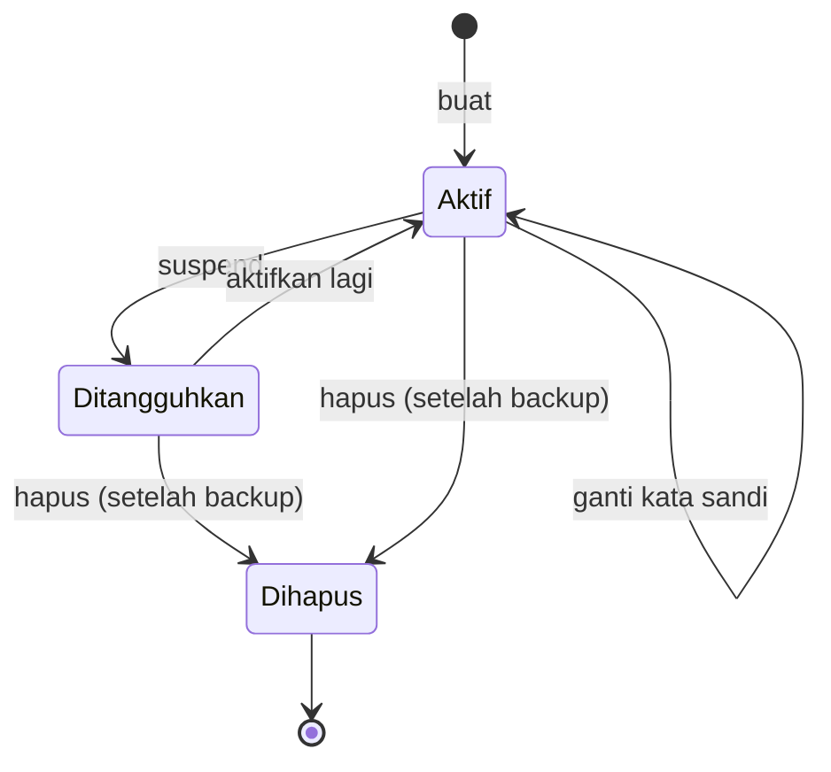

# Siklus Hidup Akun: Buat, Suspend, Hapus, Ganti Password

!!! info "Identitas chapter"
    **ID:** `CH-07-01-03` · **Kategori/modul:** CAT-07 / MOD-07-01 (Provisioning Mailbox) · **Estimasi:** 120 menit · **Lingkungan:** lab lokal (VM) · [Lihat chapter ini di dashboard](../../../#CH-07-01-03)

!!! warning "Peringatan"
    Menghapus akun berarti menghapus data email. Selalu buat salinan mailbox sebelum penghapusan, dan lakukan latihan hanya dengan akun uji. Belum dijalankan penulis pada VM (`verified_on: null`).

## 1. Ringkasan

Anda menjalankan siklus hidup akun virtual: **buat**, **suspend**, **ganti kata sandi**, dan **hapus**, dengan prosedur tertulis yang dapat diulang. Fokusnya: setiap perubahan konsisten di Postfix (`vmailbox`) dan Dovecot (`users`), dan tidak ada kata sandi yang tercetak atau tersimpan.

## 2. Tujuan Pembelajaran

1. Membuat akun baru di kedua sistem secara konsisten.
2. Menangguhkan akun tanpa menghapus data.
3. Mengganti kata sandi dan memulihkan akses secara aman.
4. Menghapus akun dengan salinan data dan langkah verifikasi.

## 3. Prasyarat

- `CH-07-01-02` — Akun Sistem vs Virtual User: Trade-off.
- Akun virtual `ani@example.com` dan `budi@example.com` dari `CH-07-01-02` (pendekatan model sudah dipilih).

## 4. Materi Teori

### 4.1 Status akun



### 4.2 Cara menangguhkan

Dua pendekatan umum pada passwd-file: tambahkan bidang ekstra `nologin` atau `allow_nets` pada baris pengguna sesuai dokumentasi, atau pindahkan sementara baris ke komentar (`#`) sehingga autentikasi gagal. Pendekatan komentar paling sederhana dan mudah dibalik; **jangan hapus** baris sebelum retensi data diputuskan. Pesan yang masuk untuk akun tersuspend tetap dapat diterima Postfix selama entri `vmailbox` ada.

### 4.3 Prinsip

Setiap perubahan dilakukan pada kedua sisi, dicatat (siapa, kapan, alasan), dan diverifikasi. Kata sandi sementara dikirim lewat kanal terpisah dan wajib diganti.

## 5. Praktik dan Implementasi

1. Buat akun `cici@example.com`.
2. Suspend lalu aktifkan kembali.
3. Ganti kata sandi.
4. Salin mailbox lalu hapus akun uji.
5. Catat tiap langkah di runbook sederhana.

## 6. Perintah Linux

```bash title="Membuat akun"
doveadm pw -s SHA512-CRYPT
echo 'cici@example.com example.com/cici/' | sudo tee -a /etc/postfix/vmailbox >/dev/null
sudo postmap /etc/postfix/vmailbox
sudo nano /etc/dovecot/users
```

Tambahkan baris `cici@example.com:{SHA512-CRYPT}<HASH>` di editor. Dovecot membaca `users` tanpa restart pada banyak kasus; bila tidak, `sudo systemctl reload dovecot`.

```bash title="Suspend (komentari baris) dan uji"
sudo sed -i 's/^cici@example.com:/#cici@example.com:/' /etc/dovecot/users
sudo doveadm auth test cici@example.com
```

Setelah dikomentari, `auth test` harus gagal. Untuk mengaktifkan, hapus tanda `#`.

```bash title="Ganti kata sandi: hasilkan hash baru, ganti hash pada baris users"
doveadm pw -s SHA512-CRYPT
```

```bash title="Salin lalu hapus akun (hanya akun uji)"
sudo tar -C /var/vmail/example.com -czf /root/cici-backup.tar.gz cici
sudo sed -i '/^#\?cici@example.com:/d' /etc/dovecot/users
sudo sed -i '/^cici@example.com /d' /etc/postfix/vmailbox
sudo postmap /etc/postfix/vmailbox
sudo rm -rf /var/vmail/example.com/cici
```

- Periksa `ls -l /root/cici-backup.tar.gz` sebelum `rm -rf`.
- Arsip berisi email sehingga harus dilindungi (`chmod 600`) dan dihapus sesuai retensi.

## 7. Konfigurasi

Tidak ada berkas baru. Berkas yang diubah: `/etc/dovecot/users` dan `/etc/postfix/vmailbox` (dengan `postmap`).

## 8. Verifikasi

```bash title="Verifikasi"
sudo doveadm auth test ani@example.com
sudo postmap -q cici@example.com hash:/etc/postfix/vmailbox
sudo doveadm user '*@example.com'
```

Hasil yang diharapkan: akun aktif lolos `auth test`; `postmap -q` setelah hapus tidak menampilkan apa-apa; `doveadm user '*@example.com'` tidak mencantumkan akun terhapus. `doveadm user` dengan wildcard memerlukan `userdb` yang dapat diiterasi; pada `userdb static` perintah ini mungkin tidak mendaftar akun, jadi gunakan `cut -d: -f1 /etc/dovecot/users` sebagai gantinya.

## 9. Troubleshooting

| Gejala | Kemungkinan penyebab | Tindakan |
|---|---|---|
| Login lama masih berhasil setelah hapus | Cache autentikasi Dovecot | `doveadm auth cache flush` atau reload |
| Pesan masih diterima akun yang dihapus | Entri `vmailbox` tertinggal | Hapus entri dan `postmap` |
| Kata sandi baru tidak berlaku | Hash lama tertinggal / baris ganda | Periksa duplikasi di `users` |
| Hapus gagal | Izin/pemilik | Jalankan sebagai root pada jalur yang benar |

## 10. Security Review

- Kata sandi sementara tidak pernah dikirim lewat email yang sama; wajibkan penggantian.
- Arsip backup berisi email: enkripsi dan jangan simpan di direktori publik.
- Catat aksi administratif; penghapusan tanpa jejak menyulitkan audit.
- Kuras sesi/token klien setelah ganti kata sandi karena sesi lama bisa tetap hidup.

## 11. Latihan

1. Tulis runbook "Pengguna lupa kata sandi" (verifikasi identitas, reset, kewajiban ganti).
2. Uji suspend lalu aktif kembali dan catat pesan yang terjadi di log.
3. Rancang kebijakan retensi untuk akun yang dihapus.

## 12. Assessment

1. Mengapa kedua file (`vmailbox` dan `users`) harus diubah bersamaan?
2. Apa kelebihan suspend dibanding hapus?
3. Mengapa arsip backup mailbox harus dilindungi?

**Kunci singkat.** (1) Agar Postfix dan Dovecot konsisten. (2) Reversible dan data utuh. (3) Berisi email pribadi.

## 13. Checklist Kelulusan

- [ ] Siklus buat → suspend → ganti kata sandi → hapus dijalankan dengan akun uji.
- [ ] Runbook tertulis tanpa kata sandi.
- [ ] Tidak ada hash/kata sandi tersimpan di repositori.

!!! note "Status belajar"
    Ubah status chapter secara manual di dashboard. Menyelesaikan checklist ini tidak mengubah status otomatis.

## 14. Referensi Resmi

- [Dokumentasi Dovecot 2.3: passwd-file](https://doc.dovecot.org/2.3/configuration_manual/authentication/passwd_file/)
- [Dokumentasi Dovecot 2.3: Password schemes](https://doc.dovecot.org/2.3/configuration_manual/authentication/password_schemes/)
- [Postfix: postmap(1)](https://www.postfix.org/postmap.1.html)

Tautan referensi tidak diverifikasi otomatis pada build ini; periksa ketersediaannya sebelum dipakai.

---

[Kembali ke dashboard kurikulum](../../../#CH-07-01-03){ .md-button }
