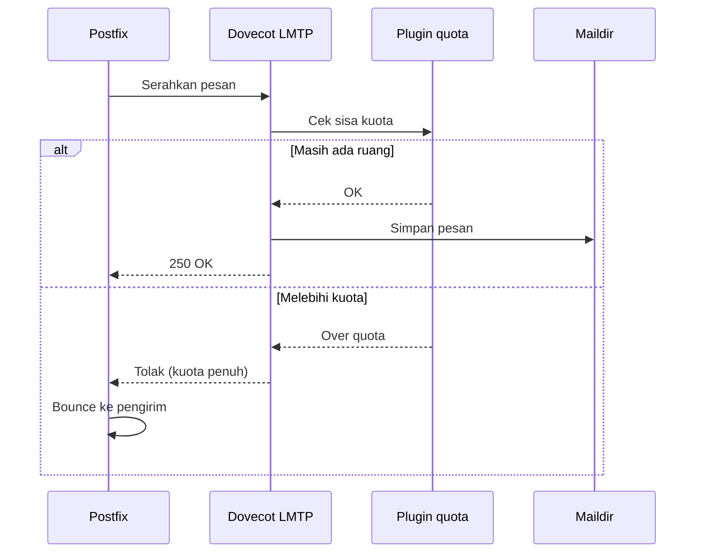

# Quota Mailbox

!!! info "Identitas chapter"
    **ID:** `CH-07-01-04` · **Kategori/modul:** CAT-07 / MOD-07-01 (Provisioning Mailbox) · **Estimasi:** 90 menit · **Lingkungan:** lab lokal (VM) · [Lihat chapter ini di dashboard](../../../#CH-07-01-04)

!!! note "Status verifikasi"
    Isi chapter ini ditulis dari dokumentasi resmi dan belum dijalankan penulis pada VM (`verified_on: null`).

## 1. Ringkasan

Quota membatasi ruang yang boleh dipakai satu akun. Anda mengaktifkan plugin `quota` Dovecot, menetapkan batas contoh, menguji perilakunya saat penuh, dan memantau konsumsi dengan `doveadm quota get`.

## 2. Tujuan Pembelajaran

1. Mengaktifkan plugin quota untuk IMAP dan LMTP.
2. Menetapkan batas per-pengguna dan menguji kondisi penuh.
3. Memantau konsumsi dan menetapkan ambang peringatan.

## 3. Prasyarat

- `CH-07-01-03` — Siklus Hidup Akun: Buat, Suspend, Hapus, Ganti Password.
- Akun virtual yang menyimpan ke Maildir (`CH-07-01-03`).

## 4. Materi Teori

### 4.1 Cara kerja

Dovecot menghitung ukuran mailbox (backend `maildir` menyimpan hitungan di berkas `maildirsize`) dan menolak delivery lewat LMTP saat melebihi batas. Penolakan dikembalikan ke Postfix sehingga pengirim menerima bounce.



### 4.2 Pertimbangan

Quota yang terlalu sempit memicu bounce ke pengirim sah. Rencanakan ambang peringatan (mis. 80%) dan jangan menyetel tanpa dasar data pemakaian. Quota juga melindungi disk dari satu akun yang menghabiskan ruang.

## 5. Praktik dan Implementasi

1. Backup `/etc/dovecot`.
2. Aktifkan plugin pada `mail_plugins` untuk protokol `imap` dan `lmtp`.
3. Tetapkan `quota` dan aturan batas.
4. Reload, lalu uji dengan kuota kecil sementara pada akun uji.

## 6. Perintah Linux

```bash title="Memeriksa dan memantau"
sudo doveconf -n | grep -E 'quota|mail_plugins'
sudo doveadm quota get -u ani@example.com
sudo doveadm quota recalc -u ani@example.com
sudo du -sh /var/vmail/example.com/*
```

Hasil `quota get` berupa tabel `Quota name`, `Type`, `Value`, `Limit`, dan `%`. `recalc` menghitung ulang bila hitungan tidak sinkron. Nilai persisnya bergantung pada isi mailbox.

## 7. Konfigurasi

```text title="/etc/dovecot/conf.d/10-mail.conf (potongan)"
mail_plugins = $mail_plugins quota
```

```text title="/etc/dovecot/conf.d/20-imap.conf (potongan)"
protocol imap {
  mail_plugins = $mail_plugins imap_quota
}
```

```text title="/etc/dovecot/conf.d/20-lmtp.conf (potongan)"
protocol lmtp {
  mail_plugins = $mail_plugins
}
```

```text title="/etc/dovecot/conf.d/90-quota.conf (potongan)"
plugin {
  quota = maildir:User quota
  quota_rule = *:storage=1G
  quota_rule2 = Trash:storage=+100M
  quota_warning = storage=80%% quota-warning 80 %u
}
```

- Nilai di atas adalah contoh. `quota_warning` memerlukan layanan `quota-warning` di `10-master.conf` dan skrip penerjemah; lewati dahulu dan hanya aktifkan setelah chapter ini selesai di lab.
- `mail_plugins` pada blok `protocol lmtp` ikut mewarisi `quota` dari setelan global.

## 8. Verifikasi

```bash title="Uji kondisi penuh dengan batas kecil sementara"
sudo doveadm quota get -u ani@example.com
printf 'Subject: uji kuota\n\nIsi.\n' | sendmail ani@example.com
sudo journalctl -u dovecot --since "5 min ago" --no-pager | grep -i quota
```

Hasil yang diharapkan: pemakaian bertambah setelah pengiriman; ketika kuota sengaja diperkecil (mis. `storage=1M`) pengiriman berikutnya ditolak dan log Dovecot mencatat pelampauan kuota. Kembalikan batas ke nilai wajar setelah uji. Teks log persisnya bergantung pada versi.

## 9. Troubleshooting

| Gejala | Kemungkinan penyebab | Tindakan |
|---|---|---|
| `quota get` kosong | Plugin belum aktif | Periksa `mail_plugins` dan `quota` |
| Hitungan tidak sesuai | `maildirsize` usang | `doveadm quota recalc` |
| Pengirim menerima bounce "over quota" | Kuota penuh | Naikkan atau bersihkan mailbox |
| Konfigurasi ditolak | Sintaks `quota_rule` | `doveconf -n` untuk galat |

## 10. Security Review

- Quota membatasi dampak penyalahgunaan akun tetapi tidak menggantikan batas pengiriman keluar (`CH-10-03-01`).
- Bounce "over quota" dapat menjadi backscatter bila diterima dari pengirim palsu; terima pesan dengan validasi di awal dan jangan menerima lalu menolak belakangan.
- Jangan mematikan kuota hanya agar bounce hilang.

## 11. Latihan

1. Atur kuota 5 MB pada akun uji, penuhi, dan dokumentasikan bounce.
2. Tentukan ambang peringatan dan prosedur komunikasi ke pengguna.
3. Hitung kebutuhan disk untuk 50 akun dengan kuota 2 GB.

## 12. Assessment

1. Apa yang terjadi pada pesan saat kuota penuh?
2. Untuk apa `doveadm quota recalc`?
3. Mengapa kuota tidak cukup sebagai satu-satunya kontrol penyalahgunaan?

**Kunci singkat.** (1) Ditolak dan Postfix membuat bounce. (2) Menyelaraskan hitungan dengan isi. (3) Tidak membatasi volume kirim keluar.

## 13. Checklist Kelulusan

- [ ] Plugin quota aktif; `quota get` menampilkan nilai.
- [ ] Uji penuh dilakukan dengan batas sementara dan dikembalikan.
- [ ] Ambang peringatan dan prosedur tertulis.

!!! note "Status belajar"
    Ubah status chapter secara manual di dashboard. Menyelesaikan checklist ini tidak mengubah status otomatis.

## 14. Referensi Resmi

- [Dokumentasi Dovecot 2.3: Quota plugin](https://doc.dovecot.org/2.3/configuration_manual/quota_plugin/)
- [Dokumentasi Dovecot 2.3: Maildir](https://doc.dovecot.org/2.3/admin_manual/mailbox_formats/maildir/)

Tautan referensi tidak diverifikasi otomatis pada build ini; periksa ketersediaannya sebelum dipakai.

---

[Kembali ke dashboard kurikulum](../../../#CH-07-01-04){ .md-button }
