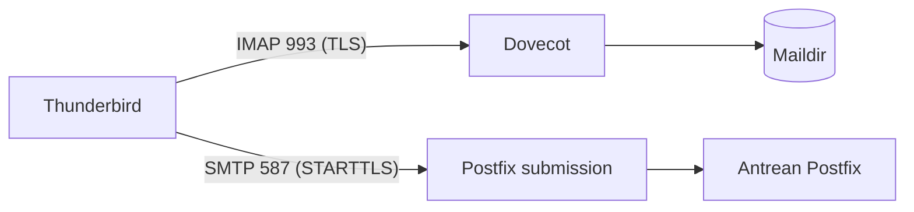

# Konfigurasi Thunderbird dan Klien Desktop

!!! info "Identitas chapter"
    **ID:** `CH-07-02-01` · **Kategori/modul:** CAT-07 / MOD-07-02 (Klien Email) · **Estimasi:** 60 menit · **Lingkungan:** lab lokal (VM) · [Lihat chapter ini di dashboard](../../../#CH-07-02-01)

!!! note "Status verifikasi"
    Isi chapter ini ditulis dari dokumentasi resmi dan belum dijalankan penulis pada VM (`verified_on: null`).

## 1. Ringkasan

Anda mengonfigurasi klien desktop (contoh: Thunderbird) untuk mengakses akun `ani@example.com` lewat IMAP dan mengirim lewat SMTP, lalu memastikan folder tersinkron. Nilai pengaturan penting: server, port, mode keamanan, dan metode autentikasi.

## 2. Tujuan Pembelajaran

1. Mengisi pengaturan IMAP dan SMTP yang benar di klien desktop.
2. Memeriksa sinkronisasi folder Inbox, Sent, Drafts, dan Trash.
3. Menjelaskan peringatan sertifikat swasigned dan implikasinya.

## 3. Prasyarat

- `CH-07-01-04` — Quota Mailbox.
- Akun virtual aktif; layanan IMAP berjalan. Untuk pengiriman dari klien, submission 587/465 dibahas penuh di `CH-08-01-03`; pada lab ini gunakan pengiriman lokal terkontrol atau lanjutkan setelah chapter tersebut.

## 4. Materi Teori

### 4.1 Parameter klien

| Pengaturan | IMAP | SMTP (submission) |
|---|---|---|
| Server | `mail.example.com` | `mail.example.com` |
| Port | 993 (TLS langsung) atau 143 (STARTTLS) | 587 (STARTTLS) atau 465 (TLS langsung) |
| Keamanan koneksi | SSL/TLS atau STARTTLS | STARTTLS atau SSL/TLS |
| Autentikasi | Kata sandi biasa (di atas TLS) | Kata sandi biasa (di atas TLS) |
| Nama pengguna | Alamat lengkap (`ani@example.com`) | Alamat lengkap |

Nama pengguna lengkap diperlukan karena `username_format=%u` pada model virtual.



### 4.2 Sertifikat

Sertifikat swasigned memicu peringatan di klien. Itu wajar di lab, tetapi biasakan **tidak** menerima pengecualian permanen; penyelesaian sebenarnya dengan sertifikat tepercaya (`CH-08-01-02`).

## 5. Praktik dan Implementasi

1. Siapkan akses: dari host Anda, server lab harus terjangkau (`ping`, `nc -vz mail.example.com 993` dengan entri `/etc/hosts` host).
2. Tambahkan akun di klien memakai tabel 4.1.
3. Periksa pengaturan keamanan sebelum mengisi kata sandi.
4. Periksa folder dan tandai satu pesan sebagai dibaca.
5. Kirim pesan uji ke akun kedua dan terima.

## 6. Perintah Linux

```bash title="Memeriksa dari host klien sebelum menyiapkan akun"
nc -vz mail.example.com 993
openssl s_client -connect mail.example.com:993 -servername mail.example.com </dev/null 2>/dev/null | openssl x509 -noout -subject -issuer -dates
```

Hasil yang diharapkan: port terbuka dan subject/issuer sertifikat tercetak. Pada sertifikat swasigned, `issuer` sama dengan `subject`. Bentuk persis bergantung pada sertifikat yang terpasang.

## 7. Konfigurasi

Tidak ada berkas konfigurasi yang diubah pada chapter ini.

## 8. Verifikasi

- Folder Inbox, Sent, Drafts, Trash muncul dan tersinkron.
- Pesan uji terkirim dan diterima; status baca tersinkron antar perangkat.
- Di server: `sudo journalctl -u dovecot --since "10 min ago" | grep -i login` menunjukkan login berhasil dari alamat klien.

## 9. Troubleshooting

| Gejala | Kemungkinan penyebab | Tindakan |
|---|---|---|
| Peringatan sertifikat | Swasigned | Wajar di lab; ganti di `CH-08-01-02` |
| Autentikasi gagal | Nama pengguna tanpa domain | Gunakan alamat lengkap |
| Folder tidak muncul | Subscription | Langganan folder di klien |
| SMTP ditolak | Submission belum aktif | Lihat `CH-08-01-03` |

## 10. Security Review

- Jangan menyimpan kata sandi di klien bersama atau perangkat tidak terenkripsi.
- Jangan memakai port 143/25 tanpa TLS untuk login dari jaringan luar.
- Jangan menerima pengecualian sertifikat secara permanen pada perangkat nyata.

## 11. Latihan

1. Konfigurasikan akun kedua dan kirim antar akun.
2. Bandingkan pengaturan IMAP 143 vs 993 dalam tabel.
3. Dokumentasikan langkah yang dapat dibagikan ke pengguna tanpa kata sandi.

## 12. Assessment

1. Mengapa nama pengguna harus alamat lengkap?
2. Apa risiko menerima pengecualian sertifikat?
3. Port mana yang menggunakan TLS langsung?

**Kunci singkat.** (1) Format `%u` pada model virtual. (2) Membuka peluang penyadapan atau penyerang di tengah. (3) 993 dan 465.

## 13. Checklist Kelulusan

- [ ] Akun terkonfigurasi di klien desktop dan folder tersinkron.
- [ ] Pengaturan keamanan didokumentasikan tanpa kata sandi.

!!! note "Status belajar"
    Ubah status chapter secara manual di dashboard. Menyelesaikan checklist ini tidak mengubah status otomatis.

## 14. Referensi Resmi

- [Dokumentasi Dovecot 2.3: IMAP](https://doc.dovecot.org/2.3/configuration_manual/protocols/imap_server/)
- [RFC 8314 — TLS untuk email](https://www.rfc-editor.org/rfc/rfc8314)
- [Dokumentasi Thunderbird (Mozilla Support)](https://support.mozilla.org/id/products/thunderbird)

Tautan referensi tidak diverifikasi otomatis pada build ini; periksa ketersediaannya sebelum dipakai.

---

[Kembali ke dashboard kurikulum](../../../#CH-07-02-01){ .md-button }
