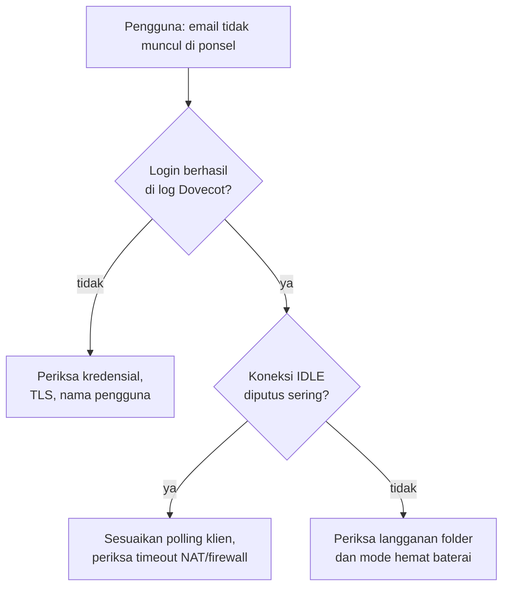

# Konfigurasi Android dan iOS

!!! info "Identitas chapter"
    **ID:** `CH-07-02-02` · **Kategori/modul:** CAT-07 / MOD-07-02 (Klien Email) · **Estimasi:** 60 menit · **Lingkungan:** lab lokal (VM) · [Lihat chapter ini di dashboard](../../../#CH-07-02-02)

!!! note "Status verifikasi"
    Isi chapter ini ditulis dari dokumentasi resmi dan belum dijalankan penulis pada VM (`verified_on: null`).

## 1. Ringkasan

Klien mobile (Android dan iOS) menggunakan pengaturan yang sama dengan desktop, tetapi berperilaku berbeda: sinkronisasi latar belakang, penanganan sertifikat, dan batas koneksi. Chapter ini membahas konfigurasi dan perbedaan perilaku untuk mendiagnosis keluhan umum.

## 2. Tujuan Pembelajaran

1. Mengonfigurasi akun IMAP/SMTP pada klien mobile.
2. Mengenali perbedaan perilaku klien (push, polling, penanganan sertifikat).
3. Mengumpulkan informasi diagnosis tanpa meminta kata sandi pengguna.

## 3. Prasyarat

- `CH-07-02-01` — Konfigurasi Thunderbird dan Klien Desktop.
- Parameter klien dari `CH-07-02-01`; sertifikat tepercaya sangat dianjurkan untuk perangkat nyata (`CH-08-01-02`).

## 4. Materi Teori

### 4.1 Perbedaan umum

| Aspek | Desktop | Mobile |
|---|---|---|
| Pembaruan pesan | Polling/IDLE | IMAP IDLE atau polling terjadwal (hemat baterai) |
| Sertifikat swasigned | Dapat diterima manual | Sering ditolak atau memerlukan pemasangan profil |
| Koneksi | Stabil | Berpindah jaringan; sering reconnect |
| Aplikasi | Satu klien | Banyak (aplikasi bawaan dan pihak ketiga) |

Perilaku persis berbeda antar versi OS dan aplikasi; periksa dokumentasi perangkat Anda.



### 4.2 Sertifikat dan keamanan perangkat

Mobile modern lebih ketat terhadap sertifikat tidak tepercaya. Memasang CA swasigned pada perangkat nyata mengubah kepercayaan perangkat; jangan lakukan pada perangkat pribadi tanpa memahami dampaknya. Gunakan sertifikat publik tepercaya.

## 5. Praktik dan Implementasi

1. Pastikan server lab terjangkau dari perangkat (jaringan sama, atau port diteruskan secara sadar).
2. Tambahkan akun uji sesuai tabel parameter.
3. Uji penerimaan dan pengiriman pesan.
4. Catat perilaku sinkronisasi (waktu sampai pesan muncul) pada Wi-Fi dan data seluler.
5. Salin pesan galat persis dari aplikasi bila gagal.

## 6. Perintah Linux

Chapter ini konseptual; tidak ada perintah yang mengubah sistem.

## 7. Konfigurasi

Tidak ada berkas konfigurasi yang diubah pada chapter ini.

## 8. Verifikasi

```bash title="Mengamati login dari ponsel di server"
sudo journalctl -u dovecot --since "10 min ago" --no-pager | grep -iE 'imap|auth'
```

Hasil yang diharapkan: baris login dari IP perangkat. Tidak ada keluaran baku; formatnya bergantung pada versi dan setelan log.

## 9. Troubleshooting

| Gejala | Kemungkinan penyebab | Tindakan |
|---|---|---|
| Aplikasi menolak sertifikat | Swasigned / nama tidak cocok | Gunakan sertifikat tepercaya dengan nama sesuai host |
| Email tertunda | Polling jarang | Atur interval atau IDLE |
| Login gagal terus | Salah format pengguna / kata sandi | Alamat lengkap; reset bila perlu |
| Perangkat tidak menjangkau server | Jaringan/firewall | Periksa `ss`, UFW, port forward |

## 10. Security Review

- Perangkat mobile hilang adalah risiko; gunakan kata sandi unik dan kemampuan mencabut akses (ganti kata sandi, hentikan sesi).
- Jangan membuka IMAP ke internet dari VM lab hanya demi uji ponsel.
- Jangan mengirim kata sandi lewat pesan atau screenshot.

## 11. Latihan

1. Ukur selisih waktu penerimaan pada Wi-Fi vs data seluler.
2. Tulis panduan pengguna satu halaman untuk menambah akun di ponsel.
3. Rancang prosedur pencabutan akses perangkat hilang.

## 12. Assessment

1. Mengapa sertifikat swasigned bermasalah di mobile?
2. Apa yang diperiksa pertama saat email tidak muncul di ponsel?
3. Bagaimana mencabut akses perangkat hilang?

**Kunci singkat.** (1) Ketat pada kepercayaan. (2) Login di log Dovecot. (3) Ganti kata sandi dan akhiri sesi.

## 13. Checklist Kelulusan

- [ ] Akun uji terkonfigurasi di minimal satu perangkat mobile (jika tersedia).
- [ ] Perilaku sinkronisasi dan galat dicatat.
- [ ] Prosedur pencabutan akses tertulis.

!!! note "Status belajar"
    Ubah status chapter secara manual di dashboard. Menyelesaikan checklist ini tidak mengubah status otomatis.

## 14. Referensi Resmi

- [Dokumentasi Dovecot 2.3: IMAP](https://doc.dovecot.org/2.3/configuration_manual/protocols/imap_server/)
- [RFC 2177 — IMAP IDLE](https://www.rfc-editor.org/rfc/rfc2177)
- [RFC 8314 — TLS untuk email](https://www.rfc-editor.org/rfc/rfc8314)

Tautan referensi tidak diverifikasi otomatis pada build ini; periksa ketersediaannya sebelum dipakai.

---

[Kembali ke dashboard kurikulum](../../../#CH-07-02-02){ .md-button }
