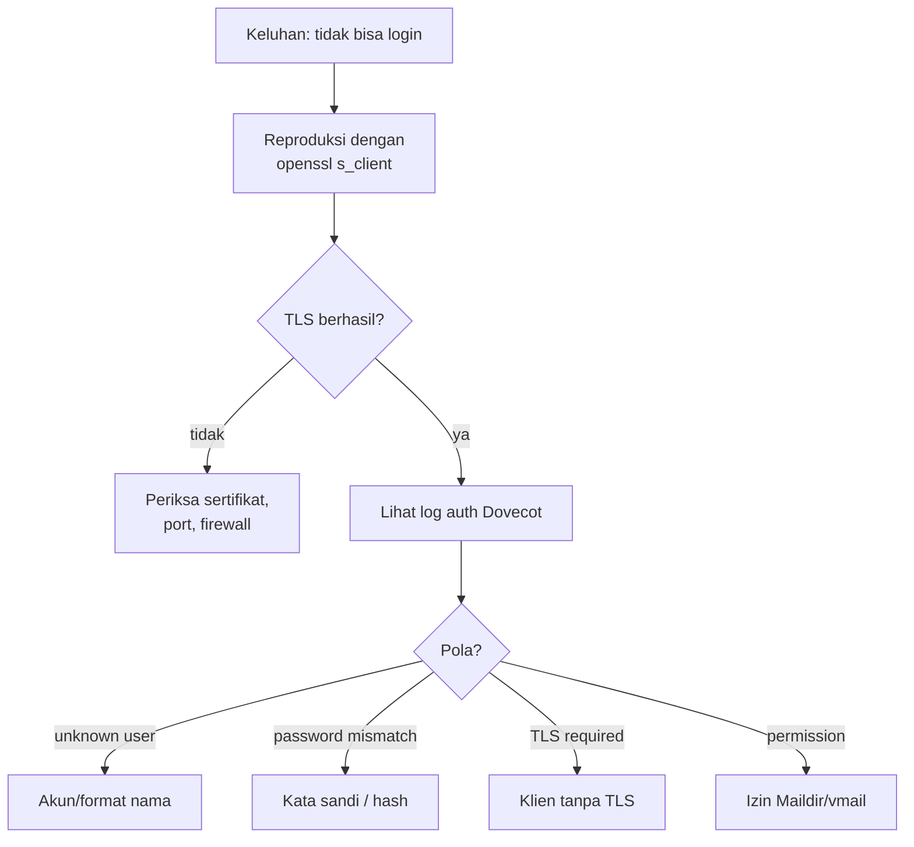

# Troubleshooting Akses Mailbox dan Log Autentikasi

!!! info "Identitas chapter"
    **ID:** `CH-07-02-03` · **Kategori/modul:** CAT-07 / MOD-07-02 (Klien Email) · **Estimasi:** 90 menit · **Lingkungan:** lab lokal (VM) · [Lihat chapter ini di dashboard](../../../#CH-07-02-03)

!!! note "Status verifikasi"
    Isi chapter ini ditulis dari dokumentasi resmi dan belum dijalankan penulis pada VM (`verified_on: null`).

## 1. Ringkasan

Saat pengguna melaporkan "tidak bisa login" atau "tidak tersinkron", log autentikasi adalah sumber kebenaran. Chapter ini mengajarkan cara membaca log Dovecot, membedakan penyebab kegagalan (kredensial, TLS, sertifikat, izin), dan mereproduksi masalah dengan `openssl s_client` serta `doveadm`.

## 2. Tujuan Pembelajaran

1. Membaca log autentikasi Dovecot dengan `journalctl`.
2. Memetakan pola log ke penyebab.
3. Mereproduksi sambungan IMAP/TLS dari luar klien.
4. Menyusun jalur eskalasi diagnosis.

## 3. Prasyarat

- `CH-07-02-02` — Konfigurasi Android dan iOS.
- Pemahaman klien dari `CH-07-02-01` dan `CH-07-02-02`.

## 4. Materi Teori

### 4.1 Urutan diagnosis



### 4.2 Aktifkan log auth lebih rinci (sementara)

Pengaturan `auth_verbose = yes` mencatat alasan kegagalan autentikasi. `auth_debug` dan `auth_debug_passwords` **memuat data sensitif** dan tidak boleh diaktifkan di produksi; di lab, gunakan hanya sementara dan jangan pernah `auth_debug_passwords`.

### 4.3 Pola yang umum

| Pesan (bentuk umum) | Arti |
|---|---|
| `unknown user` | Pengguna tidak ada di userdb |
| `password mismatch` | Kata sandi salah / skema hash tidak cocok |
| `Disconnected: ... (no auth attempts ...)` | Klien tidak mencoba login |
| Penolakan karena plaintext tidak diizinkan | Klien tanpa TLS |

Teks persis berbeda antar versi; gunakan sebagai petunjuk, bukan pola tetap.

## 5. Praktik dan Implementasi

1. Reproduksi kegagalan yang disengaja (kata sandi salah).
2. Cari baris yang sesuai di log.
3. Reproduksi di `openssl s_client`.
4. Gunakan `doveadm auth test` dan `doveadm user`.
5. Catat tabel gejala → penyebab → tindakan.

## 6. Perintah Linux

```bash title="Log autentikasi"
sudo journalctl -u dovecot --since "30 min ago" --no-pager | grep -iE 'auth|login|disconnect'
sudo doveadm log find
```

`doveadm log find` menampilkan lokasi berkas log yang dipakai. Jika `doveadm log find` melaporkan log di journald, gunakan `journalctl`.

```bash title="Mereproduksi sambungan IMAP TLS"
openssl s_client -connect mail.example.com:993 -servername mail.example.com -quiet
```

Setelah banner `* OK ... Dovecot ready.`, ketik `a1 LOGIN ani@example.com <kata-sandi-uji>` hanya untuk akun uji pada lab tertutup, lalu `a2 LOGOUT`. Jangan menjalankannya terhadap akun nyata.

```bash title="Memeriksa akun di sisi server"
sudo doveadm user ani@example.com
sudo doveadm auth test ani@example.com
```

## 7. Konfigurasi

```text title="/etc/dovecot/conf.d/10-logging.conf (sementara di lab)"
auth_verbose = yes
```

Kembalikan ke `no` setelah diagnosis. Jangan aktifkan `auth_debug_passwords`.

## 8. Verifikasi

- Setelah login gagal disengaja, log memuat baris alasan kegagalan.
- Setelah perbaikan, login berhasil dan `auth_verbose` dikembalikan.
- Catatan diagnosis tidak memuat kata sandi.

## 9. Troubleshooting

| Gejala | Kemungkinan penyebab | Tindakan |
|---|---|---|
| Tidak ada baris log | Salah unit / log ke berkas lain | `doveadm log find`, `journalctl -u dovecot` |
| TLS gagal di `s_client` | Sertifikat / port | `openssl s_client -showcerts`, periksa firewall |
| Autentikasi OK di `auth test` tapi gagal di klien | Format nama / TLS | Samakan format dan mode keamanan |
| Log terlalu bising | `auth_verbose` aktif | Kembalikan setelah selesai |

## 10. Security Review

- Log autentikasi memuat alamat email dan IP; perlakukan sebagai data pribadi.
- `auth_debug_passwords` dapat mencatat kata sandi; **jangan aktifkan**.
- Bagikan potongan log ke pihak lain hanya setelah menghapus data sensitif.

## 11. Latihan

1. Buat tabel 5 gejala → pola log → tindakan.
2. Reproduksi tiga jenis kegagalan dan catat baris log.
3. Tulis skrip yang menghitung login gagal per IP dari log (hanya membaca).

## 12. Assessment

1. Mengapa `auth_debug_passwords` dilarang di produksi?
2. Apa langkah pertama memisahkan masalah TLS dari autentikasi?
3. Untuk apa `doveadm log find`?

**Kunci singkat.** (1) Dapat membocorkan kata sandi. (2) Reproduksi dengan `openssl s_client`. (3) Menemukan lokasi log.

## 13. Checklist Kelulusan

- [ ] Tiga jenis kegagalan direproduksi dan dibaca di log.
- [ ] Pengaturan verbose dikembalikan.
- [ ] Tabel diagnosis tertulis tanpa data sensitif.

!!! note "Status belajar"
    Ubah status chapter secara manual di dashboard. Menyelesaikan checklist ini tidak mengubah status otomatis.

## 14. Referensi Resmi

- [Dokumentasi Dovecot 2.3: Logging](https://doc.dovecot.org/2.3/admin_manual/logging/)
- [Dokumentasi Dovecot 2.3: Authentication](https://doc.dovecot.org/2.3/configuration_manual/authentication/)
- [OpenSSL: s_client](https://docs.openssl.org/3.0/man1/openssl-s_client/)

Tautan referensi tidak diverifikasi otomatis pada build ini; periksa ketersediaannya sebelum dipakai.

---

[Kembali ke dashboard kurikulum](../../../#CH-07-02-03){ .md-button }
