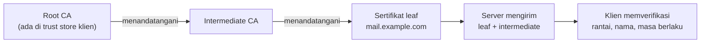

# Sertifikat TLS dan Trust Chain

!!! info "Identitas chapter"
    **ID:** `CH-08-01-01` · **Kategori/modul:** CAT-08 / MOD-08-01 (TLS dan Port Layanan) · **Estimasi:** 90 menit · **Lingkungan:** lab + domain yang Anda kendalikan · [Lihat chapter ini di dashboard](../../../#CH-08-01-01)

!!! note "Catatan"
    Mulai level ini contoh memakai domain Anda sendiri; `example.com` hanya placeholder dokumentasi dan tidak dapat memperoleh sertifikat publik. Belum dijalankan penulis pada VM (`verified_on: null`).

## 1. Ringkasan

TLS melindungi isi dan kredensial email saat melintasi jaringan. Chapter ini menjelaskan sertifikat X.509, otoritas sertifikasi (CA), dan rantai kepercayaan, lalu memakai `openssl` untuk memeriksa sertifikat sebuah server.

## 2. Tujuan Pembelajaran

1. Menjelaskan fungsi sertifikat, CA, dan rantai kepercayaan.
2. Membedakan sertifikat leaf, intermediate, dan root.
3. Memeriksa subject, SAN, issuer, dan masa berlaku dengan `openssl`.
4. Menjelaskan mengapa nama pada sertifikat harus cocok dengan nama yang dituju klien.

## 3. Prasyarat

- `CH-07-02-03` — Troubleshooting Akses Mailbox dan Log Autentikasi.
- Pemahaman IMAP/SMTP dasar (Level 5) dan alat `openssl s_client` (`CH-02-03-04`).

## 4. Materi Teori

### 4.1 Komponen

| Istilah | Arti |
|---|---|
| Sertifikat | Mengikat nama host ke kunci publik, ditandatangani CA |
| Kunci privat | Rahasia server; siapa pun yang memilikinya dapat menyamar sebagai server |
| CA | Pihak yang dipercaya perangkat untuk menandatangani sertifikat |
| SAN | Daftar nama yang sah pada sertifikat; klien memeriksa SAN, bukan CN |
| Rantai | Leaf → intermediate → root yang sudah ada di trust store klien |



### 4.2 Yang diperiksa klien

Klien memeriksa (1) rantai berujung di CA tepercaya, (2) nama host ada di SAN, (3) tanggal belum kedaluwarsa, dan (4) sertifikat belum dicabut (bila diperiksa). Antara server email (SMTP port 25) validasi sering oportunistik: sertifikat tidak selalu diverifikasi, sehingga TLS di sana melindungi dari penyadapan pasif tetapi tidak menjamin identitas.

### 4.3 Kunci vs sertifikat

Sertifikat bersifat publik; **kunci privat** tidak boleh keluar dari server dan tidak boleh masuk repositori atau backup tidak terenkripsi.

## 5. Praktik dan Implementasi

1. Periksa sertifikat server publik mana pun yang Anda kelola (atau situs publik sebagai contoh baca-saja).
2. Catat subject, issuer, SAN, dan tanggal.
3. Bandingkan dengan sertifikat swasigned lab Anda.

## 6. Perintah Linux

```bash title="Melihat rantai dan detail sertifikat (baca-saja)"
openssl s_client -connect mail.example.com:993 -servername mail.example.com -showcerts </dev/null 2>/dev/null | head -40
openssl s_client -connect mail.example.com:993 -servername mail.example.com </dev/null 2>/dev/null | openssl x509 -noout -subject -issuer -dates -ext subjectAltName
```

- Ganti `mail.example.com` dengan host yang Anda kuasai.
- `-ext subjectAltName` tersedia di OpenSSL 3.x pada Ubuntu 24.04.
- Hasil yang diharapkan: baris `subject=`, `issuer=`, `notBefore=`, `notAfter=`, dan daftar SAN. Keluaran bergantung pada server.

## 7. Konfigurasi

Tidak ada berkas konfigurasi yang diubah pada chapter ini.

## 8. Verifikasi

- Anda dapat membaca issuer, tanggal kedaluwarsa, dan SAN dari keluaran.
- Anda dapat menjelaskan mengapa sertifikat swasigned lab memiliki issuer sama dengan subject.

## 9. Troubleshooting

| Gejala | Kemungkinan penyebab | Tindakan |
|---|---|---|
| `unable to get local issuer certificate` | Intermediate tidak dikirim / CA tidak dikenal | Kirim rantai lengkap (`fullchain`) |
| Nama tidak cocok | Host tidak ada di SAN | Terbitkan sertifikat dengan nama yang benar |
| `certificate has expired` | Kedaluwarsa | Perpanjang (`CH-08-01-02`) |
| Handshake gagal | Port salah / bukan TLS | Periksa port dan mode STARTTLS |

## 10. Security Review

- Kunci privat yang bocor menuntut penerbitan ulang dan pencabutan sertifikat.
- Jangan menyimpan kunci privat di repositori, tiket, atau pesan.
- Jangan menonaktifkan verifikasi sertifikat di klien produksi demi "membuat jalan".

## 11. Latihan

1. Periksa sertifikat tiga layanan berbeda dan bandingkan issuer/SAN.
2. Gambar rantai kepercayaan untuk salah satunya.
3. Jelaskan perbedaan validasi pada klien IMAP dan antar server SMTP.

## 12. Assessment

1. Mengapa SAN yang diperiksa, bukan CN?
2. Apa isi `fullchain.pem`?
3. Apa risiko bocornya kunci privat?

**Kunci singkat.** (1) Standar modern memakai SAN. (2) Leaf plus intermediate. (3) Penyamaran dan penyadapan.

## 13. Checklist Kelulusan

- [ ] Saya dapat membaca rantai dan atribut sertifikat dengan `openssl`.
- [ ] Saya paham bedanya sertifikat dan kunci privat.

!!! note "Status belajar"
    Ubah status chapter secara manual di dashboard. Menyelesaikan checklist ini tidak mengubah status otomatis.

## 14. Referensi Resmi

- [RFC 5280 — Profil sertifikat X.509](https://www.rfc-editor.org/rfc/rfc5280)
- [RFC 8314 — TLS untuk email](https://www.rfc-editor.org/rfc/rfc8314)
- [OpenSSL: s_client](https://docs.openssl.org/3.0/man1/openssl-s_client/)
- [OpenSSL: x509](https://docs.openssl.org/3.0/man1/openssl-x509/)

Tautan referensi tidak diverifikasi otomatis pada build ini; periksa ketersediaannya sebelum dipakai.

---

[Kembali ke dashboard kurikulum](../../../#CH-08-01-01){ .md-button }
