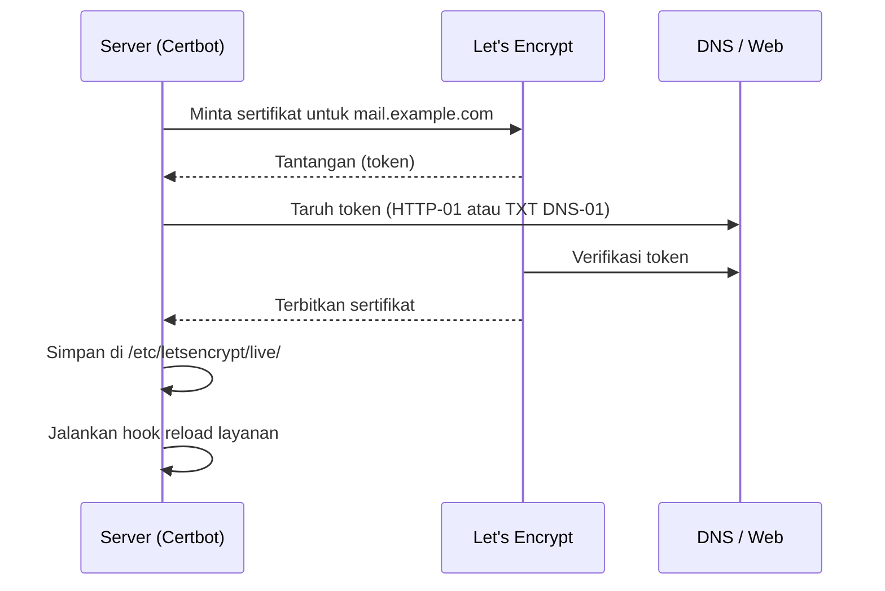

# Let's Encrypt, Certbot, dan Perpanjangan Otomatis

!!! info "Identitas chapter"
    **ID:** `CH-08-01-02` · **Kategori/modul:** CAT-08 / MOD-08-01 (TLS dan Port Layanan) · **Estimasi:** 120 menit · **Lingkungan:** lab + domain yang Anda kendalikan · [Lihat chapter ini di dashboard](../../../#CH-08-01-02)

!!! warning "Peringatan"
    Penerbitan sertifikat publik membutuhkan domain nyata, DNS publik, dan port 80 atau DNS-01. Gunakan staging/dry-run dahulu karena Let's Encrypt membatasi laju penerbitan. Belum dijalankan penulis pada VM (`verified_on: null`).

## 1. Ringkasan

Anda menerbitkan sertifikat gratis dari Let's Encrypt memakai Certbot, memahami syarat validasi, lalu memastikan perpanjangan otomatis berjalan dan layanan memuat sertifikat baru.

## 2. Tujuan Pembelajaran

1. Menjelaskan jenis validasi (HTTP-01, DNS-01) dan syaratnya.
2. Menerbitkan sertifikat untuk `mail.example.com` (domain Anda sendiri).
3. Memverifikasi timer perpanjangan dan hook reload.

## 3. Prasyarat

- `CH-08-01-01` — Sertifikat TLS dan Trust Chain.
- `CH-08-01-01`; domain dan A record `mail` mengarah ke server yang dapat dijangkau dari internet (untuk HTTP-01).

## 4. Materi Teori

### 4.1 Validasi

| Metode | Syarat | Catatan |
|---|---|---|
| HTTP-01 | Port 80 terjangkau publik | Paling sederhana; tidak untuk wildcard |
| DNS-01 | Dapat membuat record TXT `_acme-challenge` | Untuk wildcard atau server tanpa port 80 |



### 4.2 Perpanjangan

Sertifikat Let's Encrypt berumur singkat sehingga perpanjangan harus otomatis. Paket Certbot di Ubuntu menyiapkan perpanjangan terjadwal; pastikan lewat `systemctl list-timers` dan uji dengan `--dry-run`. Layanan harus **memuat ulang** sertifikat baru; itu tugas hook.

### 4.3 Batas laju

Gunakan `--staging` atau `--dry-run` saat bereksperimen agar tidak menghabiskan batas penerbitan. Lihat dokumentasi batas laju resmi.

## 5. Praktik dan Implementasi

1. Pastikan port 80 terbuka sementara dan tidak dipakai layanan lain.
2. Uji dengan `--dry-run`.
3. Terbitkan sertifikat sungguhan.
4. Pasang hook reload.
5. Verifikasi timer.

## 6. Perintah Linux

```bash title="Memasang dan menguji"
sudo apt install certbot
sudo ufw allow 80/tcp
sudo certbot certonly --standalone -d mail.example.com --dry-run
```

`--dry-run` memakai lingkungan staging dan tidak menyimpan sertifikat. Ganti `mail.example.com` dengan host nyata yang Anda kuasai. Jika berhasil, Certbot melaporkan simulasi berhasil.

```bash title="Menerbitkan sungguhan lalu menutup port 80 bila tidak dibutuhkan"
sudo certbot certonly --standalone -d mail.example.com
sudo ls -l /etc/letsencrypt/live/mail.example.com/
```

Berkas yang diharapkan: `fullchain.pem`, `privkey.pem`, `cert.pem`, `chain.pem` (tautan simbolik ke `archive/`).

```bash title="Hook reload dan timer"
sudo tee /etc/letsencrypt/renewal-hooks/deploy/reload-mail.sh >/dev/null <<'EOF'
#!/bin/sh
systemctl reload postfix dovecot
EOF
sudo chmod 0755 /etc/letsencrypt/renewal-hooks/deploy/reload-mail.sh
systemctl list-timers | grep -i certbot
sudo certbot renew --dry-run
```

## 7. Konfigurasi

Konfigurasi perpanjangan Certbot ada di `/etc/letsencrypt/renewal/mail.example.com.conf` (dibuat otomatis). Jangan menyunting kecuali memahami opsinya. Penggunaan sertifikat oleh Postfix/Dovecot dikonfigurasi di `CH-08-01-03`.

## 8. Verifikasi

```bash title="Verifikasi"
sudo certbot certificates
sudo openssl x509 -in /etc/letsencrypt/live/mail.example.com/fullchain.pem -noout -enddate
systemctl list-timers | grep -i certbot
```

Hasil yang diharapkan: sertifikat tercantum dengan tanggal kedaluwarsa kira-kira beberapa minggu ke depan (umur sertifikat ditentukan CA), timer terjadwal, dan `renew --dry-run` sukses.

## 9. Troubleshooting

| Gejala | Kemungkinan penyebab | Tindakan |
|---|---|---|
| Validasi gagal | Port 80 tertutup / A record salah | Cek firewall dan DNS dengan `dig` |
| `Address already in use` | Layanan lain memakai port 80 | Hentikan sementara atau pakai webroot/DNS-01 |
| Rate limit | Terlalu banyak percobaan | Gunakan staging, tunggu |
| Layanan tetap memakai sertifikat lama | Hook belum mereload | Periksa hook dan `systemctl reload` |

## 10. Security Review

- Direktori `/etc/letsencrypt/` berisi kunci privat: jangan di-backup tanpa enkripsi dan jangan komit.
- Tutup port 80 setelah selesai bila tidak dipakai.
- Pantau kedaluwarsa agar perpanjangan gagal tidak lolos (`CH-08-01-04`).

## 11. Latihan

1. Jalankan `renew --dry-run` dan catat hasilnya.
2. Jelaskan kapan DNS-01 lebih tepat dari HTTP-01.
3. Tulis rencana jika perpanjangan gagal pada hari ke-80.

## 12. Assessment

1. Mengapa perpanjangan otomatis wajib?
2. Apa tugas hook deploy?
3. Mengapa memakai `--dry-run` dahulu?

**Kunci singkat.** (1) Sertifikat berumur singkat. (2) Memuat ulang layanan. (3) Menghindari batas laju.

## 13. Checklist Kelulusan

- [ ] Sertifikat terbit (atau dry-run sukses) untuk host milik sendiri.
- [ ] Hook reload dan timer perpanjangan terverifikasi.
- [ ] Kunci privat tidak keluar dari server.

!!! note "Status belajar"
    Ubah status chapter secara manual di dashboard. Menyelesaikan checklist ini tidak mengubah status otomatis.

## 14. Referensi Resmi

- [Let's Encrypt: Dokumentasi](https://letsencrypt.org/docs/)
- [Let's Encrypt: Batas laju](https://letsencrypt.org/docs/rate-limits/)
- [Let's Encrypt: Jenis tantangan](https://letsencrypt.org/docs/challenge-types/)
- [Certbot: Panduan pengguna](https://eff-certbot.readthedocs.io/en/stable/using.html)

Tautan referensi tidak diverifikasi otomatis pada build ini; periksa ketersediaannya sebelum dipakai.

---

[Kembali ke dashboard kurikulum](../../../#CH-08-01-02){ .md-button }
