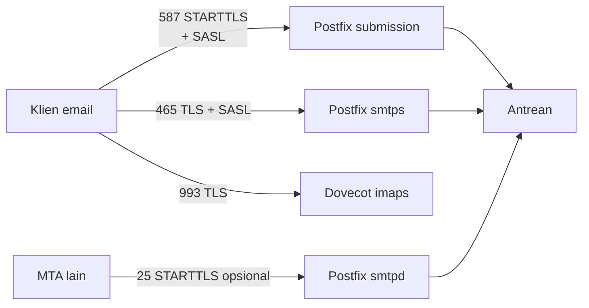

# Submission 587/465 dan IMAPS 993

!!! info "Identitas chapter"
    **ID:** `CH-08-01-03` · **Kategori/modul:** CAT-08 / MOD-08-01 (TLS dan Port Layanan) · **Estimasi:** 150 menit · **Lingkungan:** lab + domain yang Anda kendalikan · [Lihat chapter ini di dashboard](../../../#CH-08-01-03)

!!! warning "Peringatan"
    Mengubah `master.cf` dan membuka port 587/465/993 mengekspos layanan. Backup konfigurasi, pastikan relay hanya untuk pengguna terautentikasi, dan buka port di firewall secara sadar. Belum dijalankan penulis pada VM (`verified_on: null`).

## 1. Ringkasan

Anda mengaktifkan jalur kirim terautentikasi (submission 587 dengan STARTTLS dan 465 dengan TLS langsung) dan IMAPS 993, menggunakan sertifikat dari `CH-08-01-02`.

## 2. Tujuan Pembelajaran

1. Membedakan STARTTLS dan implicit TLS.
2. Mengaktifkan layanan `submission` dan `smtps` di `master.cf`.
3. Mengonfigurasi sertifikat untuk Postfix dan Dovecot.
4. Memverifikasi dengan `openssl s_client`.

## 3. Prasyarat

- `CH-08-01-02` — Let's Encrypt, Certbot, dan Perpanjangan Otomatis.
- Sertifikat tersedia (`CH-08-01-02`); SASL Dovecot–Postfix (`CH-06-02-03`).

## 4. Materi Teori

### 4.1 Port dan fungsi

| Port | Fungsi | TLS |
|---|---|---|
| 25 | Transfer antar-MTA | STARTTLS oportunistik |
| 587 | Submission klien → server | STARTTLS **wajib** |
| 465 | Submission (RFC 8314) | TLS langsung |
| 993 | IMAPS | TLS langsung |



### 4.2 Prinsip

Submission harus mensyaratkan TLS **sebelum** AUTH dan hanya menerima relay dari pengguna terautentikasi. Port 25 tidak memaksa TLS karena MTA lain mungkin tidak mendukungnya.

## 5. Praktik dan Implementasi

**Checklist persiapan**

- [ ] Backup `/etc/postfix` dan `/etc/dovecot`.
- [ ] Sertifikat terbit; nama sama dengan `myhostname`.

**Langkah**

1. Setel sertifikat di `main.cf`.
2. Aktifkan `submission` dan `smtps` di `master.cf`.
3. Setel sertifikat dan port di Dovecot.
4. Validasi, reload, dan buka port.
5. Uji dengan `openssl s_client`.

## 6. Perintah Linux

```bash title="Sertifikat Postfix"
sudo postconf -e 'smtpd_tls_chain_files = /etc/letsencrypt/live/mail.example.com/privkey.pem, /etc/letsencrypt/live/mail.example.com/fullchain.pem'
sudo postconf -e 'smtpd_tls_security_level = may'
sudo postconf -e 'smtp_tls_security_level = may'
sudo postfix check
```

`smtpd_tls_chain_files` (urutan: kunci lalu rantai) tersedia pada Postfix 3.4 ke atas. Alternatifnya `smtpd_tls_cert_file`/`smtpd_tls_key_file`.

```bash title="Uji setelah reload"
sudo systemctl reload postfix
sudo systemctl restart dovecot
sudo ss -tlnp | grep -E ':(25|465|587|993)\b'
openssl s_client -connect mail.example.com:587 -starttls smtp -servername mail.example.com </dev/null
openssl s_client -connect mail.example.com:465 -servername mail.example.com </dev/null
openssl s_client -connect mail.example.com:993 -servername mail.example.com </dev/null
```

```bash title="Firewall (hanya port yang dibutuhkan)"
sudo ufw allow 587/tcp
sudo ufw allow 465/tcp
sudo ufw allow 993/tcp
sudo ufw status
```

## 7. Konfigurasi

```text title="/etc/postfix/master.cf (aktifkan/ubah baris yang ada)"
submission inet n       -       y       -       -       smtpd
  -o syslog_name=postfix/submission
  -o smtpd_tls_security_level=encrypt
  -o smtpd_tls_auth_only=yes
  -o smtpd_sasl_auth_enable=yes
  -o smtpd_sasl_type=dovecot
  -o smtpd_sasl_path=private/auth
  -o smtpd_relay_restrictions=permit_sasl_authenticated,reject
  -o smtpd_recipient_restrictions=
smtps     inet  n       -       y       -       -       smtpd
  -o syslog_name=postfix/smtps
  -o smtpd_tls_wrappermode=yes
  -o smtpd_sasl_auth_enable=yes
  -o smtpd_sasl_type=dovecot
  -o smtpd_sasl_path=private/auth
  -o smtpd_relay_restrictions=permit_sasl_authenticated,reject
```

```text title="/etc/dovecot/conf.d/10-ssl.conf"
ssl = required
ssl_cert = </etc/letsencrypt/live/mail.example.com/fullchain.pem
ssl_key = </etc/letsencrypt/live/mail.example.com/privkey.pem
```

```text title="/etc/dovecot/conf.d/10-master.conf (potongan)"
service imap-login {
  inet_listener imap {
    port = 143
  }
  inet_listener imaps {
    port = 993
    ssl = yes
  }
}
```

- Tanda `<` sebelum jalur wajib di Dovecot (artinya "baca isi berkas").
- Paket Ubuntu sudah menyediakan baris `submission` dan `smtps` yang dikomentari; **hapus tanda komentar dan ubah**, jangan menduplikasi.
- Spasi di awal baris `-o` wajib (lanjutan baris).

## 8. Verifikasi

- `ss` menampilkan 587, 465, 993 mendengarkan.
- `s_client` pada 587 menampilkan `250-STARTTLS` pada EHLO awal dan setelah upgrade menampilkan `250-AUTH ...`; sebelum TLS, `AUTH` tidak ditawarkan.
- Rantai sertifikat tervalidasi (`Verification: OK` pada hasil, tergantung versi OpenSSL).
- Login terautentikasi berhasil dari klien, dan pengirim tidak terautentikasi ditolak relay (ulang uji open relay `CH-06-01-04`).

## 9. Troubleshooting

| Gejala | Kemungkinan penyebab | Tindakan |
|---|---|---|
| Port tidak mendengarkan | `master.cf` salah / belum reload | `postfix check`, `journalctl -u 'postfix@-'` |
| `AUTH` tidak muncul | `smtpd_tls_auth_only` tanpa TLS | Gunakan STARTTLS |
| Dovecot gagal start | Jalur sertifikat tanpa `<` / izin | `doveconf -n`, `journalctl -u dovecot` |
| Klien ditolak relay | Tidak terautentikasi | Pastikan SASL & `permit_sasl_authenticated` |

## 10. Security Review

- AUTH tanpa TLS membocorkan kata sandi: pertahankan `smtpd_tls_auth_only=yes`.
- Jangan menambahkan `permit_mynetworks` di submission publik.
- Buka 587/465/993 hanya setelah relay terbukti tertutup bagi pengguna anonim.
- Kunci privat hanya terbaca root; layanan membacanya saat start sebagai root.

## 11. Latihan

1. Bandingkan EHLO pada 25 dan 587 dan catat perbedaan.
2. Uji pengiriman terautentikasi dan tidak terautentikasi.
3. Dokumentasikan daftar port terbuka sebelum dan sesudah.

## 12. Assessment

1. Apa beda STARTTLS dan implicit TLS?
2. Mengapa submission memaksa TLS sebelum AUTH?
3. Apa fungsi tanda `<` di `ssl_cert` Dovecot?

**Kunci singkat.** (1) Upgrade vs TLS sejak koneksi. (2) Mencegah kata sandi plaintext. (3) Membaca isi berkas.

## 13. Checklist Kelulusan

- [ ] 587, 465, 993 aktif dengan sertifikat valid.
- [ ] AUTH hanya setelah TLS; relay anonim tetap ditolak.
- [ ] Port terbuka didokumentasikan.

!!! note "Status belajar"
    Ubah status chapter secara manual di dashboard. Menyelesaikan checklist ini tidak mengubah status otomatis.

## 14. Referensi Resmi

- [Postfix: TLS_README](https://www.postfix.org/TLS_README.html)
- [Postfix: SASL_README](https://www.postfix.org/SASL_README.html)
- [Dokumentasi Dovecot 2.3: SSL](https://doc.dovecot.org/2.3/configuration_manual/dovecot_ssl_configuration/)
- [RFC 8314 — TLS untuk email](https://www.rfc-editor.org/rfc/rfc8314)

Tautan referensi tidak diverifikasi otomatis pada build ini; periksa ketersediaannya sebelum dipakai.

---

[Kembali ke dashboard kurikulum](../../../#CH-08-01-03){ .md-button }
