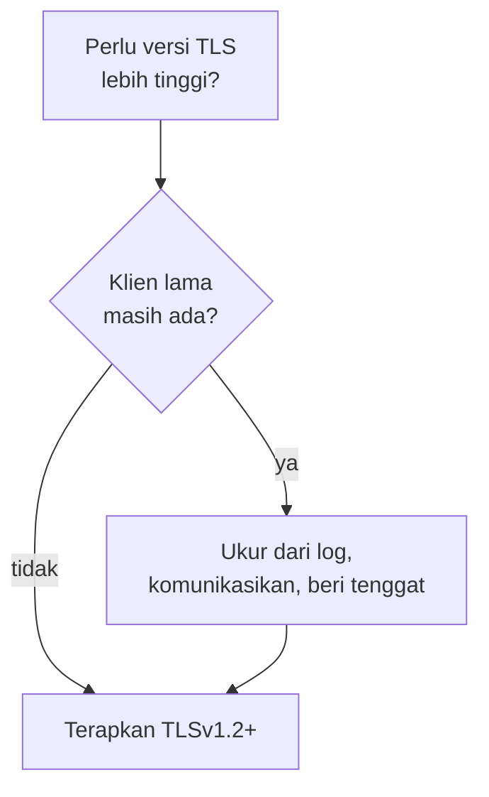

# Protokol TLS, Cipher, dan Monitoring Kedaluwarsa

!!! info "Identitas chapter"
    **ID:** `CH-08-01-04` · **Kategori/modul:** CAT-08 / MOD-08-01 (TLS dan Port Layanan) · **Estimasi:** 90 menit · **Lingkungan:** lab + domain yang Anda kendalikan · [Lihat chapter ini di dashboard](../../../#CH-08-01-04)

!!! note "Status verifikasi"
    Isi chapter ini ditulis dari dokumentasi resmi dan belum dijalankan penulis pada VM (`verified_on: null`).

## 1. Ringkasan

Setelah TLS aktif, Anda menetapkan versi protokol minimum dan daftar cipher yang masuk akal, lalu memantau tanggal kedaluwarsa sertifikat agar perpanjangan yang gagal terdeteksi sebelum layanan terganggu.

## 2. Tujuan Pembelajaran

1. Menetapkan versi TLS minimum untuk submission/IMAP.
2. Menjelaskan trade-off antara keamanan dan kompatibilitas klien.
3. Membuat pemeriksaan kedaluwarsa sertifikat yang dapat dijadwalkan.

## 3. Prasyarat

- `CH-08-01-03` — Submission 587/465 dan IMAPS 993.
- TLS aktif pada Postfix dan Dovecot (`CH-08-01-03`).

## 4. Materi Teori

### 4.1 Versi dan cipher

TLS 1.0/1.1 sudah dinyatakan usang (RFC 8996); minimal TLS 1.2, dan TLS 1.3 bila klien mendukung. Pada port 25 yang oportunistik, membatasi terlalu ketat dapat membuat MTA lain jatuh ke plaintext atau gagal; terapkan batas ketat pada port klien (587/465/993), dan pertahankan toleransi pada port 25 sesuai kebijakan Anda.

| Layanan | Parameter | Contoh |
|---|---|---|
| Postfix | `smtpd_tls_mandatory_protocols` | `>=TLSv1.2` |
| Postfix | `smtpd_tls_protocols` | `>=TLSv1.2` |
| Dovecot | `ssl_min_protocol` | `TLSv1.2` |

Untuk daftar cipher, gunakan pedoman terbaru yang terawat (mis. generator konfigurasi Mozilla) daripada menulis sendiri. Bawaan OpenSSL 3 Ubuntu 24.04 sudah memadai untuk sebagian besar kasus.



### 4.2 Pemantauan kedaluwarsa

`openssl x509 -checkend N` keluar dengan kode 0 bila sertifikat masih berlaku lebih dari N detik. Itu cocok untuk skrip yang dijadwalkan (timer) dan mengirim peringatan.

## 5. Praktik dan Implementasi

1. Ukur versi TLS yang dipakai klien dari log.
2. Setel versi minimum.
3. Uji bahwa klien modern tetap terhubung dan versi lama ditolak.
4. Tulis skrip pemeriksaan kedaluwarsa.

## 6. Perintah Linux

```bash title="Mengukur versi TLS yang dipakai klien (Dovecot)"
sudo journalctl -u dovecot --since "1 day ago" --no-pager | grep -oE 'TLS[v0-9.]*' | sort | uniq -c
```

Bila tidak ada keluaran, versi tidak dicatat pada log Anda; tambah `login_log_format_elements` sesuai dokumentasi bila perlu.

```bash title="Menguji penolakan versi lama (dari host lain)"
openssl s_client -connect mail.example.com:993 -tls1_1 </dev/null
openssl s_client -connect mail.example.com:993 -tls1_2 </dev/null | head -5
```

Hasil yang diharapkan: TLS 1.1 gagal; TLS 1.2 berhasil. Beberapa build OpenSSL menonaktifkan `-tls1_1` sehingga perintah itu sendiri galat.

```bash title="Pemeriksaan kedaluwarsa (contoh skrip)"
#!/bin/sh
CERT=/etc/letsencrypt/live/mail.example.com/fullchain.pem
if ! openssl x509 -in "$CERT" -noout -checkend $((14*24*3600)); then
  echo "Sertifikat mail.example.com kedaluwarsa dalam < 14 hari" | logger -t cert-check -p mail.warning
  exit 1
fi
```

## 7. Konfigurasi

```text title="/etc/dovecot/conf.d/10-ssl.conf"
ssl_min_protocol = TLSv1.2
```

```text title="Postfix"
smtpd_tls_mandatory_protocols = >=TLSv1.2
```

Sintaks `>=TLSv1.2` tersedia pada Postfix 3.6 ke atas (Ubuntu 24.04 membawa versi di atas itu). Periksa `postconf mail_version`.

## 8. Verifikasi

- `openssl s_client -tls1_2` berhasil dan TLS lebih rendah gagal.
- Skrip pemeriksaan keluar 0 pada sertifikat sehat; uji dengan `-checkend` bernilai sangat besar untuk melihat jalur peringatan.
- Log menunjukkan tidak ada klien sah yang gagal setelah perubahan.

## 9. Troubleshooting

| Gejala | Kemungkinan penyebab | Tindakan |
|---|---|---|
| Klien lama gagal | Versi minimum terlalu tinggi | Ukur, komunikasikan, turunkan sementara |
| `unknown option` | Sintaks versi | Periksa versi Postfix/Dovecot |
| Peringatan tidak terkirim | Skrip tidak terjadwal | Jadwalkan dengan timer (`CH-11-02-02`) |
| Handshake gagal | Cipher tidak cocok | Kembali ke bawaan |

## 10. Security Review

- Jangan menurunkan keamanan permanen demi satu klien lama; ganti klien.
- Skrip pemeriksaan hanya membaca sertifikat (bukan kunci privat).
- Sertifikat kedaluwarsa memutus layanan dan melatih pengguna mengabaikan peringatan.

## 11. Latihan

1. Ukur distribusi versi TLS selama satu hari.
2. Uji skrip dengan batas ekstrem.
3. Tulis kebijakan versi TLS minimum untuk portal Anda.

## 12. Assessment

1. Mengapa batas ketat dipasang pada port klien, bukan 25?
2. Apa arti `-checkend`?
3. Mengapa tidak menulis daftar cipher sendiri?

**Kunci singkat.** (1) Port 25 butuh kompatibilitas antar-MTA. (2) Uji berlaku sampai N detik ke depan. (3) Sulit dirawat; ikuti pedoman terawat.

## 13. Checklist Kelulusan

- [ ] Versi minimum diterapkan pada port klien dan teruji.
- [ ] Skrip kedaluwarsa dibuat dan diuji.
- [ ] Kebijakan TLS tertulis.

!!! note "Status belajar"
    Ubah status chapter secara manual di dashboard. Menyelesaikan checklist ini tidak mengubah status otomatis.

## 14. Referensi Resmi

- [RFC 8996 — Penonaktifan TLS 1.0/1.1](https://www.rfc-editor.org/rfc/rfc8996)
- [Postfix: TLS_README](https://www.postfix.org/TLS_README.html)
- [Dokumentasi Dovecot 2.3: SSL](https://doc.dovecot.org/2.3/configuration_manual/dovecot_ssl_configuration/)
- [Mozilla: Server Side TLS](https://wiki.mozilla.org/Security/Server_Side_TLS)

Tautan referensi tidak diverifikasi otomatis pada build ini; periksa ketersediaannya sebelum dipakai.

---

[Kembali ke dashboard kurikulum](../../../#CH-08-01-04){ .md-button }
