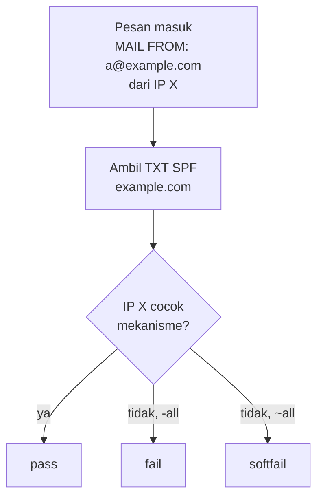

# SPF: Sintaks dan Keterbatasan

!!! info "Identitas chapter"
    **ID:** `CH-08-02-01` · **Kategori/modul:** CAT-08 / MOD-08-02 (Autentikasi Email) · **Estimasi:** 90 menit · **Lingkungan:** lab + domain yang Anda kendalikan · [Lihat chapter ini di dashboard](../../../#CH-08-02-01)

!!! note "Catatan"
    Record DNS dibuat di panel penyedia DNS domain Anda sendiri. Perubahan SPF yang salah dapat membuat email sah ditolak; mulai dengan `~all` dan ubah bertahap. Belum dijalankan penulis pada VM (`verified_on: null`).

## 1. Ringkasan

SPF (Sender Policy Framework) mengumumkan di DNS server mana yang boleh mengirim email atas nama domain Anda. Penerima membandingkan IP pengirim dengan record itu. Chapter ini membahas sintaks, evaluasi, serta keterbatasan SPF (forwarding dan batas 10 DNS lookup).

## 2. Tujuan Pembelajaran

1. Menulis record SPF dengan mekanisme `ip4`, `mx`, `a`, dan `include`.
2. Menjelaskan hasil `pass`, `fail`, `softfail`, `neutral`.
3. Menjelaskan batas 10 lookup dan masalah forwarding.
4. Memvalidasi record dengan `dig`.

## 3. Prasyarat

- `CH-08-01-04` — Protokol TLS, Cipher, dan Monitoring Kedaluwarsa.
- MX dan A/PTR sudah benar (`CAT-05`).

## 4. Materi Teori

### 4.1 Sintaks

```text
v=spf1 mx ip4:192.0.2.10 ip6:2001:db8::10 -all
```

| Komponen | Arti |
|---|---|
| `v=spf1` | Versi |
| `mx`, `a` | IP milik MX/A domain diizinkan |
| `ip4:`, `ip6:` | Alamat spesifik |
| `include:` | Memasukkan kebijakan domain lain (mis. penyedia kirim) |
| `-all` / `~all` | Sisanya ditolak / softfail |

`192.0.2.10` dan `2001:db8::10` adalah alamat dokumentasi; ganti dengan alamat Anda.

### 4.2 Yang diperiksa

SPF memeriksa domain pada **envelope sender** (`MAIL FROM`) dan `HELO`, bukan header `From:` yang dilihat pengguna. Karena itu SPF saja tidak mencegah pemalsuan tampilan pengirim; itu tugas DMARC (alignment).



### 4.3 Keterbatasan

- Maksimal **10** lookup DNS (`include`, `a`, `mx`, `ptr`, `exists`, `redirect`); melebihinya menghasilkan `permerror`.
- **Forwarding** merusak SPF karena IP pengirim berubah; mitigasinya DKIM dan ARC.
- Hanya satu record `v=spf1` per nama.

## 5. Praktik dan Implementasi

1. Daftar semua sumber yang mengirim atas nama domain.
2. Tulis record SPF yang hanya mencakup sumber itu.
3. Mulai `~all`, amati, lalu pertimbangkan `-all`.
4. Publikasikan sebagai TXT dan verifikasi.

## 6. Perintah Linux

```bash title="Memeriksa record"
dig +short TXT example.com
dig +short MX example.com
```

Ganti `example.com` dengan domain Anda. Hasil yang diharapkan: tepat satu string yang berawalan `"v=spf1`.

## 7. Konfigurasi

```text title="Contoh record TXT di panel DNS"
Nama : example.com
Tipe : TXT
Nilai: v=spf1 mx -all
TTL  : 3600
```

Hitung jumlah lookup sebelum menambah `include`. Gunakan TTL kecil saat eksperimen, lalu naikkan setelah stabil.

## 8. Verifikasi

- `dig +short TXT domain-anda` menampilkan satu record SPF.
- Penerima eksternal yang Anda kuasai menampilkan `spf=pass` pada header `Authentication-Results` (`CH-08-02-04`).

## 9. Troubleshooting

| Gejala | Kemungkinan penyebab | Tindakan |
|---|---|---|
| `permerror` | Lebih dari 10 lookup / sintaks | Kurangi `include`, gunakan `ip4` |
| Dua record SPF | Duplikat | Gabungkan menjadi satu |
| `softfail`/`fail` pada email sah | IP pengirim belum tercantum | Tambah IP / `include` |
| Forward gagal SPF | IP forwarder berubah | Andalkan DKIM |

## 10. Security Review

- `+all` atau `?all` membuat SPF tidak berguna dan berbahaya; hindari.
- Record yang terlalu longgar (`include` domain tidak tepercaya) mengizinkan pihak lain mengirim sebagai Anda.
- Domain yang tidak mengirim email sebaiknya memakai `v=spf1 -all`.

## 11. Latihan

1. Tulis SPF untuk tiga skenario (server sendiri, plus penyedia luar, domain tanpa email).
2. Hitung lookup dari `include` Anda.
3. Jelaskan mengapa SPF gagal pada forwarding.

## 12. Assessment

1. Alamat mana yang diperiksa SPF?
2. Mengapa batas 10 lookup penting?
3. Apa arti `~all` dibanding `-all`?

**Kunci singkat.** (1) `MAIL FROM`/`HELO`. (2) Lebih dari itu `permerror`. (3) Softfail vs fail.

## 13. Checklist Kelulusan

- [ ] Satu record SPF valid terpublikasi.
- [ ] Jumlah lookup ≤ 10.
- [ ] Rencana progres `~all` → `-all` tertulis.

!!! note "Status belajar"
    Ubah status chapter secara manual di dashboard. Menyelesaikan checklist ini tidak mengubah status otomatis.

## 14. Referensi Resmi

- [RFC 7208 — SPF](https://www.rfc-editor.org/rfc/rfc7208)
- [Postfix: SMTPD_ACCESS_README](https://www.postfix.org/SMTPD_ACCESS_README.html)
- [RFC 8617 — ARC](https://www.rfc-editor.org/rfc/rfc8617)

Tautan referensi tidak diverifikasi otomatis pada build ini; periksa ketersediaannya sebelum dipakai.

---

[Kembali ke dashboard kurikulum](../../../#CH-08-02-01){ .md-button }
