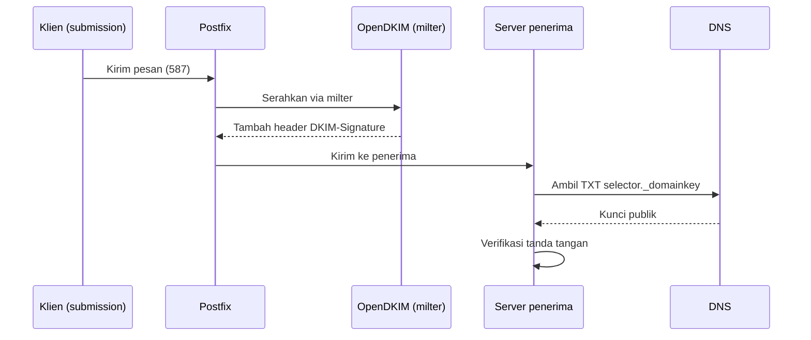

# DKIM: Signing dan Rotasi Selector

!!! info "Identitas chapter"
    **ID:** `CH-08-02-02` · **Kategori/modul:** CAT-08 / MOD-08-02 (Autentikasi Email) · **Estimasi:** 150 menit · **Lingkungan:** lab + domain yang Anda kendalikan · [Lihat chapter ini di dashboard](../../../#CH-08-02-02)

!!! warning "Peringatan"
    Kunci privat DKIM sama pentingnya dengan kunci server: jangan commit, jangan kirim, dan batasi izin. Perubahan `smtpd_milters` memengaruhi seluruh email; uji di lab dahulu. Belum dijalankan penulis pada VM (`verified_on: null`).

## 1. Ringkasan

DKIM menandatangani pesan keluar secara kriptografis; penerima memverifikasinya dengan kunci publik di DNS. Anda membuat pasangan kunci dengan OpenDKIM, menghubungkan OpenDKIM ke Postfix lewat milter, mempublikasikan kunci publik, dan merencanakan rotasi selector.

## 2. Tujuan Pembelajaran

1. Menjelaskan alur penandatanganan dan verifikasi DKIM.
2. Membuat kunci 2048-bit dengan selector dan menempatkannya dengan izin aman.
3. Mengintegrasikan OpenDKIM dengan Postfix dan memverifikasi tanda tangan.
4. Merencanakan rotasi selector tanpa gangguan.

## 3. Prasyarat

- `CH-08-02-01` — SPF: Sintaks dan Keterbatasan.
- `CH-08-02-01`; Postfix berjalan; domain di bawah kendali Anda.

## 4. Materi Teori

### 4.1 Alur



### 4.2 Selector dan rotasi

Selector memungkinkan beberapa kunci hidup bersamaan (`202610._domainkey.example.com`). Rotasi: buat selector baru, publikasikan, tunggu TTL, ganti penandatanganan, simpan selector lama sampai pesan lama tidak lagi diverifikasi, lalu hapus.

### 4.3 Ketentuan

DKIM menandatangani sebagian header dan body; perubahan oleh perantara (footer milis) dapat merusak tanda tangan. Kanonikalisasi `relaxed/simple` adalah kompromi umum.

## 5. Praktik dan Implementasi

1. Pasang `opendkim` dan `opendkim-tools`.
2. Buat kunci dan atur izin.
3. Konfigurasi tabel kunci dan penandatanganan.
4. Hubungkan Postfix.
5. Publikasikan kunci publik dan uji.

## 6. Perintah Linux

```bash title="Memasang dan membuat kunci"
sudo apt install opendkim opendkim-tools
sudo mkdir -p /etc/opendkim/keys/example.com
sudo opendkim-genkey -b 2048 -d example.com -D /etc/opendkim/keys/example.com -s 202610 -v
sudo chown -R opendkim:opendkim /etc/opendkim
sudo chmod 0600 /etc/opendkim/keys/example.com/202610.private
sudo cat /etc/opendkim/keys/example.com/202610.txt
```

Berkas `.txt` berisi record TXT yang harus Anda publikasikan; berkas `.private` rahasia. Ganti `example.com` dan selector dengan nilai Anda.

```bash title="Menguji kunci setelah DNS dipublikasikan"
opendkim-testkey -d example.com -s 202610 -vvv
dig +short TXT 202610._domainkey.example.com
```

```bash title="Mengaktifkan"
sudo systemctl restart opendkim
sudo postfix check && sudo systemctl reload postfix
```

## 7. Konfigurasi

```text title="/etc/opendkim.conf (potongan)"
Syslog                  yes
Canonicalization        relaxed/simple
Mode                    sv
SubDomains              no
Socket                  inet:8891@127.0.0.1
KeyTable                refile:/etc/opendkim/key.table
SigningTable            refile:/etc/opendkim/signing.table
InternalHosts           refile:/etc/opendkim/trusted.hosts
ExternalIgnoreList      refile:/etc/opendkim/trusted.hosts
```

```text title="/etc/opendkim/key.table"
202610._domainkey.example.com example.com:202610:/etc/opendkim/keys/example.com/202610.private
```

```text title="/etc/opendkim/signing.table"
*@example.com 202610._domainkey.example.com
```

```text title="/etc/opendkim/trusted.hosts"
127.0.0.1
localhost
```

```text title="Postfix main.cf (tambahkan)"
smtpd_milters = inet:127.0.0.1:8891
non_smtpd_milters = $smtpd_milters
milter_default_action = accept
```

- `milter_default_action = accept` memilih ketersediaan: pesan tetap lewat jika OpenDKIM mati (tanpa tanda tangan). Untuk produksi yang ketat, pertimbangkan `tempfail`.
- Paket Ubuntu dapat menyertakan `/etc/default/opendkim` atau pengaturan socket lain; pastikan hanya satu pengaturan `Socket` yang berlaku.
- Pada `Mode sv` OpenDKIM juga memverifikasi pesan masuk; hasilnya muncul di `Authentication-Results` (`CH-08-02-04`).
- Rspamd di `CH-10-02-02` juga dapat menandatangani; jangan menandatangani ganda, pilih satu.

## 8. Verifikasi

- `opendkim-testkey` melaporkan `key OK` (teks persis bergantung versi).
- Kirim pesan ke akun eksternal milik Anda; header memuat `DKIM-Signature: ... d=example.com; s=202610` dan `dkim=pass` pada `Authentication-Results`.
- `sudo journalctl -u opendkim --since "10 min ago"` menunjukkan aktivitas penandatanganan.

## 9. Troubleshooting

| Gejala | Kemungkinan penyebab | Tindakan |
|---|---|---|
| `key not found` | DNS belum menyebar / nama salah | `dig` TXT selector, tunggu TTL |
| `dkim=fail (body hash did not verify)` | Pesan diubah setelah ditandatangani | Cek urutan milter/footer |
| Tidak ada tanda tangan | Milter tidak terhubung | Cek `Socket`, `smtpd_milters`, `ss -tlnp` |
| `Permission denied` baca kunci | Pemilik/izin salah | `chown opendkim`, `chmod 600` |

## 10. Security Review

- Kunci privat bocor memungkinkan pemalsuan email bertanda tangan sah: batasi izin dan hindari backup tanpa enkripsi.
- Rotasi berkala dan segera setelah dugaan kebocoran.
- Jangan mempublikasikan `.private`; hanya isi `.txt` ke DNS.

## 11. Latihan

1. Buat selector kedua dan rencanakan urutan rotasi.
2. Kirim pesan uji dan baca `DKIM-Signature`.
3. Jelaskan efek footer milis pada tanda tangan.

## 12. Assessment

1. Mengapa kunci privat tidak boleh dikirim atau di-commit?
2. Apa fungsi selector?
3. Apa tujuan `milter_default_action`?

**Kunci singkat.** (1) Memungkinkan pemalsuan. (2) Beberapa kunci/rotasi. (3) Menentukan perilaku saat milter gagal.

## 13. Checklist Kelulusan

- [ ] Kunci dibuat dengan izin 0600 dan record DNS terpublikasi.
- [ ] Pesan keluar bertanda tangan; `dkim=pass` teramati.
- [ ] Rencana rotasi tertulis.

!!! note "Status belajar"
    Ubah status chapter secara manual di dashboard. Menyelesaikan checklist ini tidak mengubah status otomatis.

## 14. Referensi Resmi

- [RFC 6376 — DKIM](https://www.rfc-editor.org/rfc/rfc6376)
- [RFC 8301 — Algoritma DKIM](https://www.rfc-editor.org/rfc/rfc8301)
- [Postfix: MILTER_README](https://www.postfix.org/MILTER_README.html)
- [OpenDKIM (opendkim.org)](http://www.opendkim.org/)

Tautan referensi tidak diverifikasi otomatis pada build ini; periksa ketersediaannya sebelum dipakai.

---

[Kembali ke dashboard kurikulum](../../../#CH-08-02-02){ .md-button }
