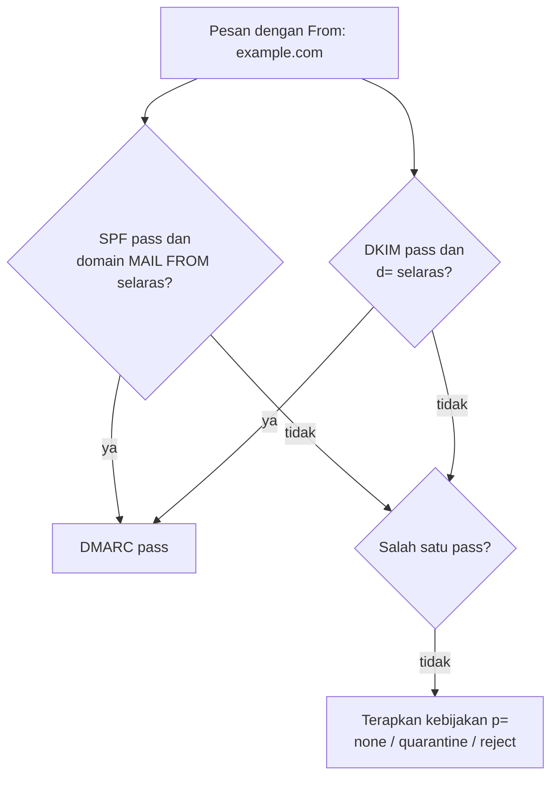

# DMARC: Alignment dan Progres Kebijakan

!!! info "Identitas chapter"
    **ID:** `CH-08-02-03` · **Kategori/modul:** CAT-08 / MOD-08-02 (Autentikasi Email) · **Estimasi:** 120 menit · **Lingkungan:** lab + domain yang Anda kendalikan · [Lihat chapter ini di dashboard](../../../#CH-08-02-03)

!!! note "Catatan"
    Kebijakan DMARC mengubah nasib email sah dan palsu. Naikkan bertahap (`none` → `quarantine` → `reject`) berdasarkan data laporan. Belum dijalankan penulis pada VM (`verified_on: null`).

## 1. Ringkasan

DMARC mengikat hasil SPF dan DKIM ke domain pada header `From:` (alignment) dan memberi tahu penerima apa yang harus dilakukan bila keduanya gagal. Chapter ini menjelaskan alignment, tag record, dan tahapan kebijakan.

## 2. Tujuan Pembelajaran

1. Menjelaskan alignment SPF dan DKIM (relaxed vs strict).
2. Menulis record DMARC dengan `p`, `rua`, `adkim`, `aspf`.
3. Merencanakan progres `none` → `quarantine` → `reject`.

## 3. Prasyarat

- `CH-08-02-02` — DKIM: Signing dan Rotasi Selector.
- SPF (`CH-08-02-01`) dan DKIM (`CH-08-02-02`) berfungsi.

## 4. Materi Teori

### 4.1 Alignment

DMARC lulus bila **salah satu** dari SPF atau DKIM lulus **dan** selaras dengan domain `From:`. Relaxed: domain organisasi sama (`mail.example.com` selaras dengan `example.com`). Strict: harus identik.



### 4.2 Tag utama

| Tag | Arti |
|---|---|
| `p` | Kebijakan domain: `none`, `quarantine`, `reject` |
| `sp` | Kebijakan subdomain |
| `rua` | Alamat laporan agregat |
| `adkim`, `aspf` | Mode alignment (`r`/`s`) |
| `pct` | Persentase pesan yang dikenai kebijakan (RFC 7489) |

Contoh awal aman: `v=DMARC1; p=none; rua=mailto:dmarc-reports@example.com`.

### 4.3 Progres

Mulai `p=none` untuk mengumpulkan laporan, perbaiki sumber sah yang gagal, naik ke `quarantine` (dengan `pct` bertahap), lalu `reject`. Strategi enforcement lengkap dibahas di `CH-10-02-04`.

## 5. Praktik dan Implementasi

1. Pastikan alamat laporan (`rua`) ada dan dapat menerima.
2. Publikasikan DMARC `p=none`.
3. Kirim email uji ke akun eksternal milik Anda dan baca hasilnya.
4. Tinjau laporan agregat (XML terkompres) setelah beberapa hari.

## 6. Perintah Linux

```bash title="Memeriksa record"
dig +short TXT _dmarc.example.com
```

Hasil yang diharapkan: string berawalan `"v=DMARC1;`. Ganti `example.com` dengan domain Anda.

## 7. Konfigurasi

```text title="Contoh record TXT di panel DNS"
Nama : _dmarc.example.com
Tipe : TXT
Nilai: v=DMARC1; p=none; rua=mailto:dmarc-reports@example.com; adkim=r; aspf=r
TTL  : 3600
```

- Alamat `rua` harus nyata. Bila berada di domain berbeda, domain tujuan perlu mengizinkan laporan (lihat RFC 7489).
- Laporan agregat dikirim oleh penerima dalam bentuk XML terkompres; jangan mengirim kata sandi atau data pribadi ke layanan analisis pihak ketiga tanpa menilai risikonya.

## 8. Verifikasi

- `dig` menampilkan satu record DMARC.
- Header pesan uji menunjukkan `dmarc=pass` pada `Authentication-Results` (`CH-08-02-04`).
- Setelah beberapa hari, laporan agregat tiba di alamat `rua`.

## 9. Troubleshooting

| Gejala | Kemungkinan penyebab | Tindakan |
|---|---|---|
| Tidak ada laporan | `rua` salah / belum ada traffic | Periksa alamat, tunggu |
| `dmarc=fail` pada email sah | Tidak selaras / sumber belum di SPF/DKIM | Perbaiki sumber, bukan longgarkan kebijakan |
| Dua record DMARC | Duplikat | Hanya satu per `_dmarc` |
| Subdomain tidak tercakup | `sp` tidak diatur | Atur `sp=` |

## 10. Security Review

- `p=none` tidak melindungi; ini fase observasi.
- Naik ke `reject` terlalu cepat menolak email sah dari sumber yang terlupa.
- Laporan agregat membuka pola traffic; batasi aksesnya.

## 11. Latihan

1. Tulis tabel sumber pengirim dan statusnya (SPF/DKIM/alignment).
2. Susun jadwal progres kebijakan beserta kriteria naik.
3. Jelaskan mengapa forwarding dapat gagal SPF tetapi lulus DMARC melalui DKIM.

## 12. Assessment

1. Apa arti alignment?
2. Mengapa mulai dari `p=none`?
3. Bagaimana DMARC lulus walau SPF gagal?

**Kunci singkat.** (1) Domain hasil cek selaras dengan `From`. (2) Mengumpulkan data tanpa menolak sah. (3) DKIM pass dan selaras.

## 13. Checklist Kelulusan

- [ ] DMARC `p=none` terpublikasi dan terbaca.
- [ ] Rencana progres dengan kriteria tertulis.

!!! note "Status belajar"
    Ubah status chapter secara manual di dashboard. Menyelesaikan checklist ini tidak mengubah status otomatis.

## 14. Referensi Resmi

- [RFC 7489 — DMARC](https://www.rfc-editor.org/rfc/rfc7489)
- [dmarc.org](https://dmarc.org/overview/)

Tautan referensi tidak diverifikasi otomatis pada build ini; periksa ketersediaannya sebelum dipakai.

---

[Kembali ke dashboard kurikulum](../../../#CH-08-02-03){ .md-button }
